```mermaid
graph TD
  N0["skill_snapshot&lt;br/&gt;__skills_manifest__"]
  N1["skill_snapshot&lt;br/&gt;__skills_manifest__"]
  N2["skill_snapshot&lt;br/&gt;__skills_manifest__"]
  N3["skill_snapshot&lt;br/&gt;__skills_manifest__"]
  N4["skill_snapshot&lt;br/&gt;__skills_manifest__"]
  N5["skill_snapshot&lt;br/&gt;__skills_manifest__"]
  N6["skill_snapshot&lt;br/&gt;__skills_manifest__"]
  N7["skill_snapshot&lt;br/&gt;__skills_manifest__"]
  N8["skill_snapshot&lt;br/&gt;__skills_manifest__"]
  N9["skill_snapshot&lt;br/&gt;__skills_manifest__"]
```

## Summarized at 2026-10-31T14:22:31.871779+00:00

<message type="human">warmup 0</message>
<message type="human">### Structural Coordinates (L1)
exploring: warmup 0
### End Structural Coordinates

### Cognitive Mode: Discovery (Ramanujan Chain)
You are in discovery mode. Your attention should condense on singularities — patterns, anomalies, and structural resonances that 'glow' in the data.
Prioritize: hypothesis generation, pattern recognition, cross-domain analogy, exploratory tool calls. Do NOT attempt rigorous proof yet.
When you sense a structural resonance, capture it as a hypothesis — the construction chain will verify it later.
### End Cognitive Mode

### Tool Preference Hint (cognitive state driven)
Prefer: web_search, literature, materials_database, structure, hypothesis_generator, knowledge
Deprioritize: vasp, lammps, qe, cp2k, abaqus
### End Tool Preference Hint

### Your Recent Goals

1. warmup 0

### End Recent Goals

---

warmup 0</message>
<message type="system">## Tool Call Budget
- This turn: 0/15 tool calls used/allowed (per-tool cap 5).
- Budget is per turn and resets on the next turn. Exhausting it is NOT game over — wrap up or switch tools, don't abandon the task.</message>
<message type="system">## Conversation summary (older messages compacted):
ok</message>
<message type="system">## Active state (preserved across compaction):
### Provenance key properties:
  - __skills_manifest__ (skill_snapshot): skills={'anti-defensive-writing': '0.0.0', 'clean-user-facing-text': '0.0.0', 'gromacs-solvation-environment': '0.0.0', 'happy-figure-skill': '0.0.0', 'industrial-asset-state': '0.0.0', 'instrument-ingest': '0.0.0', 'qwen-mm-plugins': '0.0.0', 'remove-ai-marks': '0.0.0', 'structure-encoder': '0.0.0', 'workflow-skill-creator': '0.0.0'}
  - __skills_manifest__ (skill_snapshot): skills={'anti-defensive-writing': '0.0.0', 'clean-user-facing-text': '0.0.0', 'gromacs-solvation-environment': '0.0.0', 'happy-figure-skill': '0.0.0', 'industrial-asset-state': '0.0.0', 'instrument-ingest': '0.0.0', 'qwen-mm-plugins': '0.0.0', 'remove-ai-marks': '0.0.0', 'structure-encoder': '0.0.0', 'workflow-skill-creator': '0.0.0'}
  - __skills_manifest__ (skill_snapshot): skills={'anti-defensive-writing': '0.0.0', 'clean-user-facing-text': '0.0.0', 'gromacs-solvation-environment': '0.0.0', 'happy-figure-skill': '0.0.0', 'industrial-asset-state': '0.0.0', 'instrument-ingest': '0.0.0', 'qwen-mm-plugins': '0.0.0', 'remove-ai-marks': '0.0.0', 'structure-encoder': '0.0.0', 'workflow-skill-creator': '0.0.0'}
  - __skills_manifest__ (skill_snapshot): skills={'anti-defensive-writing': '0.0.0', 'clean-user-facing-text': '0.0.0', 'gromacs-solvation-environment': '0.0.0', 'happy-figure-skill': '0.0.0', 'industrial-asset-state': '0.0.0', 'instrument-ingest': '0.0.0', 'qwen-mm-plugins': '0.0.0', 'remove-ai-marks': '0.0.0', 'structure-encoder': '0.0.0', 'workflow-skill-creator': '0.0.0'}
  - __skills_manifest__ (skill_snapshot): skills={'anti-defensive-writing': '0.0.0', 'clean-user-facing-text': '0.0.0', 'gromacs-solvation-environment': '0.0.0', 'happy-figure-skill': '0.0.0', 'industrial-asset-state': '0.0.0', 'instrument-ingest': '0.0.0', 'qwen-mm-plugins': '0.0.0', 'remove-ai-marks': '0.0.0', 'structure-encoder': '0.0.0', 'workflow-skill-creator': '0.0.0'}
  - __skills_manifest__ (skill_snapshot): skills={'anti-defensive-writing': '0.0.0', 'clean-user-facing-text': '0.0.0', 'gromacs-solvation-environment': '0.0.0', 'happy-figure-skill': '0.0.0', 'industrial-asset-state': '0.0.0', 'instrument-ingest': '0.0.0', 'qwen-mm-plugins': '0.0.0', 'remove-ai-marks': '0.0.0', 'structure-encoder': '0.0.0', 'workflow-skill-creator': '0.0.0'}
  - __skills_manifest__ (skill_snapshot): skills={'anti-defensive-writing': '0.0.0', 'clean-user-facing-text': '0.0.0', 'gromacs-solvation-environment': '0.0.0', 'happy-figure-skill': '0.0.0', 'industrial-asset-state': '0.0.0', 'instrument-ingest': '0.0.0', 'qwen-mm-plugins': '0.0.0', 'remove-ai-marks': '0.0.0', 'structure-encoder': '0.0.0', 'workflow-skill-creator': '0.0.0'}
  - __skills_manifest__ (skill_snapshot): skills={'anti-defensive-writing': '0.0.0', 'clean-user-facing-text': '0.0.0', 'gromacs-solvation-environment': '0.0.0', 'happy-figure-skill': '0.0.0', 'industrial-asset-state': '0.0.0', 'instrument-ingest': '0.0.0', 'qwen-mm-plugins': '0.0.0', 'remove-ai-marks': '0.0.0', 'structure-encoder': '0.0.0', 'workflow-skill-creator': '0.0.0'}
  - __skills_manifest__ (skill_snapshot): skills={'anti-defensive-writing': '0.0.0', 'clean-user-facing-text': '0.0.0', 'gromacs-solvation-environment': '0.0.0', 'happy-figure-skill': '0.0.0', 'industrial-asset-state': '0.0.0', 'instrument-ingest': '0.0.0', 'qwen-mm-plugins': '0.0.0', 'remove-ai-marks': '0.0.0', 'structure-encoder': '0.0.0', 'workflow-skill-creator': '0.0.0'}
  - __skills_manifest__ (skill_snapshot): skills={'anti-defensive-writing': '0.0.0', 'clean-user-facing-text': '0.0.0', 'gromacs-solvation-environment': '0.0.0', 'happy-figure-skill': '0.0.0', 'industrial-asset-state': '0.0.0', 'instrument-ingest': '0.0.0', 'qwen-mm-plugins': '0.0.0', 'remove-ai-marks': '0.0.0', 'structure-encoder': '0.0.0', 'workflow-skill-creator': '0.0.0'}
  - __skills_manifest__ (skill_snapshot): skills={'anti-defensive-writing': '0.0.0', 'clean-user-facing-text': '0.0.0', 'gromacs-solvation-environment': '0.0.0', 'happy-figure-skill': '0.0.0', 'industrial-asset-state': '0.0.0', 'instrument-ingest': '0.0.0', 'qwen-mm-plugins': '0.0.0', 'remove-ai-marks': '0.0.0', 'structure-encoder': '0.0.0', 'workflow-skill-creator': '0.0.0'}
  - __skills_manifest__ (skill_snapshot): skills={'anti-defensive-writing': '0.0.0', 'clean-user-facing-text': '0.0.0', 'gromacs-solvation-environment': '0.0.0', 'happy-figure-skill': '0.0.0', 'industrial-asset-state': '0.0.0', 'instrument-ingest': '0.0.0', 'qwen-mm-plugins': '0.0.0', 'remove-ai-marks': '0.0.0', 'structure-encoder': '0.0.0', 'workflow-skill-creator': '0.0.0'}
  - __skills_manifest__ (skill_snapshot): skills={'anti-defensive-writing': '0.0.0', 'clean-user-facing-text': '0.0.0', 'gromacs-solvation-environment': '0.0.0', 'happy-figure-skill': '0.0.0', 'industrial-asset-state': '0.0.0', 'instrument-ingest': '0.0.0', 'qwen-mm-plugins': '0.0.0', 'remove-ai-marks': '0.0.0', 'structure-encoder': '0.0.0', 'workflow-skill-creator': '0.0.0'}
  - __skills_manifest__ (skill_snapshot): skills={'anti-defensive-writing': '0.0.0', 'clean-user-facing-text': '0.0.0', 'gromacs-solvation-environment': '0.0.0', 'happy-figure-skill': '0.0.0', 'industrial-asset-state': '0.0.0', 'instrument-ingest': '0.0.0', 'qwen-mm-plugins': '0.0.0', 'remove-ai-marks': '0.0.0', 'structure-encoder': '0.0.0', 'workflow-skill-creator': '0.0.0'}
  - __skills_manifest__ (skill_snapshot): skills={'anti-defensive-writing': '0.0.0', 'clean-user-facing-text': '0.0.0', 'gromacs-solvation-environment': '0.0.0', 'happy-figure-skill': '0.0.0', 'industrial-asset-state': '0.0.0', 'instrument-ingest': '0.0.0', 'qwen-mm-plugins': '0.0.0', 'remove-ai-marks': '0.0.0', 'structure-encoder': '0.0.0', 'workflow-skill-creator': '0.0.0'}
### Predicted files (smart prefetch):
你可能需要这些文件:
  - __skills_manifest__ | skills={'anti-defensive-writing': '0.0.0', 'clean-user-facing-text': '0.0.0', 'gromacs-solvation-environment': '0.0.0', 'happy-figure-skill': '0.0.0', 'industrial-asset-state': '0.0.0', 'instrument-ingest': '0.0.0', 'qwen-mm-plugins': '0.0.0', 'remove-ai-marks': '0.0.0', 'structure-encoder': '0.0.0', 'workflow-skill-creator': '0.0.0'}
### Pipeline stage: structure (1/6)</message>
<message type="system">## Conversation summary (older messages compacted):
ok</message>
<message type="system">## Active state (preserved across compaction):
### Provenance key properties:
  - __skills_manifest__ (skill_snapshot): skills={'anti-defensive-writing': '0.0.0', 'clean-user-facing-text': '0.0.0', 'gromacs-solvation-environment': '0.0.0', 'happy-figure-skill': '0.0.0', 'industrial-asset-state': '0.0.0', 'instrument-ingest': '0.0.0', 'qwen-mm-plugins': '0.0.0', 'remove-ai-marks': '0.0.0', 'structure-encoder': '0.0.0', 'workflow-skill-creator': '0.0.0'}
  - __skills_manifest__ (skill_snapshot): skills={'anti-defensive-writing': '0.0.0', 'clean-user-facing-text': '0.0.0', 'gromacs-solvation-environment': '0.0.0', 'happy-figure-skill': '0.0.0', 'industrial-asset-state': '0.0.0', 'instrument-ingest': '0.0.0', 'qwen-mm-plugins': '0.0.0', 'remove-ai-marks': '0.0.0', 'structure-encoder': '0.0.0', 'workflow-skill-creator': '0.0.0'}
  - __skills_manifest__ (skill_snapshot): skills={'anti-defensive-writing': '0.0.0', 'clean-user-facing-text': '0.0.0', 'gromacs-solvation-environment': '0.0.0', 'happy-figure-skill': '0.0.0', 'industrial-asset-state': '0.0.0', 'instrument-ingest': '0.0.0', 'qwen-mm-plugins': '0.0.0', 'remove-ai-marks': '0.0.0', 'structure-encoder': '0.0.0', 'workflow-skill-creator': '0.0.0'}
  - __skills_manifest__ (skill_snapshot): skills={'anti-defensive-writing': '0.0.0', 'clean-user-facing-text': '0.0.0', 'gromacs-solvation-environment': '0.0.0', 'happy-figure-skill': '0.0.0', 'industrial-asset-state': '0.0.0', 'instrument-ingest': '0.0.0', 'qwen-mm-plugins': '0.0.0', 'remove-ai-marks': '0.0.0', 'structure-encoder': '0.0.0', 'workflow-skill-creator': '0.0.0'}
  - __skills_manifest__ (skill_snapshot): skills={'anti-defensive-writing': '0.0.0', 'clean-user-facing-text': '0.0.0', 'gromacs-solvation-environment': '0.0.0', 'happy-figure-skill': '0.0.0', 'industrial-asset-state': '0.0.0', 'instrument-ingest': '0.0.0', 'qwen-mm-plugins': '0.0.0', 'remove-ai-marks': '0.0.0', 'structure-encoder': '0.0.0', 'workflow-skill-creator': '0.0.0'}
  - __skills_manifest__ (skill_snapshot): skills={'anti-defensive-writing': '0.0.0', 'clean-user-facing-text': '0.0.0', 'gromacs-solvation-environment': '0.0.0', 'happy-figure-skill': '0.0.0', 'industrial-asset-state': '0.0.0', 'instrument-ingest': '0.0.0', 'qwen-mm-plugins': '0.0.0', 'remove-ai-marks': '0.0.0', 'structure-encoder': '0.0.0', 'workflow-skill-creator': '0.0.0'}
  - __skills_manifest__ (skill_snapshot): skills={'anti-defensive-writing': '0.0.0', 'clean-user-facing-text': '0.0.0', 'gromacs-solvation-environment': '0.0.0', 'happy-figure-skill': '0.0.0', 'industrial-asset-state': '0.0.0', 'instrument-ingest': '0.0.0', 'qwen-mm-plugins': '0.0.0', 'remove-ai-marks': '0.0.0', 'structure-encoder': '0.0.0', 'workflow-skill-creator': '0.0.0'}
  - __skills_manifest__ (skill_snapshot): skills={'anti-defensive-writing': '0.0.0', 'clean-user-facing-text': '0.0.0', 'gromacs-solvation-environment': '0.0.0', 'happy-figure-skill': '0.0.0', 'industrial-asset-state': '0.0.0', 'instrument-ingest': '0.0.0', 'qwen-mm-plugins': '0.0.0', 'remove-ai-marks': '0.0.0', 'structure-encoder': '0.0.0', 'workflow-skill-creator': '0.0.0'}
  - __skills_manifest__ (skill_snapshot): skills={'anti-defensive-writing': '0.0.0', 'clean-user-facing-text': '0.0.0', 'gromacs-solvation-environment': '0.0.0', 'happy-figure-skill': '0.0.0', 'industrial-asset-state': '0.0.0', 'instrument-ingest': '0.0.0', 'qwen-mm-plugins': '0.0.0', 'remove-ai-marks': '0.0.0', 'structure-encoder': '0.0.0', 'workflow-skill-creator': '0.0.0'}
  - __skills_manifest__ (skill_snapshot): skills={'anti-defensive-writing': '0.0.0', 'clean-user-facing-text': '0.0.0', 'gromacs-solvation-environment': '0.0.0', 'happy-figure-skill': '0.0.0', 'industrial-asset-state': '0.0.0', 'instrument-ingest': '0.0.0', 'qwen-mm-plugins': '0.0.0', 'remove-ai-marks': '0.0.0', 'structure-encoder': '0.0.0', 'workflow-skill-creator': '0.0.0'}
  - __skills_manifest__ (skill_snapshot): skills={'anti-defensive-writing': '0.0.0', 'clean-user-facing-text': '0.0.0', 'gromacs-solvation-environment': '0.0.0', 'happy-figure-skill': '0.0.0', 'industrial-asset-state': '0.0.0', 'instrument-ingest': '0.0.0', 'qwen-mm-plugins': '0.0.0', 'remove-ai-marks': '0.0.0', 'structure-encoder': '0.0.0', 'workflow-skill-creator': '0.0.0'}
  - __skills_manifest__ (skill_snapshot): skills={'anti-defensive-writing': '0.0.0', 'clean-user-facing-text': '0.0.0', 'gromacs-solvation-environment': '0.0.0', 'happy-figure-skill': '0.0.0', 'industrial-asset-state': '0.0.0', 'instrument-ingest': '0.0.0', 'qwen-mm-plugins': '0.0.0', 'remove-ai-marks': '0.0.0', 'structure-encoder': '0.0.0', 'workflow-skill-creator': '0.0.0'}
  - __skills_manifest__ (skill_snapshot): skills={'anti-defensive-writing': '0.0.0', 'clean-user-facing-text': '0.0.0', 'gromacs-solvation-environment': '0.0.0', 'happy-figure-skill': '0.0.0', 'industrial-asset-state': '0.0.0', 'instrument-ingest': '0.0.0', 'qwen-mm-plugins': '0.0.0', 'remove-ai-marks': '0.0.0', 'structure-encoder': '0.0.0', 'workflow-skill-creator': '0.0.0'}
  - __skills_manifest__ (skill_snapshot): skills={'anti-defensive-writing': '0.0.0', 'clean-user-facing-text': '0.0.0', 'gromacs-solvation-environment': '0.0.0', 'happy-figure-skill': '0.0.0', 'industrial-asset-state': '0.0.0', 'instrument-ingest': '0.0.0', 'qwen-mm-plugins': '0.0.0', 'remove-ai-marks': '0.0.0', 'structure-encoder': '0.0.0', 'workflow-skill-creator': '0.0.0'}
  - __skills_manifest__ (skill_snapshot): skills={'anti-defensive-writing': '0.0.0', 'clean-user-facing-text': '0.0.0', 'gromacs-solvation-environment': '0.0.0', 'happy-figure-skill': '0.0.0', 'industrial-asset-state': '0.0.0', 'instrument-ingest': '0.0.0', 'qwen-mm-plugins': '0.0.0', 'remove-ai-marks': '0.0.0', 'structure-encoder': '0.0.0', 'workflow-skill-creator': '0.0.0'}
### Predicted files (smart prefetch):
你可能需要这些文件:
  - __skills_manifest__ | skills={'anti-defensive-writing': '0.0.0', 'clean-user-facing-text': '0.0.0', 'gromacs-solvation-environment': '0.0.0', 'happy-figure-skill': '0.0.0', 'industrial-asset-state': '0.0.0', 'instrument-ingest': '0.0.0', 'qwen-mm-plugins': '0.0.0', 'remove-ai-marks': '0.0.0', 'structure-encoder': '0.0.0', 'workflow-skill-creator': '0.0.0'}
### Pipeline stage: structure (1/6)</message>
<message type="system">## Conversation summary (older messages compacted):
ok</message>
<message type="system">## Active state (preserved across compaction):
### Provenance key properties:
  - __skills_manifest__ (skill_snapshot): skills={'anti-defensive-writing': '0.0.0', 'clean-user-facing-text': '0.0.0', 'gromacs-solvation-environment': '0.0.0', 'happy-figure-skill': '0.0.0', 'industrial-asset-state': '0.0.0', 'instrument-ingest': '0.0.0', 'qwen-mm-plugins': '0.0.0', 'remove-ai-marks': '0.0.0', 'structure-encoder': '0.0.0', 'workflow-skill-creator': '0.0.0'}
  - __skills_manifest__ (skill_snapshot): skills={'anti-defensive-writing': '0.0.0', 'clean-user-facing-text': '0.0.0', 'gromacs-solvation-environment': '0.0.0', 'happy-figure-skill': '0.0.0', 'industrial-asset-state': '0.0.0', 'instrument-ingest': '0.0.0', 'qwen-mm-plugins': '0.0.0', 'remove-ai-marks': '0.0.0', 'structure-encoder': '0.0.0', 'workflow-skill-creator': '0.0.0'}
  - __skills_manifest__ (skill_snapshot): skills={'anti-defensive-writing': '0.0.0', 'clean-user-facing-text': '0.0.0', 'gromacs-solvation-environment': '0.0.0', 'happy-figure-skill': '0.0.0', 'industrial-asset-state': '0.0.0', 'instrument-ingest': '0.0.0', 'qwen-mm-plugins': '0.0.0', 'remove-ai-marks': '0.0.0', 'structure-encoder': '0.0.0', 'workflow-skill-creator': '0.0.0'}
  - __skills_manifest__ (skill_snapshot): skills={'anti-defensive-writing': '0.0.0', 'clean-user-facing-text': '0.0.0', 'gromacs-solvation-environment': '0.0.0', 'happy-figure-skill': '0.0.0', 'industrial-asset-state': '0.0.0', 'instrument-ingest': '0.0.0', 'qwen-mm-plugins': '0.0.0', 'remove-ai-marks': '0.0.0', 'structure-encoder': '0.0.0', 'workflow-skill-creator': '0.0.0'}
  - __skills_manifest__ (skill_snapshot): skills={'anti-defensive-writing': '0.0.0', 'clean-user-facing-text': '0.0.0', 'gromacs-solvation-environment': '0.0.0', 'happy-figure-skill': '0.0.0', 'industrial-asset-state': '0.0.0', 'instrument-ingest': '0.0.0', 'qwen-mm-plugins': '0.0.0', 'remove-ai-marks': '0.0.0', 'structure-encoder': '0.0.0', 'workflow-skill-creator': '0.0.0'}
  - __skills_manifest__ (skill_snapshot): skills={'anti-defensive-writing': '0.0.0', 'clean-user-facing-text': '0.0.0', 'gromacs-solvation-environment': '0.0.0', 'happy-figure-skill': '0.0.0', 'industrial-asset-state': '0.0.0', 'instrument-ingest': '0.0.0', 'qwen-mm-plugins': '0.0.0', 'remove-ai-marks': '0.0.0', 'structure-encoder': '0.0.0', 'workflow-skill-creator': '0.0.0'}
  - __skills_manifest__ (skill_snapshot): skills={'anti-defensive-writing': '0.0.0', 'clean-user-facing-text': '0.0.0', 'gromacs-solvation-environment': '0.0.0', 'happy-figure-skill': '0.0.0', 'industrial-asset-state': '0.0.0', 'instrument-ingest': '0.0.0', 'qwen-mm-plugins': '0.0.0', 'remove-ai-marks': '0.0.0', 'structure-encoder': '0.0.0', 'workflow-skill-creator': '0.0.0'}
  - __skills_manifest__ (skill_snapshot): skills={'anti-defensive-writing': '0.0.0', 'clean-user-facing-text': '0.0.0', 'gromacs-solvation-environment': '0.0.0', 'happy-figure-skill': '0.0.0', 'industrial-asset-state': '0.0.0', 'instrument-ingest': '0.0.0', 'qwen-mm-plugins': '0.0.0', 'remove-ai-marks': '0.0.0', 'structure-encoder': '0.0.0', 'workflow-skill-creator': '0.0.0'}
  - __skills_manifest__ (skill_snapshot): skills={'anti-defensive-writing': '0.0.0', 'clean-user-facing-text': '0.0.0', 'gromacs-solvation-environment': '0.0.0', 'happy-figure-skill': '0.0.0', 'industrial-asset-state': '0.0.0', 'instrument-ingest': '0.0.0', 'qwen-mm-plugins': '0.0.0', 'remove-ai-marks': '0.0.0', 'structure-encoder': '0.0.0', 'workflow-skill-creator': '0.0.0'}
  - __skills_manifest__ (skill_snapshot): skills={'anti-defensive-writing': '0.0.0', 'clean-user-facing-text': '0.0.0', 'gromacs-solvation-environment': '0.0.0', 'happy-figure-skill': '0.0.0', 'industrial-asset-state': '0.0.0', 'instrument-ingest': '0.0.0', 'qwen-mm-plugins': '0.0.0', 'remove-ai-marks': '0.0.0', 'structure-encoder': '0.0.0', 'workflow-skill-creator': '0.0.0'}
  - __skills_manifest__ (skill_snapshot): skills={'anti-defensive-writing': '0.0.0', 'clean-user-facing-text': '0.0.0', 'gromacs-solvation-environment': '0.0.0', 'happy-figure-skill': '0.0.0', 'industrial-asset-state': '0.0.0', 'instrument-ingest': '0.0.0', 'qwen-mm-plugins': '0.0.0', 'remove-ai-marks': '0.0.0', 'structure-encoder': '0.0.0', 'workflow-skill-creator': '0.0.0'}
  - __skills_manifest__ (skill_snapshot): skills={'anti-defensive-writing': '0.0.0', 'clean-user-facing-text': '0.0.0', 'gromacs-solvation-environment': '0.0.0', 'happy-figure-skill': '0.0.0', 'industrial-asset-state': '0.0.0', 'instrument-ingest': '0.0.0', 'qwen-mm-plugins': '0.0.0', 'remove-ai-marks': '0.0.0', 'structure-encoder': '0.0.0', 'workflow-skill-creator': '0.0.0'}
  - __skills_manifest__ (skill_snapshot): skills={'anti-defensive-writing': '0.0.0', 'clean-user-facing-text': '0.0.0', 'gromacs-solvation-environment': '0.0.0', 'happy-figure-skill': '0.0.0', 'industrial-asset-state': '0.0.0', 'instrument-ingest': '0.0.0', 'qwen-mm-plugins': '0.0.0', 'remove-ai-marks': '0.0.0', 'structure-encoder': '0.0.0', 'workflow-skill-creator': '0.0.0'}
  - __skills_manifest__ (skill_snapshot): skills={'anti-defensive-writing': '0.0.0', 'clean-user-facing-text': '0.0.0', 'gromacs-solvation-environment': '0.0.0', 'happy-figure-skill': '0.0.0', 'industrial-asset-state': '0.0.0', 'instrument-ingest': '0.0.0', 'qwen-mm-plugins': '0.0.0', 'remove-ai-marks': '0.0.0', 'structure-encoder': '0.0.0', 'workflow-skill-creator': '0.0.0'}
  - __skills_manifest__ (skill_snapshot): skills={'anti-defensive-writing': '0.0.0', 'clean-user-facing-text': '0.0.0', 'gromacs-solvation-environment': '0.0.0', 'happy-figure-skill': '0.0.0', 'industrial-asset-state': '0.0.0', 'instrument-ingest': '0.0.0', 'qwen-mm-plugins': '0.0.0', 'remove-ai-marks': '0.0.0', 'structure-encoder': '0.0.0', 'workflow-skill-creator': '0.0.0'}
### Predicted files (smart prefetch):
你可能需要这些文件:
  - __skills_manifest__ | skills={'anti-defensive-writing': '0.0.0', 'clean-user-facing-text': '0.0.0', 'gromacs-solvation-environment': '0.0.0', 'happy-figure-skill': '0.0.0', 'industrial-asset-state': '0.0.0', 'instrument-ingest': '0.0.0', 'qwen-mm-plugins': '0.0.0', 'remove-ai-marks': '0.0.0', 'structure-encoder': '0.0.0', 'workflow-skill-creator': '0.0.0'}
### Pipeline stage: structure (1/6)</message>
<message type="system">## Conversation summary (older messages compacted):
ok</message>
<message type="system">## Active state (preserved across compaction):
### Provenance key properties:
  - __skills_manifest__ (skill_snapshot): skills={'anti-defensive-writing': '0.0.0', 'clean-user-facing-text': '0.0.0', 'gromacs-solvation-environment': '0.0.0', 'happy-figure-skill': '0.0.0', 'industrial-asset-state': '0.0.0', 'instrument-ingest': '0.0.0', 'qwen-mm-plugins': '0.0.0', 'remove-ai-marks': '0.0.0', 'structure-encoder': '0.0.0', 'workflow-skill-creator': '0.0.0'}
  - __skills_manifest__ (skill_snapshot): skills={'anti-defensive-writing': '0.0.0', 'clean-user-facing-text': '0.0.0', 'gromacs-solvation-environment': '0.0.0', 'happy-figure-skill': '0.0.0', 'industrial-asset-state': '0.0.0', 'instrument-ingest': '0.0.0', 'qwen-mm-plugins': '0.0.0', 'remove-ai-marks': '0.0.0', 'structure-encoder': '0.0.0', 'workflow-skill-creator': '0.0.0'}
  - __skills_manifest__ (skill_snapshot): skills={'anti-defensive-writing': '0.0.0', 'clean-user-facing-text': '0.0.0', 'gromacs-solvation-environment': '0.0.0', 'happy-figure-skill': '0.0.0', 'industrial-asset-state': '0.0.0', 'instrument-ingest': '0.0.0', 'qwen-mm-plugins': '0.0.0', 'remove-ai-marks': '0.0.0', 'structure-encoder': '0.0.0', 'workflow-skill-creator': '0.0.0'}
  - __skills_manifest__ (skill_snapshot): skills={'anti-defensive-writing': '0.0.0', 'clean-user-facing-text': '0.0.0', 'gromacs-solvation-environment': '0.0.0', 'happy-figure-skill': '0.0.0', 'industrial-asset-state': '0.0.0', 'instrument-ingest': '0.0.0', 'qwen-mm-plugins': '0.0.0', 'remove-ai-marks': '0.0.0', 'structure-encoder': '0.0.0', 'workflow-skill-creator': '0.0.0'}
  - __skills_manifest__ (skill_snapshot): skills={'anti-defensive-writing': '0.0.0', 'clean-user-facing-text': '0.0.0', 'gromacs-solvation-environment': '0.0.0', 'happy-figure-skill': '0.0.0', 'industrial-asset-state': '0.0.0', 'instrument-ingest': '0.0.0', 'qwen-mm-plugins': '0.0.0', 'remove-ai-marks': '0.0.0', 'structure-encoder': '0.0.0', 'workflow-skill-creator': '0.0.0'}
  - __skills_manifest__ (skill_snapshot): skills={'anti-defensive-writing': '0.0.0', 'clean-user-facing-text': '0.0.0', 'gromacs-solvation-environment': '0.0.0', 'happy-figure-skill': '0.0.0', 'industrial-asset-state': '0.0.0', 'instrument-ingest': '0.0.0', 'qwen-mm-plugins': '0.0.0', 'remove-ai-marks': '0.0.0', 'structure-encoder': '0.0.0', 'workflow-skill-creator': '0.0.0'}
  - __skills_manifest__ (skill_snapshot): skills={'anti-defensive-writing': '0.0.0', 'clean-user-facing-text': '0.0.0', 'gromacs-solvation-environment': '0.0.0', 'happy-figure-skill': '0.0.0', 'industrial-asset-state': '0.0.0', 'instrument-ingest': '0.0.0', 'qwen-mm-plugins': '0.0.0', 'remove-ai-marks': '0.0.0', 'structure-encoder': '0.0.0', 'workflow-skill-creator': '0.0.0'}
  - __skills_manifest__ (skill_snapshot): skills={'anti-defensive-writing': '0.0.0', 'clean-user-facing-text': '0.0.0', 'gromacs-solvation-environment': '0.0.0', 'happy-figure-skill': '0.0.0', 'industrial-asset-state': '0.0.0', 'instrument-ingest': '0.0.0', 'qwen-mm-plugins': '0.0.0', 'remove-ai-marks': '0.0.0', 'structure-encoder': '0.0.0', 'workflow-skill-creator': '0.0.0'}
  - __skills_manifest__ (skill_snapshot): skills={'anti-defensive-writing': '0.0.0', 'clean-user-facing-text': '0.0.0', 'gromacs-solvation-environment': '0.0.0', 'happy-figure-skill': '0.0.0', 'industrial-asset-state': '0.0.0', 'instrument-ingest': '0.0.0', 'qwen-mm-plugins': '0.0.0', 'remove-ai-marks': '0.0.0', 'structure-encoder': '0.0.0', 'workflow-skill-creator': '0.0.0'}
  - __skills_manifest__ (skill_snapshot): skills={'anti-defensive-writing': '0.0.0', 'clean-user-facing-text': '0.0.0', 'gromacs-solvation-environment': '0.0.0', 'happy-figure-skill': '0.0.0', 'industrial-asset-state': '0.0.0', 'instrument-ingest': '0.0.0', 'qwen-mm-plugins': '0.0.0', 'remove-ai-marks': '0.0.0', 'structure-encoder': '0.0.0', 'workflow-skill-creator': '0.0.0'}
  - __skills_manifest__ (skill_snapshot): skills={'anti-defensive-writing': '0.0.0', 'clean-user-facing-text': '0.0.0', 'gromacs-solvation-environment': '0.0.0', 'happy-figure-skill': '0.0.0', 'industrial-asset-state': '0.0.0', 'instrument-ingest': '0.0.0', 'qwen-mm-plugins': '0.0.0', 'remove-ai-marks': '0.0.0', 'structure-encoder': '0.0.0', 'workflow-skill-creator': '0.0.0'}
  - __skills_manifest__ (skill_snapshot): skills={'anti-defensive-writing': '0.0.0', 'clean-user-facing-text': '0.0.0', 'gromacs-solvation-environment': '0.0.0', 'happy-figure-skill': '0.0.0', 'industrial-asset-state': '0.0.0', 'instrument-ingest': '0.0.0', 'qwen-mm-plugins': '0.0.0', 'remove-ai-marks': '0.0.0', 'structure-encoder': '0.0.0', 'workflow-skill-creator': '0.0.0'}
  - __skills_manifest__ (skill_snapshot): skills={'anti-defensive-writing': '0.0.0', 'clean-user-facing-text': '0.0.0', 'gromacs-solvation-environment': '0.0.0', 'happy-figure-skill': '0.0.0', 'industrial-asset-state': '0.0.0', 'instrument-ingest': '0.0.0', 'qwen-mm-plugins': '0.0.0', 'remove-ai-marks': '0.0.0', 'structure-encoder': '0.0.0', 'workflow-skill-creator': '0.0.0'}
  - __skills_manifest__ (skill_snapshot): skills={'anti-defensive-writing': '0.0.0', 'clean-user-facing-text': '0.0.0', 'gromacs-solvation-environment': '0.0.0', 'happy-figure-skill': '0.0.0', 'industrial-asset-state': '0.0.0', 'instrument-ingest': '0.0.0', 'qwen-mm-plugins': '0.0.0', 'remove-ai-marks': '0.0.0', 'structure-encoder': '0.0.0', 'workflow-skill-creator': '0.0.0'}
  - __skills_manifest__ (skill_snapshot): skills={'anti-defensive-writing': '0.0.0', 'clean-user-facing-text': '0.0.0', 'gromacs-solvation-environment': '0.0.0', 'happy-figure-skill': '0.0.0', 'industrial-asset-state': '0.0.0', 'instrument-ingest': '0.0.0', 'qwen-mm-plugins': '0.0.0', 'remove-ai-marks': '0.0.0', 'structure-encoder': '0.0.0', 'workflow-skill-creator': '0.0.0'}
### Predicted files (smart prefetch):
你可能需要这些文件:
  - __skills_manifest__ | skills={'anti-defensive-writing': '0.0.0', 'clean-user-facing-text': '0.0.0', 'gromacs-solvation-environment': '0.0.0', 'happy-figure-skill': '0.0.0', 'industrial-asset-state': '0.0.0', 'instrument-ingest': '0.0.0', 'qwen-mm-plugins': '0.0.0', 'remove-ai-marks': '0.0.0', 'structure-encoder': '0.0.0', 'workflow-skill-creator': '0.0.0'}
### Pipeline stage: structure (1/6)</message>
<message type="system">## Conversation summary (older messages compacted):
ok</message>
<message type="system">## Active state (preserved across compaction):
### Provenance key properties:
  - __skills_manifest__ (skill_snapshot): skills={'anti-defensive-writing': '0.0.0', 'clean-user-facing-text': '0.0.0', 'gromacs-solvation-environment': '0.0.0', 'happy-figure-skill': '0.0.0', 'industrial-asset-state': '0.0.0', 'instrument-ingest': '0.0.0', 'qwen-mm-plugins': '0.0.0', 'remove-ai-marks': '0.0.0', 'structure-encoder': '0.0.0', 'workflow-skill-creator': '0.0.0'}
  - __skills_manifest__ (skill_snapshot): skills={'anti-defensive-writing': '0.0.0', 'clean-user-facing-text': '0.0.0', 'gromacs-solvation-environment': '0.0.0', 'happy-figure-skill': '0.0.0', 'industrial-asset-state': '0.0.0', 'instrument-ingest': '0.0.0', 'qwen-mm-plugins': '0.0.0', 'remove-ai-marks': '0.0.0', 'structure-encoder': '0.0.0', 'workflow-skill-creator': '0.0.0'}
  - __skills_manifest__ (skill_snapshot): skills={'anti-defensive-writing': '0.0.0', 'clean-user-facing-text': '0.0.0', 'gromacs-solvation-environment': '0.0.0', 'happy-figure-skill': '0.0.0', 'industrial-asset-state': '0.0.0', 'instrument-ingest': '0.0.0', 'qwen-mm-plugins': '0.0.0', 'remove-ai-marks': '0.0.0', 'structure-encoder': '0.0.0', 'workflow-skill-creator': '0.0.0'}
  - __skills_manifest__ (skill_snapshot): skills={'anti-defensive-writing': '0.0.0', 'clean-user-facing-text': '0.0.0', 'gromacs-solvation-environment': '0.0.0', 'happy-figure-skill': '0.0.0', 'industrial-asset-state': '0.0.0', 'instrument-ingest': '0.0.0', 'qwen-mm-plugins': '0.0.0', 'remove-ai-marks': '0.0.0', 'structure-encoder': '0.0.0', 'workflow-skill-creator': '0.0.0'}
  - __skills_manifest__ (skill_snapshot): skills={'anti-defensive-writing': '0.0.0', 'clean-user-facing-text': '0.0.0', 'gromacs-solvation-environment': '0.0.0', 'happy-figure-skill': '0.0.0', 'industrial-asset-state': '0.0.0', 'instrument-ingest': '0.0.0', 'qwen-mm-plugins': '0.0.0', 'remove-ai-marks': '0.0.0', 'structure-encoder': '0.0.0', 'workflow-skill-creator': '0.0.0'}
  - __skills_manifest__ (skill_snapshot): skills={'anti-defensive-writing': '0.0.0', 'clean-user-facing-text': '0.0.0', 'gromacs-solvation-environment': '0.0.0', 'happy-figure-skill': '0.0.0', 'industrial-asset-state': '0.0.0', 'instrument-ingest': '0.0.0', 'qwen-mm-plugins': '0.0.0', 'remove-ai-marks': '0.0.0', 'structure-encoder': '0.0.0', 'workflow-skill-creator': '0.0.0'}
  - __skills_manifest__ (skill_snapshot): skills={'anti-defensive-writing': '0.0.0', 'clean-user-facing-text': '0.0.0', 'gromacs-solvation-environment': '0.0.0', 'happy-figure-skill': '0.0.0', 'industrial-asset-state': '0.0.0', 'instrument-ingest': '0.0.0', 'qwen-mm-plugins': '0.0.0', 'remove-ai-marks': '0.0.0', 'structure-encoder': '0.0.0', 'workflow-skill-creator': '0.0.0'}
  - __skills_manifest__ (skill_snapshot): skills={'anti-defensive-writing': '0.0.0', 'clean-user-facing-text': '0.0.0', 'gromacs-solvation-environment': '0.0.0', 'happy-figure-skill': '0.0.0', 'industrial-asset-state': '0.0.0', 'instrument-ingest': '0.0.0', 'qwen-mm-plugins': '0.0.0', 'remove-ai-marks': '0.0.0', 'structure-encoder': '0.0.0', 'workflow-skill-creator': '0.0.0'}
  - __skills_manifest__ (skill_snapshot): skills={'anti-defensive-writing': '0.0.0', 'clean-user-facing-text': '0.0.0', 'gromacs-solvation-environment': '0.0.0', 'happy-figure-skill': '0.0.0', 'industrial-asset-state': '0.0.0', 'instrument-ingest': '0.0.0', 'qwen-mm-plugins': '0.0.0', 'remove-ai-marks': '0.0.0', 'structure-encoder': '0.0.0', 'workflow-skill-creator': '0.0.0'}
  - __skills_manifest__ (skill_snapshot): skills={'anti-defensive-writing': '0.0.0', 'clean-user-facing-text': '0.0.0', 'gromacs-solvation-environment': '0.0.0', 'happy-figure-skill': '0.0.0', 'industrial-asset-state': '0.0.0', 'instrument-ingest': '0.0.0', 'qwen-mm-plugins': '0.0.0', 'remove-ai-marks': '0.0.0', 'structure-encoder': '0.0.0', 'workflow-skill-creator': '0.0.0'}
  - __skills_manifest__ (skill_snapshot): skills={'anti-defensive-writing': '0.0.0', 'clean-user-facing-text': '0.0.0', 'gromacs-solvation-environment': '0.0.0', 'happy-figure-skill': '0.0.0', 'industrial-asset-state': '0.0.0', 'instrument-ingest': '0.0.0', 'qwen-mm-plugins': '0.0.0', 'remove-ai-marks': '0.0.0', 'structure-encoder': '0.0.0', 'workflow-skill-creator': '0.0.0'}
  - __skills_manifest__ (skill_snapshot): skills={'anti-defensive-writing': '0.0.0', 'clean-user-facing-text': '0.0.0', 'gromacs-solvation-environment': '0.0.0', 'happy-figure-skill': '0.0.0', 'industrial-asset-state': '0.0.0', 'instrument-ingest': '0.0.0', 'qwen-mm-plugins': '0.0.0', 'remove-ai-marks': '0.0.0', 'structure-encoder': '0.0.0', 'workflow-skill-creator': '0.0.0'}
  - __skills_manifest__ (skill_snapshot): skills={'anti-defensive-writing': '0.0.0', 'clean-user-facing-text': '0.0.0', 'gromacs-solvation-environment': '0.0.0', 'happy-figure-skill': '0.0.0', 'industrial-asset-state': '0.0.0', 'instrument-ingest': '0.0.0', 'qwen-mm-plugins': '0.0.0', 'remove-ai-marks': '0.0.0', 'structure-encoder': '0.0.0', 'workflow-skill-creator': '0.0.0'}
  - __skills_manifest__ (skill_snapshot): skills={'anti-defensive-writing': '0.0.0', 'clean-user-facing-text': '0.0.0', 'gromacs-solvation-environment': '0.0.0', 'happy-figure-skill': '0.0.0', 'industrial-asset-state': '0.0.0', 'instrument-ingest': '0.0.0', 'qwen-mm-plugins': '0.0.0', 'remove-ai-marks': '0.0.0', 'structure-encoder': '0.0.0', 'workflow-skill-creator': '0.0.0'}
  - __skills_manifest__ (skill_snapshot): skills={'anti-defensive-writing': '0.0.0', 'clean-user-facing-text': '0.0.0', 'gromacs-solvation-environment': '0.0.0', 'happy-figure-skill': '0.0.0', 'industrial-asset-state': '0.0.0', 'instrument-ingest': '0.0.0', 'qwen-mm-plugins': '0.0.0', 'remove-ai-marks': '0.0.0', 'structure-encoder': '0.0.0', 'workflow-skill-creator': '0.0.0'}
### Predicted files (smart prefetch):
你可能需要这些文件:
  - __skills_manifest__ | skills={'anti-defensive-writing': '0.0.0', 'clean-user-facing-text': '0.0.0', 'gromacs-solvation-environment': '0.0.0', 'happy-figure-skill': '0.0.0', 'industrial-asset-state': '0.0.0', 'instrument-ingest': '0.0.0', 'qwen-mm-plugins': '0.0.0', 'remove-ai-marks': '0.0.0', 'structure-encoder': '0.0.0', 'workflow-skill-creator': '0.0.0'}
### Pipeline stage: structure (1/6)</message>
<message type="system">## Conversation summary (older messages compacted):
ok</message>
<message type="system">## Active state (preserved across compaction):
### Provenance key properties:
  - __skills_manifest__ (skill_snapshot): skills={'anti-defensive-writing': '0.0.0', 'clean-user-facing-text': '0.0.0', 'gromacs-solvation-environment': '0.0.0', 'happy-figure-skill': '0.0.0', 'industrial-asset-state': '0.0.0', 'instrument-ingest': '0.0.0', 'qwen-mm-plugins': '0.0.0', 'remove-ai-marks': '0.0.0', 'structure-encoder': '0.0.0', 'workflow-skill-creator': '0.0.0'}
  - __skills_manifest__ (skill_snapshot): skills={'anti-defensive-writing': '0.0.0', 'clean-user-facing-text': '0.0.0', 'gromacs-solvation-environment': '0.0.0', 'happy-figure-skill': '0.0.0', 'industrial-asset-state': '0.0.0', 'instrument-ingest': '0.0.0', 'qwen-mm-plugins': '0.0.0', 'remove-ai-marks': '0.0.0', 'structure-encoder': '0.0.0', 'workflow-skill-creator': '0.0.0'}
  - __skills_manifest__ (skill_snapshot): skills={'anti-defensive-writing': '0.0.0', 'clean-user-facing-text': '0.0.0', 'gromacs-solvation-environment': '0.0.0', 'happy-figure-skill': '0.0.0', 'industrial-asset-state': '0.0.0', 'instrument-ingest': '0.0.0', 'qwen-mm-plugins': '0.0.0', 'remove-ai-marks': '0.0.0', 'structure-encoder': '0.0.0', 'workflow-skill-creator': '0.0.0'}
  - __skills_manifest__ (skill_snapshot): skills={'anti-defensive-writing': '0.0.0', 'clean-user-facing-text': '0.0.0', 'gromacs-solvation-environment': '0.0.0', 'happy-figure-skill': '0.0.0', 'industrial-asset-state': '0.0.0', 'instrument-ingest': '0.0.0', 'qwen-mm-plugins': '0.0.0', 'remove-ai-marks': '0.0.0', 'structure-encoder': '0.0.0', 'workflow-skill-creator': '0.0.0'}
  - __skills_manifest__ (skill_snapshot): skills={'anti-defensive-writing': '0.0.0', 'clean-user-facing-text': '0.0.0', 'gromacs-solvation-environment': '0.0.0', 'happy-figure-skill': '0.0.0', 'industrial-asset-state': '0.0.0', 'instrument-ingest': '0.0.0', 'qwen-mm-plugins': '0.0.0', 'remove-ai-marks': '0.0.0', 'structure-encoder': '0.0.0', 'workflow-skill-creator': '0.0.0'}
  - __skills_manifest__ (skill_snapshot): skills={'anti-defensive-writing': '0.0.0', 'clean-user-facing-text': '0.0.0', 'gromacs-solvation-environment': '0.0.0', 'happy-figure-skill': '0.0.0', 'industrial-asset-state': '0.0.0', 'instrument-ingest': '0.0.0', 'qwen-mm-plugins': '0.0.0', 'remove-ai-marks': '0.0.0', 'structure-encoder': '0.0.0', 'workflow-skill-creator': '0.0.0'}
  - __skills_manifest__ (skill_snapshot): skills={'anti-defensive-writing': '0.0.0', 'clean-user-facing-text': '0.0.0', 'gromacs-solvation-environment': '0.0.0', 'happy-figure-skill': '0.0.0', 'industrial-asset-state': '0.0.0', 'instrument-ingest': '0.0.0', 'qwen-mm-plugins': '0.0.0', 'remove-ai-marks': '0.0.0', 'structure-encoder': '0.0.0', 'workflow-skill-creator': '0.0.0'}
  - __skills_manifest__ (skill_snapshot): skills={'anti-defensive-writing': '0.0.0', 'clean-user-facing-text': '0.0.0', 'gromacs-solvation-environment': '0.0.0', 'happy-figure-skill': '0.0.0', 'industrial-asset-state': '0.0.0', 'instrument-ingest': '0.0.0', 'qwen-mm-plugins': '0.0.0', 'remove-ai-marks': '0.0.0', 'structure-encoder': '0.0.0', 'workflow-skill-creator': '0.0.0'}
  - __skills_manifest__ (skill_snapshot): skills={'anti-defensive-writing': '0.0.0', 'clean-user-facing-text': '0.0.0', 'gromacs-solvation-environment': '0.0.0', 'happy-figure-skill': '0.0.0', 'industrial-asset-state': '0.0.0', 'instrument-ingest': '0.0.0', 'qwen-mm-plugins': '0.0.0', 'remove-ai-marks': '0.0.0', 'structure-encoder': '0.0.0', 'workflow-skill-creator': '0.0.0'}
  - __skills_manifest__ (skill_snapshot): skills={'anti-defensive-writing': '0.0.0', 'clean-user-facing-text': '0.0.0', 'gromacs-solvation-environment': '0.0.0', 'happy-figure-skill': '0.0.0', 'industrial-asset-state': '0.0.0', 'instrument-ingest': '0.0.0', 'qwen-mm-plugins': '0.0.0', 'remove-ai-marks': '0.0.0', 'structure-encoder': '0.0.0', 'workflow-skill-creator': '0.0.0'}
  - __skills_manifest__ (skill_snapshot): skills={'anti-defensive-writing': '0.0.0', 'clean-user-facing-text': '0.0.0', 'gromacs-solvation-environment': '0.0.0', 'happy-figure-skill': '0.0.0', 'industrial-asset-state': '0.0.0', 'instrument-ingest': '0.0.0', 'qwen-mm-plugins': '0.0.0', 'remove-ai-marks': '0.0.0', 'structure-encoder': '0.0.0', 'workflow-skill-creator': '0.0.0'}
  - __skills_manifest__ (skill_snapshot): skills={'anti-defensive-writing': '0.0.0', 'clean-user-facing-text': '0.0.0', 'gromacs-solvation-environment': '0.0.0', 'happy-figure-skill': '0.0.0', 'industrial-asset-state': '0.0.0', 'instrument-ingest': '0.0.0', 'qwen-mm-plugins': '0.0.0', 'remove-ai-marks': '0.0.0', 'structure-encoder': '0.0.0', 'workflow-skill-creator': '0.0.0'}
  - __skills_manifest__ (skill_snapshot): skills={'anti-defensive-writing': '0.0.0', 'clean-user-facing-text': '0.0.0', 'gromacs-solvation-environment': '0.0.0', 'happy-figure-skill': '0.0.0', 'industrial-asset-state': '0.0.0', 'instrument-ingest': '0.0.0', 'qwen-mm-plugins': '0.0.0', 'remove-ai-marks': '0.0.0', 'structure-encoder': '0.0.0', 'workflow-skill-creator': '0.0.0'}
  - __skills_manifest__ (skill_snapshot): skills={'anti-defensive-writing': '0.0.0', 'clean-user-facing-text': '0.0.0', 'gromacs-solvation-environment': '0.0.0', 'happy-figure-skill': '0.0.0', 'industrial-asset-state': '0.0.0', 'instrument-ingest': '0.0.0', 'qwen-mm-plugins': '0.0.0', 'remove-ai-marks': '0.0.0', 'structure-encoder': '0.0.0', 'workflow-skill-creator': '0.0.0'}
  - __skills_manifest__ (skill_snapshot): skills={'anti-defensive-writing': '0.0.0', 'clean-user-facing-text': '0.0.0', 'gromacs-solvation-environment': '0.0.0', 'happy-figure-skill': '0.0.0', 'industrial-asset-state': '0.0.0', 'instrument-ingest': '0.0.0', 'qwen-mm-plugins': '0.0.0', 'remove-ai-marks': '0.0.0', 'structure-encoder': '0.0.0', 'workflow-skill-creator': '0.0.0'}
### Predicted files (smart prefetch):
你可能需要这些文件:
  - __skills_manifest__ | skills={'anti-defensive-writing': '0.0.0', 'clean-user-facing-text': '0.0.0', 'gromacs-solvation-environment': '0.0.0', 'happy-figure-skill': '0.0.0', 'industrial-asset-state': '0.0.0', 'instrument-ingest': '0.0.0', 'qwen-mm-plugins': '0.0.0', 'remove-ai-marks': '0.0.0', 'structure-encoder': '0.0.0', 'workflow-skill-creator': '0.0.0'}
### Pipeline stage: structure (1/6)</message>
<message type="system">## Conversation summary (older messages compacted):
ok</message>
<message type="system">## Active state (preserved across compaction):
### Provenance key properties:
  - __skills_manifest__ (skill_snapshot): skills={'anti-defensive-writing': '0.0.0', 'clean-user-facing-text': '0.0.0', 'gromacs-solvation-environment': '0.0.0', 'happy-figure-skill': '0.0.0', 'industrial-asset-state': '0.0.0', 'instrument-ingest': '0.0.0', 'qwen-mm-plugins': '0.0.0', 'remove-ai-marks': '0.0.0', 'structure-encoder': '0.0.0', 'workflow-skill-creator': '0.0.0'}
  - __skills_manifest__ (skill_snapshot): skills={'anti-defensive-writing': '0.0.0', 'clean-user-facing-text': '0.0.0', 'gromacs-solvation-environment': '0.0.0', 'happy-figure-skill': '0.0.0', 'industrial-asset-state': '0.0.0', 'instrument-ingest': '0.0.0', 'qwen-mm-plugins': '0.0.0', 'remove-ai-marks': '0.0.0', 'structure-encoder': '0.0.0', 'workflow-skill-creator': '0.0.0'}
  - __skills_manifest__ (skill_snapshot): skills={'anti-defensive-writing': '0.0.0', 'clean-user-facing-text': '0.0.0', 'gromacs-solvation-environment': '0.0.0', 'happy-figure-skill': '0.0.0', 'industrial-asset-state': '0.0.0', 'instrument-ingest': '0.0.0', 'qwen-mm-plugins': '0.0.0', 'remove-ai-marks': '0.0.0', 'structure-encoder': '0.0.0', 'workflow-skill-creator': '0.0.0'}
  - __skills_manifest__ (skill_snapshot): skills={'anti-defensive-writing': '0.0.0', 'clean-user-facing-text': '0.0.0', 'gromacs-solvation-environment': '0.0.0', 'happy-figure-skill': '0.0.0', 'industrial-asset-state': '0.0.0', 'instrument-ingest': '0.0.0', 'qwen-mm-plugins': '0.0.0', 'remove-ai-marks': '0.0.0', 'structure-encoder': '0.0.0', 'workflow-skill-creator': '0.0.0'}
  - __skills_manifest__ (skill_snapshot): skills={'anti-defensive-writing': '0.0.0', 'clean-user-facing-text': '0.0.0', 'gromacs-solvation-environment': '0.0.0', 'happy-figure-skill': '0.0.0', 'industrial-asset-state': '0.0.0', 'instrument-ingest': '0.0.0', 'qwen-mm-plugins': '0.0.0', 'remove-ai-marks': '0.0.0', 'structure-encoder': '0.0.0', 'workflow-skill-creator': '0.0.0'}
  - __skills_manifest__ (skill_snapshot): skills={'anti-defensive-writing': '0.0.0', 'clean-user-facing-text': '0.0.0', 'gromacs-solvation-environment': '0.0.0', 'happy-figure-skill': '0.0.0', 'industrial-asset-state': '0.0.0', 'instrument-ingest': '0.0.0', 'qwen-mm-plugins': '0.0.0', 'remove-ai-marks': '0.0.0', 'structure-encoder': '0.0.0', 'workflow-skill-creator': '0.0.0'}
  - __skills_manifest__ (skill_snapshot): skills={'anti-defensive-writing': '0.0.0', 'clean-user-facing-text': '0.0.0', 'gromacs-solvation-environment': '0.0.0', 'happy-figure-skill': '0.0.0', 'industrial-asset-state': '0.0.0', 'instrument-ingest': '0.0.0', 'qwen-mm-plugins': '0.0.0', 'remove-ai-marks': '0.0.0', 'structure-encoder': '0.0.0', 'workflow-skill-creator': '0.0.0'}
  - __skills_manifest__ (skill_snapshot): skills={'anti-defensive-writing': '0.0.0', 'clean-user-facing-text': '0.0.0', 'gromacs-solvation-environment': '0.0.0', 'happy-figure-skill': '0.0.0', 'industrial-asset-state': '0.0.0', 'instrument-ingest': '0.0.0', 'qwen-mm-plugins': '0.0.0', 'remove-ai-marks': '0.0.0', 'structure-encoder': '0.0.0', 'workflow-skill-creator': '0.0.0'}
  - __skills_manifest__ (skill_snapshot): skills={'anti-defensive-writing': '0.0.0', 'clean-user-facing-text': '0.0.0', 'gromacs-solvation-environment': '0.0.0', 'happy-figure-skill': '0.0.0', 'industrial-asset-state': '0.0.0', 'instrument-ingest': '0.0.0', 'qwen-mm-plugins': '0.0.0', 'remove-ai-marks': '0.0.0', 'structure-encoder': '0.0.0', 'workflow-skill-creator': '0.0.0'}
  - __skills_manifest__ (skill_snapshot): skills={'anti-defensive-writing': '0.0.0', 'clean-user-facing-text': '0.0.0', 'gromacs-solvation-environment': '0.0.0', 'happy-figure-skill': '0.0.0', 'industrial-asset-state': '0.0.0', 'instrument-ingest': '0.0.0', 'qwen-mm-plugins': '0.0.0', 'remove-ai-marks': '0.0.0', 'structure-encoder': '0.0.0', 'workflow-skill-creator': '0.0.0'}
  - __skills_manifest__ (skill_snapshot): skills={'anti-defensive-writing': '0.0.0', 'clean-user-facing-text': '0.0.0', 'gromacs-solvation-environment': '0.0.0', 'happy-figure-skill': '0.0.0', 'industrial-asset-state': '0.0.0', 'instrument-ingest': '0.0.0', 'qwen-mm-plugins': '0.0.0', 'remove-ai-marks': '0.0.0', 'structure-encoder': '0.0.0', 'workflow-skill-creator': '0.0.0'}
  - __skills_manifest__ (skill_snapshot): skills={'anti-defensive-writing': '0.0.0', 'clean-user-facing-text': '0.0.0', 'gromacs-solvation-environment': '0.0.0', 'happy-figure-skill': '0.0.0', 'industrial-asset-state': '0.0.0', 'instrument-ingest': '0.0.0', 'qwen-mm-plugins': '0.0.0', 'remove-ai-marks': '0.0.0', 'structure-encoder': '0.0.0', 'workflow-skill-creator': '0.0.0'}
  - __skills_manifest__ (skill_snapshot): skills={'anti-defensive-writing': '0.0.0', 'clean-user-facing-text': '0.0.0', 'gromacs-solvation-environment': '0.0.0', 'happy-figure-skill': '0.0.0', 'industrial-asset-state': '0.0.0', 'instrument-ingest': '0.0.0', 'qwen-mm-plugins': '0.0.0', 'remove-ai-marks': '0.0.0', 'structure-encoder': '0.0.0', 'workflow-skill-creator': '0.0.0'}
  - __skills_manifest__ (skill_snapshot): skills={'anti-defensive-writing': '0.0.0', 'clean-user-facing-text': '0.0.0', 'gromacs-solvation-environment': '0.0.0', 'happy-figure-skill': '0.0.0', 'industrial-asset-state': '0.0.0', 'instrument-ingest': '0.0.0', 'qwen-mm-plugins': '0.0.0', 'remove-ai-marks': '0.0.0', 'structure-encoder': '0.0.0', 'workflow-skill-creator': '0.0.0'}
  - __skills_manifest__ (skill_snapshot): skills={'anti-defensive-writing': '0.0.0', 'clean-user-facing-text': '0.0.0', 'gromacs-solvation-environment': '0.0.0', 'happy-figure-skill': '0.0.0', 'industrial-asset-state': '0.0.0', 'instrument-ingest': '0.0.0', 'qwen-mm-plugins': '0.0.0', 'remove-ai-marks': '0.0.0', 'structure-encoder': '0.0.0', 'workflow-skill-creator': '0.0.0'}
### Predicted files (smart prefetch):
你可能需要这些文件:
  - __skills_manifest__ | skills={'anti-defensive-writing': '0.0.0', 'clean-user-facing-text': '0.0.0', 'gromacs-solvation-environment': '0.0.0', 'happy-figure-skill': '0.0.0', 'industrial-asset-state': '0.0.0', 'instrument-ingest': '0.0.0', 'qwen-mm-plugins': '0.0.0', 'remove-ai-marks': '0.0.0', 'structure-encoder': '0.0.0', 'workflow-skill-creator': '0.0.0'}
### Pipeline stage: structure (1/6)</message>
<message type="system">## Conversation summary (older messages compacted):
ok</message>
<message type="system">## Active state (preserved across compaction):
### Provenance key properties:
  - __skills_manifest__ (skill_snapshot): skills={'anti-defensive-writing': '0.0.0', 'clean-user-facing-text': '0.0.0', 'gromacs-solvation-environment': '0.0.0', 'happy-figure-skill': '0.0.0', 'industrial-asset-state': '0.0.0', 'instrument-ingest': '0.0.0', 'qwen-mm-plugins': '0.0.0', 'remove-ai-marks': '0.0.0', 'structure-encoder': '0.0.0', 'workflow-skill-creator': '0.0.0'}
  - __skills_manifest__ (skill_snapshot): skills={'anti-defensive-writing': '0.0.0', 'clean-user-facing-text': '0.0.0', 'gromacs-solvation-environment': '0.0.0', 'happy-figure-skill': '0.0.0', 'industrial-asset-state': '0.0.0', 'instrument-ingest': '0.0.0', 'qwen-mm-plugins': '0.0.0', 'remove-ai-marks': '0.0.0', 'structure-encoder': '0.0.0', 'workflow-skill-creator': '0.0.0'}
  - __skills_manifest__ (skill_snapshot): skills={'anti-defensive-writing': '0.0.0', 'clean-user-facing-text': '0.0.0', 'gromacs-solvation-environment': '0.0.0', 'happy-figure-skill': '0.0.0', 'industrial-asset-state': '0.0.0', 'instrument-ingest': '0.0.0', 'qwen-mm-plugins': '0.0.0', 'remove-ai-marks': '0.0.0', 'structure-encoder': '0.0.0', 'workflow-skill-creator': '0.0.0'}
  - __skills_manifest__ (skill_snapshot): skills={'anti-defensive-writing': '0.0.0', 'clean-user-facing-text': '0.0.0', 'gromacs-solvation-environment': '0.0.0', 'happy-figure-skill': '0.0.0', 'industrial-asset-state': '0.0.0', 'instrument-ingest': '0.0.0', 'qwen-mm-plugins': '0.0.0', 'remove-ai-marks': '0.0.0', 'structure-encoder': '0.0.0', 'workflow-skill-creator': '0.0.0'}
  - __skills_manifest__ (skill_snapshot): skills={'anti-defensive-writing': '0.0.0', 'clean-user-facing-text': '0.0.0', 'gromacs-solvation-environment': '0.0.0', 'happy-figure-skill': '0.0.0', 'industrial-asset-state': '0.0.0', 'instrument-ingest': '0.0.0', 'qwen-mm-plugins': '0.0.0', 'remove-ai-marks': '0.0.0', 'structure-encoder': '0.0.0', 'workflow-skill-creator': '0.0.0'}
  - __skills_manifest__ (skill_snapshot): skills={'anti-defensive-writing': '0.0.0', 'clean-user-facing-text': '0.0.0', 'gromacs-solvation-environment': '0.0.0', 'happy-figure-skill': '0.0.0', 'industrial-asset-state': '0.0.0', 'instrument-ingest': '0.0.0', 'qwen-mm-plugins': '0.0.0', 'remove-ai-marks': '0.0.0', 'structure-encoder': '0.0.0', 'workflow-skill-creator': '0.0.0'}
  - __skills_manifest__ (skill_snapshot): skills={'anti-defensive-writing': '0.0.0', 'clean-user-facing-text': '0.0.0', 'gromacs-solvation-environment': '0.0.0', 'happy-figure-skill': '0.0.0', 'industrial-asset-state': '0.0.0', 'instrument-ingest': '0.0.0', 'qwen-mm-plugins': '0.0.0', 'remove-ai-marks': '0.0.0', 'structure-encoder': '0.0.0', 'workflow-skill-creator': '0.0.0'}
  - __skills_manifest__ (skill_snapshot): skills={'anti-defensive-writing': '0.0.0', 'clean-user-facing-text': '0.0.0', 'gromacs-solvation-environment': '0.0.0', 'happy-figure-skill': '0.0.0', 'industrial-asset-state': '0.0.0', 'instrument-ingest': '0.0.0', 'qwen-mm-plugins': '0.0.0', 'remove-ai-marks': '0.0.0', 'structure-encoder': '0.0.0', 'workflow-skill-creator': '0.0.0'}
  - __skills_manifest__ (skill_snapshot): skills={'anti-defensive-writing': '0.0.0', 'clean-user-facing-text': '0.0.0', 'gromacs-solvation-environment': '0.0.0', 'happy-figure-skill': '0.0.0', 'industrial-asset-state': '0.0.0', 'instrument-ingest': '0.0.0', 'qwen-mm-plugins': '0.0.0', 'remove-ai-marks': '0.0.0', 'structure-encoder': '0.0.0', 'workflow-skill-creator': '0.0.0'}
  - __skills_manifest__ (skill_snapshot): skills={'anti-defensive-writing': '0.0.0', 'clean-user-facing-text': '0.0.0', 'gromacs-solvation-environment': '0.0.0', 'happy-figure-skill': '0.0.0', 'industrial-asset-state': '0.0.0', 'instrument-ingest': '0.0.0', 'qwen-mm-plugins': '0.0.0', 'remove-ai-marks': '0.0.0', 'structure-encoder': '0.0.0', 'workflow-skill-creator': '0.0.0'}
  - __skills_manifest__ (skill_snapshot): skills={'anti-defensive-writing': '0.0.0', 'clean-user-facing-text': '0.0.0', 'gromacs-solvation-environment': '0.0.0', 'happy-figure-skill': '0.0.0', 'industrial-asset-state': '0.0.0', 'instrument-ingest': '0.0.0', 'qwen-mm-plugins': '0.0.0', 'remove-ai-marks': '0.0.0', 'structure-encoder': '0.0.0', 'workflow-skill-creator': '0.0.0'}
  - __skills_manifest__ (skill_snapshot): skills={'anti-defensive-writing': '0.0.0', 'clean-user-facing-text': '0.0.0', 'gromacs-solvation-environment': '0.0.0', 'happy-figure-skill': '0.0.0', 'industrial-asset-state': '0.0.0', 'instrument-ingest': '0.0.0', 'qwen-mm-plugins': '0.0.0', 'remove-ai-marks': '0.0.0', 'structure-encoder': '0.0.0', 'workflow-skill-creator': '0.0.0'}
  - __skills_manifest__ (skill_snapshot): skills={'anti-defensive-writing': '0.0.0', 'clean-user-facing-text': '0.0.0', 'gromacs-solvation-environment': '0.0.0', 'happy-figure-skill': '0.0.0', 'industrial-asset-state': '0.0.0', 'instrument-ingest': '0.0.0', 'qwen-mm-plugins': '0.0.0', 'remove-ai-marks': '0.0.0', 'structure-encoder': '0.0.0', 'workflow-skill-creator': '0.0.0'}
  - __skills_manifest__ (skill_snapshot): skills={'anti-defensive-writing': '0.0.0', 'clean-user-facing-text': '0.0.0', 'gromacs-solvation-environment': '0.0.0', 'happy-figure-skill': '0.0.0', 'industrial-asset-state': '0.0.0', 'instrument-ingest': '0.0.0', 'qwen-mm-plugins': '0.0.0', 'remove-ai-marks': '0.0.0', 'structure-encoder': '0.0.0', 'workflow-skill-creator': '0.0.0'}
  - __skills_manifest__ (skill_snapshot): skills={'anti-defensive-writing': '0.0.0', 'clean-user-facing-text': '0.0.0', 'gromacs-solvation-environment': '0.0.0', 'happy-figure-skill': '0.0.0', 'industrial-asset-state': '0.0.0', 'instrument-ingest': '0.0.0', 'qwen-mm-plugins': '0.0.0', 'remove-ai-marks': '0.0.0', 'structure-encoder': '0.0.0', 'workflow-skill-creator': '0.0.0'}
### Predicted files (smart prefetch):
你可能需要这些文件:
  - __skills_manifest__ | skills={'anti-defensive-writing': '0.0.0', 'clean-user-facing-text': '0.0.0', 'gromacs-solvation-environment': '0.0.0', 'happy-figure-skill': '0.0.0', 'industrial-asset-state': '0.0.0', 'instrument-ingest': '0.0.0', 'qwen-mm-plugins': '0.0.0', 'remove-ai-marks': '0.0.0', 'structure-encoder': '0.0.0', 'workflow-skill-creator': '0.0.0'}
### Pipeline stage: structure (1/6)</message>
<message type="system">## Conversation summary (older messages compacted):
ok</message>
<message type="system">## Active state (preserved across compaction):
### Provenance key properties:
  - __skills_manifest__ (skill_snapshot): skills={'anti-defensive-writing': '0.0.0', 'clean-user-facing-text': '0.0.0', 'gromacs-solvation-environment': '0.0.0', 'happy-figure-skill': '0.0.0', 'industrial-asset-state': '0.0.0', 'instrument-ingest': '0.0.0', 'qwen-mm-plugins': '0.0.0', 'remove-ai-marks': '0.0.0', 'structure-encoder': '0.0.0', 'workflow-skill-creator': '0.0.0'}
  - __skills_manifest__ (skill_snapshot): skills={'anti-defensive-writing': '0.0.0', 'clean-user-facing-text': '0.0.0', 'gromacs-solvation-environment': '0.0.0', 'happy-figure-skill': '0.0.0', 'industrial-asset-state': '0.0.0', 'instrument-ingest': '0.0.0', 'qwen-mm-plugins': '0.0.0', 'remove-ai-marks': '0.0.0', 'structure-encoder': '0.0.0', 'workflow-skill-creator': '0.0.0'}
  - __skills_manifest__ (skill_snapshot): skills={'anti-defensive-writing': '0.0.0', 'clean-user-facing-text': '0.0.0', 'gromacs-solvation-environment': '0.0.0', 'happy-figure-skill': '0.0.0', 'industrial-asset-state': '0.0.0', 'instrument-ingest': '0.0.0', 'qwen-mm-plugins': '0.0.0', 'remove-ai-marks': '0.0.0', 'structure-encoder': '0.0.0', 'workflow-skill-creator': '0.0.0'}
  - __skills_manifest__ (skill_snapshot): skills={'anti-defensive-writing': '0.0.0', 'clean-user-facing-text': '0.0.0', 'gromacs-solvation-environment': '0.0.0', 'happy-figure-skill': '0.0.0', 'industrial-asset-state': '0.0.0', 'instrument-ingest': '0.0.0', 'qwen-mm-plugins': '0.0.0', 'remove-ai-marks': '0.0.0', 'structure-encoder': '0.0.0', 'workflow-skill-creator': '0.0.0'}
  - __skills_manifest__ (skill_snapshot): skills={'anti-defensive-writing': '0.0.0', 'clean-user-facing-text': '0.0.0', 'gromacs-solvation-environment': '0.0.0', 'happy-figure-skill': '0.0.0', 'industrial-asset-state': '0.0.0', 'instrument-ingest': '0.0.0', 'qwen-mm-plugins': '0.0.0', 'remove-ai-marks': '0.0.0', 'structure-encoder': '0.0.0', 'workflow-skill-creator': '0.0.0'}
  - __skills_manifest__ (skill_snapshot): skills={'anti-defensive-writing': '0.0.0', 'clean-user-facing-text': '0.0.0', 'gromacs-solvation-environment': '0.0.0', 'happy-figure-skill': '0.0.0', 'industrial-asset-state': '0.0.0', 'instrument-ingest': '0.0.0', 'qwen-mm-plugins': '0.0.0', 'remove-ai-marks': '0.0.0', 'structure-encoder': '0.0.0', 'workflow-skill-creator': '0.0.0'}
  - __skills_manifest__ (skill_snapshot): skills={'anti-defensive-writing': '0.0.0', 'clean-user-facing-text': '0.0.0', 'gromacs-solvation-environment': '0.0.0', 'happy-figure-skill': '0.0.0', 'industrial-asset-state': '0.0.0', 'instrument-ingest': '0.0.0', 'qwen-mm-plugins': '0.0.0', 'remove-ai-marks': '0.0.0', 'structure-encoder': '0.0.0', 'workflow-skill-creator': '0.0.0'}
  - __skills_manifest__ (skill_snapshot): skills={'anti-defensive-writing': '0.0.0', 'clean-user-facing-text': '0.0.0', 'gromacs-solvation-environment': '0.0.0', 'happy-figure-skill': '0.0.0', 'industrial-asset-state': '0.0.0', 'instrument-ingest': '0.0.0', 'qwen-mm-plugins': '0.0.0', 'remove-ai-marks': '0.0.0', 'structure-encoder': '0.0.0', 'workflow-skill-creator': '0.0.0'}
  - __skills_manifest__ (skill_snapshot): skills={'anti-defensive-writing': '0.0.0', 'clean-user-facing-text': '0.0.0', 'gromacs-solvation-environment': '0.0.0', 'happy-figure-skill': '0.0.0', 'industrial-asset-state': '0.0.0', 'instrument-ingest': '0.0.0', 'qwen-mm-plugins': '0.0.0', 'remove-ai-marks': '0.0.0', 'structure-encoder': '0.0.0', 'workflow-skill-creator': '0.0.0'}
  - __skills_manifest__ (skill_snapshot): skills={'anti-defensive-writing': '0.0.0', 'clean-user-facing-text': '0.0.0', 'gromacs-solvation-environment': '0.0.0', 'happy-figure-skill': '0.0.0', 'industrial-asset-state': '0.0.0', 'instrument-ingest': '0.0.0', 'qwen-mm-plugins': '0.0.0', 'remove-ai-marks': '0.0.0', 'structure-encoder': '0.0.0', 'workflow-skill-creator': '0.0.0'}
  - __skills_manifest__ (skill_snapshot): skills={'anti-defensive-writing': '0.0.0', 'clean-user-facing-text': '0.0.0', 'gromacs-solvation-environment': '0.0.0', 'happy-figure-skill': '0.0.0', 'industrial-asset-state': '0.0.0', 'instrument-ingest': '0.0.0', 'qwen-mm-plugins': '0.0.0', 'remove-ai-marks': '0.0.0', 'structure-encoder': '0.0.0', 'workflow-skill-creator': '0.0.0'}
  - __skills_manifest__ (skill_snapshot): skills={'anti-defensive-writing': '0.0.0', 'clean-user-facing-text': '0.0.0', 'gromacs-solvation-environment': '0.0.0', 'happy-figure-skill': '0.0.0', 'industrial-asset-state': '0.0.0', 'instrument-ingest': '0.0.0', 'qwen-mm-plugins': '0.0.0', 'remove-ai-marks': '0.0.0', 'structure-encoder': '0.0.0', 'workflow-skill-creator': '0.0.0'}
  - __skills_manifest__ (skill_snapshot): skills={'anti-defensive-writing': '0.0.0', 'clean-user-facing-text': '0.0.0', 'gromacs-solvation-environment': '0.0.0', 'happy-figure-skill': '0.0.0', 'industrial-asset-state': '0.0.0', 'instrument-ingest': '0.0.0', 'qwen-mm-plugins': '0.0.0', 'remove-ai-marks': '0.0.0', 'structure-encoder': '0.0.0', 'workflow-skill-creator': '0.0.0'}
  - __skills_manifest__ (skill_snapshot): skills={'anti-defensive-writing': '0.0.0', 'clean-user-facing-text': '0.0.0', 'gromacs-solvation-environment': '0.0.0', 'happy-figure-skill': '0.0.0', 'industrial-asset-state': '0.0.0', 'instrument-ingest': '0.0.0', 'qwen-mm-plugins': '0.0.0', 'remove-ai-marks': '0.0.0', 'structure-encoder': '0.0.0', 'workflow-skill-creator': '0.0.0'}
  - __skills_manifest__ (skill_snapshot): skills={'anti-defensive-writing': '0.0.0', 'clean-user-facing-text': '0.0.0', 'gromacs-solvation-environment': '0.0.0', 'happy-figure-skill': '0.0.0', 'industrial-asset-state': '0.0.0', 'instrument-ingest': '0.0.0', 'qwen-mm-plugins': '0.0.0', 'remove-ai-marks': '0.0.0', 'structure-encoder': '0.0.0', 'workflow-skill-creator': '0.0.0'}
### Predicted files (smart prefetch):
你可能需要这些文件:
  - __skills_manifest__ | skills={'anti-defensive-writing': '0.0.0', 'clean-user-facing-text': '0.0.0', 'gromacs-solvation-environment': '0.0.0', 'happy-figure-skill': '0.0.0', 'industrial-asset-state': '0.0.0', 'instrument-ingest': '0.0.0', 'qwen-mm-plugins': '0.0.0', 'remove-ai-marks': '0.0.0', 'structure-encoder': '0.0.0', 'workflow-skill-creator': '0.0.0'}
### Pipeline stage: structure (1/6)</message>
<message type="system">## Conversation summary (older messages compacted):
ok</message>
<message type="system">## Active state (preserved across compaction):
### Provenance key properties:
  - __skills_manifest__ (skill_snapshot): skills={'anti-defensive-writing': '0.0.0', 'clean-user-facing-text': '0.0.0', 'gromacs-solvation-environment': '0.0.0', 'happy-figure-skill': '0.0.0', 'industrial-asset-state': '0.0.0', 'instrument-ingest': '0.0.0', 'qwen-mm-plugins': '0.0.0', 'remove-ai-marks': '0.0.0', 'structure-encoder': '0.0.0', 'workflow-skill-creator': '0.0.0'}
  - __skills_manifest__ (skill_snapshot): skills={'anti-defensive-writing': '0.0.0', 'clean-user-facing-text': '0.0.0', 'gromacs-solvation-environment': '0.0.0', 'happy-figure-skill': '0.0.0', 'industrial-asset-state': '0.0.0', 'instrument-ingest': '0.0.0', 'qwen-mm-plugins': '0.0.0', 'remove-ai-marks': '0.0.0', 'structure-encoder': '0.0.0', 'workflow-skill-creator': '0.0.0'}
  - __skills_manifest__ (skill_snapshot): skills={'anti-defensive-writing': '0.0.0', 'clean-user-facing-text': '0.0.0', 'gromacs-solvation-environment': '0.0.0', 'happy-figure-skill': '0.0.0', 'industrial-asset-state': '0.0.0', 'instrument-ingest': '0.0.0', 'qwen-mm-plugins': '0.0.0', 'remove-ai-marks': '0.0.0', 'structure-encoder': '0.0.0', 'workflow-skill-creator': '0.0.0'}
  - __skills_manifest__ (skill_snapshot): skills={'anti-defensive-writing': '0.0.0', 'clean-user-facing-text': '0.0.0', 'gromacs-solvation-environment': '0.0.0', 'happy-figure-skill': '0.0.0', 'industrial-asset-state': '0.0.0', 'instrument-ingest': '0.0.0', 'qwen-mm-plugins': '0.0.0', 'remove-ai-marks': '0.0.0', 'structure-encoder': '0.0.0', 'workflow-skill-creator': '0.0.0'}
  - __skills_manifest__ (skill_snapshot): skills={'anti-defensive-writing': '0.0.0', 'clean-user-facing-text': '0.0.0', 'gromacs-solvation-environment': '0.0.0', 'happy-figure-skill': '0.0.0', 'industrial-asset-state': '0.0.0', 'instrument-ingest': '0.0.0', 'qwen-mm-plugins': '0.0.0', 'remove-ai-marks': '0.0.0', 'structure-encoder': '0.0.0', 'workflow-skill-creator': '0.0.0'}
  - __skills_manifest__ (skill_snapshot): skills={'anti-defensive-writing': '0.0.0', 'clean-user-facing-text': '0.0.0', 'gromacs-solvation-environment': '0.0.0', 'happy-figure-skill': '0.0.0', 'industrial-asset-state': '0.0.0', 'instrument-ingest': '0.0.0', 'qwen-mm-plugins': '0.0.0', 'remove-ai-marks': '0.0.0', 'structure-encoder': '0.0.0', 'workflow-skill-creator': '0.0.0'}
  - __skills_manifest__ (skill_snapshot): skills={'anti-defensive-writing': '0.0.0', 'clean-user-facing-text': '0.0.0', 'gromacs-solvation-environment': '0.0.0', 'happy-figure-skill': '0.0.0', 'industrial-asset-state': '0.0.0', 'instrument-ingest': '0.0.0', 'qwen-mm-plugins': '0.0.0', 'remove-ai-marks': '0.0.0', 'structure-encoder': '0.0.0', 'workflow-skill-creator': '0.0.0'}
  - __skills_manifest__ (skill_snapshot): skills={'anti-defensive-writing': '0.0.0', 'clean-user-facing-text': '0.0.0', 'gromacs-solvation-environment': '0.0.0', 'happy-figure-skill': '0.0.0', 'industrial-asset-state': '0.0.0', 'instrument-ingest': '0.0.0', 'qwen-mm-plugins': '0.0.0', 'remove-ai-marks': '0.0.0', 'structure-encoder': '0.0.0', 'workflow-skill-creator': '0.0.0'}
  - __skills_manifest__ (skill_snapshot): skills={'anti-defensive-writing': '0.0.0', 'clean-user-facing-text': '0.0.0', 'gromacs-solvation-environment': '0.0.0', 'happy-figure-skill': '0.0.0', 'industrial-asset-state': '0.0.0', 'instrument-ingest': '0.0.0', 'qwen-mm-plugins': '0.0.0', 'remove-ai-marks': '0.0.0', 'structure-encoder': '0.0.0', 'workflow-skill-creator': '0.0.0'}
  - __skills_manifest__ (skill_snapshot): skills={'anti-defensive-writing': '0.0.0', 'clean-user-facing-text': '0.0.0', 'gromacs-solvation-environment': '0.0.0', 'happy-figure-skill': '0.0.0', 'industrial-asset-state': '0.0.0', 'instrument-ingest': '0.0.0', 'qwen-mm-plugins': '0.0.0', 'remove-ai-marks': '0.0.0', 'structure-encoder': '0.0.0', 'workflow-skill-creator': '0.0.0'}
  - __skills_manifest__ (skill_snapshot): skills={'anti-defensive-writing': '0.0.0', 'clean-user-facing-text': '0.0.0', 'gromacs-solvation-environment': '0.0.0', 'happy-figure-skill': '0.0.0', 'industrial-asset-state': '0.0.0', 'instrument-ingest': '0.0.0', 'qwen-mm-plugins': '0.0.0', 'remove-ai-marks': '0.0.0', 'structure-encoder': '0.0.0', 'workflow-skill-creator': '0.0.0'}
  - __skills_manifest__ (skill_snapshot): skills={'anti-defensive-writing': '0.0.0', 'clean-user-facing-text': '0.0.0', 'gromacs-solvation-environment': '0.0.0', 'happy-figure-skill': '0.0.0', 'industrial-asset-state': '0.0.0', 'instrument-ingest': '0.0.0', 'qwen-mm-plugins': '0.0.0', 'remove-ai-marks': '0.0.0', 'structure-encoder': '0.0.0', 'workflow-skill-creator': '0.0.0'}
  - __skills_manifest__ (skill_snapshot): skills={'anti-defensive-writing': '0.0.0', 'clean-user-facing-text': '0.0.0', 'gromacs-solvation-environment': '0.0.0', 'happy-figure-skill': '0.0.0', 'industrial-asset-state': '0.0.0', 'instrument-ingest': '0.0.0', 'qwen-mm-plugins': '0.0.0', 'remove-ai-marks': '0.0.0', 'structure-encoder': '0.0.0', 'workflow-skill-creator': '0.0.0'}
  - __skills_manifest__ (skill_snapshot): skills={'anti-defensive-writing': '0.0.0', 'clean-user-facing-text': '0.0.0', 'gromacs-solvation-environment': '0.0.0', 'happy-figure-skill': '0.0.0', 'industrial-asset-state': '0.0.0', 'instrument-ingest': '0.0.0', 'qwen-mm-plugins': '0.0.0', 'remove-ai-marks': '0.0.0', 'structure-encoder': '0.0.0', 'workflow-skill-creator': '0.0.0'}
  - __skills_manifest__ (skill_snapshot): skills={'anti-defensive-writing': '0.0.0', 'clean-user-facing-text': '0.0.0', 'gromacs-solvation-environment': '0.0.0', 'happy-figure-skill': '0.0.0', 'industrial-asset-state': '0.0.0', 'instrument-ingest': '0.0.0', 'qwen-mm-plugins': '0.0.0', 'remove-ai-marks': '0.0.0', 'structure-encoder': '0.0.0', 'workflow-skill-creator': '0.0.0'}
### Predicted files (smart prefetch):
你可能需要这些文件:
  - __skills_manifest__ | skills={'anti-defensive-writing': '0.0.0', 'clean-user-facing-text': '0.0.0', 'gromacs-solvation-environment': '0.0.0', 'happy-figure-skill': '0.0.0', 'industrial-asset-state': '0.0.0', 'instrument-ingest': '0.0.0', 'qwen-mm-plugins': '0.0.0', 'remove-ai-marks': '0.0.0', 'structure-encoder': '0.0.0', 'workflow-skill-creator': '0.0.0'}
### Pipeline stage: structure (1/6)</message>
<message type="system">## Conversation summary (older messages compacted):
ok</message>
<message type="system">## Active state (preserved across compaction):
### Provenance key properties:
  - __skills_manifest__ (skill_snapshot): skills={'anti-defensive-writing': '0.0.0', 'clean-user-facing-text': '0.0.0', 'gromacs-solvation-environment': '0.0.0', 'happy-figure-skill': '0.0.0', 'industrial-asset-state': '0.0.0', 'instrument-ingest': '0.0.0', 'qwen-mm-plugins': '0.0.0', 'remove-ai-marks': '0.0.0', 'structure-encoder': '0.0.0', 'workflow-skill-creator': '0.0.0'}
  - __skills_manifest__ (skill_snapshot): skills={'anti-defensive-writing': '0.0.0', 'clean-user-facing-text': '0.0.0', 'gromacs-solvation-environment': '0.0.0', 'happy-figure-skill': '0.0.0', 'industrial-asset-state': '0.0.0', 'instrument-ingest': '0.0.0', 'qwen-mm-plugins': '0.0.0', 'remove-ai-marks': '0.0.0', 'structure-encoder': '0.0.0', 'workflow-skill-creator': '0.0.0'}
  - __skills_manifest__ (skill_snapshot): skills={'anti-defensive-writing': '0.0.0', 'clean-user-facing-text': '0.0.0', 'gromacs-solvation-environment': '0.0.0', 'happy-figure-skill': '0.0.0', 'industrial-asset-state': '0.0.0', 'instrument-ingest': '0.0.0', 'qwen-mm-plugins': '0.0.0', 'remove-ai-marks': '0.0.0', 'structure-encoder': '0.0.0', 'workflow-skill-creator': '0.0.0'}
  - __skills_manifest__ (skill_snapshot): skills={'anti-defensive-writing': '0.0.0', 'clean-user-facing-text': '0.0.0', 'gromacs-solvation-environment': '0.0.0', 'happy-figure-skill': '0.0.0', 'industrial-asset-state': '0.0.0', 'instrument-ingest': '0.0.0', 'qwen-mm-plugins': '0.0.0', 'remove-ai-marks': '0.0.0', 'structure-encoder': '0.0.0', 'workflow-skill-creator': '0.0.0'}
  - __skills_manifest__ (skill_snapshot): skills={'anti-defensive-writing': '0.0.0', 'clean-user-facing-text': '0.0.0', 'gromacs-solvation-environment': '0.0.0', 'happy-figure-skill': '0.0.0', 'industrial-asset-state': '0.0.0', 'instrument-ingest': '0.0.0', 'qwen-mm-plugins': '0.0.0', 'remove-ai-marks': '0.0.0', 'structure-encoder': '0.0.0', 'workflow-skill-creator': '0.0.0'}
  - __skills_manifest__ (skill_snapshot): skills={'anti-defensive-writing': '0.0.0', 'clean-user-facing-text': '0.0.0', 'gromacs-solvation-environment': '0.0.0', 'happy-figure-skill': '0.0.0', 'industrial-asset-state': '0.0.0', 'instrument-ingest': '0.0.0', 'qwen-mm-plugins': '0.0.0', 'remove-ai-marks': '0.0.0', 'structure-encoder': '0.0.0', 'workflow-skill-creator': '0.0.0'}
  - __skills_manifest__ (skill_snapshot): skills={'anti-defensive-writing': '0.0.0', 'clean-user-facing-text': '0.0.0', 'gromacs-solvation-environment': '0.0.0', 'happy-figure-skill': '0.0.0', 'industrial-asset-state': '0.0.0', 'instrument-ingest': '0.0.0', 'qwen-mm-plugins': '0.0.0', 'remove-ai-marks': '0.0.0', 'structure-encoder': '0.0.0', 'workflow-skill-creator': '0.0.0'}
  - __skills_manifest__ (skill_snapshot): skills={'anti-defensive-writing': '0.0.0', 'clean-user-facing-text': '0.0.0', 'gromacs-solvation-environment': '0.0.0', 'happy-figure-skill': '0.0.0', 'industrial-asset-state': '0.0.0', 'instrument-ingest': '0.0.0', 'qwen-mm-plugins': '0.0.0', 'remove-ai-marks': '0.0.0', 'structure-encoder': '0.0.0', 'workflow-skill-creator': '0.0.0'}
  - __skills_manifest__ (skill_snapshot): skills={'anti-defensive-writing': '0.0.0', 'clean-user-facing-text': '0.0.0', 'gromacs-solvation-environment': '0.0.0', 'happy-figure-skill': '0.0.0', 'industrial-asset-state': '0.0.0', 'instrument-ingest': '0.0.0', 'qwen-mm-plugins': '0.0.0', 'remove-ai-marks': '0.0.0', 'structure-encoder': '0.0.0', 'workflow-skill-creator': '0.0.0'}
  - __skills_manifest__ (skill_snapshot): skills={'anti-defensive-writing': '0.0.0', 'clean-user-facing-text': '0.0.0', 'gromacs-solvation-environment': '0.0.0', 'happy-figure-skill': '0.0.0', 'industrial-asset-state': '0.0.0', 'instrument-ingest': '0.0.0', 'qwen-mm-plugins': '0.0.0', 'remove-ai-marks': '0.0.0', 'structure-encoder': '0.0.0', 'workflow-skill-creator': '0.0.0'}
  - __skills_manifest__ (skill_snapshot): skills={'anti-defensive-writing': '0.0.0', 'clean-user-facing-text': '0.0.0', 'gromacs-solvation-environment': '0.0.0', 'happy-figure-skill': '0.0.0', 'industrial-asset-state': '0.0.0', 'instrument-ingest': '0.0.0', 'qwen-mm-plugins': '0.0.0', 'remove-ai-marks': '0.0.0', 'structure-encoder': '0.0.0', 'workflow-skill-creator': '0.0.0'}
  - __skills_manifest__ (skill_snapshot): skills={'anti-defensive-writing': '0.0.0', 'clean-user-facing-text': '0.0.0', 'gromacs-solvation-environment': '0.0.0', 'happy-figure-skill': '0.0.0', 'industrial-asset-state': '0.0.0', 'instrument-ingest': '0.0.0', 'qwen-mm-plugins': '0.0.0', 'remove-ai-marks': '0.0.0', 'structure-encoder': '0.0.0', 'workflow-skill-creator': '0.0.0'}
  - __skills_manifest__ (skill_snapshot): skills={'anti-defensive-writing': '0.0.0', 'clean-user-facing-text': '0.0.0', 'gromacs-solvation-environment': '0.0.0', 'happy-figure-skill': '0.0.0', 'industrial-asset-state': '0.0.0', 'instrument-ingest': '0.0.0', 'qwen-mm-plugins': '0.0.0', 'remove-ai-marks': '0.0.0', 'structure-encoder': '0.0.0', 'workflow-skill-creator': '0.0.0'}
  - __skills_manifest__ (skill_snapshot): skills={'anti-defensive-writing': '0.0.0', 'clean-user-facing-text': '0.0.0', 'gromacs-solvation-environment': '0.0.0', 'happy-figure-skill': '0.0.0', 'industrial-asset-state': '0.0.0', 'instrument-ingest': '0.0.0', 'qwen-mm-plugins': '0.0.0', 'remove-ai-marks': '0.0.0', 'structure-encoder': '0.0.0', 'workflow-skill-creator': '0.0.0'}
  - __skills_manifest__ (skill_snapshot): skills={'anti-defensive-writing': '0.0.0', 'clean-user-facing-text': '0.0.0', 'gromacs-solvation-environment': '0.0.0', 'happy-figure-skill': '0.0.0', 'industrial-asset-state': '0.0.0', 'instrument-ingest': '0.0.0', 'qwen-mm-plugins': '0.0.0', 'remove-ai-marks': '0.0.0', 'structure-encoder': '0.0.0', 'workflow-skill-creator': '0.0.0'}
### Predicted files (smart prefetch):
你可能需要这些文件:
  - __skills_manifest__ | skills={'anti-defensive-writing': '0.0.0', 'clean-user-facing-text': '0.0.0', 'gromacs-solvation-environment': '0.0.0', 'happy-figure-skill': '0.0.0', 'industrial-asset-state': '0.0.0', 'instrument-ingest': '0.0.0', 'qwen-mm-plugins': '0.0.0', 'remove-ai-marks': '0.0.0', 'structure-encoder': '0.0.0', 'workflow-skill-creator': '0.0.0'}
### Pipeline stage: structure (1/6)</message>
<message type="system">## Conversation summary (older messages compacted):
ok</message>
<message type="system">## Active state (preserved across compaction):
### Provenance key properties:
  - __skills_manifest__ (skill_snapshot): skills={'anti-defensive-writing': '0.0.0', 'clean-user-facing-text': '0.0.0', 'gromacs-solvation-environment': '0.0.0', 'happy-figure-skill': '0.0.0', 'industrial-asset-state': '0.0.0', 'instrument-ingest': '0.0.0', 'qwen-mm-plugins': '0.0.0', 'remove-ai-marks': '0.0.0', 'structure-encoder': '0.0.0', 'workflow-skill-creator': '0.0.0'}
  - __skills_manifest__ (skill_snapshot): skills={'anti-defensive-writing': '0.0.0', 'clean-user-facing-text': '0.0.0', 'gromacs-solvation-environment': '0.0.0', 'happy-figure-skill': '0.0.0', 'industrial-asset-state': '0.0.0', 'instrument-ingest': '0.0.0', 'qwen-mm-plugins': '0.0.0', 'remove-ai-marks': '0.0.0', 'structure-encoder': '0.0.0', 'workflow-skill-creator': '0.0.0'}
  - __skills_manifest__ (skill_snapshot): skills={'anti-defensive-writing': '0.0.0', 'clean-user-facing-text': '0.0.0', 'gromacs-solvation-environment': '0.0.0', 'happy-figure-skill': '0.0.0', 'industrial-asset-state': '0.0.0', 'instrument-ingest': '0.0.0', 'qwen-mm-plugins': '0.0.0', 'remove-ai-marks': '0.0.0', 'structure-encoder': '0.0.0', 'workflow-skill-creator': '0.0.0'}
  - __skills_manifest__ (skill_snapshot): skills={'anti-defensive-writing': '0.0.0', 'clean-user-facing-text': '0.0.0', 'gromacs-solvation-environment': '0.0.0', 'happy-figure-skill': '0.0.0', 'industrial-asset-state': '0.0.0', 'instrument-ingest': '0.0.0', 'qwen-mm-plugins': '0.0.0', 'remove-ai-marks': '0.0.0', 'structure-encoder': '0.0.0', 'workflow-skill-creator': '0.0.0'}
  - __skills_manifest__ (skill_snapshot): skills={'anti-defensive-writing': '0.0.0', 'clean-user-facing-text': '0.0.0', 'gromacs-solvation-environment': '0.0.0', 'happy-figure-skill': '0.0.0', 'industrial-asset-state': '0.0.0', 'instrument-ingest': '0.0.0', 'qwen-mm-plugins': '0.0.0', 'remove-ai-marks': '0.0.0', 'structure-encoder': '0.0.0', 'workflow-skill-creator': '0.0.0'}
  - __skills_manifest__ (skill_snapshot): skills={'anti-defensive-writing': '0.0.0', 'clean-user-facing-text': '0.0.0', 'gromacs-solvation-environment': '0.0.0', 'happy-figure-skill': '0.0.0', 'industrial-asset-state': '0.0.0', 'instrument-ingest': '0.0.0', 'qwen-mm-plugins': '0.0.0', 'remove-ai-marks': '0.0.0', 'structure-encoder': '0.0.0', 'workflow-skill-creator': '0.0.0'}
  - __skills_manifest__ (skill_snapshot): skills={'anti-defensive-writing': '0.0.0', 'clean-user-facing-text': '0.0.0', 'gromacs-solvation-environment': '0.0.0', 'happy-figure-skill': '0.0.0', 'industrial-asset-state': '0.0.0', 'instrument-ingest': '0.0.0', 'qwen-mm-plugins': '0.0.0', 'remove-ai-marks': '0.0.0', 'structure-encoder': '0.0.0', 'workflow-skill-creator': '0.0.0'}
  - __skills_manifest__ (skill_snapshot): skills={'anti-defensive-writing': '0.0.0', 'clean-user-facing-text': '0.0.0', 'gromacs-solvation-environment': '0.0.0', 'happy-figure-skill': '0.0.0', 'industrial-asset-state': '0.0.0', 'instrument-ingest': '0.0.0', 'qwen-mm-plugins': '0.0.0', 'remove-ai-marks': '0.0.0', 'structure-encoder': '0.0.0', 'workflow-skill-creator': '0.0.0'}
  - __skills_manifest__ (skill_snapshot): skills={'anti-defensive-writing': '0.0.0', 'clean-user-facing-text': '0.0.0', 'gromacs-solvation-environment': '0.0.0', 'happy-figure-skill': '0.0.0', 'industrial-asset-state': '0.0.0', 'instrument-ingest': '0.0.0', 'qwen-mm-plugins': '0.0.0', 'remove-ai-marks': '0.0.0', 'structure-encoder': '0.0.0', 'workflow-skill-creator': '0.0.0'}
  - __skills_manifest__ (skill_snapshot): skills={'anti-defensive-writing': '0.0.0', 'clean-user-facing-text': '0.0.0', 'gromacs-solvation-environment': '0.0.0', 'happy-figure-skill': '0.0.0', 'industrial-asset-state': '0.0.0', 'instrument-ingest': '0.0.0', 'qwen-mm-plugins': '0.0.0', 'remove-ai-marks': '0.0.0', 'structure-encoder': '0.0.0', 'workflow-skill-creator': '0.0.0'}
  - __skills_manifest__ (skill_snapshot): skills={'anti-defensive-writing': '0.0.0', 'clean-user-facing-text': '0.0.0', 'gromacs-solvation-environment': '0.0.0', 'happy-figure-skill': '0.0.0', 'industrial-asset-state': '0.0.0', 'instrument-ingest': '0.0.0', 'qwen-mm-plugins': '0.0.0', 'remove-ai-marks': '0.0.0', 'structure-encoder': '0.0.0', 'workflow-skill-creator': '0.0.0'}
  - __skills_manifest__ (skill_snapshot): skills={'anti-defensive-writing': '0.0.0', 'clean-user-facing-text': '0.0.0', 'gromacs-solvation-environment': '0.0.0', 'happy-figure-skill': '0.0.0', 'industrial-asset-state': '0.0.0', 'instrument-ingest': '0.0.0', 'qwen-mm-plugins': '0.0.0', 'remove-ai-marks': '0.0.0', 'structure-encoder': '0.0.0', 'workflow-skill-creator': '0.0.0'}
  - __skills_manifest__ (skill_snapshot): skills={'anti-defensive-writing': '0.0.0', 'clean-user-facing-text': '0.0.0', 'gromacs-solvation-environment': '0.0.0', 'happy-figure-skill': '0.0.0', 'industrial-asset-state': '0.0.0', 'instrument-ingest': '0.0.0', 'qwen-mm-plugins': '0.0.0', 'remove-ai-marks': '0.0.0', 'structure-encoder': '0.0.0', 'workflow-skill-creator': '0.0.0'}
  - __skills_manifest__ (skill_snapshot): skills={'anti-defensive-writing': '0.0.0', 'clean-user-facing-text': '0.0.0', 'gromacs-solvation-environment': '0.0.0', 'happy-figure-skill': '0.0.0', 'industrial-asset-state': '0.0.0', 'instrument-ingest': '0.0.0', 'qwen-mm-plugins': '0.0.0', 'remove-ai-marks': '0.0.0', 'structure-encoder': '0.0.0', 'workflow-skill-creator': '0.0.0'}
  - __skills_manifest__ (skill_snapshot): skills={'anti-defensive-writing': '0.0.0', 'clean-user-facing-text': '0.0.0', 'gromacs-solvation-environment': '0.0.0', 'happy-figure-skill': '0.0.0', 'industrial-asset-state': '0.0.0', 'instrument-ingest': '0.0.0', 'qwen-mm-plugins': '0.0.0', 'remove-ai-marks': '0.0.0', 'structure-encoder': '0.0.0', 'workflow-skill-creator': '0.0.0'}
### Predicted files (smart prefetch):
你可能需要这些文件:
  - __skills_manifest__ | skills={'anti-defensive-writing': '0.0.0', 'clean-user-facing-text': '0.0.0', 'gromacs-solvation-environment': '0.0.0', 'happy-figure-skill': '0.0.0', 'industrial-asset-state': '0.0.0', 'instrument-ingest': '0.0.0', 'qwen-mm-plugins': '0.0.0', 'remove-ai-marks': '0.0.0', 'structure-encoder': '0.0.0', 'workflow-skill-creator': '0.0.0'}
### Pipeline stage: structure (1/6)</message>
<message type="system">## Conversation summary (older messages compacted):
ok</message>
<message type="system">## Active state (preserved across compaction):
### Provenance key properties:
  - __skills_manifest__ (skill_snapshot): skills={'anti-defensive-writing': '0.0.0', 'clean-user-facing-text': '0.0.0', 'gromacs-solvation-environment': '0.0.0', 'happy-figure-skill': '0.0.0', 'industrial-asset-state': '0.0.0', 'instrument-ingest': '0.0.0', 'qwen-mm-plugins': '0.0.0', 'remove-ai-marks': '0.0.0', 'structure-encoder': '0.0.0', 'workflow-skill-creator': '0.0.0'}
  - __skills_manifest__ (skill_snapshot): skills={'anti-defensive-writing': '0.0.0', 'clean-user-facing-text': '0.0.0', 'gromacs-solvation-environment': '0.0.0', 'happy-figure-skill': '0.0.0', 'industrial-asset-state': '0.0.0', 'instrument-ingest': '0.0.0', 'qwen-mm-plugins': '0.0.0', 'remove-ai-marks': '0.0.0', 'structure-encoder': '0.0.0', 'workflow-skill-creator': '0.0.0'}
  - __skills_manifest__ (skill_snapshot): skills={'anti-defensive-writing': '0.0.0', 'clean-user-facing-text': '0.0.0', 'gromacs-solvation-environment': '0.0.0', 'happy-figure-skill': '0.0.0', 'industrial-asset-state': '0.0.0', 'instrument-ingest': '0.0.0', 'qwen-mm-plugins': '0.0.0', 'remove-ai-marks': '0.0.0', 'structure-encoder': '0.0.0', 'workflow-skill-creator': '0.0.0'}
  - __skills_manifest__ (skill_snapshot): skills={'anti-defensive-writing': '0.0.0', 'clean-user-facing-text': '0.0.0', 'gromacs-solvation-environment': '0.0.0', 'happy-figure-skill': '0.0.0', 'industrial-asset-state': '0.0.0', 'instrument-ingest': '0.0.0', 'qwen-mm-plugins': '0.0.0', 'remove-ai-marks': '0.0.0', 'structure-encoder': '0.0.0', 'workflow-skill-creator': '0.0.0'}
  - __skills_manifest__ (skill_snapshot): skills={'anti-defensive-writing': '0.0.0', 'clean-user-facing-text': '0.0.0', 'gromacs-solvation-environment': '0.0.0', 'happy-figure-skill': '0.0.0', 'industrial-asset-state': '0.0.0', 'instrument-ingest': '0.0.0', 'qwen-mm-plugins': '0.0.0', 'remove-ai-marks': '0.0.0', 'structure-encoder': '0.0.0', 'workflow-skill-creator': '0.0.0'}
  - __skills_manifest__ (skill_snapshot): skills={'anti-defensive-writing': '0.0.0', 'clean-user-facing-text': '0.0.0', 'gromacs-solvation-environment': '0.0.0', 'happy-figure-skill': '0.0.0', 'industrial-asset-state': '0.0.0', 'instrument-ingest': '0.0.0', 'qwen-mm-plugins': '0.0.0', 'remove-ai-marks': '0.0.0', 'structure-encoder': '0.0.0', 'workflow-skill-creator': '0.0.0'}
  - __skills_manifest__ (skill_snapshot): skills={'anti-defensive-writing': '0.0.0', 'clean-user-facing-text': '0.0.0', 'gromacs-solvation-environment': '0.0.0', 'happy-figure-skill': '0.0.0', 'industrial-asset-state': '0.0.0', 'instrument-ingest': '0.0.0', 'qwen-mm-plugins': '0.0.0', 'remove-ai-marks': '0.0.0', 'structure-encoder': '0.0.0', 'workflow-skill-creator': '0.0.0'}
  - __skills_manifest__ (skill_snapshot): skills={'anti-defensive-writing': '0.0.0', 'clean-user-facing-text': '0.0.0', 'gromacs-solvation-environment': '0.0.0', 'happy-figure-skill': '0.0.0', 'industrial-asset-state': '0.0.0', 'instrument-ingest': '0.0.0', 'qwen-mm-plugins': '0.0.0', 'remove-ai-marks': '0.0.0', 'structure-encoder': '0.0.0', 'workflow-skill-creator': '0.0.0'}
  - __skills_manifest__ (skill_snapshot): skills={'anti-defensive-writing': '0.0.0', 'clean-user-facing-text': '0.0.0', 'gromacs-solvation-environment': '0.0.0', 'happy-figure-skill': '0.0.0', 'industrial-asset-state': '0.0.0', 'instrument-ingest': '0.0.0', 'qwen-mm-plugins': '0.0.0', 'remove-ai-marks': '0.0.0', 'structure-encoder': '0.0.0', 'workflow-skill-creator': '0.0.0'}
  - __skills_manifest__ (skill_snapshot): skills={'anti-defensive-writing': '0.0.0', 'clean-user-facing-text': '0.0.0', 'gromacs-solvation-environment': '0.0.0', 'happy-figure-skill': '0.0.0', 'industrial-asset-state': '0.0.0', 'instrument-ingest': '0.0.0', 'qwen-mm-plugins': '0.0.0', 'remove-ai-marks': '0.0.0', 'structure-encoder': '0.0.0', 'workflow-skill-creator': '0.0.0'}
  - __skills_manifest__ (skill_snapshot): skills={'anti-defensive-writing': '0.0.0', 'clean-user-facing-text': '0.0.0', 'gromacs-solvation-environment': '0.0.0', 'happy-figure-skill': '0.0.0', 'industrial-asset-state': '0.0.0', 'instrument-ingest': '0.0.0', 'qwen-mm-plugins': '0.0.0', 'remove-ai-marks': '0.0.0', 'structure-encoder': '0.0.0', 'workflow-skill-creator': '0.0.0'}
  - __skills_manifest__ (skill_snapshot): skills={'anti-defensive-writing': '0.0.0', 'clean-user-facing-text': '0.0.0', 'gromacs-solvation-environment': '0.0.0', 'happy-figure-skill': '0.0.0', 'industrial-asset-state': '0.0.0', 'instrument-ingest': '0.0.0', 'qwen-mm-plugins': '0.0.0', 'remove-ai-marks': '0.0.0', 'structure-encoder': '0.0.0', 'workflow-skill-creator': '0.0.0'}
  - __skills_manifest__ (skill_snapshot): skills={'anti-defensive-writing': '0.0.0', 'clean-user-facing-text': '0.0.0', 'gromacs-solvation-environment': '0.0.0', 'happy-figure-skill': '0.0.0', 'industrial-asset-state': '0.0.0', 'instrument-ingest': '0.0.0', 'qwen-mm-plugins': '0.0.0', 'remove-ai-marks': '0.0.0', 'structure-encoder': '0.0.0', 'workflow-skill-creator': '0.0.0'}
  - __skills_manifest__ (skill_snapshot): skills={'anti-defensive-writing': '0.0.0', 'clean-user-facing-text': '0.0.0', 'gromacs-solvation-environment': '0.0.0', 'happy-figure-skill': '0.0.0', 'industrial-asset-state': '0.0.0', 'instrument-ingest': '0.0.0', 'qwen-mm-plugins': '0.0.0', 'remove-ai-marks': '0.0.0', 'structure-encoder': '0.0.0', 'workflow-skill-creator': '0.0.0'}
  - __skills_manifest__ (skill_snapshot): skills={'anti-defensive-writing': '0.0.0', 'clean-user-facing-text': '0.0.0', 'gromacs-solvation-environment': '0.0.0', 'happy-figure-skill': '0.0.0', 'industrial-asset-state': '0.0.0', 'instrument-ingest': '0.0.0', 'qwen-mm-plugins': '0.0.0', 'remove-ai-marks': '0.0.0', 'structure-encoder': '0.0.0', 'workflow-skill-creator': '0.0.0'}
### Predicted files (smart prefetch):
你可能需要这些文件:
  - __skills_manifest__ | skills={'anti-defensive-writing': '0.0.0', 'clean-user-facing-text': '0.0.0', 'gromacs-solvation-environment': '0.0.0', 'happy-figure-skill': '0.0.0', 'industrial-asset-state': '0.0.0', 'instrument-ingest': '0.0.0', 'qwen-mm-plugins': '0.0.0', 'remove-ai-marks': '0.0.0', 'structure-encoder': '0.0.0', 'workflow-skill-creator': '0.0.0'}
### Pipeline stage: structure (1/6)</message>
<message type="system">## Conversation summary (older messages compacted):
ok</message>
<message type="system">## Active state (preserved across compaction):
### Provenance key properties:
  - __skills_manifest__ (skill_snapshot): skills={'anti-defensive-writing': '0.0.0', 'clean-user-facing-text': '0.0.0', 'gromacs-solvation-environment': '0.0.0', 'happy-figure-skill': '0.0.0', 'industrial-asset-state': '0.0.0', 'instrument-ingest': '0.0.0', 'qwen-mm-plugins': '0.0.0', 'remove-ai-marks': '0.0.0', 'structure-encoder': '0.0.0', 'workflow-skill-creator': '0.0.0'}
  - __skills_manifest__ (skill_snapshot): skills={'anti-defensive-writing': '0.0.0', 'clean-user-facing-text': '0.0.0', 'gromacs-solvation-environment': '0.0.0', 'happy-figure-skill': '0.0.0', 'industrial-asset-state': '0.0.0', 'instrument-ingest': '0.0.0', 'qwen-mm-plugins': '0.0.0', 'remove-ai-marks': '0.0.0', 'structure-encoder': '0.0.0', 'workflow-skill-creator': '0.0.0'}
  - __skills_manifest__ (skill_snapshot): skills={'anti-defensive-writing': '0.0.0', 'clean-user-facing-text': '0.0.0', 'gromacs-solvation-environment': '0.0.0', 'happy-figure-skill': '0.0.0', 'industrial-asset-state': '0.0.0', 'instrument-ingest': '0.0.0', 'qwen-mm-plugins': '0.0.0', 'remove-ai-marks': '0.0.0', 'structure-encoder': '0.0.0', 'workflow-skill-creator': '0.0.0'}
  - __skills_manifest__ (skill_snapshot): skills={'anti-defensive-writing': '0.0.0', 'clean-user-facing-text': '0.0.0', 'gromacs-solvation-environment': '0.0.0', 'happy-figure-skill': '0.0.0', 'industrial-asset-state': '0.0.0', 'instrument-ingest': '0.0.0', 'qwen-mm-plugins': '0.0.0', 'remove-ai-marks': '0.0.0', 'structure-encoder': '0.0.0', 'workflow-skill-creator': '0.0.0'}
  - __skills_manifest__ (skill_snapshot): skills={'anti-defensive-writing': '0.0.0', 'clean-user-facing-text': '0.0.0', 'gromacs-solvation-environment': '0.0.0', 'happy-figure-skill': '0.0.0', 'industrial-asset-state': '0.0.0', 'instrument-ingest': '0.0.0', 'qwen-mm-plugins': '0.0.0', 'remove-ai-marks': '0.0.0', 'structure-encoder': '0.0.0', 'workflow-skill-creator': '0.0.0'}
  - __skills_manifest__ (skill_snapshot): skills={'anti-defensive-writing': '0.0.0', 'clean-user-facing-text': '0.0.0', 'gromacs-solvation-environment': '0.0.0', 'happy-figure-skill': '0.0.0', 'industrial-asset-state': '0.0.0', 'instrument-ingest': '0.0.0', 'qwen-mm-plugins': '0.0.0', 'remove-ai-marks': '0.0.0', 'structure-encoder': '0.0.0', 'workflow-skill-creator': '0.0.0'}
  - __skills_manifest__ (skill_snapshot): skills={'anti-defensive-writing': '0.0.0', 'clean-user-facing-text': '0.0.0', 'gromacs-solvation-environment': '0.0.0', 'happy-figure-skill': '0.0.0', 'industrial-asset-state': '0.0.0', 'instrument-ingest': '0.0.0', 'qwen-mm-plugins': '0.0.0', 'remove-ai-marks': '0.0.0', 'structure-encoder': '0.0.0', 'workflow-skill-creator': '0.0.0'}
  - __skills_manifest__ (skill_snapshot): skills={'anti-defensive-writing': '0.0.0', 'clean-user-facing-text': '0.0.0', 'gromacs-solvation-environment': '0.0.0', 'happy-figure-skill': '0.0.0', 'industrial-asset-state': '0.0.0', 'instrument-ingest': '0.0.0', 'qwen-mm-plugins': '0.0.0', 'remove-ai-marks': '0.0.0', 'structure-encoder': '0.0.0', 'workflow-skill-creator': '0.0.0'}
  - __skills_manifest__ (skill_snapshot): skills={'anti-defensive-writing': '0.0.0', 'clean-user-facing-text': '0.0.0', 'gromacs-solvation-environment': '0.0.0', 'happy-figure-skill': '0.0.0', 'industrial-asset-state': '0.0.0', 'instrument-ingest': '0.0.0', 'qwen-mm-plugins': '0.0.0', 'remove-ai-marks': '0.0.0', 'structure-encoder': '0.0.0', 'workflow-skill-creator': '0.0.0'}
  - __skills_manifest__ (skill_snapshot): skills={'anti-defensive-writing': '0.0.0', 'clean-user-facing-text': '0.0.0', 'gromacs-solvation-environment': '0.0.0', 'happy-figure-skill': '0.0.0', 'industrial-asset-state': '0.0.0', 'instrument-ingest': '0.0.0', 'qwen-mm-plugins': '0.0.0', 'remove-ai-marks': '0.0.0', 'structure-encoder': '0.0.0', 'workflow-skill-creator': '0.0.0'}
  - __skills_manifest__ (skill_snapshot): skills={'anti-defensive-writing': '0.0.0', 'clean-user-facing-text': '0.0.0', 'gromacs-solvation-environment': '0.0.0', 'happy-figure-skill': '0.0.0', 'industrial-asset-state': '0.0.0', 'instrument-ingest': '0.0.0', 'qwen-mm-plugins': '0.0.0', 'remove-ai-marks': '0.0.0', 'structure-encoder': '0.0.0', 'workflow-skill-creator': '0.0.0'}
  - __skills_manifest__ (skill_snapshot): skills={'anti-defensive-writing': '0.0.0', 'clean-user-facing-text': '0.0.0', 'gromacs-solvation-environment': '0.0.0', 'happy-figure-skill': '0.0.0', 'industrial-asset-state': '0.0.0', 'instrument-ingest': '0.0.0', 'qwen-mm-plugins': '0.0.0', 'remove-ai-marks': '0.0.0', 'structure-encoder': '0.0.0', 'workflow-skill-creator': '0.0.0'}
  - __skills_manifest__ (skill_snapshot): skills={'anti-defensive-writing': '0.0.0', 'clean-user-facing-text': '0.0.0', 'gromacs-solvation-environment': '0.0.0', 'happy-figure-skill': '0.0.0', 'industrial-asset-state': '0.0.0', 'instrument-ingest': '0.0.0', 'qwen-mm-plugins': '0.0.0', 'remove-ai-marks': '0.0.0', 'structure-encoder': '0.0.0', 'workflow-skill-creator': '0.0.0'}
  - __skills_manifest__ (skill_snapshot): skills={'anti-defensive-writing': '0.0.0', 'clean-user-facing-text': '0.0.0', 'gromacs-solvation-environment': '0.0.0', 'happy-figure-skill': '0.0.0', 'industrial-asset-state': '0.0.0', 'instrument-ingest': '0.0.0', 'qwen-mm-plugins': '0.0.0', 'remove-ai-marks': '0.0.0', 'structure-encoder': '0.0.0', 'workflow-skill-creator': '0.0.0'}
  - __skills_manifest__ (skill_snapshot): skills={'anti-defensive-writing': '0.0.0', 'clean-user-facing-text': '0.0.0', 'gromacs-solvation-environment': '0.0.0', 'happy-figure-skill': '0.0.0', 'industrial-asset-state': '0.0.0', 'instrument-ingest': '0.0.0', 'qwen-mm-plugins': '0.0.0', 'remove-ai-marks': '0.0.0', 'structure-encoder': '0.0.0', 'workflow-skill-creator': '0.0.0'}
### Predicted files (smart prefetch):
你可能需要这些文件:
  - __skills_manifest__ | skills={'anti-defensive-writing': '0.0.0', 'clean-user-facing-text': '0.0.0', 'gromacs-solvation-environment': '0.0.0', 'happy-figure-skill': '0.0.0', 'industrial-asset-state': '0.0.0', 'instrument-ingest': '0.0.0', 'qwen-mm-plugins': '0.0.0', 'remove-ai-marks': '0.0.0', 'structure-encoder': '0.0.0', 'workflow-skill-creator': '0.0.0'}
### Pipeline stage: structure (1/6)</message>
<message type="system">## Conversation summary (older messages compacted):
ok</message>
<message type="system">## Active state (preserved across compaction):
### Provenance key properties:
  - __skills_manifest__ (skill_snapshot): skills={'anti-defensive-writing': '0.0.0', 'clean-user-facing-text': '0.0.0', 'gromacs-solvation-environment': '0.0.0', 'happy-figure-skill': '0.0.0', 'industrial-asset-state': '0.0.0', 'instrument-ingest': '0.0.0', 'qwen-mm-plugins': '0.0.0', 'remove-ai-marks': '0.0.0', 'structure-encoder': '0.0.0', 'workflow-skill-creator': '0.0.0'}
  - __skills_manifest__ (skill_snapshot): skills={'anti-defensive-writing': '0.0.0', 'clean-user-facing-text': '0.0.0', 'gromacs-solvation-environment': '0.0.0', 'happy-figure-skill': '0.0.0', 'industrial-asset-state': '0.0.0', 'instrument-ingest': '0.0.0', 'qwen-mm-plugins': '0.0.0', 'remove-ai-marks': '0.0.0', 'structure-encoder': '0.0.0', 'workflow-skill-creator': '0.0.0'}
  - __skills_manifest__ (skill_snapshot): skills={'anti-defensive-writing': '0.0.0', 'clean-user-facing-text': '0.0.0', 'gromacs-solvation-environment': '0.0.0', 'happy-figure-skill': '0.0.0', 'industrial-asset-state': '0.0.0', 'instrument-ingest': '0.0.0', 'qwen-mm-plugins': '0.0.0', 'remove-ai-marks': '0.0.0', 'structure-encoder': '0.0.0', 'workflow-skill-creator': '0.0.0'}
  - __skills_manifest__ (skill_snapshot): skills={'anti-defensive-writing': '0.0.0', 'clean-user-facing-text': '0.0.0', 'gromacs-solvation-environment': '0.0.0', 'happy-figure-skill': '0.0.0', 'industrial-asset-state': '0.0.0', 'instrument-ingest': '0.0.0', 'qwen-mm-plugins': '0.0.0', 'remove-ai-marks': '0.0.0', 'structure-encoder': '0.0.0', 'workflow-skill-creator': '0.0.0'}
  - __skills_manifest__ (skill_snapshot): skills={'anti-defensive-writing': '0.0.0', 'clean-user-facing-text': '0.0.0', 'gromacs-solvation-environment': '0.0.0', 'happy-figure-skill': '0.0.0', 'industrial-asset-state': '0.0.0', 'instrument-ingest': '0.0.0', 'qwen-mm-plugins': '0.0.0', 'remove-ai-marks': '0.0.0', 'structure-encoder': '0.0.0', 'workflow-skill-creator': '0.0.0'}
  - __skills_manifest__ (skill_snapshot): skills={'anti-defensive-writing': '0.0.0', 'clean-user-facing-text': '0.0.0', 'gromacs-solvation-environment': '0.0.0', 'happy-figure-skill': '0.0.0', 'industrial-asset-state': '0.0.0', 'instrument-ingest': '0.0.0', 'qwen-mm-plugins': '0.0.0', 'remove-ai-marks': '0.0.0', 'structure-encoder': '0.0.0', 'workflow-skill-creator': '0.0.0'}
  - __skills_manifest__ (skill_snapshot): skills={'anti-defensive-writing': '0.0.0', 'clean-user-facing-text': '0.0.0', 'gromacs-solvation-environment': '0.0.0', 'happy-figure-skill': '0.0.0', 'industrial-asset-state': '0.0.0', 'instrument-ingest': '0.0.0', 'qwen-mm-plugins': '0.0.0', 'remove-ai-marks': '0.0.0', 'structure-encoder': '0.0.0', 'workflow-skill-creator': '0.0.0'}
  - __skills_manifest__ (skill_snapshot): skills={'anti-defensive-writing': '0.0.0', 'clean-user-facing-text': '0.0.0', 'gromacs-solvation-environment': '0.0.0', 'happy-figure-skill': '0.0.0', 'industrial-asset-state': '0.0.0', 'instrument-ingest': '0.0.0', 'qwen-mm-plugins': '0.0.0', 'remove-ai-marks': '0.0.0', 'structure-encoder': '0.0.0', 'workflow-skill-creator': '0.0.0'}
  - __skills_manifest__ (skill_snapshot): skills={'anti-defensive-writing': '0.0.0', 'clean-user-facing-text': '0.0.0', 'gromacs-solvation-environment': '0.0.0', 'happy-figure-skill': '0.0.0', 'industrial-asset-state': '0.0.0', 'instrument-ingest': '0.0.0', 'qwen-mm-plugins': '0.0.0', 'remove-ai-marks': '0.0.0', 'structure-encoder': '0.0.0', 'workflow-skill-creator': '0.0.0'}
  - __skills_manifest__ (skill_snapshot): skills={'anti-defensive-writing': '0.0.0', 'clean-user-facing-text': '0.0.0', 'gromacs-solvation-environment': '0.0.0', 'happy-figure-skill': '0.0.0', 'industrial-asset-state': '0.0.0', 'instrument-ingest': '0.0.0', 'qwen-mm-plugins': '0.0.0', 'remove-ai-marks': '0.0.0', 'structure-encoder': '0.0.0', 'workflow-skill-creator': '0.0.0'}
  - __skills_manifest__ (skill_snapshot): skills={'anti-defensive-writing': '0.0.0', 'clean-user-facing-text': '0.0.0', 'gromacs-solvation-environment': '0.0.0', 'happy-figure-skill': '0.0.0', 'industrial-asset-state': '0.0.0', 'instrument-ingest': '0.0.0', 'qwen-mm-plugins': '0.0.0', 'remove-ai-marks': '0.0.0', 'structure-encoder': '0.0.0', 'workflow-skill-creator': '0.0.0'}
  - __skills_manifest__ (skill_snapshot): skills={'anti-defensive-writing': '0.0.0', 'clean-user-facing-text': '0.0.0', 'gromacs-solvation-environment': '0.0.0', 'happy-figure-skill': '0.0.0', 'industrial-asset-state': '0.0.0', 'instrument-ingest': '0.0.0', 'qwen-mm-plugins': '0.0.0', 'remove-ai-marks': '0.0.0', 'structure-encoder': '0.0.0', 'workflow-skill-creator': '0.0.0'}
  - __skills_manifest__ (skill_snapshot): skills={'anti-defensive-writing': '0.0.0', 'clean-user-facing-text': '0.0.0', 'gromacs-solvation-environment': '0.0.0', 'happy-figure-skill': '0.0.0', 'industrial-asset-state': '0.0.0', 'instrument-ingest': '0.0.0', 'qwen-mm-plugins': '0.0.0', 'remove-ai-marks': '0.0.0', 'structure-encoder': '0.0.0', 'workflow-skill-creator': '0.0.0'}
  - __skills_manifest__ (skill_snapshot): skills={'anti-defensive-writing': '0.0.0', 'clean-user-facing-text': '0.0.0', 'gromacs-solvation-environment': '0.0.0', 'happy-figure-skill': '0.0.0', 'industrial-asset-state': '0.0.0', 'instrument-ingest': '0.0.0', 'qwen-mm-plugins': '0.0.0', 'remove-ai-marks': '0.0.0', 'structure-encoder': '0.0.0', 'workflow-skill-creator': '0.0.0'}
  - __skills_manifest__ (skill_snapshot): skills={'anti-defensive-writing': '0.0.0', 'clean-user-facing-text': '0.0.0', 'gromacs-solvation-environment': '0.0.0', 'happy-figure-skill': '0.0.0', 'industrial-asset-state': '0.0.0', 'instrument-ingest': '0.0.0', 'qwen-mm-plugins': '0.0.0', 'remove-ai-marks': '0.0.0', 'structure-encoder': '0.0.0', 'workflow-skill-creator': '0.0.0'}
### Predicted files (smart prefetch):
你可能需要这些文件:
  - __skills_manifest__ | skills={'anti-defensive-writing': '0.0.0', 'clean-user-facing-text': '0.0.0', 'gromacs-solvation-environment': '0.0.0', 'happy-figure-skill': '0.0.0', 'industrial-asset-state': '0.0.0', 'instrument-ingest': '0.0.0', 'qwen-mm-plugins': '0.0.0', 'remove-ai-marks': '0.0.0', 'structure-encoder': '0.0.0', 'workflow-skill-creator': '0.0.0'}
### Pipeline stage: structure (1/6)</message>
<message type="system">## Conversation summary (older messages compacted):
ok</message>
<message type="system">## Active state (preserved across compaction):
### Provenance key properties:
  - __skills_manifest__ (skill_snapshot): skills={'anti-defensive-writing': '0.0.0', 'clean-user-facing-text': '0.0.0', 'gromacs-solvation-environment': '0.0.0', 'happy-figure-skill': '0.0.0', 'industrial-asset-state': '0.0.0', 'instrument-ingest': '0.0.0', 'qwen-mm-plugins': '0.0.0', 'remove-ai-marks': '0.0.0', 'structure-encoder': '0.0.0', 'workflow-skill-creator': '0.0.0'}
  - __skills_manifest__ (skill_snapshot): skills={'anti-defensive-writing': '0.0.0', 'clean-user-facing-text': '0.0.0', 'gromacs-solvation-environment': '0.0.0', 'happy-figure-skill': '0.0.0', 'industrial-asset-state': '0.0.0', 'instrument-ingest': '0.0.0', 'qwen-mm-plugins': '0.0.0', 'remove-ai-marks': '0.0.0', 'structure-encoder': '0.0.0', 'workflow-skill-creator': '0.0.0'}
  - __skills_manifest__ (skill_snapshot): skills={'anti-defensive-writing': '0.0.0', 'clean-user-facing-text': '0.0.0', 'gromacs-solvation-environment': '0.0.0', 'happy-figure-skill': '0.0.0', 'industrial-asset-state': '0.0.0', 'instrument-ingest': '0.0.0', 'qwen-mm-plugins': '0.0.0', 'remove-ai-marks': '0.0.0', 'structure-encoder': '0.0.0', 'workflow-skill-creator': '0.0.0'}
  - __skills_manifest__ (skill_snapshot): skills={'anti-defensive-writing': '0.0.0', 'clean-user-facing-text': '0.0.0', 'gromacs-solvation-environment': '0.0.0', 'happy-figure-skill': '0.0.0', 'industrial-asset-state': '0.0.0', 'instrument-ingest': '0.0.0', 'qwen-mm-plugins': '0.0.0', 'remove-ai-marks': '0.0.0', 'structure-encoder': '0.0.0', 'workflow-skill-creator': '0.0.0'}
  - __skills_manifest__ (skill_snapshot): skills={'anti-defensive-writing': '0.0.0', 'clean-user-facing-text': '0.0.0', 'gromacs-solvation-environment': '0.0.0', 'happy-figure-skill': '0.0.0', 'industrial-asset-state': '0.0.0', 'instrument-ingest': '0.0.0', 'qwen-mm-plugins': '0.0.0', 'remove-ai-marks': '0.0.0', 'structure-encoder': '0.0.0', 'workflow-skill-creator': '0.0.0'}
  - __skills_manifest__ (skill_snapshot): skills={'anti-defensive-writing': '0.0.0', 'clean-user-facing-text': '0.0.0', 'gromacs-solvation-environment': '0.0.0', 'happy-figure-skill': '0.0.0', 'industrial-asset-state': '0.0.0', 'instrument-ingest': '0.0.0', 'qwen-mm-plugins': '0.0.0', 'remove-ai-marks': '0.0.0', 'structure-encoder': '0.0.0', 'workflow-skill-creator': '0.0.0'}
  - __skills_manifest__ (skill_snapshot): skills={'anti-defensive-writing': '0.0.0', 'clean-user-facing-text': '0.0.0', 'gromacs-solvation-environment': '0.0.0', 'happy-figure-skill': '0.0.0', 'industrial-asset-state': '0.0.0', 'instrument-ingest': '0.0.0', 'qwen-mm-plugins': '0.0.0', 'remove-ai-marks': '0.0.0', 'structure-encoder': '0.0.0', 'workflow-skill-creator': '0.0.0'}
  - __skills_manifest__ (skill_snapshot): skills={'anti-defensive-writing': '0.0.0', 'clean-user-facing-text': '0.0.0', 'gromacs-solvation-environment': '0.0.0', 'happy-figure-skill': '0.0.0', 'industrial-asset-state': '0.0.0', 'instrument-ingest': '0.0.0', 'qwen-mm-plugins': '0.0.0', 'remove-ai-marks': '0.0.0', 'structure-encoder': '0.0.0', 'workflow-skill-creator': '0.0.0'}
  - __skills_manifest__ (skill_snapshot): skills={'anti-defensive-writing': '0.0.0', 'clean-user-facing-text': '0.0.0', 'gromacs-solvation-environment': '0.0.0', 'happy-figure-skill': '0.0.0', 'industrial-asset-state': '0.0.0', 'instrument-ingest': '0.0.0', 'qwen-mm-plugins': '0.0.0', 'remove-ai-marks': '0.0.0', 'structure-encoder': '0.0.0', 'workflow-skill-creator': '0.0.0'}
  - __skills_manifest__ (skill_snapshot): skills={'anti-defensive-writing': '0.0.0', 'clean-user-facing-text': '0.0.0', 'gromacs-solvation-environment': '0.0.0', 'happy-figure-skill': '0.0.0', 'industrial-asset-state': '0.0.0', 'instrument-ingest': '0.0.0', 'qwen-mm-plugins': '0.0.0', 'remove-ai-marks': '0.0.0', 'structure-encoder': '0.0.0', 'workflow-skill-creator': '0.0.0'}
  - __skills_manifest__ (skill_snapshot): skills={'anti-defensive-writing': '0.0.0', 'clean-user-facing-text': '0.0.0', 'gromacs-solvation-environment': '0.0.0', 'happy-figure-skill': '0.0.0', 'industrial-asset-state': '0.0.0', 'instrument-ingest': '0.0.0', 'qwen-mm-plugins': '0.0.0', 'remove-ai-marks': '0.0.0', 'structure-encoder': '0.0.0', 'workflow-skill-creator': '0.0.0'}
  - __skills_manifest__ (skill_snapshot): skills={'anti-defensive-writing': '0.0.0', 'clean-user-facing-text': '0.0.0', 'gromacs-solvation-environment': '0.0.0', 'happy-figure-skill': '0.0.0', 'industrial-asset-state': '0.0.0', 'instrument-ingest': '0.0.0', 'qwen-mm-plugins': '0.0.0', 'remove-ai-marks': '0.0.0', 'structure-encoder': '0.0.0', 'workflow-skill-creator': '0.0.0'}
  - __skills_manifest__ (skill_snapshot): skills={'anti-defensive-writing': '0.0.0', 'clean-user-facing-text': '0.0.0', 'gromacs-solvation-environment': '0.0.0', 'happy-figure-skill': '0.0.0', 'industrial-asset-state': '0.0.0', 'instrument-ingest': '0.0.0', 'qwen-mm-plugins': '0.0.0', 'remove-ai-marks': '0.0.0', 'structure-encoder': '0.0.0', 'workflow-skill-creator': '0.0.0'}
  - __skills_manifest__ (skill_snapshot): skills={'anti-defensive-writing': '0.0.0', 'clean-user-facing-text': '0.0.0', 'gromacs-solvation-environment': '0.0.0', 'happy-figure-skill': '0.0.0', 'industrial-asset-state': '0.0.0', 'instrument-ingest': '0.0.0', 'qwen-mm-plugins': '0.0.0', 'remove-ai-marks': '0.0.0', 'structure-encoder': '0.0.0', 'workflow-skill-creator': '0.0.0'}
  - __skills_manifest__ (skill_snapshot): skills={'anti-defensive-writing': '0.0.0', 'clean-user-facing-text': '0.0.0', 'gromacs-solvation-environment': '0.0.0', 'happy-figure-skill': '0.0.0', 'industrial-asset-state': '0.0.0', 'instrument-ingest': '0.0.0', 'qwen-mm-plugins': '0.0.0', 'remove-ai-marks': '0.0.0', 'structure-encoder': '0.0.0', 'workflow-skill-creator': '0.0.0'}
### Predicted files (smart prefetch):
你可能需要这些文件:
  - __skills_manifest__ | skills={'anti-defensive-writing': '0.0.0', 'clean-user-facing-text': '0.0.0', 'gromacs-solvation-environment': '0.0.0', 'happy-figure-skill': '0.0.0', 'industrial-asset-state': '0.0.0', 'instrument-ingest': '0.0.0', 'qwen-mm-plugins': '0.0.0', 'remove-ai-marks': '0.0.0', 'structure-encoder': '0.0.0', 'workflow-skill-creator': '0.0.0'}
### Pipeline stage: structure (1/6)</message>
<message type="system">## Conversation summary (older messages compacted):
ok</message>
<message type="system">## Active state (preserved across compaction):
### Provenance key properties:
  - __skills_manifest__ (skill_snapshot): skills={'anti-defensive-writing': '0.0.0', 'clean-user-facing-text': '0.0.0', 'gromacs-solvation-environment': '0.0.0', 'happy-figure-skill': '0.0.0', 'industrial-asset-state': '0.0.0', 'instrument-ingest': '0.0.0', 'qwen-mm-plugins': '0.0.0', 'remove-ai-marks': '0.0.0', 'structure-encoder': '0.0.0', 'workflow-skill-creator': '0.0.0'}
  - __skills_manifest__ (skill_snapshot): skills={'anti-defensive-writing': '0.0.0', 'clean-user-facing-text': '0.0.0', 'gromacs-solvation-environment': '0.0.0', 'happy-figure-skill': '0.0.0', 'industrial-asset-state': '0.0.0', 'instrument-ingest': '0.0.0', 'qwen-mm-plugins': '0.0.0', 'remove-ai-marks': '0.0.0', 'structure-encoder': '0.0.0', 'workflow-skill-creator': '0.0.0'}
  - __skills_manifest__ (skill_snapshot): skills={'anti-defensive-writing': '0.0.0', 'clean-user-facing-text': '0.0.0', 'gromacs-solvation-environment': '0.0.0', 'happy-figure-skill': '0.0.0', 'industrial-asset-state': '0.0.0', 'instrument-ingest': '0.0.0', 'qwen-mm-plugins': '0.0.0', 'remove-ai-marks': '0.0.0', 'structure-encoder': '0.0.0', 'workflow-skill-creator': '0.0.0'}
  - __skills_manifest__ (skill_snapshot): skills={'anti-defensive-writing': '0.0.0', 'clean-user-facing-text': '0.0.0', 'gromacs-solvation-environment': '0.0.0', 'happy-figure-skill': '0.0.0', 'industrial-asset-state': '0.0.0', 'instrument-ingest': '0.0.0', 'qwen-mm-plugins': '0.0.0', 'remove-ai-marks': '0.0.0', 'structure-encoder': '0.0.0', 'workflow-skill-creator': '0.0.0'}
  - __skills_manifest__ (skill_snapshot): skills={'anti-defensive-writing': '0.0.0', 'clean-user-facing-text': '0.0.0', 'gromacs-solvation-environment': '0.0.0', 'happy-figure-skill': '0.0.0', 'industrial-asset-state': '0.0.0', 'instrument-ingest': '0.0.0', 'qwen-mm-plugins': '0.0.0', 'remove-ai-marks': '0.0.0', 'structure-encoder': '0.0.0', 'workflow-skill-creator': '0.0.0'}
  - __skills_manifest__ (skill_snapshot): skills={'anti-defensive-writing': '0.0.0', 'clean-user-facing-text': '0.0.0', 'gromacs-solvation-environment': '0.0.0', 'happy-figure-skill': '0.0.0', 'industrial-asset-state': '0.0.0', 'instrument-ingest': '0.0.0', 'qwen-mm-plugins': '0.0.0', 'remove-ai-marks': '0.0.0', 'structure-encoder': '0.0.0', 'workflow-skill-creator': '0.0.0'}
  - __skills_manifest__ (skill_snapshot): skills={'anti-defensive-writing': '0.0.0', 'clean-user-facing-text': '0.0.0', 'gromacs-solvation-environment': '0.0.0', 'happy-figure-skill': '0.0.0', 'industrial-asset-state': '0.0.0', 'instrument-ingest': '0.0.0', 'qwen-mm-plugins': '0.0.0', 'remove-ai-marks': '0.0.0', 'structure-encoder': '0.0.0', 'workflow-skill-creator': '0.0.0'}
  - __skills_manifest__ (skill_snapshot): skills={'anti-defensive-writing': '0.0.0', 'clean-user-facing-text': '0.0.0', 'gromacs-solvation-environment': '0.0.0', 'happy-figure-skill': '0.0.0', 'industrial-asset-state': '0.0.0', 'instrument-ingest': '0.0.0', 'qwen-mm-plugins': '0.0.0', 'remove-ai-marks': '0.0.0', 'structure-encoder': '0.0.0', 'workflow-skill-creator': '0.0.0'}
  - __skills_manifest__ (skill_snapshot): skills={'anti-defensive-writing': '0.0.0', 'clean-user-facing-text': '0.0.0', 'gromacs-solvation-environment': '0.0.0', 'happy-figure-skill': '0.0.0', 'industrial-asset-state': '0.0.0', 'instrument-ingest': '0.0.0', 'qwen-mm-plugins': '0.0.0', 'remove-ai-marks': '0.0.0', 'structure-encoder': '0.0.0', 'workflow-skill-creator': '0.0.0'}
  - __skills_manifest__ (skill_snapshot): skills={'anti-defensive-writing': '0.0.0', 'clean-user-facing-text': '0.0.0', 'gromacs-solvation-environment': '0.0.0', 'happy-figure-skill': '0.0.0', 'industrial-asset-state': '0.0.0', 'instrument-ingest': '0.0.0', 'qwen-mm-plugins': '0.0.0', 'remove-ai-marks': '0.0.0', 'structure-encoder': '0.0.0', 'workflow-skill-creator': '0.0.0'}
  - __skills_manifest__ (skill_snapshot): skills={'anti-defensive-writing': '0.0.0', 'clean-user-facing-text': '0.0.0', 'gromacs-solvation-environment': '0.0.0', 'happy-figure-skill': '0.0.0', 'industrial-asset-state': '0.0.0', 'instrument-ingest': '0.0.0', 'qwen-mm-plugins': '0.0.0', 'remove-ai-marks': '0.0.0', 'structure-encoder': '0.0.0', 'workflow-skill-creator': '0.0.0'}
  - __skills_manifest__ (skill_snapshot): skills={'anti-defensive-writing': '0.0.0', 'clean-user-facing-text': '0.0.0', 'gromacs-solvation-environment': '0.0.0', 'happy-figure-skill': '0.0.0', 'industrial-asset-state': '0.0.0', 'instrument-ingest': '0.0.0', 'qwen-mm-plugins': '0.0.0', 'remove-ai-marks': '0.0.0', 'structure-encoder': '0.0.0', 'workflow-skill-creator': '0.0.0'}
  - __skills_manifest__ (skill_snapshot): skills={'anti-defensive-writing': '0.0.0', 'clean-user-facing-text': '0.0.0', 'gromacs-solvation-environment': '0.0.0', 'happy-figure-skill': '0.0.0', 'industrial-asset-state': '0.0.0', 'instrument-ingest': '0.0.0', 'qwen-mm-plugins': '0.0.0', 'remove-ai-marks': '0.0.0', 'structure-encoder': '0.0.0', 'workflow-skill-creator': '0.0.0'}
  - __skills_manifest__ (skill_snapshot): skills={'anti-defensive-writing': '0.0.0', 'clean-user-facing-text': '0.0.0', 'gromacs-solvation-environment': '0.0.0', 'happy-figure-skill': '0.0.0', 'industrial-asset-state': '0.0.0', 'instrument-ingest': '0.0.0', 'qwen-mm-plugins': '0.0.0', 'remove-ai-marks': '0.0.0', 'structure-encoder': '0.0.0', 'workflow-skill-creator': '0.0.0'}
  - __skills_manifest__ (skill_snapshot): skills={'anti-defensive-writing': '0.0.0', 'clean-user-facing-text': '0.0.0', 'gromacs-solvation-environment': '0.0.0', 'happy-figure-skill': '0.0.0', 'industrial-asset-state': '0.0.0', 'instrument-ingest': '0.0.0', 'qwen-mm-plugins': '0.0.0', 'remove-ai-marks': '0.0.0', 'structure-encoder': '0.0.0', 'workflow-skill-creator': '0.0.0'}
### Predicted files (smart prefetch):
你可能需要这些文件:
  - __skills_manifest__ | skills={'anti-defensive-writing': '0.0.0', 'clean-user-facing-text': '0.0.0', 'gromacs-solvation-environment': '0.0.0', 'happy-figure-skill': '0.0.0', 'industrial-asset-state': '0.0.0', 'instrument-ingest': '0.0.0', 'qwen-mm-plugins': '0.0.0', 'remove-ai-marks': '0.0.0', 'structure-encoder': '0.0.0', 'workflow-skill-creator': '0.0.0'}
### Pipeline stage: structure (1/6)</message>
<message type="system">## Conversation summary (older messages compacted):
ok</message>
<message type="system">## Active state (preserved across compaction):
### Provenance key properties:
  - __skills_manifest__ (skill_snapshot): skills={'anti-defensive-writing': '0.0.0', 'clean-user-facing-text': '0.0.0', 'gromacs-solvation-environment': '0.0.0', 'happy-figure-skill': '0.0.0', 'industrial-asset-state': '0.0.0', 'instrument-ingest': '0.0.0', 'qwen-mm-plugins': '0.0.0', 'remove-ai-marks': '0.0.0', 'structure-encoder': '0.0.0', 'workflow-skill-creator': '0.0.0'}
  - __skills_manifest__ (skill_snapshot): skills={'anti-defensive-writing': '0.0.0', 'clean-user-facing-text': '0.0.0', 'gromacs-solvation-environment': '0.0.0', 'happy-figure-skill': '0.0.0', 'industrial-asset-state': '0.0.0', 'instrument-ingest': '0.0.0', 'qwen-mm-plugins': '0.0.0', 'remove-ai-marks': '0.0.0', 'structure-encoder': '0.0.0', 'workflow-skill-creator': '0.0.0'}
  - __skills_manifest__ (skill_snapshot): skills={'anti-defensive-writing': '0.0.0', 'clean-user-facing-text': '0.0.0', 'gromacs-solvation-environment': '0.0.0', 'happy-figure-skill': '0.0.0', 'industrial-asset-state': '0.0.0', 'instrument-ingest': '0.0.0', 'qwen-mm-plugins': '0.0.0', 'remove-ai-marks': '0.0.0', 'structure-encoder': '0.0.0', 'workflow-skill-creator': '0.0.0'}
  - __skills_manifest__ (skill_snapshot): skills={'anti-defensive-writing': '0.0.0', 'clean-user-facing-text': '0.0.0', 'gromacs-solvation-environment': '0.0.0', 'happy-figure-skill': '0.0.0', 'industrial-asset-state': '0.0.0', 'instrument-ingest': '0.0.0', 'qwen-mm-plugins': '0.0.0', 'remove-ai-marks': '0.0.0', 'structure-encoder': '0.0.0', 'workflow-skill-creator': '0.0.0'}
  - __skills_manifest__ (skill_snapshot): skills={'anti-defensive-writing': '0.0.0', 'clean-user-facing-text': '0.0.0', 'gromacs-solvation-environment': '0.0.0', 'happy-figure-skill': '0.0.0', 'industrial-asset-state': '0.0.0', 'instrument-ingest': '0.0.0', 'qwen-mm-plugins': '0.0.0', 'remove-ai-marks': '0.0.0', 'structure-encoder': '0.0.0', 'workflow-skill-creator': '0.0.0'}
  - __skills_manifest__ (skill_snapshot): skills={'anti-defensive-writing': '0.0.0', 'clean-user-facing-text': '0.0.0', 'gromacs-solvation-environment': '0.0.0', 'happy-figure-skill': '0.0.0', 'industrial-asset-state': '0.0.0', 'instrument-ingest': '0.0.0', 'qwen-mm-plugins': '0.0.0', 'remove-ai-marks': '0.0.0', 'structure-encoder': '0.0.0', 'workflow-skill-creator': '0.0.0'}
  - __skills_manifest__ (skill_snapshot): skills={'anti-defensive-writing': '0.0.0', 'clean-user-facing-text': '0.0.0', 'gromacs-solvation-environment': '0.0.0', 'happy-figure-skill': '0.0.0', 'industrial-asset-state': '0.0.0', 'instrument-ingest': '0.0.0', 'qwen-mm-plugins': '0.0.0', 'remove-ai-marks': '0.0.0', 'structure-encoder': '0.0.0', 'workflow-skill-creator': '0.0.0'}
  - __skills_manifest__ (skill_snapshot): skills={'anti-defensive-writing': '0.0.0', 'clean-user-facing-text': '0.0.0', 'gromacs-solvation-environment': '0.0.0', 'happy-figure-skill': '0.0.0', 'industrial-asset-state': '0.0.0', 'instrument-ingest': '0.0.0', 'qwen-mm-plugins': '0.0.0', 'remove-ai-marks': '0.0.0', 'structure-encoder': '0.0.0', 'workflow-skill-creator': '0.0.0'}
  - __skills_manifest__ (skill_snapshot): skills={'anti-defensive-writing': '0.0.0', 'clean-user-facing-text': '0.0.0', 'gromacs-solvation-environment': '0.0.0', 'happy-figure-skill': '0.0.0', 'industrial-asset-state': '0.0.0', 'instrument-ingest': '0.0.0', 'qwen-mm-plugins': '0.0.0', 'remove-ai-marks': '0.0.0', 'structure-encoder': '0.0.0', 'workflow-skill-creator': '0.0.0'}
  - __skills_manifest__ (skill_snapshot): skills={'anti-defensive-writing': '0.0.0', 'clean-user-facing-text': '0.0.0', 'gromacs-solvation-environment': '0.0.0', 'happy-figure-skill': '0.0.0', 'industrial-asset-state': '0.0.0', 'instrument-ingest': '0.0.0', 'qwen-mm-plugins': '0.0.0', 'remove-ai-marks': '0.0.0', 'structure-encoder': '0.0.0', 'workflow-skill-creator': '0.0.0'}
  - __skills_manifest__ (skill_snapshot): skills={'anti-defensive-writing': '0.0.0', 'clean-user-facing-text': '0.0.0', 'gromacs-solvation-environment': '0.0.0', 'happy-figure-skill': '0.0.0', 'industrial-asset-state': '0.0.0', 'instrument-ingest': '0.0.0', 'qwen-mm-plugins': '0.0.0', 'remove-ai-marks': '0.0.0', 'structure-encoder': '0.0.0', 'workflow-skill-creator': '0.0.0'}
  - __skills_manifest__ (skill_snapshot): skills={'anti-defensive-writing': '0.0.0', 'clean-user-facing-text': '0.0.0', 'gromacs-solvation-environment': '0.0.0', 'happy-figure-skill': '0.0.0', 'industrial-asset-state': '0.0.0', 'instrument-ingest': '0.0.0', 'qwen-mm-plugins': '0.0.0', 'remove-ai-marks': '0.0.0', 'structure-encoder': '0.0.0', 'workflow-skill-creator': '0.0.0'}
  - __skills_manifest__ (skill_snapshot): skills={'anti-defensive-writing': '0.0.0', 'clean-user-facing-text': '0.0.0', 'gromacs-solvation-environment': '0.0.0', 'happy-figure-skill': '0.0.0', 'industrial-asset-state': '0.0.0', 'instrument-ingest': '0.0.0', 'qwen-mm-plugins': '0.0.0', 'remove-ai-marks': '0.0.0', 'structure-encoder': '0.0.0', 'workflow-skill-creator': '0.0.0'}
  - __skills_manifest__ (skill_snapshot): skills={'anti-defensive-writing': '0.0.0', 'clean-user-facing-text': '0.0.0', 'gromacs-solvation-environment': '0.0.0', 'happy-figure-skill': '0.0.0', 'industrial-asset-state': '0.0.0', 'instrument-ingest': '0.0.0', 'qwen-mm-plugins': '0.0.0', 'remove-ai-marks': '0.0.0', 'structure-encoder': '0.0.0', 'workflow-skill-creator': '0.0.0'}
  - __skills_manifest__ (skill_snapshot): skills={'anti-defensive-writing': '0.0.0', 'clean-user-facing-text': '0.0.0', 'gromacs-solvation-environment': '0.0.0', 'happy-figure-skill': '0.0.0', 'industrial-asset-state': '0.0.0', 'instrument-ingest': '0.0.0', 'qwen-mm-plugins': '0.0.0', 'remove-ai-marks': '0.0.0', 'structure-encoder': '0.0.0', 'workflow-skill-creator': '0.0.0'}
### Predicted files (smart prefetch):
你可能需要这些文件:
  - __skills_manifest__ | skills={'anti-defensive-writing': '0.0.0', 'clean-user-facing-text': '0.0.0', 'gromacs-solvation-environment': '0.0.0', 'happy-figure-skill': '0.0.0', 'industrial-asset-state': '0.0.0', 'instrument-ingest': '0.0.0', 'qwen-mm-plugins': '0.0.0', 'remove-ai-marks': '0.0.0', 'structure-encoder': '0.0.0', 'workflow-skill-creator': '0.0.0'}
### Pipeline stage: structure (1/6)</message>
<message type="system">## Conversation summary (older messages compacted):
ok</message>
<message type="system">## Active state (preserved across compaction):
### Provenance key properties:
  - __skills_manifest__ (skill_snapshot): skills={'anti-defensive-writing': '0.0.0', 'clean-user-facing-text': '0.0.0', 'gromacs-solvation-environment': '0.0.0', 'happy-figure-skill': '0.0.0', 'industrial-asset-state': '0.0.0', 'instrument-ingest': '0.0.0', 'qwen-mm-plugins': '0.0.0', 'remove-ai-marks': '0.0.0', 'structure-encoder': '0.0.0', 'workflow-skill-creator': '0.0.0'}
  - __skills_manifest__ (skill_snapshot): skills={'anti-defensive-writing': '0.0.0', 'clean-user-facing-text': '0.0.0', 'gromacs-solvation-environment': '0.0.0', 'happy-figure-skill': '0.0.0', 'industrial-asset-state': '0.0.0', 'instrument-ingest': '0.0.0', 'qwen-mm-plugins': '0.0.0', 'remove-ai-marks': '0.0.0', 'structure-encoder': '0.0.0', 'workflow-skill-creator': '0.0.0'}
  - __skills_manifest__ (skill_snapshot): skills={'anti-defensive-writing': '0.0.0', 'clean-user-facing-text': '0.0.0', 'gromacs-solvation-environment': '0.0.0', 'happy-figure-skill': '0.0.0', 'industrial-asset-state': '0.0.0', 'instrument-ingest': '0.0.0', 'qwen-mm-plugins': '0.0.0', 'remove-ai-marks': '0.0.0', 'structure-encoder': '0.0.0', 'workflow-skill-creator': '0.0.0'}
  - __skills_manifest__ (skill_snapshot): skills={'anti-defensive-writing': '0.0.0', 'clean-user-facing-text': '0.0.0', 'gromacs-solvation-environment': '0.0.0', 'happy-figure-skill': '0.0.0', 'industrial-asset-state': '0.0.0', 'instrument-ingest': '0.0.0', 'qwen-mm-plugins': '0.0.0', 'remove-ai-marks': '0.0.0', 'structure-encoder': '0.0.0', 'workflow-skill-creator': '0.0.0'}
  - __skills_manifest__ (skill_snapshot): skills={'anti-defensive-writing': '0.0.0', 'clean-user-facing-text': '0.0.0', 'gromacs-solvation-environment': '0.0.0', 'happy-figure-skill': '0.0.0', 'industrial-asset-state': '0.0.0', 'instrument-ingest': '0.0.0', 'qwen-mm-plugins': '0.0.0', 'remove-ai-marks': '0.0.0', 'structure-encoder': '0.0.0', 'workflow-skill-creator': '0.0.0'}
  - __skills_manifest__ (skill_snapshot): skills={'anti-defensive-writing': '0.0.0', 'clean-user-facing-text': '0.0.0', 'gromacs-solvation-environment': '0.0.0', 'happy-figure-skill': '0.0.0', 'industrial-asset-state': '0.0.0', 'instrument-ingest': '0.0.0', 'qwen-mm-plugins': '0.0.0', 'remove-ai-marks': '0.0.0', 'structure-encoder': '0.0.0', 'workflow-skill-creator': '0.0.0'}
  - __skills_manifest__ (skill_snapshot): skills={'anti-defensive-writing': '0.0.0', 'clean-user-facing-text': '0.0.0', 'gromacs-solvation-environment': '0.0.0', 'happy-figure-skill': '0.0.0', 'industrial-asset-state': '0.0.0', 'instrument-ingest': '0.0.0', 'qwen-mm-plugins': '0.0.0', 'remove-ai-marks': '0.0.0', 'structure-encoder': '0.0.0', 'workflow-skill-creator': '0.0.0'}
  - __skills_manifest__ (skill_snapshot): skills={'anti-defensive-writing': '0.0.0', 'clean-user-facing-text': '0.0.0', 'gromacs-solvation-environment': '0.0.0', 'happy-figure-skill': '0.0.0', 'industrial-asset-state': '0.0.0', 'instrument-ingest': '0.0.0', 'qwen-mm-plugins': '0.0.0', 'remove-ai-marks': '0.0.0', 'structure-encoder': '0.0.0', 'workflow-skill-creator': '0.0.0'}
  - __skills_manifest__ (skill_snapshot): skills={'anti-defensive-writing': '0.0.0', 'clean-user-facing-text': '0.0.0', 'gromacs-solvation-environment': '0.0.0', 'happy-figure-skill': '0.0.0', 'industrial-asset-state': '0.0.0', 'instrument-ingest': '0.0.0', 'qwen-mm-plugins': '0.0.0', 'remove-ai-marks': '0.0.0', 'structure-encoder': '0.0.0', 'workflow-skill-creator': '0.0.0'}
  - __skills_manifest__ (skill_snapshot): skills={'anti-defensive-writing': '0.0.0', 'clean-user-facing-text': '0.0.0', 'gromacs-solvation-environment': '0.0.0', 'happy-figure-skill': '0.0.0', 'industrial-asset-state': '0.0.0', 'instrument-ingest': '0.0.0', 'qwen-mm-plugins': '0.0.0', 'remove-ai-marks': '0.0.0', 'structure-encoder': '0.0.0', 'workflow-skill-creator': '0.0.0'}
  - __skills_manifest__ (skill_snapshot): skills={'anti-defensive-writing': '0.0.0', 'clean-user-facing-text': '0.0.0', 'gromacs-solvation-environment': '0.0.0', 'happy-figure-skill': '0.0.0', 'industrial-asset-state': '0.0.0', 'instrument-ingest': '0.0.0', 'qwen-mm-plugins': '0.0.0', 'remove-ai-marks': '0.0.0', 'structure-encoder': '0.0.0', 'workflow-skill-creator': '0.0.0'}
  - __skills_manifest__ (skill_snapshot): skills={'anti-defensive-writing': '0.0.0', 'clean-user-facing-text': '0.0.0', 'gromacs-solvation-environment': '0.0.0', 'happy-figure-skill': '0.0.0', 'industrial-asset-state': '0.0.0', 'instrument-ingest': '0.0.0', 'qwen-mm-plugins': '0.0.0', 'remove-ai-marks': '0.0.0', 'structure-encoder': '0.0.0', 'workflow-skill-creator': '0.0.0'}
  - __skills_manifest__ (skill_snapshot): skills={'anti-defensive-writing': '0.0.0', 'clean-user-facing-text': '0.0.0', 'gromacs-solvation-environment': '0.0.0', 'happy-figure-skill': '0.0.0', 'industrial-asset-state': '0.0.0', 'instrument-ingest': '0.0.0', 'qwen-mm-plugins': '0.0.0', 'remove-ai-marks': '0.0.0', 'structure-encoder': '0.0.0', 'workflow-skill-creator': '0.0.0'}
  - __skills_manifest__ (skill_snapshot): skills={'anti-defensive-writing': '0.0.0', 'clean-user-facing-text': '0.0.0', 'gromacs-solvation-environment': '0.0.0', 'happy-figure-skill': '0.0.0', 'industrial-asset-state': '0.0.0', 'instrument-ingest': '0.0.0', 'qwen-mm-plugins': '0.0.0', 'remove-ai-marks': '0.0.0', 'structure-encoder': '0.0.0', 'workflow-skill-creator': '0.0.0'}
  - __skills_manifest__ (skill_snapshot): skills={'anti-defensive-writing': '0.0.0', 'clean-user-facing-text': '0.0.0', 'gromacs-solvation-environment': '0.0.0', 'happy-figure-skill': '0.0.0', 'industrial-asset-state': '0.0.0', 'instrument-ingest': '0.0.0', 'qwen-mm-plugins': '0.0.0', 'remove-ai-marks': '0.0.0', 'structure-encoder': '0.0.0', 'workflow-skill-creator': '0.0.0'}
### Predicted files (smart prefetch):
你可能需要这些文件:
  - __skills_manifest__ | skills={'anti-defensive-writing': '0.0.0', 'clean-user-facing-text': '0.0.0', 'gromacs-solvation-environment': '0.0.0', 'happy-figure-skill': '0.0.0', 'industrial-asset-state': '0.0.0', 'instrument-ingest': '0.0.0', 'qwen-mm-plugins': '0.0.0', 'remove-ai-marks': '0.0.0', 'structure-encoder': '0.0.0', 'workflow-skill-creator': '0.0.0'}
### Pipeline stage: structure (1/6)</message>
<message type="system">## Conversation summary (older messages compacted):
ok</message>
<message type="system">## Active state (preserved across compaction):
### Provenance key properties:
  - __skills_manifest__ (skill_snapshot): skills={'anti-defensive-writing': '0.0.0', 'clean-user-facing-text': '0.0.0', 'gromacs-solvation-environment': '0.0.0', 'happy-figure-skill': '0.0.0', 'industrial-asset-state': '0.0.0', 'instrument-ingest': '0.0.0', 'qwen-mm-plugins': '0.0.0', 'remove-ai-marks': '0.0.0', 'structure-encoder': '0.0.0', 'workflow-skill-creator': '0.0.0'}
  - __skills_manifest__ (skill_snapshot): skills={'anti-defensive-writing': '0.0.0', 'clean-user-facing-text': '0.0.0', 'gromacs-solvation-environment': '0.0.0', 'happy-figure-skill': '0.0.0', 'industrial-asset-state': '0.0.0', 'instrument-ingest': '0.0.0', 'qwen-mm-plugins': '0.0.0', 'remove-ai-marks': '0.0.0', 'structure-encoder': '0.0.0', 'workflow-skill-creator': '0.0.0'}
  - __skills_manifest__ (skill_snapshot): skills={'anti-defensive-writing': '0.0.0', 'clean-user-facing-text': '0.0.0', 'gromacs-solvation-environment': '0.0.0', 'happy-figure-skill': '0.0.0', 'industrial-asset-state': '0.0.0', 'instrument-ingest': '0.0.0', 'qwen-mm-plugins': '0.0.0', 'remove-ai-marks': '0.0.0', 'structure-encoder': '0.0.0', 'workflow-skill-creator': '0.0.0'}
  - __skills_manifest__ (skill_snapshot): skills={'anti-defensive-writing': '0.0.0', 'clean-user-facing-text': '0.0.0', 'gromacs-solvation-environment': '0.0.0', 'happy-figure-skill': '0.0.0', 'industrial-asset-state': '0.0.0', 'instrument-ingest': '0.0.0', 'qwen-mm-plugins': '0.0.0', 'remove-ai-marks': '0.0.0', 'structure-encoder': '0.0.0', 'workflow-skill-creator': '0.0.0'}
  - __skills_manifest__ (skill_snapshot): skills={'anti-defensive-writing': '0.0.0', 'clean-user-facing-text': '0.0.0', 'gromacs-solvation-environment': '0.0.0', 'happy-figure-skill': '0.0.0', 'industrial-asset-state': '0.0.0', 'instrument-ingest': '0.0.0', 'qwen-mm-plugins': '0.0.0', 'remove-ai-marks': '0.0.0', 'structure-encoder': '0.0.0', 'workflow-skill-creator': '0.0.0'}
  - __skills_manifest__ (skill_snapshot): skills={'anti-defensive-writing': '0.0.0', 'clean-user-facing-text': '0.0.0', 'gromacs-solvation-environment': '0.0.0', 'happy-figure-skill': '0.0.0', 'industrial-asset-state': '0.0.0', 'instrument-ingest': '0.0.0', 'qwen-mm-plugins': '0.0.0', 'remove-ai-marks': '0.0.0', 'structure-encoder': '0.0.0', 'workflow-skill-creator': '0.0.0'}
  - __skills_manifest__ (skill_snapshot): skills={'anti-defensive-writing': '0.0.0', 'clean-user-facing-text': '0.0.0', 'gromacs-solvation-environment': '0.0.0', 'happy-figure-skill': '0.0.0', 'industrial-asset-state': '0.0.0', 'instrument-ingest': '0.0.0', 'qwen-mm-plugins': '0.0.0', 'remove-ai-marks': '0.0.0', 'structure-encoder': '0.0.0', 'workflow-skill-creator': '0.0.0'}
  - __skills_manifest__ (skill_snapshot): skills={'anti-defensive-writing': '0.0.0', 'clean-user-facing-text': '0.0.0', 'gromacs-solvation-environment': '0.0.0', 'happy-figure-skill': '0.0.0', 'industrial-asset-state': '0.0.0', 'instrument-ingest': '0.0.0', 'qwen-mm-plugins': '0.0.0', 'remove-ai-marks': '0.0.0', 'structure-encoder': '0.0.0', 'workflow-skill-creator': '0.0.0'}
  - __skills_manifest__ (skill_snapshot): skills={'anti-defensive-writing': '0.0.0', 'clean-user-facing-text': '0.0.0', 'gromacs-solvation-environment': '0.0.0', 'happy-figure-skill': '0.0.0', 'industrial-asset-state': '0.0.0', 'instrument-ingest': '0.0.0', 'qwen-mm-plugins': '0.0.0', 'remove-ai-marks': '0.0.0', 'structure-encoder': '0.0.0', 'workflow-skill-creator': '0.0.0'}
  - __skills_manifest__ (skill_snapshot): skills={'anti-defensive-writing': '0.0.0', 'clean-user-facing-text': '0.0.0', 'gromacs-solvation-environment': '0.0.0', 'happy-figure-skill': '0.0.0', 'industrial-asset-state': '0.0.0', 'instrument-ingest': '0.0.0', 'qwen-mm-plugins': '0.0.0', 'remove-ai-marks': '0.0.0', 'structure-encoder': '0.0.0', 'workflow-skill-creator': '0.0.0'}
  - __skills_manifest__ (skill_snapshot): skills={'anti-defensive-writing': '0.0.0', 'clean-user-facing-text': '0.0.0', 'gromacs-solvation-environment': '0.0.0', 'happy-figure-skill': '0.0.0', 'industrial-asset-state': '0.0.0', 'instrument-ingest': '0.0.0', 'qwen-mm-plugins': '0.0.0', 'remove-ai-marks': '0.0.0', 'structure-encoder': '0.0.0', 'workflow-skill-creator': '0.0.0'}
  - __skills_manifest__ (skill_snapshot): skills={'anti-defensive-writing': '0.0.0', 'clean-user-facing-text': '0.0.0', 'gromacs-solvation-environment': '0.0.0', 'happy-figure-skill': '0.0.0', 'industrial-asset-state': '0.0.0', 'instrument-ingest': '0.0.0', 'qwen-mm-plugins': '0.0.0', 'remove-ai-marks': '0.0.0', 'structure-encoder': '0.0.0', 'workflow-skill-creator': '0.0.0'}
  - __skills_manifest__ (skill_snapshot): skills={'anti-defensive-writing': '0.0.0', 'clean-user-facing-text': '0.0.0', 'gromacs-solvation-environment': '0.0.0', 'happy-figure-skill': '0.0.0', 'industrial-asset-state': '0.0.0', 'instrument-ingest': '0.0.0', 'qwen-mm-plugins': '0.0.0', 'remove-ai-marks': '0.0.0', 'structure-encoder': '0.0.0', 'workflow-skill-creator': '0.0.0'}
  - __skills_manifest__ (skill_snapshot): skills={'anti-defensive-writing': '0.0.0', 'clean-user-facing-text': '0.0.0', 'gromacs-solvation-environment': '0.0.0', 'happy-figure-skill': '0.0.0', 'industrial-asset-state': '0.0.0', 'instrument-ingest': '0.0.0', 'qwen-mm-plugins': '0.0.0', 'remove-ai-marks': '0.0.0', 'structure-encoder': '0.0.0', 'workflow-skill-creator': '0.0.0'}
  - __skills_manifest__ (skill_snapshot): skills={'anti-defensive-writing': '0.0.0', 'clean-user-facing-text': '0.0.0', 'gromacs-solvation-environment': '0.0.0', 'happy-figure-skill': '0.0.0', 'industrial-asset-state': '0.0.0', 'instrument-ingest': '0.0.0', 'qwen-mm-plugins': '0.0.0', 'remove-ai-marks': '0.0.0', 'structure-encoder': '0.0.0', 'workflow-skill-creator': '0.0.0'}
### Predicted files (smart prefetch):
你可能需要这些文件:
  - __skills_manifest__ | skills={'anti-defensive-writing': '0.0.0', 'clean-user-facing-text': '0.0.0', 'gromacs-solvation-environment': '0.0.0', 'happy-figure-skill': '0.0.0', 'industrial-asset-state': '0.0.0', 'instrument-ingest': '0.0.0', 'qwen-mm-plugins': '0.0.0', 'remove-ai-marks': '0.0.0', 'structure-encoder': '0.0.0', 'workflow-skill-creator': '0.0.0'}
### Pipeline stage: structure (1/6)</message>
<message type="system">## Conversation summary (older messages compacted):
ok</message>
<message type="system">## Active state (preserved across compaction):
### Provenance key properties:
  - __skills_manifest__ (skill_snapshot): skills={'anti-defensive-writing': '0.0.0', 'clean-user-facing-text': '0.0.0', 'gromacs-solvation-environment': '0.0.0', 'happy-figure-skill': '0.0.0', 'industrial-asset-state': '0.0.0', 'instrument-ingest': '0.0.0', 'qwen-mm-plugins': '0.0.0', 'remove-ai-marks': '0.0.0', 'structure-encoder': '0.0.0', 'workflow-skill-creator': '0.0.0'}
  - __skills_manifest__ (skill_snapshot): skills={'anti-defensive-writing': '0.0.0', 'clean-user-facing-text': '0.0.0', 'gromacs-solvation-environment': '0.0.0', 'happy-figure-skill': '0.0.0', 'industrial-asset-state': '0.0.0', 'instrument-ingest': '0.0.0', 'qwen-mm-plugins': '0.0.0', 'remove-ai-marks': '0.0.0', 'structure-encoder': '0.0.0', 'workflow-skill-creator': '0.0.0'}
  - __skills_manifest__ (skill_snapshot): skills={'anti-defensive-writing': '0.0.0', 'clean-user-facing-text': '0.0.0', 'gromacs-solvation-environment': '0.0.0', 'happy-figure-skill': '0.0.0', 'industrial-asset-state': '0.0.0', 'instrument-ingest': '0.0.0', 'qwen-mm-plugins': '0.0.0', 'remove-ai-marks': '0.0.0', 'structure-encoder': '0.0.0', 'workflow-skill-creator': '0.0.0'}
  - __skills_manifest__ (skill_snapshot): skills={'anti-defensive-writing': '0.0.0', 'clean-user-facing-text': '0.0.0', 'gromacs-solvation-environment': '0.0.0', 'happy-figure-skill': '0.0.0', 'industrial-asset-state': '0.0.0', 'instrument-ingest': '0.0.0', 'qwen-mm-plugins': '0.0.0', 'remove-ai-marks': '0.0.0', 'structure-encoder': '0.0.0', 'workflow-skill-creator': '0.0.0'}
  - __skills_manifest__ (skill_snapshot): skills={'anti-defensive-writing': '0.0.0', 'clean-user-facing-text': '0.0.0', 'gromacs-solvation-environment': '0.0.0', 'happy-figure-skill': '0.0.0', 'industrial-asset-state': '0.0.0', 'instrument-ingest': '0.0.0', 'qwen-mm-plugins': '0.0.0', 'remove-ai-marks': '0.0.0', 'structure-encoder': '0.0.0', 'workflow-skill-creator': '0.0.0'}
  - __skills_manifest__ (skill_snapshot): skills={'anti-defensive-writing': '0.0.0', 'clean-user-facing-text': '0.0.0', 'gromacs-solvation-environment': '0.0.0', 'happy-figure-skill': '0.0.0', 'industrial-asset-state': '0.0.0', 'instrument-ingest': '0.0.0', 'qwen-mm-plugins': '0.0.0', 'remove-ai-marks': '0.0.0', 'structure-encoder': '0.0.0', 'workflow-skill-creator': '0.0.0'}
  - __skills_manifest__ (skill_snapshot): skills={'anti-defensive-writing': '0.0.0', 'clean-user-facing-text': '0.0.0', 'gromacs-solvation-environment': '0.0.0', 'happy-figure-skill': '0.0.0', 'industrial-asset-state': '0.0.0', 'instrument-ingest': '0.0.0', 'qwen-mm-plugins': '0.0.0', 'remove-ai-marks': '0.0.0', 'structure-encoder': '0.0.0', 'workflow-skill-creator': '0.0.0'}
  - __skills_manifest__ (skill_snapshot): skills={'anti-defensive-writing': '0.0.0', 'clean-user-facing-text': '0.0.0', 'gromacs-solvation-environment': '0.0.0', 'happy-figure-skill': '0.0.0', 'industrial-asset-state': '0.0.0', 'instrument-ingest': '0.0.0', 'qwen-mm-plugins': '0.0.0', 'remove-ai-marks': '0.0.0', 'structure-encoder': '0.0.0', 'workflow-skill-creator': '0.0.0'}
  - __skills_manifest__ (skill_snapshot): skills={'anti-defensive-writing': '0.0.0', 'clean-user-facing-text': '0.0.0', 'gromacs-solvation-environment': '0.0.0', 'happy-figure-skill': '0.0.0', 'industrial-asset-state': '0.0.0', 'instrument-ingest': '0.0.0', 'qwen-mm-plugins': '0.0.0', 'remove-ai-marks': '0.0.0', 'structure-encoder': '0.0.0', 'workflow-skill-creator': '0.0.0'}
  - __skills_manifest__ (skill_snapshot): skills={'anti-defensive-writing': '0.0.0', 'clean-user-facing-text': '0.0.0', 'gromacs-solvation-environment': '0.0.0', 'happy-figure-skill': '0.0.0', 'industrial-asset-state': '0.0.0', 'instrument-ingest': '0.0.0', 'qwen-mm-plugins': '0.0.0', 'remove-ai-marks': '0.0.0', 'structure-encoder': '0.0.0', 'workflow-skill-creator': '0.0.0'}
  - __skills_manifest__ (skill_snapshot): skills={'anti-defensive-writing': '0.0.0', 'clean-user-facing-text': '0.0.0', 'gromacs-solvation-environment': '0.0.0', 'happy-figure-skill': '0.0.0', 'industrial-asset-state': '0.0.0', 'instrument-ingest': '0.0.0', 'qwen-mm-plugins': '0.0.0', 'remove-ai-marks': '0.0.0', 'structure-encoder': '0.0.0', 'workflow-skill-creator': '0.0.0'}
  - __skills_manifest__ (skill_snapshot): skills={'anti-defensive-writing': '0.0.0', 'clean-user-facing-text': '0.0.0', 'gromacs-solvation-environment': '0.0.0', 'happy-figure-skill': '0.0.0', 'industrial-asset-state': '0.0.0', 'instrument-ingest': '0.0.0', 'qwen-mm-plugins': '0.0.0', 'remove-ai-marks': '0.0.0', 'structure-encoder': '0.0.0', 'workflow-skill-creator': '0.0.0'}
  - __skills_manifest__ (skill_snapshot): skills={'anti-defensive-writing': '0.0.0', 'clean-user-facing-text': '0.0.0', 'gromacs-solvation-environment': '0.0.0', 'happy-figure-skill': '0.0.0', 'industrial-asset-state': '0.0.0', 'instrument-ingest': '0.0.0', 'qwen-mm-plugins': '0.0.0', 'remove-ai-marks': '0.0.0', 'structure-encoder': '0.0.0', 'workflow-skill-creator': '0.0.0'}
  - __skills_manifest__ (skill_snapshot): skills={'anti-defensive-writing': '0.0.0', 'clean-user-facing-text': '0.0.0', 'gromacs-solvation-environment': '0.0.0', 'happy-figure-skill': '0.0.0', 'industrial-asset-state': '0.0.0', 'instrument-ingest': '0.0.0', 'qwen-mm-plugins': '0.0.0', 'remove-ai-marks': '0.0.0', 'structure-encoder': '0.0.0', 'workflow-skill-creator': '0.0.0'}
  - __skills_manifest__ (skill_snapshot): skills={'anti-defensive-writing': '0.0.0', 'clean-user-facing-text': '0.0.0', 'gromacs-solvation-environment': '0.0.0', 'happy-figure-skill': '0.0.0', 'industrial-asset-state': '0.0.0', 'instrument-ingest': '0.0.0', 'qwen-mm-plugins': '0.0.0', 'remove-ai-marks': '0.0.0', 'structure-encoder': '0.0.0', 'workflow-skill-creator': '0.0.0'}
### Predicted files (smart prefetch):
你可能需要这些文件:
  - __skills_manifest__ | skills={'anti-defensive-writing': '0.0.0', 'clean-user-facing-text': '0.0.0', 'gromacs-solvation-environment': '0.0.0', 'happy-figure-skill': '0.0.0', 'industrial-asset-state': '0.0.0', 'instrument-ingest': '0.0.0', 'qwen-mm-plugins': '0.0.0', 'remove-ai-marks': '0.0.0', 'structure-encoder': '0.0.0', 'workflow-skill-creator': '0.0.0'}
### Pipeline stage: structure (1/6)</message>
<message type="system">## Conversation summary (older messages compacted):
ok</message>
<message type="system">## Active state (preserved across compaction):
### Provenance key properties:
  - __skills_manifest__ (skill_snapshot): skills={'anti-defensive-writing': '0.0.0', 'clean-user-facing-text': '0.0.0', 'gromacs-solvation-environment': '0.0.0', 'happy-figure-skill': '0.0.0', 'industrial-asset-state': '0.0.0', 'instrument-ingest': '0.0.0', 'qwen-mm-plugins': '0.0.0', 'remove-ai-marks': '0.0.0', 'structure-encoder': '0.0.0', 'workflow-skill-creator': '0.0.0'}
  - __skills_manifest__ (skill_snapshot): skills={'anti-defensive-writing': '0.0.0', 'clean-user-facing-text': '0.0.0', 'gromacs-solvation-environment': '0.0.0', 'happy-figure-skill': '0.0.0', 'industrial-asset-state': '0.0.0', 'instrument-ingest': '0.0.0', 'qwen-mm-plugins': '0.0.0', 'remove-ai-marks': '0.0.0', 'structure-encoder': '0.0.0', 'workflow-skill-creator': '0.0.0'}
  - __skills_manifest__ (skill_snapshot): skills={'anti-defensive-writing': '0.0.0', 'clean-user-facing-text': '0.0.0', 'gromacs-solvation-environment': '0.0.0', 'happy-figure-skill': '0.0.0', 'industrial-asset-state': '0.0.0', 'instrument-ingest': '0.0.0', 'qwen-mm-plugins': '0.0.0', 'remove-ai-marks': '0.0.0', 'structure-encoder': '0.0.0', 'workflow-skill-creator': '0.0.0'}
  - __skills_manifest__ (skill_snapshot): skills={'anti-defensive-writing': '0.0.0', 'clean-user-facing-text': '0.0.0', 'gromacs-solvation-environment': '0.0.0', 'happy-figure-skill': '0.0.0', 'industrial-asset-state': '0.0.0', 'instrument-ingest': '0.0.0', 'qwen-mm-plugins': '0.0.0', 'remove-ai-marks': '0.0.0', 'structure-encoder': '0.0.0', 'workflow-skill-creator': '0.0.0'}
  - __skills_manifest__ (skill_snapshot): skills={'anti-defensive-writing': '0.0.0', 'clean-user-facing-text': '0.0.0', 'gromacs-solvation-environment': '0.0.0', 'happy-figure-skill': '0.0.0', 'industrial-asset-state': '0.0.0', 'instrument-ingest': '0.0.0', 'qwen-mm-plugins': '0.0.0', 'remove-ai-marks': '0.0.0', 'structure-encoder': '0.0.0', 'workflow-skill-creator': '0.0.0'}
  - __skills_manifest__ (skill_snapshot): skills={'anti-defensive-writing': '0.0.0', 'clean-user-facing-text': '0.0.0', 'gromacs-solvation-environment': '0.0.0', 'happy-figure-skill': '0.0.0', 'industrial-asset-state': '0.0.0', 'instrument-ingest': '0.0.0', 'qwen-mm-plugins': '0.0.0', 'remove-ai-marks': '0.0.0', 'structure-encoder': '0.0.0', 'workflow-skill-creator': '0.0.0'}
  - __skills_manifest__ (skill_snapshot): skills={'anti-defensive-writing': '0.0.0', 'clean-user-facing-text': '0.0.0', 'gromacs-solvation-environment': '0.0.0', 'happy-figure-skill': '0.0.0', 'industrial-asset-state': '0.0.0', 'instrument-ingest': '0.0.0', 'qwen-mm-plugins': '0.0.0', 'remove-ai-marks': '0.0.0', 'structure-encoder': '0.0.0', 'workflow-skill-creator': '0.0.0'}
  - __skills_manifest__ (skill_snapshot): skills={'anti-defensive-writing': '0.0.0', 'clean-user-facing-text': '0.0.0', 'gromacs-solvation-environment': '0.0.0', 'happy-figure-skill': '0.0.0', 'industrial-asset-state': '0.0.0', 'instrument-ingest': '0.0.0', 'qwen-mm-plugins': '0.0.0', 'remove-ai-marks': '0.0.0', 'structure-encoder': '0.0.0', 'workflow-skill-creator': '0.0.0'}
  - __skills_manifest__ (skill_snapshot): skills={'anti-defensive-writing': '0.0.0', 'clean-user-facing-text': '0.0.0', 'gromacs-solvation-environment': '0.0.0', 'happy-figure-skill': '0.0.0', 'industrial-asset-state': '0.0.0', 'instrument-ingest': '0.0.0', 'qwen-mm-plugins': '0.0.0', 'remove-ai-marks': '0.0.0', 'structure-encoder': '0.0.0', 'workflow-skill-creator': '0.0.0'}
  - __skills_manifest__ (skill_snapshot): skills={'anti-defensive-writing': '0.0.0', 'clean-user-facing-text': '0.0.0', 'gromacs-solvation-environment': '0.0.0', 'happy-figure-skill': '0.0.0', 'industrial-asset-state': '0.0.0', 'instrument-ingest': '0.0.0', 'qwen-mm-plugins': '0.0.0', 'remove-ai-marks': '0.0.0', 'structure-encoder': '0.0.0', 'workflow-skill-creator': '0.0.0'}
  - __skills_manifest__ (skill_snapshot): skills={'anti-defensive-writing': '0.0.0', 'clean-user-facing-text': '0.0.0', 'gromacs-solvation-environment': '0.0.0', 'happy-figure-skill': '0.0.0', 'industrial-asset-state': '0.0.0', 'instrument-ingest': '0.0.0', 'qwen-mm-plugins': '0.0.0', 'remove-ai-marks': '0.0.0', 'structure-encoder': '0.0.0', 'workflow-skill-creator': '0.0.0'}
  - __skills_manifest__ (skill_snapshot): skills={'anti-defensive-writing': '0.0.0', 'clean-user-facing-text': '0.0.0', 'gromacs-solvation-environment': '0.0.0', 'happy-figure-skill': '0.0.0', 'industrial-asset-state': '0.0.0', 'instrument-ingest': '0.0.0', 'qwen-mm-plugins': '0.0.0', 'remove-ai-marks': '0.0.0', 'structure-encoder': '0.0.0', 'workflow-skill-creator': '0.0.0'}
  - __skills_manifest__ (skill_snapshot): skills={'anti-defensive-writing': '0.0.0', 'clean-user-facing-text': '0.0.0', 'gromacs-solvation-environment': '0.0.0', 'happy-figure-skill': '0.0.0', 'industrial-asset-state': '0.0.0', 'instrument-ingest': '0.0.0', 'qwen-mm-plugins': '0.0.0', 'remove-ai-marks': '0.0.0', 'structure-encoder': '0.0.0', 'workflow-skill-creator': '0.0.0'}
  - __skills_manifest__ (skill_snapshot): skills={'anti-defensive-writing': '0.0.0', 'clean-user-facing-text': '0.0.0', 'gromacs-solvation-environment': '0.0.0', 'happy-figure-skill': '0.0.0', 'industrial-asset-state': '0.0.0', 'instrument-ingest': '0.0.0', 'qwen-mm-plugins': '0.0.0', 'remove-ai-marks': '0.0.0', 'structure-encoder': '0.0.0', 'workflow-skill-creator': '0.0.0'}
  - __skills_manifest__ (skill_snapshot): skills={'anti-defensive-writing': '0.0.0', 'clean-user-facing-text': '0.0.0', 'gromacs-solvation-environment': '0.0.0', 'happy-figure-skill': '0.0.0', 'industrial-asset-state': '0.0.0', 'instrument-ingest': '0.0.0', 'qwen-mm-plugins': '0.0.0', 'remove-ai-marks': '0.0.0', 'structure-encoder': '0.0.0', 'workflow-skill-creator': '0.0.0'}
### Predicted files (smart prefetch):
你可能需要这些文件:
  - __skills_manifest__ | skills={'anti-defensive-writing': '0.0.0', 'clean-user-facing-text': '0.0.0', 'gromacs-solvation-environment': '0.0.0', 'happy-figure-skill': '0.0.0', 'industrial-asset-state': '0.0.0', 'instrument-ingest': '0.0.0', 'qwen-mm-plugins': '0.0.0', 'remove-ai-marks': '0.0.0', 'structure-encoder': '0.0.0', 'workflow-skill-creator': '0.0.0'}
### Pipeline stage: structure (1/6)</message>
<message type="system">## Conversation summary (older messages compacted):
ok</message>
<message type="system">## Active state (preserved across compaction):
### Provenance key properties:
  - __skills_manifest__ (skill_snapshot): skills={'anti-defensive-writing': '0.0.0', 'clean-user-facing-text': '0.0.0', 'gromacs-solvation-environment': '0.0.0', 'happy-figure-skill': '0.0.0', 'industrial-asset-state': '0.0.0', 'instrument-ingest': '0.0.0', 'qwen-mm-plugins': '0.0.0', 'remove-ai-marks': '0.0.0', 'structure-encoder': '0.0.0', 'workflow-skill-creator': '0.0.0'}
  - __skills_manifest__ (skill_snapshot): skills={'anti-defensive-writing': '0.0.0', 'clean-user-facing-text': '0.0.0', 'gromacs-solvation-environment': '0.0.0', 'happy-figure-skill': '0.0.0', 'industrial-asset-state': '0.0.0', 'instrument-ingest': '0.0.0', 'qwen-mm-plugins': '0.0.0', 'remove-ai-marks': '0.0.0', 'structure-encoder': '0.0.0', 'workflow-skill-creator': '0.0.0'}
  - __skills_manifest__ (skill_snapshot): skills={'anti-defensive-writing': '0.0.0', 'clean-user-facing-text': '0.0.0', 'gromacs-solvation-environment': '0.0.0', 'happy-figure-skill': '0.0.0', 'industrial-asset-state': '0.0.0', 'instrument-ingest': '0.0.0', 'qwen-mm-plugins': '0.0.0', 'remove-ai-marks': '0.0.0', 'structure-encoder': '0.0.0', 'workflow-skill-creator': '0.0.0'}
  - __skills_manifest__ (skill_snapshot): skills={'anti-defensive-writing': '0.0.0', 'clean-user-facing-text': '0.0.0', 'gromacs-solvation-environment': '0.0.0', 'happy-figure-skill': '0.0.0', 'industrial-asset-state': '0.0.0', 'instrument-ingest': '0.0.0', 'qwen-mm-plugins': '0.0.0', 'remove-ai-marks': '0.0.0', 'structure-encoder': '0.0.0', 'workflow-skill-creator': '0.0.0'}
  - __skills_manifest__ (skill_snapshot): skills={'anti-defensive-writing': '0.0.0', 'clean-user-facing-text': '0.0.0', 'gromacs-solvation-environment': '0.0.0', 'happy-figure-skill': '0.0.0', 'industrial-asset-state': '0.0.0', 'instrument-ingest': '0.0.0', 'qwen-mm-plugins': '0.0.0', 'remove-ai-marks': '0.0.0', 'structure-encoder': '0.0.0', 'workflow-skill-creator': '0.0.0'}
  - __skills_manifest__ (skill_snapshot): skills={'anti-defensive-writing': '0.0.0', 'clean-user-facing-text': '0.0.0', 'gromacs-solvation-environment': '0.0.0', 'happy-figure-skill': '0.0.0', 'industrial-asset-state': '0.0.0', 'instrument-ingest': '0.0.0', 'qwen-mm-plugins': '0.0.0', 'remove-ai-marks': '0.0.0', 'structure-encoder': '0.0.0', 'workflow-skill-creator': '0.0.0'}
  - __skills_manifest__ (skill_snapshot): skills={'anti-defensive-writing': '0.0.0', 'clean-user-facing-text': '0.0.0', 'gromacs-solvation-environment': '0.0.0', 'happy-figure-skill': '0.0.0', 'industrial-asset-state': '0.0.0', 'instrument-ingest': '0.0.0', 'qwen-mm-plugins': '0.0.0', 'remove-ai-marks': '0.0.0', 'structure-encoder': '0.0.0', 'workflow-skill-creator': '0.0.0'}
  - __skills_manifest__ (skill_snapshot): skills={'anti-defensive-writing': '0.0.0', 'clean-user-facing-text': '0.0.0', 'gromacs-solvation-environment': '0.0.0', 'happy-figure-skill': '0.0.0', 'industrial-asset-state': '0.0.0', 'instrument-ingest': '0.0.0', 'qwen-mm-plugins': '0.0.0', 'remove-ai-marks': '0.0.0', 'structure-encoder': '0.0.0', 'workflow-skill-creator': '0.0.0'}
  - __skills_manifest__ (skill_snapshot): skills={'anti-defensive-writing': '0.0.0', 'clean-user-facing-text': '0.0.0', 'gromacs-solvation-environment': '0.0.0', 'happy-figure-skill': '0.0.0', 'industrial-asset-state': '0.0.0', 'instrument-ingest': '0.0.0', 'qwen-mm-plugins': '0.0.0', 'remove-ai-marks': '0.0.0', 'structure-encoder': '0.0.0', 'workflow-skill-creator': '0.0.0'}
  - __skills_manifest__ (skill_snapshot): skills={'anti-defensive-writing': '0.0.0', 'clean-user-facing-text': '0.0.0', 'gromacs-solvation-environment': '0.0.0', 'happy-figure-skill': '0.0.0', 'industrial-asset-state': '0.0.0', 'instrument-ingest': '0.0.0', 'qwen-mm-plugins': '0.0.0', 'remove-ai-marks': '0.0.0', 'structure-encoder': '0.0.0', 'workflow-skill-creator': '0.0.0'}
  - __skills_manifest__ (skill_snapshot): skills={'anti-defensive-writing': '0.0.0', 'clean-user-facing-text': '0.0.0', 'gromacs-solvation-environment': '0.0.0', 'happy-figure-skill': '0.0.0', 'industrial-asset-state': '0.0.0', 'instrument-ingest': '0.0.0', 'qwen-mm-plugins': '0.0.0', 'remove-ai-marks': '0.0.0', 'structure-encoder': '0.0.0', 'workflow-skill-creator': '0.0.0'}
  - __skills_manifest__ (skill_snapshot): skills={'anti-defensive-writing': '0.0.0', 'clean-user-facing-text': '0.0.0', 'gromacs-solvation-environment': '0.0.0', 'happy-figure-skill': '0.0.0', 'industrial-asset-state': '0.0.0', 'instrument-ingest': '0.0.0', 'qwen-mm-plugins': '0.0.0', 'remove-ai-marks': '0.0.0', 'structure-encoder': '0.0.0', 'workflow-skill-creator': '0.0.0'}
  - __skills_manifest__ (skill_snapshot): skills={'anti-defensive-writing': '0.0.0', 'clean-user-facing-text': '0.0.0', 'gromacs-solvation-environment': '0.0.0', 'happy-figure-skill': '0.0.0', 'industrial-asset-state': '0.0.0', 'instrument-ingest': '0.0.0', 'qwen-mm-plugins': '0.0.0', 'remove-ai-marks': '0.0.0', 'structure-encoder': '0.0.0', 'workflow-skill-creator': '0.0.0'}
  - __skills_manifest__ (skill_snapshot): skills={'anti-defensive-writing': '0.0.0', 'clean-user-facing-text': '0.0.0', 'gromacs-solvation-environment': '0.0.0', 'happy-figure-skill': '0.0.0', 'industrial-asset-state': '0.0.0', 'instrument-ingest': '0.0.0', 'qwen-mm-plugins': '0.0.0', 'remove-ai-marks': '0.0.0', 'structure-encoder': '0.0.0', 'workflow-skill-creator': '0.0.0'}
  - __skills_manifest__ (skill_snapshot): skills={'anti-defensive-writing': '0.0.0', 'clean-user-facing-text': '0.0.0', 'gromacs-solvation-environment': '0.0.0', 'happy-figure-skill': '0.0.0', 'industrial-asset-state': '0.0.0', 'instrument-ingest': '0.0.0', 'qwen-mm-plugins': '0.0.0', 'remove-ai-marks': '0.0.0', 'structure-encoder': '0.0.0', 'workflow-skill-creator': '0.0.0'}
### Predicted files (smart prefetch):
你可能需要这些文件:
  - __skills_manifest__ | skills={'anti-defensive-writing': '0.0.0', 'clean-user-facing-text': '0.0.0', 'gromacs-solvation-environment': '0.0.0', 'happy-figure-skill': '0.0.0', 'industrial-asset-state': '0.0.0', 'instrument-ingest': '0.0.0', 'qwen-mm-plugins': '0.0.0', 'remove-ai-marks': '0.0.0', 'structure-encoder': '0.0.0', 'workflow-skill-creator': '0.0.0'}
### Pipeline stage: structure (1/6)</message>
<message type="system">## Conversation summary (older messages compacted):
ok</message>
<message type="system">## Active state (preserved across compaction):
### Provenance key properties:
  - __skills_manifest__ (skill_snapshot): skills={'anti-defensive-writing': '0.0.0', 'clean-user-facing-text': '0.0.0', 'gromacs-solvation-environment': '0.0.0', 'happy-figure-skill': '0.0.0', 'industrial-asset-state': '0.0.0', 'instrument-ingest': '0.0.0', 'qwen-mm-plugins': '0.0.0', 'remove-ai-marks': '0.0.0', 'structure-encoder': '0.0.0', 'workflow-skill-creator': '0.0.0'}
  - __skills_manifest__ (skill_snapshot): skills={'anti-defensive-writing': '0.0.0', 'clean-user-facing-text': '0.0.0', 'gromacs-solvation-environment': '0.0.0', 'happy-figure-skill': '0.0.0', 'industrial-asset-state': '0.0.0', 'instrument-ingest': '0.0.0', 'qwen-mm-plugins': '0.0.0', 'remove-ai-marks': '0.0.0', 'structure-encoder': '0.0.0', 'workflow-skill-creator': '0.0.0'}
  - __skills_manifest__ (skill_snapshot): skills={'anti-defensive-writing': '0.0.0', 'clean-user-facing-text': '0.0.0', 'gromacs-solvation-environment': '0.0.0', 'happy-figure-skill': '0.0.0', 'industrial-asset-state': '0.0.0', 'instrument-ingest': '0.0.0', 'qwen-mm-plugins': '0.0.0', 'remove-ai-marks': '0.0.0', 'structure-encoder': '0.0.0', 'workflow-skill-creator': '0.0.0'}
  - __skills_manifest__ (skill_snapshot): skills={'anti-defensive-writing': '0.0.0', 'clean-user-facing-text': '0.0.0', 'gromacs-solvation-environment': '0.0.0', 'happy-figure-skill': '0.0.0', 'industrial-asset-state': '0.0.0', 'instrument-ingest': '0.0.0', 'qwen-mm-plugins': '0.0.0', 'remove-ai-marks': '0.0.0', 'structure-encoder': '0.0.0', 'workflow-skill-creator': '0.0.0'}
  - __skills_manifest__ (skill_snapshot): skills={'anti-defensive-writing': '0.0.0', 'clean-user-facing-text': '0.0.0', 'gromacs-solvation-environment': '0.0.0', 'happy-figure-skill': '0.0.0', 'industrial-asset-state': '0.0.0', 'instrument-ingest': '0.0.0', 'qwen-mm-plugins': '0.0.0', 'remove-ai-marks': '0.0.0', 'structure-encoder': '0.0.0', 'workflow-skill-creator': '0.0.0'}
  - __skills_manifest__ (skill_snapshot): skills={'anti-defensive-writing': '0.0.0', 'clean-user-facing-text': '0.0.0', 'gromacs-solvation-environment': '0.0.0', 'happy-figure-skill': '0.0.0', 'industrial-asset-state': '0.0.0', 'instrument-ingest': '0.0.0', 'qwen-mm-plugins': '0.0.0', 'remove-ai-marks': '0.0.0', 'structure-encoder': '0.0.0', 'workflow-skill-creator': '0.0.0'}
  - __skills_manifest__ (skill_snapshot): skills={'anti-defensive-writing': '0.0.0', 'clean-user-facing-text': '0.0.0', 'gromacs-solvation-environment': '0.0.0', 'happy-figure-skill': '0.0.0', 'industrial-asset-state': '0.0.0', 'instrument-ingest': '0.0.0', 'qwen-mm-plugins': '0.0.0', 'remove-ai-marks': '0.0.0', 'structure-encoder': '0.0.0', 'workflow-skill-creator': '0.0.0'}
  - __skills_manifest__ (skill_snapshot): skills={'anti-defensive-writing': '0.0.0', 'clean-user-facing-text': '0.0.0', 'gromacs-solvation-environment': '0.0.0', 'happy-figure-skill': '0.0.0', 'industrial-asset-state': '0.0.0', 'instrument-ingest': '0.0.0', 'qwen-mm-plugins': '0.0.0', 'remove-ai-marks': '0.0.0', 'structure-encoder': '0.0.0', 'workflow-skill-creator': '0.0.0'}
  - __skills_manifest__ (skill_snapshot): skills={'anti-defensive-writing': '0.0.0', 'clean-user-facing-text': '0.0.0', 'gromacs-solvation-environment': '0.0.0', 'happy-figure-skill': '0.0.0', 'industrial-asset-state': '0.0.0', 'instrument-ingest': '0.0.0', 'qwen-mm-plugins': '0.0.0', 'remove-ai-marks': '0.0.0', 'structure-encoder': '0.0.0', 'workflow-skill-creator': '0.0.0'}
  - __skills_manifest__ (skill_snapshot): skills={'anti-defensive-writing': '0.0.0', 'clean-user-facing-text': '0.0.0', 'gromacs-solvation-environment': '0.0.0', 'happy-figure-skill': '0.0.0', 'industrial-asset-state': '0.0.0', 'instrument-ingest': '0.0.0', 'qwen-mm-plugins': '0.0.0', 'remove-ai-marks': '0.0.0', 'structure-encoder': '0.0.0', 'workflow-skill-creator': '0.0.0'}
  - __skills_manifest__ (skill_snapshot): skills={'anti-defensive-writing': '0.0.0', 'clean-user-facing-text': '0.0.0', 'gromacs-solvation-environment': '0.0.0', 'happy-figure-skill': '0.0.0', 'industrial-asset-state': '0.0.0', 'instrument-ingest': '0.0.0', 'qwen-mm-plugins': '0.0.0', 'remove-ai-marks': '0.0.0', 'structure-encoder': '0.0.0', 'workflow-skill-creator': '0.0.0'}
  - __skills_manifest__ (skill_snapshot): skills={'anti-defensive-writing': '0.0.0', 'clean-user-facing-text': '0.0.0', 'gromacs-solvation-environment': '0.0.0', 'happy-figure-skill': '0.0.0', 'industrial-asset-state': '0.0.0', 'instrument-ingest': '0.0.0', 'qwen-mm-plugins': '0.0.0', 'remove-ai-marks': '0.0.0', 'structure-encoder': '0.0.0', 'workflow-skill-creator': '0.0.0'}
  - __skills_manifest__ (skill_snapshot): skills={'anti-defensive-writing': '0.0.0', 'clean-user-facing-text': '0.0.0', 'gromacs-solvation-environment': '0.0.0', 'happy-figure-skill': '0.0.0', 'industrial-asset-state': '0.0.0', 'instrument-ingest': '0.0.0', 'qwen-mm-plugins': '0.0.0', 'remove-ai-marks': '0.0.0', 'structure-encoder': '0.0.0', 'workflow-skill-creator': '0.0.0'}
  - __skills_manifest__ (skill_snapshot): skills={'anti-defensive-writing': '0.0.0', 'clean-user-facing-text': '0.0.0', 'gromacs-solvation-environment': '0.0.0', 'happy-figure-skill': '0.0.0', 'industrial-asset-state': '0.0.0', 'instrument-ingest': '0.0.0', 'qwen-mm-plugins': '0.0.0', 'remove-ai-marks': '0.0.0', 'structure-encoder': '0.0.0', 'workflow-skill-creator': '0.0.0'}
  - __skills_manifest__ (skill_snapshot): skills={'anti-defensive-writing': '0.0.0', 'clean-user-facing-text': '0.0.0', 'gromacs-solvation-environment': '0.0.0', 'happy-figure-skill': '0.0.0', 'industrial-asset-state': '0.0.0', 'instrument-ingest': '0.0.0', 'qwen-mm-plugins': '0.0.0', 'remove-ai-marks': '0.0.0', 'structure-encoder': '0.0.0', 'workflow-skill-creator': '0.0.0'}
### Predicted files (smart prefetch):
你可能需要这些文件:
  - __skills_manifest__ | skills={'anti-defensive-writing': '0.0.0', 'clean-user-facing-text': '0.0.0', 'gromacs-solvation-environment': '0.0.0', 'happy-figure-skill': '0.0.0', 'industrial-asset-state': '0.0.0', 'instrument-ingest': '0.0.0', 'qwen-mm-plugins': '0.0.0', 'remove-ai-marks': '0.0.0', 'structure-encoder': '0.0.0', 'workflow-skill-creator': '0.0.0'}
### Pipeline stage: structure (1/6)</message>
<message type="system">## Conversation summary (older messages compacted):
ok</message>
<message type="system">## Active state (preserved across compaction):
### Provenance key properties:
  - __skills_manifest__ (skill_snapshot): skills={'anti-defensive-writing': '0.0.0', 'clean-user-facing-text': '0.0.0', 'gromacs-solvation-environment': '0.0.0', 'happy-figure-skill': '0.0.0', 'industrial-asset-state': '0.0.0', 'instrument-ingest': '0.0.0', 'qwen-mm-plugins': '0.0.0', 'remove-ai-marks': '0.0.0', 'structure-encoder': '0.0.0', 'workflow-skill-creator': '0.0.0'}
  - __skills_manifest__ (skill_snapshot): skills={'anti-defensive-writing': '0.0.0', 'clean-user-facing-text': '0.0.0', 'gromacs-solvation-environment': '0.0.0', 'happy-figure-skill': '0.0.0', 'industrial-asset-state': '0.0.0', 'instrument-ingest': '0.0.0', 'qwen-mm-plugins': '0.0.0', 'remove-ai-marks': '0.0.0', 'structure-encoder': '0.0.0', 'workflow-skill-creator': '0.0.0'}
  - __skills_manifest__ (skill_snapshot): skills={'anti-defensive-writing': '0.0.0', 'clean-user-facing-text': '0.0.0', 'gromacs-solvation-environment': '0.0.0', 'happy-figure-skill': '0.0.0', 'industrial-asset-state': '0.0.0', 'instrument-ingest': '0.0.0', 'qwen-mm-plugins': '0.0.0', 'remove-ai-marks': '0.0.0', 'structure-encoder': '0.0.0', 'workflow-skill-creator': '0.0.0'}
  - __skills_manifest__ (skill_snapshot): skills={'anti-defensive-writing': '0.0.0', 'clean-user-facing-text': '0.0.0', 'gromacs-solvation-environment': '0.0.0', 'happy-figure-skill': '0.0.0', 'industrial-asset-state': '0.0.0', 'instrument-ingest': '0.0.0', 'qwen-mm-plugins': '0.0.0', 'remove-ai-marks': '0.0.0', 'structure-encoder': '0.0.0', 'workflow-skill-creator': '0.0.0'}
  - __skills_manifest__ (skill_snapshot): skills={'anti-defensive-writing': '0.0.0', 'clean-user-facing-text': '0.0.0', 'gromacs-solvation-environment': '0.0.0', 'happy-figure-skill': '0.0.0', 'industrial-asset-state': '0.0.0', 'instrument-ingest': '0.0.0', 'qwen-mm-plugins': '0.0.0', 'remove-ai-marks': '0.0.0', 'structure-encoder': '0.0.0', 'workflow-skill-creator': '0.0.0'}
  - __skills_manifest__ (skill_snapshot): skills={'anti-defensive-writing': '0.0.0', 'clean-user-facing-text': '0.0.0', 'gromacs-solvation-environment': '0.0.0', 'happy-figure-skill': '0.0.0', 'industrial-asset-state': '0.0.0', 'instrument-ingest': '0.0.0', 'qwen-mm-plugins': '0.0.0', 'remove-ai-marks': '0.0.0', 'structure-encoder': '0.0.0', 'workflow-skill-creator': '0.0.0'}
  - __skills_manifest__ (skill_snapshot): skills={'anti-defensive-writing': '0.0.0', 'clean-user-facing-text': '0.0.0', 'gromacs-solvation-environment': '0.0.0', 'happy-figure-skill': '0.0.0', 'industrial-asset-state': '0.0.0', 'instrument-ingest': '0.0.0', 'qwen-mm-plugins': '0.0.0', 'remove-ai-marks': '0.0.0', 'structure-encoder': '0.0.0', 'workflow-skill-creator': '0.0.0'}
  - __skills_manifest__ (skill_snapshot): skills={'anti-defensive-writing': '0.0.0', 'clean-user-facing-text': '0.0.0', 'gromacs-solvation-environment': '0.0.0', 'happy-figure-skill': '0.0.0', 'industrial-asset-state': '0.0.0', 'instrument-ingest': '0.0.0', 'qwen-mm-plugins': '0.0.0', 'remove-ai-marks': '0.0.0', 'structure-encoder': '0.0.0', 'workflow-skill-creator': '0.0.0'}
  - __skills_manifest__ (skill_snapshot): skills={'anti-defensive-writing': '0.0.0', 'clean-user-facing-text': '0.0.0', 'gromacs-solvation-environment': '0.0.0', 'happy-figure-skill': '0.0.0', 'industrial-asset-state': '0.0.0', 'instrument-ingest': '0.0.0', 'qwen-mm-plugins': '0.0.0', 'remove-ai-marks': '0.0.0', 'structure-encoder': '0.0.0', 'workflow-skill-creator': '0.0.0'}
  - __skills_manifest__ (skill_snapshot): skills={'anti-defensive-writing': '0.0.0', 'clean-user-facing-text': '0.0.0', 'gromacs-solvation-environment': '0.0.0', 'happy-figure-skill': '0.0.0', 'industrial-asset-state': '0.0.0', 'instrument-ingest': '0.0.0', 'qwen-mm-plugins': '0.0.0', 'remove-ai-marks': '0.0.0', 'structure-encoder': '0.0.0', 'workflow-skill-creator': '0.0.0'}
  - __skills_manifest__ (skill_snapshot): skills={'anti-defensive-writing': '0.0.0', 'clean-user-facing-text': '0.0.0', 'gromacs-solvation-environment': '0.0.0', 'happy-figure-skill': '0.0.0', 'industrial-asset-state': '0.0.0', 'instrument-ingest': '0.0.0', 'qwen-mm-plugins': '0.0.0', 'remove-ai-marks': '0.0.0', 'structure-encoder': '0.0.0', 'workflow-skill-creator': '0.0.0'}
  - __skills_manifest__ (skill_snapshot): skills={'anti-defensive-writing': '0.0.0', 'clean-user-facing-text': '0.0.0', 'gromacs-solvation-environment': '0.0.0', 'happy-figure-skill': '0.0.0', 'industrial-asset-state': '0.0.0', 'instrument-ingest': '0.0.0', 'qwen-mm-plugins': '0.0.0', 'remove-ai-marks': '0.0.0', 'structure-encoder': '0.0.0', 'workflow-skill-creator': '0.0.0'}
  - __skills_manifest__ (skill_snapshot): skills={'anti-defensive-writing': '0.0.0', 'clean-user-facing-text': '0.0.0', 'gromacs-solvation-environment': '0.0.0', 'happy-figure-skill': '0.0.0', 'industrial-asset-state': '0.0.0', 'instrument-ingest': '0.0.0', 'qwen-mm-plugins': '0.0.0', 'remove-ai-marks': '0.0.0', 'structure-encoder': '0.0.0', 'workflow-skill-creator': '0.0.0'}
  - __skills_manifest__ (skill_snapshot): skills={'anti-defensive-writing': '0.0.0', 'clean-user-facing-text': '0.0.0', 'gromacs-solvation-environment': '0.0.0', 'happy-figure-skill': '0.0.0', 'industrial-asset-state': '0.0.0', 'instrument-ingest': '0.0.0', 'qwen-mm-plugins': '0.0.0', 'remove-ai-marks': '0.0.0', 'structure-encoder': '0.0.0', 'workflow-skill-creator': '0.0.0'}
  - __skills_manifest__ (skill_snapshot): skills={'anti-defensive-writing': '0.0.0', 'clean-user-facing-text': '0.0.0', 'gromacs-solvation-environment': '0.0.0', 'happy-figure-skill': '0.0.0', 'industrial-asset-state': '0.0.0', 'instrument-ingest': '0.0.0', 'qwen-mm-plugins': '0.0.0', 'remove-ai-marks': '0.0.0', 'structure-encoder': '0.0.0', 'workflow-skill-creator': '0.0.0'}
### Predicted files (smart prefetch):
你可能需要这些文件:
  - __skills_manifest__ | skills={'anti-defensive-writing': '0.0.0', 'clean-user-facing-text': '0.0.0', 'gromacs-solvation-environment': '0.0.0', 'happy-figure-skill': '0.0.0', 'industrial-asset-state': '0.0.0', 'instrument-ingest': '0.0.0', 'qwen-mm-plugins': '0.0.0', 'remove-ai-marks': '0.0.0', 'structure-encoder': '0.0.0', 'workflow-skill-creator': '0.0.0'}
### Pipeline stage: structure (1/6)</message>
<message type="system">## Conversation summary (older messages compacted):
ok</message>
<message type="system">## Active state (preserved across compaction):
### Provenance key properties:
  - __skills_manifest__ (skill_snapshot): skills={'anti-defensive-writing': '0.0.0', 'clean-user-facing-text': '0.0.0', 'gromacs-solvation-environment': '0.0.0', 'happy-figure-skill': '0.0.0', 'industrial-asset-state': '0.0.0', 'instrument-ingest': '0.0.0', 'qwen-mm-plugins': '0.0.0', 'remove-ai-marks': '0.0.0', 'structure-encoder': '0.0.0', 'workflow-skill-creator': '0.0.0'}
  - __skills_manifest__ (skill_snapshot): skills={'anti-defensive-writing': '0.0.0', 'clean-user-facing-text': '0.0.0', 'gromacs-solvation-environment': '0.0.0', 'happy-figure-skill': '0.0.0', 'industrial-asset-state': '0.0.0', 'instrument-ingest': '0.0.0', 'qwen-mm-plugins': '0.0.0', 'remove-ai-marks': '0.0.0', 'structure-encoder': '0.0.0', 'workflow-skill-creator': '0.0.0'}
  - __skills_manifest__ (skill_snapshot): skills={'anti-defensive-writing': '0.0.0', 'clean-user-facing-text': '0.0.0', 'gromacs-solvation-environment': '0.0.0', 'happy-figure-skill': '0.0.0', 'industrial-asset-state': '0.0.0', 'instrument-ingest': '0.0.0', 'qwen-mm-plugins': '0.0.0', 'remove-ai-marks': '0.0.0', 'structure-encoder': '0.0.0', 'workflow-skill-creator': '0.0.0'}
  - __skills_manifest__ (skill_snapshot): skills={'anti-defensive-writing': '0.0.0', 'clean-user-facing-text': '0.0.0', 'gromacs-solvation-environment': '0.0.0', 'happy-figure-skill': '0.0.0', 'industrial-asset-state': '0.0.0', 'instrument-ingest': '0.0.0', 'qwen-mm-plugins': '0.0.0', 'remove-ai-marks': '0.0.0', 'structure-encoder': '0.0.0', 'workflow-skill-creator': '0.0.0'}
  - __skills_manifest__ (skill_snapshot): skills={'anti-defensive-writing': '0.0.0', 'clean-user-facing-text': '0.0.0', 'gromacs-solvation-environment': '0.0.0', 'happy-figure-skill': '0.0.0', 'industrial-asset-state': '0.0.0', 'instrument-ingest': '0.0.0', 'qwen-mm-plugins': '0.0.0', 'remove-ai-marks': '0.0.0', 'structure-encoder': '0.0.0', 'workflow-skill-creator': '0.0.0'}
  - __skills_manifest__ (skill_snapshot): skills={'anti-defensive-writing': '0.0.0', 'clean-user-facing-text': '0.0.0', 'gromacs-solvation-environment': '0.0.0', 'happy-figure-skill': '0.0.0', 'industrial-asset-state': '0.0.0', 'instrument-ingest': '0.0.0', 'qwen-mm-plugins': '0.0.0', 'remove-ai-marks': '0.0.0', 'structure-encoder': '0.0.0', 'workflow-skill-creator': '0.0.0'}
  - __skills_manifest__ (skill_snapshot): skills={'anti-defensive-writing': '0.0.0', 'clean-user-facing-text': '0.0.0', 'gromacs-solvation-environment': '0.0.0', 'happy-figure-skill': '0.0.0', 'industrial-asset-state': '0.0.0', 'instrument-ingest': '0.0.0', 'qwen-mm-plugins': '0.0.0', 'remove-ai-marks': '0.0.0', 'structure-encoder': '0.0.0', 'workflow-skill-creator': '0.0.0'}
  - __skills_manifest__ (skill_snapshot): skills={'anti-defensive-writing': '0.0.0', 'clean-user-facing-text': '0.0.0', 'gromacs-solvation-environment': '0.0.0', 'happy-figure-skill': '0.0.0', 'industrial-asset-state': '0.0.0', 'instrument-ingest': '0.0.0', 'qwen-mm-plugins': '0.0.0', 'remove-ai-marks': '0.0.0', 'structure-encoder': '0.0.0', 'workflow-skill-creator': '0.0.0'}
  - __skills_manifest__ (skill_snapshot): skills={'anti-defensive-writing': '0.0.0', 'clean-user-facing-text': '0.0.0', 'gromacs-solvation-environment': '0.0.0', 'happy-figure-skill': '0.0.0', 'industrial-asset-state': '0.0.0', 'instrument-ingest': '0.0.0', 'qwen-mm-plugins': '0.0.0', 'remove-ai-marks': '0.0.0', 'structure-encoder': '0.0.0', 'workflow-skill-creator': '0.0.0'}
  - __skills_manifest__ (skill_snapshot): skills={'anti-defensive-writing': '0.0.0', 'clean-user-facing-text': '0.0.0', 'gromacs-solvation-environment': '0.0.0', 'happy-figure-skill': '0.0.0', 'industrial-asset-state': '0.0.0', 'instrument-ingest': '0.0.0', 'qwen-mm-plugins': '0.0.0', 'remove-ai-marks': '0.0.0', 'structure-encoder': '0.0.0', 'workflow-skill-creator': '0.0.0'}
  - __skills_manifest__ (skill_snapshot): skills={'anti-defensive-writing': '0.0.0', 'clean-user-facing-text': '0.0.0', 'gromacs-solvation-environment': '0.0.0', 'happy-figure-skill': '0.0.0', 'industrial-asset-state': '0.0.0', 'instrument-ingest': '0.0.0', 'qwen-mm-plugins': '0.0.0', 'remove-ai-marks': '0.0.0', 'structure-encoder': '0.0.0', 'workflow-skill-creator': '0.0.0'}
  - __skills_manifest__ (skill_snapshot): skills={'anti-defensive-writing': '0.0.0', 'clean-user-facing-text': '0.0.0', 'gromacs-solvation-environment': '0.0.0', 'happy-figure-skill': '0.0.0', 'industrial-asset-state': '0.0.0', 'instrument-ingest': '0.0.0', 'qwen-mm-plugins': '0.0.0', 'remove-ai-marks': '0.0.0', 'structure-encoder': '0.0.0', 'workflow-skill-creator': '0.0.0'}
  - __skills_manifest__ (skill_snapshot): skills={'anti-defensive-writing': '0.0.0', 'clean-user-facing-text': '0.0.0', 'gromacs-solvation-environment': '0.0.0', 'happy-figure-skill': '0.0.0', 'industrial-asset-state': '0.0.0', 'instrument-ingest': '0.0.0', 'qwen-mm-plugins': '0.0.0', 'remove-ai-marks': '0.0.0', 'structure-encoder': '0.0.0', 'workflow-skill-creator': '0.0.0'}
  - __skills_manifest__ (skill_snapshot): skills={'anti-defensive-writing': '0.0.0', 'clean-user-facing-text': '0.0.0', 'gromacs-solvation-environment': '0.0.0', 'happy-figure-skill': '0.0.0', 'industrial-asset-state': '0.0.0', 'instrument-ingest': '0.0.0', 'qwen-mm-plugins': '0.0.0', 'remove-ai-marks': '0.0.0', 'structure-encoder': '0.0.0', 'workflow-skill-creator': '0.0.0'}
  - __skills_manifest__ (skill_snapshot): skills={'anti-defensive-writing': '0.0.0', 'clean-user-facing-text': '0.0.0', 'gromacs-solvation-environment': '0.0.0', 'happy-figure-skill': '0.0.0', 'industrial-asset-state': '0.0.0', 'instrument-ingest': '0.0.0', 'qwen-mm-plugins': '0.0.0', 'remove-ai-marks': '0.0.0', 'structure-encoder': '0.0.0', 'workflow-skill-creator': '0.0.0'}
### Predicted files (smart prefetch):
你可能需要这些文件:
  - __skills_manifest__ | skills={'anti-defensive-writing': '0.0.0', 'clean-user-facing-text': '0.0.0', 'gromacs-solvation-environment': '0.0.0', 'happy-figure-skill': '0.0.0', 'industrial-asset-state': '0.0.0', 'instrument-ingest': '0.0.0', 'qwen-mm-plugins': '0.0.0', 'remove-ai-marks': '0.0.0', 'structure-encoder': '0.0.0', 'workflow-skill-creator': '0.0.0'}
### Pipeline stage: structure (1/6)</message>
<message type="system">## Conversation summary (older messages compacted):
ok</message>
<message type="system">## Active state (preserved across compaction):
### Provenance key properties:
  - __skills_manifest__ (skill_snapshot): skills={'anti-defensive-writing': '0.0.0', 'clean-user-facing-text': '0.0.0', 'gromacs-solvation-environment': '0.0.0', 'happy-figure-skill': '0.0.0', 'industrial-asset-state': '0.0.0', 'instrument-ingest': '0.0.0', 'qwen-mm-plugins': '0.0.0', 'remove-ai-marks': '0.0.0', 'structure-encoder': '0.0.0', 'workflow-skill-creator': '0.0.0'}
  - __skills_manifest__ (skill_snapshot): skills={'anti-defensive-writing': '0.0.0', 'clean-user-facing-text': '0.0.0', 'gromacs-solvation-environment': '0.0.0', 'happy-figure-skill': '0.0.0', 'industrial-asset-state': '0.0.0', 'instrument-ingest': '0.0.0', 'qwen-mm-plugins': '0.0.0', 'remove-ai-marks': '0.0.0', 'structure-encoder': '0.0.0', 'workflow-skill-creator': '0.0.0'}
  - __skills_manifest__ (skill_snapshot): skills={'anti-defensive-writing': '0.0.0', 'clean-user-facing-text': '0.0.0', 'gromacs-solvation-environment': '0.0.0', 'happy-figure-skill': '0.0.0', 'industrial-asset-state': '0.0.0', 'instrument-ingest': '0.0.0', 'qwen-mm-plugins': '0.0.0', 'remove-ai-marks': '0.0.0', 'structure-encoder': '0.0.0', 'workflow-skill-creator': '0.0.0'}
  - __skills_manifest__ (skill_snapshot): skills={'anti-defensive-writing': '0.0.0', 'clean-user-facing-text': '0.0.0', 'gromacs-solvation-environment': '0.0.0', 'happy-figure-skill': '0.0.0', 'industrial-asset-state': '0.0.0', 'instrument-ingest': '0.0.0', 'qwen-mm-plugins': '0.0.0', 'remove-ai-marks': '0.0.0', 'structure-encoder': '0.0.0', 'workflow-skill-creator': '0.0.0'}
  - __skills_manifest__ (skill_snapshot): skills={'anti-defensive-writing': '0.0.0', 'clean-user-facing-text': '0.0.0', 'gromacs-solvation-environment': '0.0.0', 'happy-figure-skill': '0.0.0', 'industrial-asset-state': '0.0.0', 'instrument-ingest': '0.0.0', 'qwen-mm-plugins': '0.0.0', 'remove-ai-marks': '0.0.0', 'structure-encoder': '0.0.0', 'workflow-skill-creator': '0.0.0'}
  - __skills_manifest__ (skill_snapshot): skills={'anti-defensive-writing': '0.0.0', 'clean-user-facing-text': '0.0.0', 'gromacs-solvation-environment': '0.0.0', 'happy-figure-skill': '0.0.0', 'industrial-asset-state': '0.0.0', 'instrument-ingest': '0.0.0', 'qwen-mm-plugins': '0.0.0', 'remove-ai-marks': '0.0.0', 'structure-encoder': '0.0.0', 'workflow-skill-creator': '0.0.0'}
  - __skills_manifest__ (skill_snapshot): skills={'anti-defensive-writing': '0.0.0', 'clean-user-facing-text': '0.0.0', 'gromacs-solvation-environment': '0.0.0', 'happy-figure-skill': '0.0.0', 'industrial-asset-state': '0.0.0', 'instrument-ingest': '0.0.0', 'qwen-mm-plugins': '0.0.0', 'remove-ai-marks': '0.0.0', 'structure-encoder': '0.0.0', 'workflow-skill-creator': '0.0.0'}
  - __skills_manifest__ (skill_snapshot): skills={'anti-defensive-writing': '0.0.0', 'clean-user-facing-text': '0.0.0', 'gromacs-solvation-environment': '0.0.0', 'happy-figure-skill': '0.0.0', 'industrial-asset-state': '0.0.0', 'instrument-ingest': '0.0.0', 'qwen-mm-plugins': '0.0.0', 'remove-ai-marks': '0.0.0', 'structure-encoder': '0.0.0', 'workflow-skill-creator': '0.0.0'}
  - __skills_manifest__ (skill_snapshot): skills={'anti-defensive-writing': '0.0.0', 'clean-user-facing-text': '0.0.0', 'gromacs-solvation-environment': '0.0.0', 'happy-figure-skill': '0.0.0', 'industrial-asset-state': '0.0.0', 'instrument-ingest': '0.0.0', 'qwen-mm-plugins': '0.0.0', 'remove-ai-marks': '0.0.0', 'structure-encoder': '0.0.0', 'workflow-skill-creator': '0.0.0'}
  - __skills_manifest__ (skill_snapshot): skills={'anti-defensive-writing': '0.0.0', 'clean-user-facing-text': '0.0.0', 'gromacs-solvation-environment': '0.0.0', 'happy-figure-skill': '0.0.0', 'industrial-asset-state': '0.0.0', 'instrument-ingest': '0.0.0', 'qwen-mm-plugins': '0.0.0', 'remove-ai-marks': '0.0.0', 'structure-encoder': '0.0.0', 'workflow-skill-creator': '0.0.0'}
  - __skills_manifest__ (skill_snapshot): skills={'anti-defensive-writing': '0.0.0', 'clean-user-facing-text': '0.0.0', 'gromacs-solvation-environment': '0.0.0', 'happy-figure-skill': '0.0.0', 'industrial-asset-state': '0.0.0', 'instrument-ingest': '0.0.0', 'qwen-mm-plugins': '0.0.0', 'remove-ai-marks': '0.0.0', 'structure-encoder': '0.0.0', 'workflow-skill-creator': '0.0.0'}
  - __skills_manifest__ (skill_snapshot): skills={'anti-defensive-writing': '0.0.0', 'clean-user-facing-text': '0.0.0', 'gromacs-solvation-environment': '0.0.0', 'happy-figure-skill': '0.0.0', 'industrial-asset-state': '0.0.0', 'instrument-ingest': '0.0.0', 'qwen-mm-plugins': '0.0.0', 'remove-ai-marks': '0.0.0', 'structure-encoder': '0.0.0', 'workflow-skill-creator': '0.0.0'}
  - __skills_manifest__ (skill_snapshot): skills={'anti-defensive-writing': '0.0.0', 'clean-user-facing-text': '0.0.0', 'gromacs-solvation-environment': '0.0.0', 'happy-figure-skill': '0.0.0', 'industrial-asset-state': '0.0.0', 'instrument-ingest': '0.0.0', 'qwen-mm-plugins': '0.0.0', 'remove-ai-marks': '0.0.0', 'structure-encoder': '0.0.0', 'workflow-skill-creator': '0.0.0'}
  - __skills_manifest__ (skill_snapshot): skills={'anti-defensive-writing': '0.0.0', 'clean-user-facing-text': '0.0.0', 'gromacs-solvation-environment': '0.0.0', 'happy-figure-skill': '0.0.0', 'industrial-asset-state': '0.0.0', 'instrument-ingest': '0.0.0', 'qwen-mm-plugins': '0.0.0', 'remove-ai-marks': '0.0.0', 'structure-encoder': '0.0.0', 'workflow-skill-creator': '0.0.0'}
  - __skills_manifest__ (skill_snapshot): skills={'anti-defensive-writing': '0.0.0', 'clean-user-facing-text': '0.0.0', 'gromacs-solvation-environment': '0.0.0', 'happy-figure-skill': '0.0.0', 'industrial-asset-state': '0.0.0', 'instrument-ingest': '0.0.0', 'qwen-mm-plugins': '0.0.0', 'remove-ai-marks': '0.0.0', 'structure-encoder': '0.0.0', 'workflow-skill-creator': '0.0.0'}
### Predicted files (smart prefetch):
你可能需要这些文件:
  - __skills_manifest__ | skills={'anti-defensive-writing': '0.0.0', 'clean-user-facing-text': '0.0.0', 'gromacs-solvation-environment': '0.0.0', 'happy-figure-skill': '0.0.0', 'industrial-asset-state': '0.0.0', 'instrument-ingest': '0.0.0', 'qwen-mm-plugins': '0.0.0', 'remove-ai-marks': '0.0.0', 'structure-encoder': '0.0.0', 'workflow-skill-creator': '0.0.0'}
### Pipeline stage: structure (1/6)</message>
<message type="system">## Conversation summary (older messages compacted):
ok</message>
<message type="system">## Active state (preserved across compaction):
### Provenance key properties:
  - __skills_manifest__ (skill_snapshot): skills={'anti-defensive-writing': '0.0.0', 'clean-user-facing-text': '0.0.0', 'gromacs-solvation-environment': '0.0.0', 'happy-figure-skill': '0.0.0', 'industrial-asset-state': '0.0.0', 'instrument-ingest': '0.0.0', 'qwen-mm-plugins': '0.0.0', 'remove-ai-marks': '0.0.0', 'structure-encoder': '0.0.0', 'workflow-skill-creator': '0.0.0'}
  - __skills_manifest__ (skill_snapshot): skills={'anti-defensive-writing': '0.0.0', 'clean-user-facing-text': '0.0.0', 'gromacs-solvation-environment': '0.0.0', 'happy-figure-skill': '0.0.0', 'industrial-asset-state': '0.0.0', 'instrument-ingest': '0.0.0', 'qwen-mm-plugins': '0.0.0', 'remove-ai-marks': '0.0.0', 'structure-encoder': '0.0.0', 'workflow-skill-creator': '0.0.0'}
  - __skills_manifest__ (skill_snapshot): skills={'anti-defensive-writing': '0.0.0', 'clean-user-facing-text': '0.0.0', 'gromacs-solvation-environment': '0.0.0', 'happy-figure-skill': '0.0.0', 'industrial-asset-state': '0.0.0', 'instrument-ingest': '0.0.0', 'qwen-mm-plugins': '0.0.0', 'remove-ai-marks': '0.0.0', 'structure-encoder': '0.0.0', 'workflow-skill-creator': '0.0.0'}
  - __skills_manifest__ (skill_snapshot): skills={'anti-defensive-writing': '0.0.0', 'clean-user-facing-text': '0.0.0', 'gromacs-solvation-environment': '0.0.0', 'happy-figure-skill': '0.0.0', 'industrial-asset-state': '0.0.0', 'instrument-ingest': '0.0.0', 'qwen-mm-plugins': '0.0.0', 'remove-ai-marks': '0.0.0', 'structure-encoder': '0.0.0', 'workflow-skill-creator': '0.0.0'}
  - __skills_manifest__ (skill_snapshot): skills={'anti-defensive-writing': '0.0.0', 'clean-user-facing-text': '0.0.0', 'gromacs-solvation-environment': '0.0.0', 'happy-figure-skill': '0.0.0', 'industrial-asset-state': '0.0.0', 'instrument-ingest': '0.0.0', 'qwen-mm-plugins': '0.0.0', 'remove-ai-marks': '0.0.0', 'structure-encoder': '0.0.0', 'workflow-skill-creator': '0.0.0'}
  - __skills_manifest__ (skill_snapshot): skills={'anti-defensive-writing': '0.0.0', 'clean-user-facing-text': '0.0.0', 'gromacs-solvation-environment': '0.0.0', 'happy-figure-skill': '0.0.0', 'industrial-asset-state': '0.0.0', 'instrument-ingest': '0.0.0', 'qwen-mm-plugins': '0.0.0', 'remove-ai-marks': '0.0.0', 'structure-encoder': '0.0.0', 'workflow-skill-creator': '0.0.0'}
  - __skills_manifest__ (skill_snapshot): skills={'anti-defensive-writing': '0.0.0', 'clean-user-facing-text': '0.0.0', 'gromacs-solvation-environment': '0.0.0', 'happy-figure-skill': '0.0.0', 'industrial-asset-state': '0.0.0', 'instrument-ingest': '0.0.0', 'qwen-mm-plugins': '0.0.0', 'remove-ai-marks': '0.0.0', 'structure-encoder': '0.0.0', 'workflow-skill-creator': '0.0.0'}
  - __skills_manifest__ (skill_snapshot): skills={'anti-defensive-writing': '0.0.0', 'clean-user-facing-text': '0.0.0', 'gromacs-solvation-environment': '0.0.0', 'happy-figure-skill': '0.0.0', 'industrial-asset-state': '0.0.0', 'instrument-ingest': '0.0.0', 'qwen-mm-plugins': '0.0.0', 'remove-ai-marks': '0.0.0', 'structure-encoder': '0.0.0', 'workflow-skill-creator': '0.0.0'}
  - __skills_manifest__ (skill_snapshot): skills={'anti-defensive-writing': '0.0.0', 'clean-user-facing-text': '0.0.0', 'gromacs-solvation-environment': '0.0.0', 'happy-figure-skill': '0.0.0', 'industrial-asset-state': '0.0.0', 'instrument-ingest': '0.0.0', 'qwen-mm-plugins': '0.0.0', 'remove-ai-marks': '0.0.0', 'structure-encoder': '0.0.0', 'workflow-skill-creator': '0.0.0'}
  - __skills_manifest__ (skill_snapshot): skills={'anti-defensive-writing': '0.0.0', 'clean-user-facing-text': '0.0.0', 'gromacs-solvation-environment': '0.0.0', 'happy-figure-skill': '0.0.0', 'industrial-asset-state': '0.0.0', 'instrument-ingest': '0.0.0', 'qwen-mm-plugins': '0.0.0', 'remove-ai-marks': '0.0.0', 'structure-encoder': '0.0.0', 'workflow-skill-creator': '0.0.0'}
  - __skills_manifest__ (skill_snapshot): skills={'anti-defensive-writing': '0.0.0', 'clean-user-facing-text': '0.0.0', 'gromacs-solvation-environment': '0.0.0', 'happy-figure-skill': '0.0.0', 'industrial-asset-state': '0.0.0', 'instrument-ingest': '0.0.0', 'qwen-mm-plugins': '0.0.0', 'remove-ai-marks': '0.0.0', 'structure-encoder': '0.0.0', 'workflow-skill-creator': '0.0.0'}
  - __skills_manifest__ (skill_snapshot): skills={'anti-defensive-writing': '0.0.0', 'clean-user-facing-text': '0.0.0', 'gromacs-solvation-environment': '0.0.0', 'happy-figure-skill': '0.0.0', 'industrial-asset-state': '0.0.0', 'instrument-ingest': '0.0.0', 'qwen-mm-plugins': '0.0.0', 'remove-ai-marks': '0.0.0', 'structure-encoder': '0.0.0', 'workflow-skill-creator': '0.0.0'}
  - __skills_manifest__ (skill_snapshot): skills={'anti-defensive-writing': '0.0.0', 'clean-user-facing-text': '0.0.0', 'gromacs-solvation-environment': '0.0.0', 'happy-figure-skill': '0.0.0', 'industrial-asset-state': '0.0.0', 'instrument-ingest': '0.0.0', 'qwen-mm-plugins': '0.0.0', 'remove-ai-marks': '0.0.0', 'structure-encoder': '0.0.0', 'workflow-skill-creator': '0.0.0'}
  - __skills_manifest__ (skill_snapshot): skills={'anti-defensive-writing': '0.0.0', 'clean-user-facing-text': '0.0.0', 'gromacs-solvation-environment': '0.0.0', 'happy-figure-skill': '0.0.0', 'industrial-asset-state': '0.0.0', 'instrument-ingest': '0.0.0', 'qwen-mm-plugins': '0.0.0', 'remove-ai-marks': '0.0.0', 'structure-encoder': '0.0.0', 'workflow-skill-creator': '0.0.0'}
  - __skills_manifest__ (skill_snapshot): skills={'anti-defensive-writing': '0.0.0', 'clean-user-facing-text': '0.0.0', 'gromacs-solvation-environment': '0.0.0', 'happy-figure-skill': '0.0.0', 'industrial-asset-state': '0.0.0', 'instrument-ingest': '0.0.0', 'qwen-mm-plugins': '0.0.0', 'remove-ai-marks': '0.0.0', 'structure-encoder': '0.0.0', 'workflow-skill-creator': '0.0.0'}
### Predicted files (smart prefetch):
你可能需要这些文件:
  - __skills_manifest__ | skills={'anti-defensive-writing': '0.0.0', 'clean-user-facing-text': '0.0.0', 'gromacs-solvation-environment': '0.0.0', 'happy-figure-skill': '0.0.0', 'industrial-asset-state': '0.0.0', 'instrument-ingest': '0.0.0', 'qwen-mm-plugins': '0.0.0', 'remove-ai-marks': '0.0.0', 'structure-encoder': '0.0.0', 'workflow-skill-creator': '0.0.0'}
### Pipeline stage: structure (1/6)</message>
<message type="system">## Conversation summary (older messages compacted):
ok</message>
<message type="system">## Active state (preserved across compaction):
### Provenance key properties:
  - __skills_manifest__ (skill_snapshot): skills={'anti-defensive-writing': '0.0.0', 'clean-user-facing-text': '0.0.0', 'gromacs-solvation-environment': '0.0.0', 'happy-figure-skill': '0.0.0', 'industrial-asset-state': '0.0.0', 'instrument-ingest': '0.0.0', 'qwen-mm-plugins': '0.0.0', 'remove-ai-marks': '0.0.0', 'structure-encoder': '0.0.0', 'workflow-skill-creator': '0.0.0'}
  - __skills_manifest__ (skill_snapshot): skills={'anti-defensive-writing': '0.0.0', 'clean-user-facing-text': '0.0.0', 'gromacs-solvation-environment': '0.0.0', 'happy-figure-skill': '0.0.0', 'industrial-asset-state': '0.0.0', 'instrument-ingest': '0.0.0', 'qwen-mm-plugins': '0.0.0', 'remove-ai-marks': '0.0.0', 'structure-encoder': '0.0.0', 'workflow-skill-creator': '0.0.0'}
  - __skills_manifest__ (skill_snapshot): skills={'anti-defensive-writing': '0.0.0', 'clean-user-facing-text': '0.0.0', 'gromacs-solvation-environment': '0.0.0', 'happy-figure-skill': '0.0.0', 'industrial-asset-state': '0.0.0', 'instrument-ingest': '0.0.0', 'qwen-mm-plugins': '0.0.0', 'remove-ai-marks': '0.0.0', 'structure-encoder': '0.0.0', 'workflow-skill-creator': '0.0.0'}
  - __skills_manifest__ (skill_snapshot): skills={'anti-defensive-writing': '0.0.0', 'clean-user-facing-text': '0.0.0', 'gromacs-solvation-environment': '0.0.0', 'happy-figure-skill': '0.0.0', 'industrial-asset-state': '0.0.0', 'instrument-ingest': '0.0.0', 'qwen-mm-plugins': '0.0.0', 'remove-ai-marks': '0.0.0', 'structure-encoder': '0.0.0', 'workflow-skill-creator': '0.0.0'}
  - __skills_manifest__ (skill_snapshot): skills={'anti-defensive-writing': '0.0.0', 'clean-user-facing-text': '0.0.0', 'gromacs-solvation-environment': '0.0.0', 'happy-figure-skill': '0.0.0', 'industrial-asset-state': '0.0.0', 'instrument-ingest': '0.0.0', 'qwen-mm-plugins': '0.0.0', 'remove-ai-marks': '0.0.0', 'structure-encoder': '0.0.0', 'workflow-skill-creator': '0.0.0'}
  - __skills_manifest__ (skill_snapshot): skills={'anti-defensive-writing': '0.0.0', 'clean-user-facing-text': '0.0.0', 'gromacs-solvation-environment': '0.0.0', 'happy-figure-skill': '0.0.0', 'industrial-asset-state': '0.0.0', 'instrument-ingest': '0.0.0', 'qwen-mm-plugins': '0.0.0', 'remove-ai-marks': '0.0.0', 'structure-encoder': '0.0.0', 'workflow-skill-creator': '0.0.0'}
  - __skills_manifest__ (skill_snapshot): skills={'anti-defensive-writing': '0.0.0', 'clean-user-facing-text': '0.0.0', 'gromacs-solvation-environment': '0.0.0', 'happy-figure-skill': '0.0.0', 'industrial-asset-state': '0.0.0', 'instrument-ingest': '0.0.0', 'qwen-mm-plugins': '0.0.0', 'remove-ai-marks': '0.0.0', 'structure-encoder': '0.0.0', 'workflow-skill-creator': '0.0.0'}
  - __skills_manifest__ (skill_snapshot): skills={'anti-defensive-writing': '0.0.0', 'clean-user-facing-text': '0.0.0', 'gromacs-solvation-environment': '0.0.0', 'happy-figure-skill': '0.0.0', 'industrial-asset-state': '0.0.0', 'instrument-ingest': '0.0.0', 'qwen-mm-plugins': '0.0.0', 'remove-ai-marks': '0.0.0', 'structure-encoder': '0.0.0', 'workflow-skill-creator': '0.0.0'}
  - __skills_manifest__ (skill_snapshot): skills={'anti-defensive-writing': '0.0.0', 'clean-user-facing-text': '0.0.0', 'gromacs-solvation-environment': '0.0.0', 'happy-figure-skill': '0.0.0', 'industrial-asset-state': '0.0.0', 'instrument-ingest': '0.0.0', 'qwen-mm-plugins': '0.0.0', 'remove-ai-marks': '0.0.0', 'structure-encoder': '0.0.0', 'workflow-skill-creator': '0.0.0'}
  - __skills_manifest__ (skill_snapshot): skills={'anti-defensive-writing': '0.0.0', 'clean-user-facing-text': '0.0.0', 'gromacs-solvation-environment': '0.0.0', 'happy-figure-skill': '0.0.0', 'industrial-asset-state': '0.0.0', 'instrument-ingest': '0.0.0', 'qwen-mm-plugins': '0.0.0', 'remove-ai-marks': '0.0.0', 'structure-encoder': '0.0.0', 'workflow-skill-creator': '0.0.0'}
  - __skills_manifest__ (skill_snapshot): skills={'anti-defensive-writing': '0.0.0', 'clean-user-facing-text': '0.0.0', 'gromacs-solvation-environment': '0.0.0', 'happy-figure-skill': '0.0.0', 'industrial-asset-state': '0.0.0', 'instrument-ingest': '0.0.0', 'qwen-mm-plugins': '0.0.0', 'remove-ai-marks': '0.0.0', 'structure-encoder': '0.0.0', 'workflow-skill-creator': '0.0.0'}
  - __skills_manifest__ (skill_snapshot): skills={'anti-defensive-writing': '0.0.0', 'clean-user-facing-text': '0.0.0', 'gromacs-solvation-environment': '0.0.0', 'happy-figure-skill': '0.0.0', 'industrial-asset-state': '0.0.0', 'instrument-ingest': '0.0.0', 'qwen-mm-plugins': '0.0.0', 'remove-ai-marks': '0.0.0', 'structure-encoder': '0.0.0', 'workflow-skill-creator': '0.0.0'}
  - __skills_manifest__ (skill_snapshot): skills={'anti-defensive-writing': '0.0.0', 'clean-user-facing-text': '0.0.0', 'gromacs-solvation-environment': '0.0.0', 'happy-figure-skill': '0.0.0', 'industrial-asset-state': '0.0.0', 'instrument-ingest': '0.0.0', 'qwen-mm-plugins': '0.0.0', 'remove-ai-marks': '0.0.0', 'structure-encoder': '0.0.0', 'workflow-skill-creator': '0.0.0'}
  - __skills_manifest__ (skill_snapshot): skills={'anti-defensive-writing': '0.0.0', 'clean-user-facing-text': '0.0.0', 'gromacs-solvation-environment': '0.0.0', 'happy-figure-skill': '0.0.0', 'industrial-asset-state': '0.0.0', 'instrument-ingest': '0.0.0', 'qwen-mm-plugins': '0.0.0', 'remove-ai-marks': '0.0.0', 'structure-encoder': '0.0.0', 'workflow-skill-creator': '0.0.0'}
  - __skills_manifest__ (skill_snapshot): skills={'anti-defensive-writing': '0.0.0', 'clean-user-facing-text': '0.0.0', 'gromacs-solvation-environment': '0.0.0', 'happy-figure-skill': '0.0.0', 'industrial-asset-state': '0.0.0', 'instrument-ingest': '0.0.0', 'qwen-mm-plugins': '0.0.0', 'remove-ai-marks': '0.0.0', 'structure-encoder': '0.0.0', 'workflow-skill-creator': '0.0.0'}
### Predicted files (smart prefetch):
你可能需要这些文件:
  - __skills_manifest__ | skills={'anti-defensive-writing': '0.0.0', 'clean-user-facing-text': '0.0.0', 'gromacs-solvation-environment': '0.0.0', 'happy-figure-skill': '0.0.0', 'industrial-asset-state': '0.0.0', 'instrument-ingest': '0.0.0', 'qwen-mm-plugins': '0.0.0', 'remove-ai-marks': '0.0.0', 'structure-encoder': '0.0.0', 'workflow-skill-creator': '0.0.0'}
### Pipeline stage: structure (1/6)</message>
<message type="system">## Conversation summary (older messages compacted):
ok</message>
<message type="system">## Active state (preserved across compaction):
### Provenance key properties:
  - __skills_manifest__ (skill_snapshot): skills={'anti-defensive-writing': '0.0.0', 'clean-user-facing-text': '0.0.0', 'gromacs-solvation-environment': '0.0.0', 'happy-figure-skill': '0.0.0', 'industrial-asset-state': '0.0.0', 'instrument-ingest': '0.0.0', 'qwen-mm-plugins': '0.0.0', 'remove-ai-marks': '0.0.0', 'structure-encoder': '0.0.0', 'workflow-skill-creator': '0.0.0'}
  - __skills_manifest__ (skill_snapshot): skills={'anti-defensive-writing': '0.0.0', 'clean-user-facing-text': '0.0.0', 'gromacs-solvation-environment': '0.0.0', 'happy-figure-skill': '0.0.0', 'industrial-asset-state': '0.0.0', 'instrument-ingest': '0.0.0', 'qwen-mm-plugins': '0.0.0', 'remove-ai-marks': '0.0.0', 'structure-encoder': '0.0.0', 'workflow-skill-creator': '0.0.0'}
  - __skills_manifest__ (skill_snapshot): skills={'anti-defensive-writing': '0.0.0', 'clean-user-facing-text': '0.0.0', 'gromacs-solvation-environment': '0.0.0', 'happy-figure-skill': '0.0.0', 'industrial-asset-state': '0.0.0', 'instrument-ingest': '0.0.0', 'qwen-mm-plugins': '0.0.0', 'remove-ai-marks': '0.0.0', 'structure-encoder': '0.0.0', 'workflow-skill-creator': '0.0.0'}
  - __skills_manifest__ (skill_snapshot): skills={'anti-defensive-writing': '0.0.0', 'clean-user-facing-text': '0.0.0', 'gromacs-solvation-environment': '0.0.0', 'happy-figure-skill': '0.0.0', 'industrial-asset-state': '0.0.0', 'instrument-ingest': '0.0.0', 'qwen-mm-plugins': '0.0.0', 'remove-ai-marks': '0.0.0', 'structure-encoder': '0.0.0', 'workflow-skill-creator': '0.0.0'}
  - __skills_manifest__ (skill_snapshot): skills={'anti-defensive-writing': '0.0.0', 'clean-user-facing-text': '0.0.0', 'gromacs-solvation-environment': '0.0.0', 'happy-figure-skill': '0.0.0', 'industrial-asset-state': '0.0.0', 'instrument-ingest': '0.0.0', 'qwen-mm-plugins': '0.0.0', 'remove-ai-marks': '0.0.0', 'structure-encoder': '0.0.0', 'workflow-skill-creator': '0.0.0'}
  - __skills_manifest__ (skill_snapshot): skills={'anti-defensive-writing': '0.0.0', 'clean-user-facing-text': '0.0.0', 'gromacs-solvation-environment': '0.0.0', 'happy-figure-skill': '0.0.0', 'industrial-asset-state': '0.0.0', 'instrument-ingest': '0.0.0', 'qwen-mm-plugins': '0.0.0', 'remove-ai-marks': '0.0.0', 'structure-encoder': '0.0.0', 'workflow-skill-creator': '0.0.0'}
  - __skills_manifest__ (skill_snapshot): skills={'anti-defensive-writing': '0.0.0', 'clean-user-facing-text': '0.0.0', 'gromacs-solvation-environment': '0.0.0', 'happy-figure-skill': '0.0.0', 'industrial-asset-state': '0.0.0', 'instrument-ingest': '0.0.0', 'qwen-mm-plugins': '0.0.0', 'remove-ai-marks': '0.0.0', 'structure-encoder': '0.0.0', 'workflow-skill-creator': '0.0.0'}
  - __skills_manifest__ (skill_snapshot): skills={'anti-defensive-writing': '0.0.0', 'clean-user-facing-text': '0.0.0', 'gromacs-solvation-environment': '0.0.0', 'happy-figure-skill': '0.0.0', 'industrial-asset-state': '0.0.0', 'instrument-ingest': '0.0.0', 'qwen-mm-plugins': '0.0.0', 'remove-ai-marks': '0.0.0', 'structure-encoder': '0.0.0', 'workflow-skill-creator': '0.0.0'}
  - __skills_manifest__ (skill_snapshot): skills={'anti-defensive-writing': '0.0.0', 'clean-user-facing-text': '0.0.0', 'gromacs-solvation-environment': '0.0.0', 'happy-figure-skill': '0.0.0', 'industrial-asset-state': '0.0.0', 'instrument-ingest': '0.0.0', 'qwen-mm-plugins': '0.0.0', 'remove-ai-marks': '0.0.0', 'structure-encoder': '0.0.0', 'workflow-skill-creator': '0.0.0'}
  - __skills_manifest__ (skill_snapshot): skills={'anti-defensive-writing': '0.0.0', 'clean-user-facing-text': '0.0.0', 'gromacs-solvation-environment': '0.0.0', 'happy-figure-skill': '0.0.0', 'industrial-asset-state': '0.0.0', 'instrument-ingest': '0.0.0', 'qwen-mm-plugins': '0.0.0', 'remove-ai-marks': '0.0.0', 'structure-encoder': '0.0.0', 'workflow-skill-creator': '0.0.0'}
  - __skills_manifest__ (skill_snapshot): skills={'anti-defensive-writing': '0.0.0', 'clean-user-facing-text': '0.0.0', 'gromacs-solvation-environment': '0.0.0', 'happy-figure-skill': '0.0.0', 'industrial-asset-state': '0.0.0', 'instrument-ingest': '0.0.0', 'qwen-mm-plugins': '0.0.0', 'remove-ai-marks': '0.0.0', 'structure-encoder': '0.0.0', 'workflow-skill-creator': '0.0.0'}
  - __skills_manifest__ (skill_snapshot): skills={'anti-defensive-writing': '0.0.0', 'clean-user-facing-text': '0.0.0', 'gromacs-solvation-environment': '0.0.0', 'happy-figure-skill': '0.0.0', 'industrial-asset-state': '0.0.0', 'instrument-ingest': '0.0.0', 'qwen-mm-plugins': '0.0.0', 'remove-ai-marks': '0.0.0', 'structure-encoder': '0.0.0', 'workflow-skill-creator': '0.0.0'}
  - __skills_manifest__ (skill_snapshot): skills={'anti-defensive-writing': '0.0.0', 'clean-user-facing-text': '0.0.0', 'gromacs-solvation-environment': '0.0.0', 'happy-figure-skill': '0.0.0', 'industrial-asset-state': '0.0.0', 'instrument-ingest': '0.0.0', 'qwen-mm-plugins': '0.0.0', 'remove-ai-marks': '0.0.0', 'structure-encoder': '0.0.0', 'workflow-skill-creator': '0.0.0'}
  - __skills_manifest__ (skill_snapshot): skills={'anti-defensive-writing': '0.0.0', 'clean-user-facing-text': '0.0.0', 'gromacs-solvation-environment': '0.0.0', 'happy-figure-skill': '0.0.0', 'industrial-asset-state': '0.0.0', 'instrument-ingest': '0.0.0', 'qwen-mm-plugins': '0.0.0', 'remove-ai-marks': '0.0.0', 'structure-encoder': '0.0.0', 'workflow-skill-creator': '0.0.0'}
  - __skills_manifest__ (skill_snapshot): skills={'anti-defensive-writing': '0.0.0', 'clean-user-facing-text': '0.0.0', 'gromacs-solvation-environment': '0.0.0', 'happy-figure-skill': '0.0.0', 'industrial-asset-state': '0.0.0', 'instrument-ingest': '0.0.0', 'qwen-mm-plugins': '0.0.0', 'remove-ai-marks': '0.0.0', 'structure-encoder': '0.0.0', 'workflow-skill-creator': '0.0.0'}
### Predicted files (smart prefetch):
你可能需要这些文件:
  - __skills_manifest__ | skills={'anti-defensive-writing': '0.0.0', 'clean-user-facing-text': '0.0.0', 'gromacs-solvation-environment': '0.0.0', 'happy-figure-skill': '0.0.0', 'industrial-asset-state': '0.0.0', 'instrument-ingest': '0.0.0', 'qwen-mm-plugins': '0.0.0', 'remove-ai-marks': '0.0.0', 'structure-encoder': '0.0.0', 'workflow-skill-creator': '0.0.0'}
### Pipeline stage: structure (1/6)</message>
<message type="system">## Conversation summary (older messages compacted):
ok</message>
<message type="system">## Active state (preserved across compaction):
### Provenance key properties:
  - __skills_manifest__ (skill_snapshot): skills={'anti-defensive-writing': '0.0.0', 'clean-user-facing-text': '0.0.0', 'gromacs-solvation-environment': '0.0.0', 'happy-figure-skill': '0.0.0', 'industrial-asset-state': '0.0.0', 'instrument-ingest': '0.0.0', 'qwen-mm-plugins': '0.0.0', 'remove-ai-marks': '0.0.0', 'structure-encoder': '0.0.0', 'workflow-skill-creator': '0.0.0'}
  - __skills_manifest__ (skill_snapshot): skills={'anti-defensive-writing': '0.0.0', 'clean-user-facing-text': '0.0.0', 'gromacs-solvation-environment': '0.0.0', 'happy-figure-skill': '0.0.0', 'industrial-asset-state': '0.0.0', 'instrument-ingest': '0.0.0', 'qwen-mm-plugins': '0.0.0', 'remove-ai-marks': '0.0.0', 'structure-encoder': '0.0.0', 'workflow-skill-creator': '0.0.0'}
  - __skills_manifest__ (skill_snapshot): skills={'anti-defensive-writing': '0.0.0', 'clean-user-facing-text': '0.0.0', 'gromacs-solvation-environment': '0.0.0', 'happy-figure-skill': '0.0.0', 'industrial-asset-state': '0.0.0', 'instrument-ingest': '0.0.0', 'qwen-mm-plugins': '0.0.0', 'remove-ai-marks': '0.0.0', 'structure-encoder': '0.0.0', 'workflow-skill-creator': '0.0.0'}
  - __skills_manifest__ (skill_snapshot): skills={'anti-defensive-writing': '0.0.0', 'clean-user-facing-text': '0.0.0', 'gromacs-solvation-environment': '0.0.0', 'happy-figure-skill': '0.0.0', 'industrial-asset-state': '0.0.0', 'instrument-ingest': '0.0.0', 'qwen-mm-plugins': '0.0.0', 'remove-ai-marks': '0.0.0', 'structure-encoder': '0.0.0', 'workflow-skill-creator': '0.0.0'}
  - __skills_manifest__ (skill_snapshot): skills={'anti-defensive-writing': '0.0.0', 'clean-user-facing-text': '0.0.0', 'gromacs-solvation-environment': '0.0.0', 'happy-figure-skill': '0.0.0', 'industrial-asset-state': '0.0.0', 'instrument-ingest': '0.0.0', 'qwen-mm-plugins': '0.0.0', 'remove-ai-marks': '0.0.0', 'structure-encoder': '0.0.0', 'workflow-skill-creator': '0.0.0'}
  - __skills_manifest__ (skill_snapshot): skills={'anti-defensive-writing': '0.0.0', 'clean-user-facing-text': '0.0.0', 'gromacs-solvation-environment': '0.0.0', 'happy-figure-skill': '0.0.0', 'industrial-asset-state': '0.0.0', 'instrument-ingest': '0.0.0', 'qwen-mm-plugins': '0.0.0', 'remove-ai-marks': '0.0.0', 'structure-encoder': '0.0.0', 'workflow-skill-creator': '0.0.0'}
  - __skills_manifest__ (skill_snapshot): skills={'anti-defensive-writing': '0.0.0', 'clean-user-facing-text': '0.0.0', 'gromacs-solvation-environment': '0.0.0', 'happy-figure-skill': '0.0.0', 'industrial-asset-state': '0.0.0', 'instrument-ingest': '0.0.0', 'qwen-mm-plugins': '0.0.0', 'remove-ai-marks': '0.0.0', 'structure-encoder': '0.0.0', 'workflow-skill-creator': '0.0.0'}
  - __skills_manifest__ (skill_snapshot): skills={'anti-defensive-writing': '0.0.0', 'clean-user-facing-text': '0.0.0', 'gromacs-solvation-environment': '0.0.0', 'happy-figure-skill': '0.0.0', 'industrial-asset-state': '0.0.0', 'instrument-ingest': '0.0.0', 'qwen-mm-plugins': '0.0.0', 'remove-ai-marks': '0.0.0', 'structure-encoder': '0.0.0', 'workflow-skill-creator': '0.0.0'}
  - __skills_manifest__ (skill_snapshot): skills={'anti-defensive-writing': '0.0.0', 'clean-user-facing-text': '0.0.0', 'gromacs-solvation-environment': '0.0.0', 'happy-figure-skill': '0.0.0', 'industrial-asset-state': '0.0.0', 'instrument-ingest': '0.0.0', 'qwen-mm-plugins': '0.0.0', 'remove-ai-marks': '0.0.0', 'structure-encoder': '0.0.0', 'workflow-skill-creator': '0.0.0'}
  - __skills_manifest__ (skill_snapshot): skills={'anti-defensive-writing': '0.0.0', 'clean-user-facing-text': '0.0.0', 'gromacs-solvation-environment': '0.0.0', 'happy-figure-skill': '0.0.0', 'industrial-asset-state': '0.0.0', 'instrument-ingest': '0.0.0', 'qwen-mm-plugins': '0.0.0', 'remove-ai-marks': '0.0.0', 'structure-encoder': '0.0.0', 'workflow-skill-creator': '0.0.0'}
  - __skills_manifest__ (skill_snapshot): skills={'anti-defensive-writing': '0.0.0', 'clean-user-facing-text': '0.0.0', 'gromacs-solvation-environment': '0.0.0', 'happy-figure-skill': '0.0.0', 'industrial-asset-state': '0.0.0', 'instrument-ingest': '0.0.0', 'qwen-mm-plugins': '0.0.0', 'remove-ai-marks': '0.0.0', 'structure-encoder': '0.0.0', 'workflow-skill-creator': '0.0.0'}
  - __skills_manifest__ (skill_snapshot): skills={'anti-defensive-writing': '0.0.0', 'clean-user-facing-text': '0.0.0', 'gromacs-solvation-environment': '0.0.0', 'happy-figure-skill': '0.0.0', 'industrial-asset-state': '0.0.0', 'instrument-ingest': '0.0.0', 'qwen-mm-plugins': '0.0.0', 'remove-ai-marks': '0.0.0', 'structure-encoder': '0.0.0', 'workflow-skill-creator': '0.0.0'}
  - __skills_manifest__ (skill_snapshot): skills={'anti-defensive-writing': '0.0.0', 'clean-user-facing-text': '0.0.0', 'gromacs-solvation-environment': '0.0.0', 'happy-figure-skill': '0.0.0', 'industrial-asset-state': '0.0.0', 'instrument-ingest': '0.0.0', 'qwen-mm-plugins': '0.0.0', 'remove-ai-marks': '0.0.0', 'structure-encoder': '0.0.0', 'workflow-skill-creator': '0.0.0'}
  - __skills_manifest__ (skill_snapshot): skills={'anti-defensive-writing': '0.0.0', 'clean-user-facing-text': '0.0.0', 'gromacs-solvation-environment': '0.0.0', 'happy-figure-skill': '0.0.0', 'industrial-asset-state': '0.0.0', 'instrument-ingest': '0.0.0', 'qwen-mm-plugins': '0.0.0', 'remove-ai-marks': '0.0.0', 'structure-encoder': '0.0.0', 'workflow-skill-creator': '0.0.0'}
  - __skills_manifest__ (skill_snapshot): skills={'anti-defensive-writing': '0.0.0', 'clean-user-facing-text': '0.0.0', 'gromacs-solvation-environment': '0.0.0', 'happy-figure-skill': '0.0.0', 'industrial-asset-state': '0.0.0', 'instrument-ingest': '0.0.0', 'qwen-mm-plugins': '0.0.0', 'remove-ai-marks': '0.0.0', 'structure-encoder': '0.0.0', 'workflow-skill-creator': '0.0.0'}
### Predicted files (smart prefetch):
你可能需要这些文件:
  - __skills_manifest__ | skills={'anti-defensive-writing': '0.0.0', 'clean-user-facing-text': '0.0.0', 'gromacs-solvation-environment': '0.0.0', 'happy-figure-skill': '0.0.0', 'industrial-asset-state': '0.0.0', 'instrument-ingest': '0.0.0', 'qwen-mm-plugins': '0.0.0', 'remove-ai-marks': '0.0.0', 'structure-encoder': '0.0.0', 'workflow-skill-creator': '0.0.0'}
### Pipeline stage: structure (1/6)</message>
<message type="system">## Conversation summary (older messages compacted):
ok</message>
<message type="system">## Active state (preserved across compaction):
### Provenance key properties:
  - __skills_manifest__ (skill_snapshot): skills={'anti-defensive-writing': '0.0.0', 'clean-user-facing-text': '0.0.0', 'gromacs-solvation-environment': '0.0.0', 'happy-figure-skill': '0.0.0', 'industrial-asset-state': '0.0.0', 'instrument-ingest': '0.0.0', 'qwen-mm-plugins': '0.0.0', 'remove-ai-marks': '0.0.0', 'structure-encoder': '0.0.0', 'workflow-skill-creator': '0.0.0'}
  - __skills_manifest__ (skill_snapshot): skills={'anti-defensive-writing': '0.0.0', 'clean-user-facing-text': '0.0.0', 'gromacs-solvation-environment': '0.0.0', 'happy-figure-skill': '0.0.0', 'industrial-asset-state': '0.0.0', 'instrument-ingest': '0.0.0', 'qwen-mm-plugins': '0.0.0', 'remove-ai-marks': '0.0.0', 'structure-encoder': '0.0.0', 'workflow-skill-creator': '0.0.0'}
  - __skills_manifest__ (skill_snapshot): skills={'anti-defensive-writing': '0.0.0', 'clean-user-facing-text': '0.0.0', 'gromacs-solvation-environment': '0.0.0', 'happy-figure-skill': '0.0.0', 'industrial-asset-state': '0.0.0', 'instrument-ingest': '0.0.0', 'qwen-mm-plugins': '0.0.0', 'remove-ai-marks': '0.0.0', 'structure-encoder': '0.0.0', 'workflow-skill-creator': '0.0.0'}
  - __skills_manifest__ (skill_snapshot): skills={'anti-defensive-writing': '0.0.0', 'clean-user-facing-text': '0.0.0', 'gromacs-solvation-environment': '0.0.0', 'happy-figure-skill': '0.0.0', 'industrial-asset-state': '0.0.0', 'instrument-ingest': '0.0.0', 'qwen-mm-plugins': '0.0.0', 'remove-ai-marks': '0.0.0', 'structure-encoder': '0.0.0', 'workflow-skill-creator': '0.0.0'}
  - __skills_manifest__ (skill_snapshot): skills={'anti-defensive-writing': '0.0.0', 'clean-user-facing-text': '0.0.0', 'gromacs-solvation-environment': '0.0.0', 'happy-figure-skill': '0.0.0', 'industrial-asset-state': '0.0.0', 'instrument-ingest': '0.0.0', 'qwen-mm-plugins': '0.0.0', 'remove-ai-marks': '0.0.0', 'structure-encoder': '0.0.0', 'workflow-skill-creator': '0.0.0'}
  - __skills_manifest__ (skill_snapshot): skills={'anti-defensive-writing': '0.0.0', 'clean-user-facing-text': '0.0.0', 'gromacs-solvation-environment': '0.0.0', 'happy-figure-skill': '0.0.0', 'industrial-asset-state': '0.0.0', 'instrument-ingest': '0.0.0', 'qwen-mm-plugins': '0.0.0', 'remove-ai-marks': '0.0.0', 'structure-encoder': '0.0.0', 'workflow-skill-creator': '0.0.0'}
  - __skills_manifest__ (skill_snapshot): skills={'anti-defensive-writing': '0.0.0', 'clean-user-facing-text': '0.0.0', 'gromacs-solvation-environment': '0.0.0', 'happy-figure-skill': '0.0.0', 'industrial-asset-state': '0.0.0', 'instrument-ingest': '0.0.0', 'qwen-mm-plugins': '0.0.0', 'remove-ai-marks': '0.0.0', 'structure-encoder': '0.0.0', 'workflow-skill-creator': '0.0.0'}
  - __skills_manifest__ (skill_snapshot): skills={'anti-defensive-writing': '0.0.0', 'clean-user-facing-text': '0.0.0', 'gromacs-solvation-environment': '0.0.0', 'happy-figure-skill': '0.0.0', 'industrial-asset-state': '0.0.0', 'instrument-ingest': '0.0.0', 'qwen-mm-plugins': '0.0.0', 'remove-ai-marks': '0.0.0', 'structure-encoder': '0.0.0', 'workflow-skill-creator': '0.0.0'}
  - __skills_manifest__ (skill_snapshot): skills={'anti-defensive-writing': '0.0.0', 'clean-user-facing-text': '0.0.0', 'gromacs-solvation-environment': '0.0.0', 'happy-figure-skill': '0.0.0', 'industrial-asset-state': '0.0.0', 'instrument-ingest': '0.0.0', 'qwen-mm-plugins': '0.0.0', 'remove-ai-marks': '0.0.0', 'structure-encoder': '0.0.0', 'workflow-skill-creator': '0.0.0'}
  - __skills_manifest__ (skill_snapshot): skills={'anti-defensive-writing': '0.0.0', 'clean-user-facing-text': '0.0.0', 'gromacs-solvation-environment': '0.0.0', 'happy-figure-skill': '0.0.0', 'industrial-asset-state': '0.0.0', 'instrument-ingest': '0.0.0', 'qwen-mm-plugins': '0.0.0', 'remove-ai-marks': '0.0.0', 'structure-encoder': '0.0.0', 'workflow-skill-creator': '0.0.0'}
  - __skills_manifest__ (skill_snapshot): skills={'anti-defensive-writing': '0.0.0', 'clean-user-facing-text': '0.0.0', 'gromacs-solvation-environment': '0.0.0', 'happy-figure-skill': '0.0.0', 'industrial-asset-state': '0.0.0', 'instrument-ingest': '0.0.0', 'qwen-mm-plugins': '0.0.0', 'remove-ai-marks': '0.0.0', 'structure-encoder': '0.0.0', 'workflow-skill-creator': '0.0.0'}
  - __skills_manifest__ (skill_snapshot): skills={'anti-defensive-writing': '0.0.0', 'clean-user-facing-text': '0.0.0', 'gromacs-solvation-environment': '0.0.0', 'happy-figure-skill': '0.0.0', 'industrial-asset-state': '0.0.0', 'instrument-ingest': '0.0.0', 'qwen-mm-plugins': '0.0.0', 'remove-ai-marks': '0.0.0', 'structure-encoder': '0.0.0', 'workflow-skill-creator': '0.0.0'}
  - __skills_manifest__ (skill_snapshot): skills={'anti-defensive-writing': '0.0.0', 'clean-user-facing-text': '0.0.0', 'gromacs-solvation-environment': '0.0.0', 'happy-figure-skill': '0.0.0', 'industrial-asset-state': '0.0.0', 'instrument-ingest': '0.0.0', 'qwen-mm-plugins': '0.0.0', 'remove-ai-marks': '0.0.0', 'structure-encoder': '0.0.0', 'workflow-skill-creator': '0.0.0'}
  - __skills_manifest__ (skill_snapshot): skills={'anti-defensive-writing': '0.0.0', 'clean-user-facing-text': '0.0.0', 'gromacs-solvation-environment': '0.0.0', 'happy-figure-skill': '0.0.0', 'industrial-asset-state': '0.0.0', 'instrument-ingest': '0.0.0', 'qwen-mm-plugins': '0.0.0', 'remove-ai-marks': '0.0.0', 'structure-encoder': '0.0.0', 'workflow-skill-creator': '0.0.0'}
  - __skills_manifest__ (skill_snapshot): skills={'anti-defensive-writing': '0.0.0', 'clean-user-facing-text': '0.0.0', 'gromacs-solvation-environment': '0.0.0', 'happy-figure-skill': '0.0.0', 'industrial-asset-state': '0.0.0', 'instrument-ingest': '0.0.0', 'qwen-mm-plugins': '0.0.0', 'remove-ai-marks': '0.0.0', 'structure-encoder': '0.0.0', 'workflow-skill-creator': '0.0.0'}
### Predicted files (smart prefetch):
你可能需要这些文件:
  - __skills_manifest__ | skills={'anti-defensive-writing': '0.0.0', 'clean-user-facing-text': '0.0.0', 'gromacs-solvation-environment': '0.0.0', 'happy-figure-skill': '0.0.0', 'industrial-asset-state': '0.0.0', 'instrument-ingest': '0.0.0', 'qwen-mm-plugins': '0.0.0', 'remove-ai-marks': '0.0.0', 'structure-encoder': '0.0.0', 'workflow-skill-creator': '0.0.0'}
### Pipeline stage: structure (1/6)</message>
<message type="system">## Conversation summary (older messages compacted):
ok</message>
<message type="system">## Active state (preserved across compaction):
### Provenance key properties:
  - __skills_manifest__ (skill_snapshot): skills={'anti-defensive-writing': '0.0.0', 'clean-user-facing-text': '0.0.0', 'gromacs-solvation-environment': '0.0.0', 'happy-figure-skill': '0.0.0', 'industrial-asset-state': '0.0.0', 'instrument-ingest': '0.0.0', 'qwen-mm-plugins': '0.0.0', 'remove-ai-marks': '0.0.0', 'structure-encoder': '0.0.0', 'workflow-skill-creator': '0.0.0'}
  - __skills_manifest__ (skill_snapshot): skills={'anti-defensive-writing': '0.0.0', 'clean-user-facing-text': '0.0.0', 'gromacs-solvation-environment': '0.0.0', 'happy-figure-skill': '0.0.0', 'industrial-asset-state': '0.0.0', 'instrument-ingest': '0.0.0', 'qwen-mm-plugins': '0.0.0', 'remove-ai-marks': '0.0.0', 'structure-encoder': '0.0.0', 'workflow-skill-creator': '0.0.0'}
  - __skills_manifest__ (skill_snapshot): skills={'anti-defensive-writing': '0.0.0', 'clean-user-facing-text': '0.0.0', 'gromacs-solvation-environment': '0.0.0', 'happy-figure-skill': '0.0.0', 'industrial-asset-state': '0.0.0', 'instrument-ingest': '0.0.0', 'qwen-mm-plugins': '0.0.0', 'remove-ai-marks': '0.0.0', 'structure-encoder': '0.0.0', 'workflow-skill-creator': '0.0.0'}
  - __skills_manifest__ (skill_snapshot): skills={'anti-defensive-writing': '0.0.0', 'clean-user-facing-text': '0.0.0', 'gromacs-solvation-environment': '0.0.0', 'happy-figure-skill': '0.0.0', 'industrial-asset-state': '0.0.0', 'instrument-ingest': '0.0.0', 'qwen-mm-plugins': '0.0.0', 'remove-ai-marks': '0.0.0', 'structure-encoder': '0.0.0', 'workflow-skill-creator': '0.0.0'}
  - __skills_manifest__ (skill_snapshot): skills={'anti-defensive-writing': '0.0.0', 'clean-user-facing-text': '0.0.0', 'gromacs-solvation-environment': '0.0.0', 'happy-figure-skill': '0.0.0', 'industrial-asset-state': '0.0.0', 'instrument-ingest': '0.0.0', 'qwen-mm-plugins': '0.0.0', 'remove-ai-marks': '0.0.0', 'structure-encoder': '0.0.0', 'workflow-skill-creator': '0.0.0'}
  - __skills_manifest__ (skill_snapshot): skills={'anti-defensive-writing': '0.0.0', 'clean-user-facing-text': '0.0.0', 'gromacs-solvation-environment': '0.0.0', 'happy-figure-skill': '0.0.0', 'industrial-asset-state': '0.0.0', 'instrument-ingest': '0.0.0', 'qwen-mm-plugins': '0.0.0', 'remove-ai-marks': '0.0.0', 'structure-encoder': '0.0.0', 'workflow-skill-creator': '0.0.0'}
  - __skills_manifest__ (skill_snapshot): skills={'anti-defensive-writing': '0.0.0', 'clean-user-facing-text': '0.0.0', 'gromacs-solvation-environment': '0.0.0', 'happy-figure-skill': '0.0.0', 'industrial-asset-state': '0.0.0', 'instrument-ingest': '0.0.0', 'qwen-mm-plugins': '0.0.0', 'remove-ai-marks': '0.0.0', 'structure-encoder': '0.0.0', 'workflow-skill-creator': '0.0.0'}
  - __skills_manifest__ (skill_snapshot): skills={'anti-defensive-writing': '0.0.0', 'clean-user-facing-text': '0.0.0', 'gromacs-solvation-environment': '0.0.0', 'happy-figure-skill': '0.0.0', 'industrial-asset-state': '0.0.0', 'instrument-ingest': '0.0.0', 'qwen-mm-plugins': '0.0.0', 'remove-ai-marks': '0.0.0', 'structure-encoder': '0.0.0', 'workflow-skill-creator': '0.0.0'}
  - __skills_manifest__ (skill_snapshot): skills={'anti-defensive-writing': '0.0.0', 'clean-user-facing-text': '0.0.0', 'gromacs-solvation-environment': '0.0.0', 'happy-figure-skill': '0.0.0', 'industrial-asset-state': '0.0.0', 'instrument-ingest': '0.0.0', 'qwen-mm-plugins': '0.0.0', 'remove-ai-marks': '0.0.0', 'structure-encoder': '0.0.0', 'workflow-skill-creator': '0.0.0'}
  - __skills_manifest__ (skill_snapshot): skills={'anti-defensive-writing': '0.0.0', 'clean-user-facing-text': '0.0.0', 'gromacs-solvation-environment': '0.0.0', 'happy-figure-skill': '0.0.0', 'industrial-asset-state': '0.0.0', 'instrument-ingest': '0.0.0', 'qwen-mm-plugins': '0.0.0', 'remove-ai-marks': '0.0.0', 'structure-encoder': '0.0.0', 'workflow-skill-creator': '0.0.0'}
  - __skills_manifest__ (skill_snapshot): skills={'anti-defensive-writing': '0.0.0', 'clean-user-facing-text': '0.0.0', 'gromacs-solvation-environment': '0.0.0', 'happy-figure-skill': '0.0.0', 'industrial-asset-state': '0.0.0', 'instrument-ingest': '0.0.0', 'qwen-mm-plugins': '0.0.0', 'remove-ai-marks': '0.0.0', 'structure-encoder': '0.0.0', 'workflow-skill-creator': '0.0.0'}
  - __skills_manifest__ (skill_snapshot): skills={'anti-defensive-writing': '0.0.0', 'clean-user-facing-text': '0.0.0', 'gromacs-solvation-environment': '0.0.0', 'happy-figure-skill': '0.0.0', 'industrial-asset-state': '0.0.0', 'instrument-ingest': '0.0.0', 'qwen-mm-plugins': '0.0.0', 'remove-ai-marks': '0.0.0', 'structure-encoder': '0.0.0', 'workflow-skill-creator': '0.0.0'}
  - __skills_manifest__ (skill_snapshot): skills={'anti-defensive-writing': '0.0.0', 'clean-user-facing-text': '0.0.0', 'gromacs-solvation-environment': '0.0.0', 'happy-figure-skill': '0.0.0', 'industrial-asset-state': '0.0.0', 'instrument-ingest': '0.0.0', 'qwen-mm-plugins': '0.0.0', 'remove-ai-marks': '0.0.0', 'structure-encoder': '0.0.0', 'workflow-skill-creator': '0.0.0'}
  - __skills_manifest__ (skill_snapshot): skills={'anti-defensive-writing': '0.0.0', 'clean-user-facing-text': '0.0.0', 'gromacs-solvation-environment': '0.0.0', 'happy-figure-skill': '0.0.0', 'industrial-asset-state': '0.0.0', 'instrument-ingest': '0.0.0', 'qwen-mm-plugins': '0.0.0', 'remove-ai-marks': '0.0.0', 'structure-encoder': '0.0.0', 'workflow-skill-creator': '0.0.0'}
  - __skills_manifest__ (skill_snapshot): skills={'anti-defensive-writing': '0.0.0', 'clean-user-facing-text': '0.0.0', 'gromacs-solvation-environment': '0.0.0', 'happy-figure-skill': '0.0.0', 'industrial-asset-state': '0.0.0', 'instrument-ingest': '0.0.0', 'qwen-mm-plugins': '0.0.0', 'remove-ai-marks': '0.0.0', 'structure-encoder': '0.0.0', 'workflow-skill-creator': '0.0.0'}
### Predicted files (smart prefetch):
你可能需要这些文件:
  - __skills_manifest__ | skills={'anti-defensive-writing': '0.0.0', 'clean-user-facing-text': '0.0.0', 'gromacs-solvation-environment': '0.0.0', 'happy-figure-skill': '0.0.0', 'industrial-asset-state': '0.0.0', 'instrument-ingest': '0.0.0', 'qwen-mm-plugins': '0.0.0', 'remove-ai-marks': '0.0.0', 'structure-encoder': '0.0.0', 'workflow-skill-creator': '0.0.0'}
### Pipeline stage: structure (1/6)</message>
<message type="system">## Conversation summary (older messages compacted):
ok</message>
<message type="system">## Active state (preserved across compaction):
### Provenance key properties:
  - __skills_manifest__ (skill_snapshot): skills={'anti-defensive-writing': '0.0.0', 'clean-user-facing-text': '0.0.0', 'gromacs-solvation-environment': '0.0.0', 'happy-figure-skill': '0.0.0', 'industrial-asset-state': '0.0.0', 'instrument-ingest': '0.0.0', 'qwen-mm-plugins': '0.0.0', 'remove-ai-marks': '0.0.0', 'structure-encoder': '0.0.0', 'workflow-skill-creator': '0.0.0'}
  - __skills_manifest__ (skill_snapshot): skills={'anti-defensive-writing': '0.0.0', 'clean-user-facing-text': '0.0.0', 'gromacs-solvation-environment': '0.0.0', 'happy-figure-skill': '0.0.0', 'industrial-asset-state': '0.0.0', 'instrument-ingest': '0.0.0', 'qwen-mm-plugins': '0.0.0', 'remove-ai-marks': '0.0.0', 'structure-encoder': '0.0.0', 'workflow-skill-creator': '0.0.0'}
  - __skills_manifest__ (skill_snapshot): skills={'anti-defensive-writing': '0.0.0', 'clean-user-facing-text': '0.0.0', 'gromacs-solvation-environment': '0.0.0', 'happy-figure-skill': '0.0.0', 'industrial-asset-state': '0.0.0', 'instrument-ingest': '0.0.0', 'qwen-mm-plugins': '0.0.0', 'remove-ai-marks': '0.0.0', 'structure-encoder': '0.0.0', 'workflow-skill-creator': '0.0.0'}
  - __skills_manifest__ (skill_snapshot): skills={'anti-defensive-writing': '0.0.0', 'clean-user-facing-text': '0.0.0', 'gromacs-solvation-environment': '0.0.0', 'happy-figure-skill': '0.0.0', 'industrial-asset-state': '0.0.0', 'instrument-ingest': '0.0.0', 'qwen-mm-plugins': '0.0.0', 'remove-ai-marks': '0.0.0', 'structure-encoder': '0.0.0', 'workflow-skill-creator': '0.0.0'}
  - __skills_manifest__ (skill_snapshot): skills={'anti-defensive-writing': '0.0.0', 'clean-user-facing-text': '0.0.0', 'gromacs-solvation-environment': '0.0.0', 'happy-figure-skill': '0.0.0', 'industrial-asset-state': '0.0.0', 'instrument-ingest': '0.0.0', 'qwen-mm-plugins': '0.0.0', 'remove-ai-marks': '0.0.0', 'structure-encoder': '0.0.0', 'workflow-skill-creator': '0.0.0'}
  - __skills_manifest__ (skill_snapshot): skills={'anti-defensive-writing': '0.0.0', 'clean-user-facing-text': '0.0.0', 'gromacs-solvation-environment': '0.0.0', 'happy-figure-skill': '0.0.0', 'industrial-asset-state': '0.0.0', 'instrument-ingest': '0.0.0', 'qwen-mm-plugins': '0.0.0', 'remove-ai-marks': '0.0.0', 'structure-encoder': '0.0.0', 'workflow-skill-creator': '0.0.0'}
  - __skills_manifest__ (skill_snapshot): skills={'anti-defensive-writing': '0.0.0', 'clean-user-facing-text': '0.0.0', 'gromacs-solvation-environment': '0.0.0', 'happy-figure-skill': '0.0.0', 'industrial-asset-state': '0.0.0', 'instrument-ingest': '0.0.0', 'qwen-mm-plugins': '0.0.0', 'remove-ai-marks': '0.0.0', 'structure-encoder': '0.0.0', 'workflow-skill-creator': '0.0.0'}
  - __skills_manifest__ (skill_snapshot): skills={'anti-defensive-writing': '0.0.0', 'clean-user-facing-text': '0.0.0', 'gromacs-solvation-environment': '0.0.0', 'happy-figure-skill': '0.0.0', 'industrial-asset-state': '0.0.0', 'instrument-ingest': '0.0.0', 'qwen-mm-plugins': '0.0.0', 'remove-ai-marks': '0.0.0', 'structure-encoder': '0.0.0', 'workflow-skill-creator': '0.0.0'}
  - __skills_manifest__ (skill_snapshot): skills={'anti-defensive-writing': '0.0.0', 'clean-user-facing-text': '0.0.0', 'gromacs-solvation-environment': '0.0.0', 'happy-figure-skill': '0.0.0', 'industrial-asset-state': '0.0.0', 'instrument-ingest': '0.0.0', 'qwen-mm-plugins': '0.0.0', 'remove-ai-marks': '0.0.0', 'structure-encoder': '0.0.0', 'workflow-skill-creator': '0.0.0'}
  - __skills_manifest__ (skill_snapshot): skills={'anti-defensive-writing': '0.0.0', 'clean-user-facing-text': '0.0.0', 'gromacs-solvation-environment': '0.0.0', 'happy-figure-skill': '0.0.0', 'industrial-asset-state': '0.0.0', 'instrument-ingest': '0.0.0', 'qwen-mm-plugins': '0.0.0', 'remove-ai-marks': '0.0.0', 'structure-encoder': '0.0.0', 'workflow-skill-creator': '0.0.0'}
  - __skills_manifest__ (skill_snapshot): skills={'anti-defensive-writing': '0.0.0', 'clean-user-facing-text': '0.0.0', 'gromacs-solvation-environment': '0.0.0', 'happy-figure-skill': '0.0.0', 'industrial-asset-state': '0.0.0', 'instrument-ingest': '0.0.0', 'qwen-mm-plugins': '0.0.0', 'remove-ai-marks': '0.0.0', 'structure-encoder': '0.0.0', 'workflow-skill-creator': '0.0.0'}
  - __skills_manifest__ (skill_snapshot): skills={'anti-defensive-writing': '0.0.0', 'clean-user-facing-text': '0.0.0', 'gromacs-solvation-environment': '0.0.0', 'happy-figure-skill': '0.0.0', 'industrial-asset-state': '0.0.0', 'instrument-ingest': '0.0.0', 'qwen-mm-plugins': '0.0.0', 'remove-ai-marks': '0.0.0', 'structure-encoder': '0.0.0', 'workflow-skill-creator': '0.0.0'}
  - __skills_manifest__ (skill_snapshot): skills={'anti-defensive-writing': '0.0.0', 'clean-user-facing-text': '0.0.0', 'gromacs-solvation-environment': '0.0.0', 'happy-figure-skill': '0.0.0', 'industrial-asset-state': '0.0.0', 'instrument-ingest': '0.0.0', 'qwen-mm-plugins': '0.0.0', 'remove-ai-marks': '0.0.0', 'structure-encoder': '0.0.0', 'workflow-skill-creator': '0.0.0'}
  - __skills_manifest__ (skill_snapshot): skills={'anti-defensive-writing': '0.0.0', 'clean-user-facing-text': '0.0.0', 'gromacs-solvation-environment': '0.0.0', 'happy-figure-skill': '0.0.0', 'industrial-asset-state': '0.0.0', 'instrument-ingest': '0.0.0', 'qwen-mm-plugins': '0.0.0', 'remove-ai-marks': '0.0.0', 'structure-encoder': '0.0.0', 'workflow-skill-creator': '0.0.0'}
  - __skills_manifest__ (skill_snapshot): skills={'anti-defensive-writing': '0.0.0', 'clean-user-facing-text': '0.0.0', 'gromacs-solvation-environment': '0.0.0', 'happy-figure-skill': '0.0.0', 'industrial-asset-state': '0.0.0', 'instrument-ingest': '0.0.0', 'qwen-mm-plugins': '0.0.0', 'remove-ai-marks': '0.0.0', 'structure-encoder': '0.0.0', 'workflow-skill-creator': '0.0.0'}
### Predicted files (smart prefetch):
你可能需要这些文件:
  - __skills_manifest__ | skills={'anti-defensive-writing': '0.0.0', 'clean-user-facing-text': '0.0.0', 'gromacs-solvation-environment': '0.0.0', 'happy-figure-skill': '0.0.0', 'industrial-asset-state': '0.0.0', 'instrument-ingest': '0.0.0', 'qwen-mm-plugins': '0.0.0', 'remove-ai-marks': '0.0.0', 'structure-encoder': '0.0.0', 'workflow-skill-creator': '0.0.0'}
### Pipeline stage: structure (1/6)</message>
<message type="system">## Conversation summary (older messages compacted):
ok</message>
<message type="system">## Active state (preserved across compaction):
### Provenance key properties:
  - __skills_manifest__ (skill_snapshot): skills={'anti-defensive-writing': '0.0.0', 'clean-user-facing-text': '0.0.0', 'gromacs-solvation-environment': '0.0.0', 'happy-figure-skill': '0.0.0', 'industrial-asset-state': '0.0.0', 'instrument-ingest': '0.0.0', 'qwen-mm-plugins': '0.0.0', 'remove-ai-marks': '0.0.0', 'structure-encoder': '0.0.0', 'workflow-skill-creator': '0.0.0'}
  - __skills_manifest__ (skill_snapshot): skills={'anti-defensive-writing': '0.0.0', 'clean-user-facing-text': '0.0.0', 'gromacs-solvation-environment': '0.0.0', 'happy-figure-skill': '0.0.0', 'industrial-asset-state': '0.0.0', 'instrument-ingest': '0.0.0', 'qwen-mm-plugins': '0.0.0', 'remove-ai-marks': '0.0.0', 'structure-encoder': '0.0.0', 'workflow-skill-creator': '0.0.0'}
  - __skills_manifest__ (skill_snapshot): skills={'anti-defensive-writing': '0.0.0', 'clean-user-facing-text': '0.0.0', 'gromacs-solvation-environment': '0.0.0', 'happy-figure-skill': '0.0.0', 'industrial-asset-state': '0.0.0', 'instrument-ingest': '0.0.0', 'qwen-mm-plugins': '0.0.0', 'remove-ai-marks': '0.0.0', 'structure-encoder': '0.0.0', 'workflow-skill-creator': '0.0.0'}
  - __skills_manifest__ (skill_snapshot): skills={'anti-defensive-writing': '0.0.0', 'clean-user-facing-text': '0.0.0', 'gromacs-solvation-environment': '0.0.0', 'happy-figure-skill': '0.0.0', 'industrial-asset-state': '0.0.0', 'instrument-ingest': '0.0.0', 'qwen-mm-plugins': '0.0.0', 'remove-ai-marks': '0.0.0', 'structure-encoder': '0.0.0', 'workflow-skill-creator': '0.0.0'}
  - __skills_manifest__ (skill_snapshot): skills={'anti-defensive-writing': '0.0.0', 'clean-user-facing-text': '0.0.0', 'gromacs-solvation-environment': '0.0.0', 'happy-figure-skill': '0.0.0', 'industrial-asset-state': '0.0.0', 'instrument-ingest': '0.0.0', 'qwen-mm-plugins': '0.0.0', 'remove-ai-marks': '0.0.0', 'structure-encoder': '0.0.0', 'workflow-skill-creator': '0.0.0'}
  - __skills_manifest__ (skill_snapshot): skills={'anti-defensive-writing': '0.0.0', 'clean-user-facing-text': '0.0.0', 'gromacs-solvation-environment': '0.0.0', 'happy-figure-skill': '0.0.0', 'industrial-asset-state': '0.0.0', 'instrument-ingest': '0.0.0', 'qwen-mm-plugins': '0.0.0', 'remove-ai-marks': '0.0.0', 'structure-encoder': '0.0.0', 'workflow-skill-creator': '0.0.0'}
  - __skills_manifest__ (skill_snapshot): skills={'anti-defensive-writing': '0.0.0', 'clean-user-facing-text': '0.0.0', 'gromacs-solvation-environment': '0.0.0', 'happy-figure-skill': '0.0.0', 'industrial-asset-state': '0.0.0', 'instrument-ingest': '0.0.0', 'qwen-mm-plugins': '0.0.0', 'remove-ai-marks': '0.0.0', 'structure-encoder': '0.0.0', 'workflow-skill-creator': '0.0.0'}
  - __skills_manifest__ (skill_snapshot): skills={'anti-defensive-writing': '0.0.0', 'clean-user-facing-text': '0.0.0', 'gromacs-solvation-environment': '0.0.0', 'happy-figure-skill': '0.0.0', 'industrial-asset-state': '0.0.0', 'instrument-ingest': '0.0.0', 'qwen-mm-plugins': '0.0.0', 'remove-ai-marks': '0.0.0', 'structure-encoder': '0.0.0', 'workflow-skill-creator': '0.0.0'}
  - __skills_manifest__ (skill_snapshot): skills={'anti-defensive-writing': '0.0.0', 'clean-user-facing-text': '0.0.0', 'gromacs-solvation-environment': '0.0.0', 'happy-figure-skill': '0.0.0', 'industrial-asset-state': '0.0.0', 'instrument-ingest': '0.0.0', 'qwen-mm-plugins': '0.0.0', 'remove-ai-marks': '0.0.0', 'structure-encoder': '0.0.0', 'workflow-skill-creator': '0.0.0'}
  - __skills_manifest__ (skill_snapshot): skills={'anti-defensive-writing': '0.0.0', 'clean-user-facing-text': '0.0.0', 'gromacs-solvation-environment': '0.0.0', 'happy-figure-skill': '0.0.0', 'industrial-asset-state': '0.0.0', 'instrument-ingest': '0.0.0', 'qwen-mm-plugins': '0.0.0', 'remove-ai-marks': '0.0.0', 'structure-encoder': '0.0.0', 'workflow-skill-creator': '0.0.0'}
  - __skills_manifest__ (skill_snapshot): skills={'anti-defensive-writing': '0.0.0', 'clean-user-facing-text': '0.0.0', 'gromacs-solvation-environment': '0.0.0', 'happy-figure-skill': '0.0.0', 'industrial-asset-state': '0.0.0', 'instrument-ingest': '0.0.0', 'qwen-mm-plugins': '0.0.0', 'remove-ai-marks': '0.0.0', 'structure-encoder': '0.0.0', 'workflow-skill-creator': '0.0.0'}
  - __skills_manifest__ (skill_snapshot): skills={'anti-defensive-writing': '0.0.0', 'clean-user-facing-text': '0.0.0', 'gromacs-solvation-environment': '0.0.0', 'happy-figure-skill': '0.0.0', 'industrial-asset-state': '0.0.0', 'instrument-ingest': '0.0.0', 'qwen-mm-plugins': '0.0.0', 'remove-ai-marks': '0.0.0', 'structure-encoder': '0.0.0', 'workflow-skill-creator': '0.0.0'}
  - __skills_manifest__ (skill_snapshot): skills={'anti-defensive-writing': '0.0.0', 'clean-user-facing-text': '0.0.0', 'gromacs-solvation-environment': '0.0.0', 'happy-figure-skill': '0.0.0', 'industrial-asset-state': '0.0.0', 'instrument-ingest': '0.0.0', 'qwen-mm-plugins': '0.0.0', 'remove-ai-marks': '0.0.0', 'structure-encoder': '0.0.0', 'workflow-skill-creator': '0.0.0'}
  - __skills_manifest__ (skill_snapshot): skills={'anti-defensive-writing': '0.0.0', 'clean-user-facing-text': '0.0.0', 'gromacs-solvation-environment': '0.0.0', 'happy-figure-skill': '0.0.0', 'industrial-asset-state': '0.0.0', 'instrument-ingest': '0.0.0', 'qwen-mm-plugins': '0.0.0', 'remove-ai-marks': '0.0.0', 'structure-encoder': '0.0.0', 'workflow-skill-creator': '0.0.0'}
  - __skills_manifest__ (skill_snapshot): skills={'anti-defensive-writing': '0.0.0', 'clean-user-facing-text': '0.0.0', 'gromacs-solvation-environment': '0.0.0', 'happy-figure-skill': '0.0.0', 'industrial-asset-state': '0.0.0', 'instrument-ingest': '0.0.0', 'qwen-mm-plugins': '0.0.0', 'remove-ai-marks': '0.0.0', 'structure-encoder': '0.0.0', 'workflow-skill-creator': '0.0.0'}
### Predicted files (smart prefetch):
你可能需要这些文件:
  - __skills_manifest__ | skills={'anti-defensive-writing': '0.0.0', 'clean-user-facing-text': '0.0.0', 'gromacs-solvation-environment': '0.0.0', 'happy-figure-skill': '0.0.0', 'industrial-asset-state': '0.0.0', 'instrument-ingest': '0.0.0', 'qwen-mm-plugins': '0.0.0', 'remove-ai-marks': '0.0.0', 'structure-encoder': '0.0.0', 'workflow-skill-creator': '0.0.0'}
### Pipeline stage: structure (1/6)</message>
<message type="system">## Conversation summary (older messages compacted):
ok</message>
<message type="system">## Active state (preserved across compaction):
### Provenance key properties:
  - __skills_manifest__ (skill_snapshot): skills={'anti-defensive-writing': '0.0.0', 'clean-user-facing-text': '0.0.0', 'gromacs-solvation-environment': '0.0.0', 'happy-figure-skill': '0.0.0', 'industrial-asset-state': '0.0.0', 'instrument-ingest': '0.0.0', 'qwen-mm-plugins': '0.0.0', 'remove-ai-marks': '0.0.0', 'structure-encoder': '0.0.0', 'workflow-skill-creator': '0.0.0'}
  - __skills_manifest__ (skill_snapshot): skills={'anti-defensive-writing': '0.0.0', 'clean-user-facing-text': '0.0.0', 'gromacs-solvation-environment': '0.0.0', 'happy-figure-skill': '0.0.0', 'industrial-asset-state': '0.0.0', 'instrument-ingest': '0.0.0', 'qwen-mm-plugins': '0.0.0', 'remove-ai-marks': '0.0.0', 'structure-encoder': '0.0.0', 'workflow-skill-creator': '0.0.0'}
  - __skills_manifest__ (skill_snapshot): skills={'anti-defensive-writing': '0.0.0', 'clean-user-facing-text': '0.0.0', 'gromacs-solvation-environment': '0.0.0', 'happy-figure-skill': '0.0.0', 'industrial-asset-state': '0.0.0', 'instrument-ingest': '0.0.0', 'qwen-mm-plugins': '0.0.0', 'remove-ai-marks': '0.0.0', 'structure-encoder': '0.0.0', 'workflow-skill-creator': '0.0.0'}
  - __skills_manifest__ (skill_snapshot): skills={'anti-defensive-writing': '0.0.0', 'clean-user-facing-text': '0.0.0', 'gromacs-solvation-environment': '0.0.0', 'happy-figure-skill': '0.0.0', 'industrial-asset-state': '0.0.0', 'instrument-ingest': '0.0.0', 'qwen-mm-plugins': '0.0.0', 'remove-ai-marks': '0.0.0', 'structure-encoder': '0.0.0', 'workflow-skill-creator': '0.0.0'}
  - __skills_manifest__ (skill_snapshot): skills={'anti-defensive-writing': '0.0.0', 'clean-user-facing-text': '0.0.0', 'gromacs-solvation-environment': '0.0.0', 'happy-figure-skill': '0.0.0', 'industrial-asset-state': '0.0.0', 'instrument-ingest': '0.0.0', 'qwen-mm-plugins': '0.0.0', 'remove-ai-marks': '0.0.0', 'structure-encoder': '0.0.0', 'workflow-skill-creator': '0.0.0'}
  - __skills_manifest__ (skill_snapshot): skills={'anti-defensive-writing': '0.0.0', 'clean-user-facing-text': '0.0.0', 'gromacs-solvation-environment': '0.0.0', 'happy-figure-skill': '0.0.0', 'industrial-asset-state': '0.0.0', 'instrument-ingest': '0.0.0', 'qwen-mm-plugins': '0.0.0', 'remove-ai-marks': '0.0.0', 'structure-encoder': '0.0.0', 'workflow-skill-creator': '0.0.0'}
  - __skills_manifest__ (skill_snapshot): skills={'anti-defensive-writing': '0.0.0', 'clean-user-facing-text': '0.0.0', 'gromacs-solvation-environment': '0.0.0', 'happy-figure-skill': '0.0.0', 'industrial-asset-state': '0.0.0', 'instrument-ingest': '0.0.0', 'qwen-mm-plugins': '0.0.0', 'remove-ai-marks': '0.0.0', 'structure-encoder': '0.0.0', 'workflow-skill-creator': '0.0.0'}
  - __skills_manifest__ (skill_snapshot): skills={'anti-defensive-writing': '0.0.0', 'clean-user-facing-text': '0.0.0', 'gromacs-solvation-environment': '0.0.0', 'happy-figure-skill': '0.0.0', 'industrial-asset-state': '0.0.0', 'instrument-ingest': '0.0.0', 'qwen-mm-plugins': '0.0.0', 'remove-ai-marks': '0.0.0', 'structure-encoder': '0.0.0', 'workflow-skill-creator': '0.0.0'}
  - __skills_manifest__ (skill_snapshot): skills={'anti-defensive-writing': '0.0.0', 'clean-user-facing-text': '0.0.0', 'gromacs-solvation-environment': '0.0.0', 'happy-figure-skill': '0.0.0', 'industrial-asset-state': '0.0.0', 'instrument-ingest': '0.0.0', 'qwen-mm-plugins': '0.0.0', 'remove-ai-marks': '0.0.0', 'structure-encoder': '0.0.0', 'workflow-skill-creator': '0.0.0'}
  - __skills_manifest__ (skill_snapshot): skills={'anti-defensive-writing': '0.0.0', 'clean-user-facing-text': '0.0.0', 'gromacs-solvation-environment': '0.0.0', 'happy-figure-skill': '0.0.0', 'industrial-asset-state': '0.0.0', 'instrument-ingest': '0.0.0', 'qwen-mm-plugins': '0.0.0', 'remove-ai-marks': '0.0.0', 'structure-encoder': '0.0.0', 'workflow-skill-creator': '0.0.0'}
  - __skills_manifest__ (skill_snapshot): skills={'anti-defensive-writing': '0.0.0', 'clean-user-facing-text': '0.0.0', 'gromacs-solvation-environment': '0.0.0', 'happy-figure-skill': '0.0.0', 'industrial-asset-state': '0.0.0', 'instrument-ingest': '0.0.0', 'qwen-mm-plugins': '0.0.0', 'remove-ai-marks': '0.0.0', 'structure-encoder': '0.0.0', 'workflow-skill-creator': '0.0.0'}
  - __skills_manifest__ (skill_snapshot): skills={'anti-defensive-writing': '0.0.0', 'clean-user-facing-text': '0.0.0', 'gromacs-solvation-environment': '0.0.0', 'happy-figure-skill': '0.0.0', 'industrial-asset-state': '0.0.0', 'instrument-ingest': '0.0.0', 'qwen-mm-plugins': '0.0.0', 'remove-ai-marks': '0.0.0', 'structure-encoder': '0.0.0', 'workflow-skill-creator': '0.0.0'}
  - __skills_manifest__ (skill_snapshot): skills={'anti-defensive-writing': '0.0.0', 'clean-user-facing-text': '0.0.0', 'gromacs-solvation-environment': '0.0.0', 'happy-figure-skill': '0.0.0', 'industrial-asset-state': '0.0.0', 'instrument-ingest': '0.0.0', 'qwen-mm-plugins': '0.0.0', 'remove-ai-marks': '0.0.0', 'structure-encoder': '0.0.0', 'workflow-skill-creator': '0.0.0'}
  - __skills_manifest__ (skill_snapshot): skills={'anti-defensive-writing': '0.0.0', 'clean-user-facing-text': '0.0.0', 'gromacs-solvation-environment': '0.0.0', 'happy-figure-skill': '0.0.0', 'industrial-asset-state': '0.0.0', 'instrument-ingest': '0.0.0', 'qwen-mm-plugins': '0.0.0', 'remove-ai-marks': '0.0.0', 'structure-encoder': '0.0.0', 'workflow-skill-creator': '0.0.0'}
  - __skills_manifest__ (skill_snapshot): skills={'anti-defensive-writing': '0.0.0', 'clean-user-facing-text': '0.0.0', 'gromacs-solvation-environment': '0.0.0', 'happy-figure-skill': '0.0.0', 'industrial-asset-state': '0.0.0', 'instrument-ingest': '0.0.0', 'qwen-mm-plugins': '0.0.0', 'remove-ai-marks': '0.0.0', 'structure-encoder': '0.0.0', 'workflow-skill-creator': '0.0.0'}
### Predicted files (smart prefetch):
你可能需要这些文件:
  - __skills_manifest__ | skills={'anti-defensive-writing': '0.0.0', 'clean-user-facing-text': '0.0.0', 'gromacs-solvation-environment': '0.0.0', 'happy-figure-skill': '0.0.0', 'industrial-asset-state': '0.0.0', 'instrument-ingest': '0.0.0', 'qwen-mm-plugins': '0.0.0', 'remove-ai-marks': '0.0.0', 'structure-encoder': '0.0.0', 'workflow-skill-creator': '0.0.0'}
### Pipeline stage: structure (1/6)</message>
<message type="system">## Conversation summary (older messages compacted):
ok</message>
<message type="system">## Active state (preserved across compaction):
### Provenance key properties:
  - __skills_manifest__ (skill_snapshot): skills={'anti-defensive-writing': '0.0.0', 'clean-user-facing-text': '0.0.0', 'gromacs-solvation-environment': '0.0.0', 'happy-figure-skill': '0.0.0', 'industrial-asset-state': '0.0.0', 'instrument-ingest': '0.0.0', 'qwen-mm-plugins': '0.0.0', 'remove-ai-marks': '0.0.0', 'structure-encoder': '0.0.0', 'workflow-skill-creator': '0.0.0'}
  - __skills_manifest__ (skill_snapshot): skills={'anti-defensive-writing': '0.0.0', 'clean-user-facing-text': '0.0.0', 'gromacs-solvation-environment': '0.0.0', 'happy-figure-skill': '0.0.0', 'industrial-asset-state': '0.0.0', 'instrument-ingest': '0.0.0', 'qwen-mm-plugins': '0.0.0', 'remove-ai-marks': '0.0.0', 'structure-encoder': '0.0.0', 'workflow-skill-creator': '0.0.0'}
  - __skills_manifest__ (skill_snapshot): skills={'anti-defensive-writing': '0.0.0', 'clean-user-facing-text': '0.0.0', 'gromacs-solvation-environment': '0.0.0', 'happy-figure-skill': '0.0.0', 'industrial-asset-state': '0.0.0', 'instrument-ingest': '0.0.0', 'qwen-mm-plugins': '0.0.0', 'remove-ai-marks': '0.0.0', 'structure-encoder': '0.0.0', 'workflow-skill-creator': '0.0.0'}
  - __skills_manifest__ (skill_snapshot): skills={'anti-defensive-writing': '0.0.0', 'clean-user-facing-text': '0.0.0', 'gromacs-solvation-environment': '0.0.0', 'happy-figure-skill': '0.0.0', 'industrial-asset-state': '0.0.0', 'instrument-ingest': '0.0.0', 'qwen-mm-plugins': '0.0.0', 'remove-ai-marks': '0.0.0', 'structure-encoder': '0.0.0', 'workflow-skill-creator': '0.0.0'}
  - __skills_manifest__ (skill_snapshot): skills={'anti-defensive-writing': '0.0.0', 'clean-user-facing-text': '0.0.0', 'gromacs-solvation-environment': '0.0.0', 'happy-figure-skill': '0.0.0', 'industrial-asset-state': '0.0.0', 'instrument-ingest': '0.0.0', 'qwen-mm-plugins': '0.0.0', 'remove-ai-marks': '0.0.0', 'structure-encoder': '0.0.0', 'workflow-skill-creator': '0.0.0'}
  - __skills_manifest__ (skill_snapshot): skills={'anti-defensive-writing': '0.0.0', 'clean-user-facing-text': '0.0.0', 'gromacs-solvation-environment': '0.0.0', 'happy-figure-skill': '0.0.0', 'industrial-asset-state': '0.0.0', 'instrument-ingest': '0.0.0', 'qwen-mm-plugins': '0.0.0', 'remove-ai-marks': '0.0.0', 'structure-encoder': '0.0.0', 'workflow-skill-creator': '0.0.0'}
  - __skills_manifest__ (skill_snapshot): skills={'anti-defensive-writing': '0.0.0', 'clean-user-facing-text': '0.0.0', 'gromacs-solvation-environment': '0.0.0', 'happy-figure-skill': '0.0.0', 'industrial-asset-state': '0.0.0', 'instrument-ingest': '0.0.0', 'qwen-mm-plugins': '0.0.0', 'remove-ai-marks': '0.0.0', 'structure-encoder': '0.0.0', 'workflow-skill-creator': '0.0.0'}
  - __skills_manifest__ (skill_snapshot): skills={'anti-defensive-writing': '0.0.0', 'clean-user-facing-text': '0.0.0', 'gromacs-solvation-environment': '0.0.0', 'happy-figure-skill': '0.0.0', 'industrial-asset-state': '0.0.0', 'instrument-ingest': '0.0.0', 'qwen-mm-plugins': '0.0.0', 'remove-ai-marks': '0.0.0', 'structure-encoder': '0.0.0', 'workflow-skill-creator': '0.0.0'}
  - __skills_manifest__ (skill_snapshot): skills={'anti-defensive-writing': '0.0.0', 'clean-user-facing-text': '0.0.0', 'gromacs-solvation-environment': '0.0.0', 'happy-figure-skill': '0.0.0', 'industrial-asset-state': '0.0.0', 'instrument-ingest': '0.0.0', 'qwen-mm-plugins': '0.0.0', 'remove-ai-marks': '0.0.0', 'structure-encoder': '0.0.0', 'workflow-skill-creator': '0.0.0'}
  - __skills_manifest__ (skill_snapshot): skills={'anti-defensive-writing': '0.0.0', 'clean-user-facing-text': '0.0.0', 'gromacs-solvation-environment': '0.0.0', 'happy-figure-skill': '0.0.0', 'industrial-asset-state': '0.0.0', 'instrument-ingest': '0.0.0', 'qwen-mm-plugins': '0.0.0', 'remove-ai-marks': '0.0.0', 'structure-encoder': '0.0.0', 'workflow-skill-creator': '0.0.0'}
  - __skills_manifest__ (skill_snapshot): skills={'anti-defensive-writing': '0.0.0', 'clean-user-facing-text': '0.0.0', 'gromacs-solvation-environment': '0.0.0', 'happy-figure-skill': '0.0.0', 'industrial-asset-state': '0.0.0', 'instrument-ingest': '0.0.0', 'qwen-mm-plugins': '0.0.0', 'remove-ai-marks': '0.0.0', 'structure-encoder': '0.0.0', 'workflow-skill-creator': '0.0.0'}
  - __skills_manifest__ (skill_snapshot): skills={'anti-defensive-writing': '0.0.0', 'clean-user-facing-text': '0.0.0', 'gromacs-solvation-environment': '0.0.0', 'happy-figure-skill': '0.0.0', 'industrial-asset-state': '0.0.0', 'instrument-ingest': '0.0.0', 'qwen-mm-plugins': '0.0.0', 'remove-ai-marks': '0.0.0', 'structure-encoder': '0.0.0', 'workflow-skill-creator': '0.0.0'}
  - __skills_manifest__ (skill_snapshot): skills={'anti-defensive-writing': '0.0.0', 'clean-user-facing-text': '0.0.0', 'gromacs-solvation-environment': '0.0.0', 'happy-figure-skill': '0.0.0', 'industrial-asset-state': '0.0.0', 'instrument-ingest': '0.0.0', 'qwen-mm-plugins': '0.0.0', 'remove-ai-marks': '0.0.0', 'structure-encoder': '0.0.0', 'workflow-skill-creator': '0.0.0'}
  - __skills_manifest__ (skill_snapshot): skills={'anti-defensive-writing': '0.0.0', 'clean-user-facing-text': '0.0.0', 'gromacs-solvation-environment': '0.0.0', 'happy-figure-skill': '0.0.0', 'industrial-asset-state': '0.0.0', 'instrument-ingest': '0.0.0', 'qwen-mm-plugins': '0.0.0', 'remove-ai-marks': '0.0.0', 'structure-encoder': '0.0.0', 'workflow-skill-creator': '0.0.0'}
  - __skills_manifest__ (skill_snapshot): skills={'anti-defensive-writing': '0.0.0', 'clean-user-facing-text': '0.0.0', 'gromacs-solvation-environment': '0.0.0', 'happy-figure-skill': '0.0.0', 'industrial-asset-state': '0.0.0', 'instrument-ingest': '0.0.0', 'qwen-mm-plugins': '0.0.0', 'remove-ai-marks': '0.0.0', 'structure-encoder': '0.0.0', 'workflow-skill-creator': '0.0.0'}
### Predicted files (smart prefetch):
你可能需要这些文件:
  - __skills_manifest__ | skills={'anti-defensive-writing': '0.0.0', 'clean-user-facing-text': '0.0.0', 'gromacs-solvation-environment': '0.0.0', 'happy-figure-skill': '0.0.0', 'industrial-asset-state': '0.0.0', 'instrument-ingest': '0.0.0', 'qwen-mm-plugins': '0.0.0', 'remove-ai-marks': '0.0.0', 'structure-encoder': '0.0.0', 'workflow-skill-creator': '0.0.0'}
### Pipeline stage: structure (1/6)</message>
<message type="system">## Conversation summary (older messages compacted):
ok</message>
<message type="system">## Active state (preserved across compaction):
### Provenance key properties:
  - __skills_manifest__ (skill_snapshot): skills={'anti-defensive-writing': '0.0.0', 'clean-user-facing-text': '0.0.0', 'gromacs-solvation-environment': '0.0.0', 'happy-figure-skill': '0.0.0', 'industrial-asset-state': '0.0.0', 'instrument-ingest': '0.0.0', 'qwen-mm-plugins': '0.0.0', 'remove-ai-marks': '0.0.0', 'structure-encoder': '0.0.0', 'workflow-skill-creator': '0.0.0'}
  - __skills_manifest__ (skill_snapshot): skills={'anti-defensive-writing': '0.0.0', 'clean-user-facing-text': '0.0.0', 'gromacs-solvation-environment': '0.0.0', 'happy-figure-skill': '0.0.0', 'industrial-asset-state': '0.0.0', 'instrument-ingest': '0.0.0', 'qwen-mm-plugins': '0.0.0', 'remove-ai-marks': '0.0.0', 'structure-encoder': '0.0.0', 'workflow-skill-creator': '0.0.0'}
  - __skills_manifest__ (skill_snapshot): skills={'anti-defensive-writing': '0.0.0', 'clean-user-facing-text': '0.0.0', 'gromacs-solvation-environment': '0.0.0', 'happy-figure-skill': '0.0.0', 'industrial-asset-state': '0.0.0', 'instrument-ingest': '0.0.0', 'qwen-mm-plugins': '0.0.0', 'remove-ai-marks': '0.0.0', 'structure-encoder': '0.0.0', 'workflow-skill-creator': '0.0.0'}
  - __skills_manifest__ (skill_snapshot): skills={'anti-defensive-writing': '0.0.0', 'clean-user-facing-text': '0.0.0', 'gromacs-solvation-environment': '0.0.0', 'happy-figure-skill': '0.0.0', 'industrial-asset-state': '0.0.0', 'instrument-ingest': '0.0.0', 'qwen-mm-plugins': '0.0.0', 'remove-ai-marks': '0.0.0', 'structure-encoder': '0.0.0', 'workflow-skill-creator': '0.0.0'}
  - __skills_manifest__ (skill_snapshot): skills={'anti-defensive-writing': '0.0.0', 'clean-user-facing-text': '0.0.0', 'gromacs-solvation-environment': '0.0.0', 'happy-figure-skill': '0.0.0', 'industrial-asset-state': '0.0.0', 'instrument-ingest': '0.0.0', 'qwen-mm-plugins': '0.0.0', 'remove-ai-marks': '0.0.0', 'structure-encoder': '0.0.0', 'workflow-skill-creator': '0.0.0'}
  - __skills_manifest__ (skill_snapshot): skills={'anti-defensive-writing': '0.0.0', 'clean-user-facing-text': '0.0.0', 'gromacs-solvation-environment': '0.0.0', 'happy-figure-skill': '0.0.0', 'industrial-asset-state': '0.0.0', 'instrument-ingest': '0.0.0', 'qwen-mm-plugins': '0.0.0', 'remove-ai-marks': '0.0.0', 'structure-encoder': '0.0.0', 'workflow-skill-creator': '0.0.0'}
  - __skills_manifest__ (skill_snapshot): skills={'anti-defensive-writing': '0.0.0', 'clean-user-facing-text': '0.0.0', 'gromacs-solvation-environment': '0.0.0', 'happy-figure-skill': '0.0.0', 'industrial-asset-state': '0.0.0', 'instrument-ingest': '0.0.0', 'qwen-mm-plugins': '0.0.0', 'remove-ai-marks': '0.0.0', 'structure-encoder': '0.0.0', 'workflow-skill-creator': '0.0.0'}
  - __skills_manifest__ (skill_snapshot): skills={'anti-defensive-writing': '0.0.0', 'clean-user-facing-text': '0.0.0', 'gromacs-solvation-environment': '0.0.0', 'happy-figure-skill': '0.0.0', 'industrial-asset-state': '0.0.0', 'instrument-ingest': '0.0.0', 'qwen-mm-plugins': '0.0.0', 'remove-ai-marks': '0.0.0', 'structure-encoder': '0.0.0', 'workflow-skill-creator': '0.0.0'}
  - __skills_manifest__ (skill_snapshot): skills={'anti-defensive-writing': '0.0.0', 'clean-user-facing-text': '0.0.0', 'gromacs-solvation-environment': '0.0.0', 'happy-figure-skill': '0.0.0', 'industrial-asset-state': '0.0.0', 'instrument-ingest': '0.0.0', 'qwen-mm-plugins': '0.0.0', 'remove-ai-marks': '0.0.0', 'structure-encoder': '0.0.0', 'workflow-skill-creator': '0.0.0'}
  - __skills_manifest__ (skill_snapshot): skills={'anti-defensive-writing': '0.0.0', 'clean-user-facing-text': '0.0.0', 'gromacs-solvation-environment': '0.0.0', 'happy-figure-skill': '0.0.0', 'industrial-asset-state': '0.0.0', 'instrument-ingest': '0.0.0', 'qwen-mm-plugins': '0.0.0', 'remove-ai-marks': '0.0.0', 'structure-encoder': '0.0.0', 'workflow-skill-creator': '0.0.0'}
  - __skills_manifest__ (skill_snapshot): skills={'anti-defensive-writing': '0.0.0', 'clean-user-facing-text': '0.0.0', 'gromacs-solvation-environment': '0.0.0', 'happy-figure-skill': '0.0.0', 'industrial-asset-state': '0.0.0', 'instrument-ingest': '0.0.0', 'qwen-mm-plugins': '0.0.0', 'remove-ai-marks': '0.0.0', 'structure-encoder': '0.0.0', 'workflow-skill-creator': '0.0.0'}
  - __skills_manifest__ (skill_snapshot): skills={'anti-defensive-writing': '0.0.0', 'clean-user-facing-text': '0.0.0', 'gromacs-solvation-environment': '0.0.0', 'happy-figure-skill': '0.0.0', 'industrial-asset-state': '0.0.0', 'instrument-ingest': '0.0.0', 'qwen-mm-plugins': '0.0.0', 'remove-ai-marks': '0.0.0', 'structure-encoder': '0.0.0', 'workflow-skill-creator': '0.0.0'}
  - __skills_manifest__ (skill_snapshot): skills={'anti-defensive-writing': '0.0.0', 'clean-user-facing-text': '0.0.0', 'gromacs-solvation-environment': '0.0.0', 'happy-figure-skill': '0.0.0', 'industrial-asset-state': '0.0.0', 'instrument-ingest': '0.0.0', 'qwen-mm-plugins': '0.0.0', 'remove-ai-marks': '0.0.0', 'structure-encoder': '0.0.0', 'workflow-skill-creator': '0.0.0'}
  - __skills_manifest__ (skill_snapshot): skills={'anti-defensive-writing': '0.0.0', 'clean-user-facing-text': '0.0.0', 'gromacs-solvation-environment': '0.0.0', 'happy-figure-skill': '0.0.0', 'industrial-asset-state': '0.0.0', 'instrument-ingest': '0.0.0', 'qwen-mm-plugins': '0.0.0', 'remove-ai-marks': '0.0.0', 'structure-encoder': '0.0.0', 'workflow-skill-creator': '0.0.0'}
  - __skills_manifest__ (skill_snapshot): skills={'anti-defensive-writing': '0.0.0', 'clean-user-facing-text': '0.0.0', 'gromacs-solvation-environment': '0.0.0', 'happy-figure-skill': '0.0.0', 'industrial-asset-state': '0.0.0', 'instrument-ingest': '0.0.0', 'qwen-mm-plugins': '0.0.0', 'remove-ai-marks': '0.0.0', 'structure-encoder': '0.0.0', 'workflow-skill-creator': '0.0.0'}
### Predicted files (smart prefetch):
你可能需要这些文件:
  - __skills_manifest__ | skills={'anti-defensive-writing': '0.0.0', 'clean-user-facing-text': '0.0.0', 'gromacs-solvation-environment': '0.0.0', 'happy-figure-skill': '0.0.0', 'industrial-asset-state': '0.0.0', 'instrument-ingest': '0.0.0', 'qwen-mm-plugins': '0.0.0', 'remove-ai-marks': '0.0.0', 'structure-encoder': '0.0.0', 'workflow-skill-creator': '0.0.0'}
### Pipeline stage: structure (1/6)</message>
<message type="system">## Conversation summary (older messages compacted):
ok</message>
<message type="system">## Active state (preserved across compaction):
### Provenance key properties:
  - __skills_manifest__ (skill_snapshot): skills={'anti-defensive-writing': '0.0.0', 'clean-user-facing-text': '0.0.0', 'gromacs-solvation-environment': '0.0.0', 'happy-figure-skill': '0.0.0', 'industrial-asset-state': '0.0.0', 'instrument-ingest': '0.0.0', 'qwen-mm-plugins': '0.0.0', 'remove-ai-marks': '0.0.0', 'structure-encoder': '0.0.0', 'workflow-skill-creator': '0.0.0'}
  - __skills_manifest__ (skill_snapshot): skills={'anti-defensive-writing': '0.0.0', 'clean-user-facing-text': '0.0.0', 'gromacs-solvation-environment': '0.0.0', 'happy-figure-skill': '0.0.0', 'industrial-asset-state': '0.0.0', 'instrument-ingest': '0.0.0', 'qwen-mm-plugins': '0.0.0', 'remove-ai-marks': '0.0.0', 'structure-encoder': '0.0.0', 'workflow-skill-creator': '0.0.0'}
  - __skills_manifest__ (skill_snapshot): skills={'anti-defensive-writing': '0.0.0', 'clean-user-facing-text': '0.0.0', 'gromacs-solvation-environment': '0.0.0', 'happy-figure-skill': '0.0.0', 'industrial-asset-state': '0.0.0', 'instrument-ingest': '0.0.0', 'qwen-mm-plugins': '0.0.0', 'remove-ai-marks': '0.0.0', 'structure-encoder': '0.0.0', 'workflow-skill-creator': '0.0.0'}
  - __skills_manifest__ (skill_snapshot): skills={'anti-defensive-writing': '0.0.0', 'clean-user-facing-text': '0.0.0', 'gromacs-solvation-environment': '0.0.0', 'happy-figure-skill': '0.0.0', 'industrial-asset-state': '0.0.0', 'instrument-ingest': '0.0.0', 'qwen-mm-plugins': '0.0.0', 'remove-ai-marks': '0.0.0', 'structure-encoder': '0.0.0', 'workflow-skill-creator': '0.0.0'}
  - __skills_manifest__ (skill_snapshot): skills={'anti-defensive-writing': '0.0.0', 'clean-user-facing-text': '0.0.0', 'gromacs-solvation-environment': '0.0.0', 'happy-figure-skill': '0.0.0', 'industrial-asset-state': '0.0.0', 'instrument-ingest': '0.0.0', 'qwen-mm-plugins': '0.0.0', 'remove-ai-marks': '0.0.0', 'structure-encoder': '0.0.0', 'workflow-skill-creator': '0.0.0'}
  - __skills_manifest__ (skill_snapshot): skills={'anti-defensive-writing': '0.0.0', 'clean-user-facing-text': '0.0.0', 'gromacs-solvation-environment': '0.0.0', 'happy-figure-skill': '0.0.0', 'industrial-asset-state': '0.0.0', 'instrument-ingest': '0.0.0', 'qwen-mm-plugins': '0.0.0', 'remove-ai-marks': '0.0.0', 'structure-encoder': '0.0.0', 'workflow-skill-creator': '0.0.0'}
  - __skills_manifest__ (skill_snapshot): skills={'anti-defensive-writing': '0.0.0', 'clean-user-facing-text': '0.0.0', 'gromacs-solvation-environment': '0.0.0', 'happy-figure-skill': '0.0.0', 'industrial-asset-state': '0.0.0', 'instrument-ingest': '0.0.0', 'qwen-mm-plugins': '0.0.0', 'remove-ai-marks': '0.0.0', 'structure-encoder': '0.0.0', 'workflow-skill-creator': '0.0.0'}
  - __skills_manifest__ (skill_snapshot): skills={'anti-defensive-writing': '0.0.0', 'clean-user-facing-text': '0.0.0', 'gromacs-solvation-environment': '0.0.0', 'happy-figure-skill': '0.0.0', 'industrial-asset-state': '0.0.0', 'instrument-ingest': '0.0.0', 'qwen-mm-plugins': '0.0.0', 'remove-ai-marks': '0.0.0', 'structure-encoder': '0.0.0', 'workflow-skill-creator': '0.0.0'}
  - __skills_manifest__ (skill_snapshot): skills={'anti-defensive-writing': '0.0.0', 'clean-user-facing-text': '0.0.0', 'gromacs-solvation-environment': '0.0.0', 'happy-figure-skill': '0.0.0', 'industrial-asset-state': '0.0.0', 'instrument-ingest': '0.0.0', 'qwen-mm-plugins': '0.0.0', 'remove-ai-marks': '0.0.0', 'structure-encoder': '0.0.0', 'workflow-skill-creator': '0.0.0'}
  - __skills_manifest__ (skill_snapshot): skills={'anti-defensive-writing': '0.0.0', 'clean-user-facing-text': '0.0.0', 'gromacs-solvation-environment': '0.0.0', 'happy-figure-skill': '0.0.0', 'industrial-asset-state': '0.0.0', 'instrument-ingest': '0.0.0', 'qwen-mm-plugins': '0.0.0', 'remove-ai-marks': '0.0.0', 'structure-encoder': '0.0.0', 'workflow-skill-creator': '0.0.0'}
  - __skills_manifest__ (skill_snapshot): skills={'anti-defensive-writing': '0.0.0', 'clean-user-facing-text': '0.0.0', 'gromacs-solvation-environment': '0.0.0', 'happy-figure-skill': '0.0.0', 'industrial-asset-state': '0.0.0', 'instrument-ingest': '0.0.0', 'qwen-mm-plugins': '0.0.0', 'remove-ai-marks': '0.0.0', 'structure-encoder': '0.0.0', 'workflow-skill-creator': '0.0.0'}
  - __skills_manifest__ (skill_snapshot): skills={'anti-defensive-writing': '0.0.0', 'clean-user-facing-text': '0.0.0', 'gromacs-solvation-environment': '0.0.0', 'happy-figure-skill': '0.0.0', 'industrial-asset-state': '0.0.0', 'instrument-ingest': '0.0.0', 'qwen-mm-plugins': '0.0.0', 'remove-ai-marks': '0.0.0', 'structure-encoder': '0.0.0', 'workflow-skill-creator': '0.0.0'}
  - __skills_manifest__ (skill_snapshot): skills={'anti-defensive-writing': '0.0.0', 'clean-user-facing-text': '0.0.0', 'gromacs-solvation-environment': '0.0.0', 'happy-figure-skill': '0.0.0', 'industrial-asset-state': '0.0.0', 'instrument-ingest': '0.0.0', 'qwen-mm-plugins': '0.0.0', 'remove-ai-marks': '0.0.0', 'structure-encoder': '0.0.0', 'workflow-skill-creator': '0.0.0'}
  - __skills_manifest__ (skill_snapshot): skills={'anti-defensive-writing': '0.0.0', 'clean-user-facing-text': '0.0.0', 'gromacs-solvation-environment': '0.0.0', 'happy-figure-skill': '0.0.0', 'industrial-asset-state': '0.0.0', 'instrument-ingest': '0.0.0', 'qwen-mm-plugins': '0.0.0', 'remove-ai-marks': '0.0.0', 'structure-encoder': '0.0.0', 'workflow-skill-creator': '0.0.0'}
  - __skills_manifest__ (skill_snapshot): skills={'anti-defensive-writing': '0.0.0', 'clean-user-facing-text': '0.0.0', 'gromacs-solvation-environment': '0.0.0', 'happy-figure-skill': '0.0.0', 'industrial-asset-state': '0.0.0', 'instrument-ingest': '0.0.0', 'qwen-mm-plugins': '0.0.0', 'remove-ai-marks': '0.0.0', 'structure-encoder': '0.0.0', 'workflow-skill-creator': '0.0.0'}
### Predicted files (smart prefetch):
你可能需要这些文件:
  - __skills_manifest__ | skills={'anti-defensive-writing': '0.0.0', 'clean-user-facing-text': '0.0.0', 'gromacs-solvation-environment': '0.0.0', 'happy-figure-skill': '0.0.0', 'industrial-asset-state': '0.0.0', 'instrument-ingest': '0.0.0', 'qwen-mm-plugins': '0.0.0', 'remove-ai-marks': '0.0.0', 'structure-encoder': '0.0.0', 'workflow-skill-creator': '0.0.0'}
### Pipeline stage: structure (1/6)</message>
<message type="system">## Conversation summary (older messages compacted):
ok</message>
<message type="system">## Active state (preserved across compaction):
### Provenance key properties:
  - __skills_manifest__ (skill_snapshot): skills={'anti-defensive-writing': '0.0.0', 'clean-user-facing-text': '0.0.0', 'gromacs-solvation-environment': '0.0.0', 'happy-figure-skill': '0.0.0', 'industrial-asset-state': '0.0.0', 'instrument-ingest': '0.0.0', 'qwen-mm-plugins': '0.0.0', 'remove-ai-marks': '0.0.0', 'structure-encoder': '0.0.0', 'workflow-skill-creator': '0.0.0'}
  - __skills_manifest__ (skill_snapshot): skills={'anti-defensive-writing': '0.0.0', 'clean-user-facing-text': '0.0.0', 'gromacs-solvation-environment': '0.0.0', 'happy-figure-skill': '0.0.0', 'industrial-asset-state': '0.0.0', 'instrument-ingest': '0.0.0', 'qwen-mm-plugins': '0.0.0', 'remove-ai-marks': '0.0.0', 'structure-encoder': '0.0.0', 'workflow-skill-creator': '0.0.0'}
  - __skills_manifest__ (skill_snapshot): skills={'anti-defensive-writing': '0.0.0', 'clean-user-facing-text': '0.0.0', 'gromacs-solvation-environment': '0.0.0', 'happy-figure-skill': '0.0.0', 'industrial-asset-state': '0.0.0', 'instrument-ingest': '0.0.0', 'qwen-mm-plugins': '0.0.0', 'remove-ai-marks': '0.0.0', 'structure-encoder': '0.0.0', 'workflow-skill-creator': '0.0.0'}
  - __skills_manifest__ (skill_snapshot): skills={'anti-defensive-writing': '0.0.0', 'clean-user-facing-text': '0.0.0', 'gromacs-solvation-environment': '0.0.0', 'happy-figure-skill': '0.0.0', 'industrial-asset-state': '0.0.0', 'instrument-ingest': '0.0.0', 'qwen-mm-plugins': '0.0.0', 'remove-ai-marks': '0.0.0', 'structure-encoder': '0.0.0', 'workflow-skill-creator': '0.0.0'}
  - __skills_manifest__ (skill_snapshot): skills={'anti-defensive-writing': '0.0.0', 'clean-user-facing-text': '0.0.0', 'gromacs-solvation-environment': '0.0.0', 'happy-figure-skill': '0.0.0', 'industrial-asset-state': '0.0.0', 'instrument-ingest': '0.0.0', 'qwen-mm-plugins': '0.0.0', 'remove-ai-marks': '0.0.0', 'structure-encoder': '0.0.0', 'workflow-skill-creator': '0.0.0'}
  - __skills_manifest__ (skill_snapshot): skills={'anti-defensive-writing': '0.0.0', 'clean-user-facing-text': '0.0.0', 'gromacs-solvation-environment': '0.0.0', 'happy-figure-skill': '0.0.0', 'industrial-asset-state': '0.0.0', 'instrument-ingest': '0.0.0', 'qwen-mm-plugins': '0.0.0', 'remove-ai-marks': '0.0.0', 'structure-encoder': '0.0.0', 'workflow-skill-creator': '0.0.0'}
  - __skills_manifest__ (skill_snapshot): skills={'anti-defensive-writing': '0.0.0', 'clean-user-facing-text': '0.0.0', 'gromacs-solvation-environment': '0.0.0', 'happy-figure-skill': '0.0.0', 'industrial-asset-state': '0.0.0', 'instrument-ingest': '0.0.0', 'qwen-mm-plugins': '0.0.0', 'remove-ai-marks': '0.0.0', 'structure-encoder': '0.0.0', 'workflow-skill-creator': '0.0.0'}
  - __skills_manifest__ (skill_snapshot): skills={'anti-defensive-writing': '0.0.0', 'clean-user-facing-text': '0.0.0', 'gromacs-solvation-environment': '0.0.0', 'happy-figure-skill': '0.0.0', 'industrial-asset-state': '0.0.0', 'instrument-ingest': '0.0.0', 'qwen-mm-plugins': '0.0.0', 'remove-ai-marks': '0.0.0', 'structure-encoder': '0.0.0', 'workflow-skill-creator': '0.0.0'}
  - __skills_manifest__ (skill_snapshot): skills={'anti-defensive-writing': '0.0.0', 'clean-user-facing-text': '0.0.0', 'gromacs-solvation-environment': '0.0.0', 'happy-figure-skill': '0.0.0', 'industrial-asset-state': '0.0.0', 'instrument-ingest': '0.0.0', 'qwen-mm-plugins': '0.0.0', 'remove-ai-marks': '0.0.0', 'structure-encoder': '0.0.0', 'workflow-skill-creator': '0.0.0'}
  - __skills_manifest__ (skill_snapshot): skills={'anti-defensive-writing': '0.0.0', 'clean-user-facing-text': '0.0.0', 'gromacs-solvation-environment': '0.0.0', 'happy-figure-skill': '0.0.0', 'industrial-asset-state': '0.0.0', 'instrument-ingest': '0.0.0', 'qwen-mm-plugins': '0.0.0', 'remove-ai-marks': '0.0.0', 'structure-encoder': '0.0.0', 'workflow-skill-creator': '0.0.0'}
  - __skills_manifest__ (skill_snapshot): skills={'anti-defensive-writing': '0.0.0', 'clean-user-facing-text': '0.0.0', 'gromacs-solvation-environment': '0.0.0', 'happy-figure-skill': '0.0.0', 'industrial-asset-state': '0.0.0', 'instrument-ingest': '0.0.0', 'qwen-mm-plugins': '0.0.0', 'remove-ai-marks': '0.0.0', 'structure-encoder': '0.0.0', 'workflow-skill-creator': '0.0.0'}
  - __skills_manifest__ (skill_snapshot): skills={'anti-defensive-writing': '0.0.0', 'clean-user-facing-text': '0.0.0', 'gromacs-solvation-environment': '0.0.0', 'happy-figure-skill': '0.0.0', 'industrial-asset-state': '0.0.0', 'instrument-ingest': '0.0.0', 'qwen-mm-plugins': '0.0.0', 'remove-ai-marks': '0.0.0', 'structure-encoder': '0.0.0', 'workflow-skill-creator': '0.0.0'}
  - __skills_manifest__ (skill_snapshot): skills={'anti-defensive-writing': '0.0.0', 'clean-user-facing-text': '0.0.0', 'gromacs-solvation-environment': '0.0.0', 'happy-figure-skill': '0.0.0', 'industrial-asset-state': '0.0.0', 'instrument-ingest': '0.0.0', 'qwen-mm-plugins': '0.0.0', 'remove-ai-marks': '0.0.0', 'structure-encoder': '0.0.0', 'workflow-skill-creator': '0.0.0'}
  - __skills_manifest__ (skill_snapshot): skills={'anti-defensive-writing': '0.0.0', 'clean-user-facing-text': '0.0.0', 'gromacs-solvation-environment': '0.0.0', 'happy-figure-skill': '0.0.0', 'industrial-asset-state': '0.0.0', 'instrument-ingest': '0.0.0', 'qwen-mm-plugins': '0.0.0', 'remove-ai-marks': '0.0.0', 'structure-encoder': '0.0.0', 'workflow-skill-creator': '0.0.0'}
  - __skills_manifest__ (skill_snapshot): skills={'anti-defensive-writing': '0.0.0', 'clean-user-facing-text': '0.0.0', 'gromacs-solvation-environment': '0.0.0', 'happy-figure-skill': '0.0.0', 'industrial-asset-state': '0.0.0', 'instrument-ingest': '0.0.0', 'qwen-mm-plugins': '0.0.0', 'remove-ai-marks': '0.0.0', 'structure-encoder': '0.0.0', 'workflow-skill-creator': '0.0.0'}
### Predicted files (smart prefetch):
你可能需要这些文件:
  - __skills_manifest__ | skills={'anti-defensive-writing': '0.0.0', 'clean-user-facing-text': '0.0.0', 'gromacs-solvation-environment': '0.0.0', 'happy-figure-skill': '0.0.0', 'industrial-asset-state': '0.0.0', 'instrument-ingest': '0.0.0', 'qwen-mm-plugins': '0.0.0', 'remove-ai-marks': '0.0.0', 'structure-encoder': '0.0.0', 'workflow-skill-creator': '0.0.0'}
### Pipeline stage: structure (1/6)</message>
<message type="system">## Conversation summary (older messages compacted):
ok</message>
<message type="system">## Active state (preserved across compaction):
### Provenance key properties:
  - __skills_manifest__ (skill_snapshot): skills={'anti-defensive-writing': '0.0.0', 'clean-user-facing-text': '0.0.0', 'gromacs-solvation-environment': '0.0.0', 'happy-figure-skill': '0.0.0', 'industrial-asset-state': '0.0.0', 'instrument-ingest': '0.0.0', 'qwen-mm-plugins': '0.0.0', 'remove-ai-marks': '0.0.0', 'structure-encoder': '0.0.0', 'workflow-skill-creator': '0.0.0'}
  - __skills_manifest__ (skill_snapshot): skills={'anti-defensive-writing': '0.0.0', 'clean-user-facing-text': '0.0.0', 'gromacs-solvation-environment': '0.0.0', 'happy-figure-skill': '0.0.0', 'industrial-asset-state': '0.0.0', 'instrument-ingest': '0.0.0', 'qwen-mm-plugins': '0.0.0', 'remove-ai-marks': '0.0.0', 'structure-encoder': '0.0.0', 'workflow-skill-creator': '0.0.0'}
  - __skills_manifest__ (skill_snapshot): skills={'anti-defensive-writing': '0.0.0', 'clean-user-facing-text': '0.0.0', 'gromacs-solvation-environment': '0.0.0', 'happy-figure-skill': '0.0.0', 'industrial-asset-state': '0.0.0', 'instrument-ingest': '0.0.0', 'qwen-mm-plugins': '0.0.0', 'remove-ai-marks': '0.0.0', 'structure-encoder': '0.0.0', 'workflow-skill-creator': '0.0.0'}
  - __skills_manifest__ (skill_snapshot): skills={'anti-defensive-writing': '0.0.0', 'clean-user-facing-text': '0.0.0', 'gromacs-solvation-environment': '0.0.0', 'happy-figure-skill': '0.0.0', 'industrial-asset-state': '0.0.0', 'instrument-ingest': '0.0.0', 'qwen-mm-plugins': '0.0.0', 'remove-ai-marks': '0.0.0', 'structure-encoder': '0.0.0', 'workflow-skill-creator': '0.0.0'}
  - __skills_manifest__ (skill_snapshot): skills={'anti-defensive-writing': '0.0.0', 'clean-user-facing-text': '0.0.0', 'gromacs-solvation-environment': '0.0.0', 'happy-figure-skill': '0.0.0', 'industrial-asset-state': '0.0.0', 'instrument-ingest': '0.0.0', 'qwen-mm-plugins': '0.0.0', 'remove-ai-marks': '0.0.0', 'structure-encoder': '0.0.0', 'workflow-skill-creator': '0.0.0'}
  - __skills_manifest__ (skill_snapshot): skills={'anti-defensive-writing': '0.0.0', 'clean-user-facing-text': '0.0.0', 'gromacs-solvation-environment': '0.0.0', 'happy-figure-skill': '0.0.0', 'industrial-asset-state': '0.0.0', 'instrument-ingest': '0.0.0', 'qwen-mm-plugins': '0.0.0', 'remove-ai-marks': '0.0.0', 'structure-encoder': '0.0.0', 'workflow-skill-creator': '0.0.0'}
  - __skills_manifest__ (skill_snapshot): skills={'anti-defensive-writing': '0.0.0', 'clean-user-facing-text': '0.0.0', 'gromacs-solvation-environment': '0.0.0', 'happy-figure-skill': '0.0.0', 'industrial-asset-state': '0.0.0', 'instrument-ingest': '0.0.0', 'qwen-mm-plugins': '0.0.0', 'remove-ai-marks': '0.0.0', 'structure-encoder': '0.0.0', 'workflow-skill-creator': '0.0.0'}
  - __skills_manifest__ (skill_snapshot): skills={'anti-defensive-writing': '0.0.0', 'clean-user-facing-text': '0.0.0', 'gromacs-solvation-environment': '0.0.0', 'happy-figure-skill': '0.0.0', 'industrial-asset-state': '0.0.0', 'instrument-ingest': '0.0.0', 'qwen-mm-plugins': '0.0.0', 'remove-ai-marks': '0.0.0', 'structure-encoder': '0.0.0', 'workflow-skill-creator': '0.0.0'}
  - __skills_manifest__ (skill_snapshot): skills={'anti-defensive-writing': '0.0.0', 'clean-user-facing-text': '0.0.0', 'gromacs-solvation-environment': '0.0.0', 'happy-figure-skill': '0.0.0', 'industrial-asset-state': '0.0.0', 'instrument-ingest': '0.0.0', 'qwen-mm-plugins': '0.0.0', 'remove-ai-marks': '0.0.0', 'structure-encoder': '0.0.0', 'workflow-skill-creator': '0.0.0'}
  - __skills_manifest__ (skill_snapshot): skills={'anti-defensive-writing': '0.0.0', 'clean-user-facing-text': '0.0.0', 'gromacs-solvation-environment': '0.0.0', 'happy-figure-skill': '0.0.0', 'industrial-asset-state': '0.0.0', 'instrument-ingest': '0.0.0', 'qwen-mm-plugins': '0.0.0', 'remove-ai-marks': '0.0.0', 'structure-encoder': '0.0.0', 'workflow-skill-creator': '0.0.0'}
  - __skills_manifest__ (skill_snapshot): skills={'anti-defensive-writing': '0.0.0', 'clean-user-facing-text': '0.0.0', 'gromacs-solvation-environment': '0.0.0', 'happy-figure-skill': '0.0.0', 'industrial-asset-state': '0.0.0', 'instrument-ingest': '0.0.0', 'qwen-mm-plugins': '0.0.0', 'remove-ai-marks': '0.0.0', 'structure-encoder': '0.0.0', 'workflow-skill-creator': '0.0.0'}
  - __skills_manifest__ (skill_snapshot): skills={'anti-defensive-writing': '0.0.0', 'clean-user-facing-text': '0.0.0', 'gromacs-solvation-environment': '0.0.0', 'happy-figure-skill': '0.0.0', 'industrial-asset-state': '0.0.0', 'instrument-ingest': '0.0.0', 'qwen-mm-plugins': '0.0.0', 'remove-ai-marks': '0.0.0', 'structure-encoder': '0.0.0', 'workflow-skill-creator': '0.0.0'}
  - __skills_manifest__ (skill_snapshot): skills={'anti-defensive-writing': '0.0.0', 'clean-user-facing-text': '0.0.0', 'gromacs-solvation-environment': '0.0.0', 'happy-figure-skill': '0.0.0', 'industrial-asset-state': '0.0.0', 'instrument-ingest': '0.0.0', 'qwen-mm-plugins': '0.0.0', 'remove-ai-marks': '0.0.0', 'structure-encoder': '0.0.0', 'workflow-skill-creator': '0.0.0'}
  - __skills_manifest__ (skill_snapshot): skills={'anti-defensive-writing': '0.0.0', 'clean-user-facing-text': '0.0.0', 'gromacs-solvation-environment': '0.0.0', 'happy-figure-skill': '0.0.0', 'industrial-asset-state': '0.0.0', 'instrument-ingest': '0.0.0', 'qwen-mm-plugins': '0.0.0', 'remove-ai-marks': '0.0.0', 'structure-encoder': '0.0.0', 'workflow-skill-creator': '0.0.0'}
  - __skills_manifest__ (skill_snapshot): skills={'anti-defensive-writing': '0.0.0', 'clean-user-facing-text': '0.0.0', 'gromacs-solvation-environment': '0.0.0', 'happy-figure-skill': '0.0.0', 'industrial-asset-state': '0.0.0', 'instrument-ingest': '0.0.0', 'qwen-mm-plugins': '0.0.0', 'remove-ai-marks': '0.0.0', 'structure-encoder': '0.0.0', 'workflow-skill-creator': '0.0.0'}
### Predicted files (smart prefetch):
你可能需要这些文件:
  - __skills_manifest__ | skills={'anti-defensive-writing': '0.0.0', 'clean-user-facing-text': '0.0.0', 'gromacs-solvation-environment': '0.0.0', 'happy-figure-skill': '0.0.0', 'industrial-asset-state': '0.0.0', 'instrument-ingest': '0.0.0', 'qwen-mm-plugins': '0.0.0', 'remove-ai-marks': '0.0.0', 'structure-encoder': '0.0.0', 'workflow-skill-creator': '0.0.0'}
### Pipeline stage: structure (1/6)</message>
<message type="system">## Conversation summary (older messages compacted):
ok</message>
<message type="system">## Active state (preserved across compaction):
### Provenance key properties:
  - __skills_manifest__ (skill_snapshot): skills={'anti-defensive-writing': '0.0.0', 'clean-user-facing-text': '0.0.0', 'gromacs-solvation-environment': '0.0.0', 'happy-figure-skill': '0.0.0', 'industrial-asset-state': '0.0.0', 'instrument-ingest': '0.0.0', 'qwen-mm-plugins': '0.0.0', 'remove-ai-marks': '0.0.0', 'structure-encoder': '0.0.0', 'workflow-skill-creator': '0.0.0'}
  - __skills_manifest__ (skill_snapshot): skills={'anti-defensive-writing': '0.0.0', 'clean-user-facing-text': '0.0.0', 'gromacs-solvation-environment': '0.0.0', 'happy-figure-skill': '0.0.0', 'industrial-asset-state': '0.0.0', 'instrument-ingest': '0.0.0', 'qwen-mm-plugins': '0.0.0', 'remove-ai-marks': '0.0.0', 'structure-encoder': '0.0.0', 'workflow-skill-creator': '0.0.0'}
  - __skills_manifest__ (skill_snapshot): skills={'anti-defensive-writing': '0.0.0', 'clean-user-facing-text': '0.0.0', 'gromacs-solvation-environment': '0.0.0', 'happy-figure-skill': '0.0.0', 'industrial-asset-state': '0.0.0', 'instrument-ingest': '0.0.0', 'qwen-mm-plugins': '0.0.0', 'remove-ai-marks': '0.0.0', 'structure-encoder': '0.0.0', 'workflow-skill-creator': '0.0.0'}
  - __skills_manifest__ (skill_snapshot): skills={'anti-defensive-writing': '0.0.0', 'clean-user-facing-text': '0.0.0', 'gromacs-solvation-environment': '0.0.0', 'happy-figure-skill': '0.0.0', 'industrial-asset-state': '0.0.0', 'instrument-ingest': '0.0.0', 'qwen-mm-plugins': '0.0.0', 'remove-ai-marks': '0.0.0', 'structure-encoder': '0.0.0', 'workflow-skill-creator': '0.0.0'}
  - __skills_manifest__ (skill_snapshot): skills={'anti-defensive-writing': '0.0.0', 'clean-user-facing-text': '0.0.0', 'gromacs-solvation-environment': '0.0.0', 'happy-figure-skill': '0.0.0', 'industrial-asset-state': '0.0.0', 'instrument-ingest': '0.0.0', 'qwen-mm-plugins': '0.0.0', 'remove-ai-marks': '0.0.0', 'structure-encoder': '0.0.0', 'workflow-skill-creator': '0.0.0'}
  - __skills_manifest__ (skill_snapshot): skills={'anti-defensive-writing': '0.0.0', 'clean-user-facing-text': '0.0.0', 'gromacs-solvation-environment': '0.0.0', 'happy-figure-skill': '0.0.0', 'industrial-asset-state': '0.0.0', 'instrument-ingest': '0.0.0', 'qwen-mm-plugins': '0.0.0', 'remove-ai-marks': '0.0.0', 'structure-encoder': '0.0.0', 'workflow-skill-creator': '0.0.0'}
  - __skills_manifest__ (skill_snapshot): skills={'anti-defensive-writing': '0.0.0', 'clean-user-facing-text': '0.0.0', 'gromacs-solvation-environment': '0.0.0', 'happy-figure-skill': '0.0.0', 'industrial-asset-state': '0.0.0', 'instrument-ingest': '0.0.0', 'qwen-mm-plugins': '0.0.0', 'remove-ai-marks': '0.0.0', 'structure-encoder': '0.0.0', 'workflow-skill-creator': '0.0.0'}
  - __skills_manifest__ (skill_snapshot): skills={'anti-defensive-writing': '0.0.0', 'clean-user-facing-text': '0.0.0', 'gromacs-solvation-environment': '0.0.0', 'happy-figure-skill': '0.0.0', 'industrial-asset-state': '0.0.0', 'instrument-ingest': '0.0.0', 'qwen-mm-plugins': '0.0.0', 'remove-ai-marks': '0.0.0', 'structure-encoder': '0.0.0', 'workflow-skill-creator': '0.0.0'}
  - __skills_manifest__ (skill_snapshot): skills={'anti-defensive-writing': '0.0.0', 'clean-user-facing-text': '0.0.0', 'gromacs-solvation-environment': '0.0.0', 'happy-figure-skill': '0.0.0', 'industrial-asset-state': '0.0.0', 'instrument-ingest': '0.0.0', 'qwen-mm-plugins': '0.0.0', 'remove-ai-marks': '0.0.0', 'structure-encoder': '0.0.0', 'workflow-skill-creator': '0.0.0'}
  - __skills_manifest__ (skill_snapshot): skills={'anti-defensive-writing': '0.0.0', 'clean-user-facing-text': '0.0.0', 'gromacs-solvation-environment': '0.0.0', 'happy-figure-skill': '0.0.0', 'industrial-asset-state': '0.0.0', 'instrument-ingest': '0.0.0', 'qwen-mm-plugins': '0.0.0', 'remove-ai-marks': '0.0.0', 'structure-encoder': '0.0.0', 'workflow-skill-creator': '0.0.0'}
  - __skills_manifest__ (skill_snapshot): skills={'anti-defensive-writing': '0.0.0', 'clean-user-facing-text': '0.0.0', 'gromacs-solvation-environment': '0.0.0', 'happy-figure-skill': '0.0.0', 'industrial-asset-state': '0.0.0', 'instrument-ingest': '0.0.0', 'qwen-mm-plugins': '0.0.0', 'remove-ai-marks': '0.0.0', 'structure-encoder': '0.0.0', 'workflow-skill-creator': '0.0.0'}
  - __skills_manifest__ (skill_snapshot): skills={'anti-defensive-writing': '0.0.0', 'clean-user-facing-text': '0.0.0', 'gromacs-solvation-environment': '0.0.0', 'happy-figure-skill': '0.0.0', 'industrial-asset-state': '0.0.0', 'instrument-ingest': '0.0.0', 'qwen-mm-plugins': '0.0.0', 'remove-ai-marks': '0.0.0', 'structure-encoder': '0.0.0', 'workflow-skill-creator': '0.0.0'}
  - __skills_manifest__ (skill_snapshot): skills={'anti-defensive-writing': '0.0.0', 'clean-user-facing-text': '0.0.0', 'gromacs-solvation-environment': '0.0.0', 'happy-figure-skill': '0.0.0', 'industrial-asset-state': '0.0.0', 'instrument-ingest': '0.0.0', 'qwen-mm-plugins': '0.0.0', 'remove-ai-marks': '0.0.0', 'structure-encoder': '0.0.0', 'workflow-skill-creator': '0.0.0'}
  - __skills_manifest__ (skill_snapshot): skills={'anti-defensive-writing': '0.0.0', 'clean-user-facing-text': '0.0.0', 'gromacs-solvation-environment': '0.0.0', 'happy-figure-skill': '0.0.0', 'industrial-asset-state': '0.0.0', 'instrument-ingest': '0.0.0', 'qwen-mm-plugins': '0.0.0', 'remove-ai-marks': '0.0.0', 'structure-encoder': '0.0.0', 'workflow-skill-creator': '0.0.0'}
  - __skills_manifest__ (skill_snapshot): skills={'anti-defensive-writing': '0.0.0', 'clean-user-facing-text': '0.0.0', 'gromacs-solvation-environment': '0.0.0', 'happy-figure-skill': '0.0.0', 'industrial-asset-state': '0.0.0', 'instrument-ingest': '0.0.0', 'qwen-mm-plugins': '0.0.0', 'remove-ai-marks': '0.0.0', 'structure-encoder': '0.0.0', 'workflow-skill-creator': '0.0.0'}
### Predicted files (smart prefetch):
你可能需要这些文件:
  - __skills_manifest__ | skills={'anti-defensive-writing': '0.0.0', 'clean-user-facing-text': '0.0.0', 'gromacs-solvation-environment': '0.0.0', 'happy-figure-skill': '0.0.0', 'industrial-asset-state': '0.0.0', 'instrument-ingest': '0.0.0', 'qwen-mm-plugins': '0.0.0', 'remove-ai-marks': '0.0.0', 'structure-encoder': '0.0.0', 'workflow-skill-creator': '0.0.0'}
### Pipeline stage: structure (1/6)</message>
<message type="system">## Conversation summary (older messages compacted):
ok</message>
<message type="system">## Active state (preserved across compaction):
### Provenance key properties:
  - __skills_manifest__ (skill_snapshot): skills={'anti-defensive-writing': '0.0.0', 'clean-user-facing-text': '0.0.0', 'gromacs-solvation-environment': '0.0.0', 'happy-figure-skill': '0.0.0', 'industrial-asset-state': '0.0.0', 'instrument-ingest': '0.0.0', 'qwen-mm-plugins': '0.0.0', 'remove-ai-marks': '0.0.0', 'structure-encoder': '0.0.0', 'workflow-skill-creator': '0.0.0'}
  - __skills_manifest__ (skill_snapshot): skills={'anti-defensive-writing': '0.0.0', 'clean-user-facing-text': '0.0.0', 'gromacs-solvation-environment': '0.0.0', 'happy-figure-skill': '0.0.0', 'industrial-asset-state': '0.0.0', 'instrument-ingest': '0.0.0', 'qwen-mm-plugins': '0.0.0', 'remove-ai-marks': '0.0.0', 'structure-encoder': '0.0.0', 'workflow-skill-creator': '0.0.0'}
  - __skills_manifest__ (skill_snapshot): skills={'anti-defensive-writing': '0.0.0', 'clean-user-facing-text': '0.0.0', 'gromacs-solvation-environment': '0.0.0', 'happy-figure-skill': '0.0.0', 'industrial-asset-state': '0.0.0', 'instrument-ingest': '0.0.0', 'qwen-mm-plugins': '0.0.0', 'remove-ai-marks': '0.0.0', 'structure-encoder': '0.0.0', 'workflow-skill-creator': '0.0.0'}
  - __skills_manifest__ (skill_snapshot): skills={'anti-defensive-writing': '0.0.0', 'clean-user-facing-text': '0.0.0', 'gromacs-solvation-environment': '0.0.0', 'happy-figure-skill': '0.0.0', 'industrial-asset-state': '0.0.0', 'instrument-ingest': '0.0.0', 'qwen-mm-plugins': '0.0.0', 'remove-ai-marks': '0.0.0', 'structure-encoder': '0.0.0', 'workflow-skill-creator': '0.0.0'}
  - __skills_manifest__ (skill_snapshot): skills={'anti-defensive-writing': '0.0.0', 'clean-user-facing-text': '0.0.0', 'gromacs-solvation-environment': '0.0.0', 'happy-figure-skill': '0.0.0', 'industrial-asset-state': '0.0.0', 'instrument-ingest': '0.0.0', 'qwen-mm-plugins': '0.0.0', 'remove-ai-marks': '0.0.0', 'structure-encoder': '0.0.0', 'workflow-skill-creator': '0.0.0'}
  - __skills_manifest__ (skill_snapshot): skills={'anti-defensive-writing': '0.0.0', 'clean-user-facing-text': '0.0.0', 'gromacs-solvation-environment': '0.0.0', 'happy-figure-skill': '0.0.0', 'industrial-asset-state': '0.0.0', 'instrument-ingest': '0.0.0', 'qwen-mm-plugins': '0.0.0', 'remove-ai-marks': '0.0.0', 'structure-encoder': '0.0.0', 'workflow-skill-creator': '0.0.0'}
  - __skills_manifest__ (skill_snapshot): skills={'anti-defensive-writing': '0.0.0', 'clean-user-facing-text': '0.0.0', 'gromacs-solvation-environment': '0.0.0', 'happy-figure-skill': '0.0.0', 'industrial-asset-state': '0.0.0', 'instrument-ingest': '0.0.0', 'qwen-mm-plugins': '0.0.0', 'remove-ai-marks': '0.0.0', 'structure-encoder': '0.0.0', 'workflow-skill-creator': '0.0.0'}
  - __skills_manifest__ (skill_snapshot): skills={'anti-defensive-writing': '0.0.0', 'clean-user-facing-text': '0.0.0', 'gromacs-solvation-environment': '0.0.0', 'happy-figure-skill': '0.0.0', 'industrial-asset-state': '0.0.0', 'instrument-ingest': '0.0.0', 'qwen-mm-plugins': '0.0.0', 'remove-ai-marks': '0.0.0', 'structure-encoder': '0.0.0', 'workflow-skill-creator': '0.0.0'}
  - __skills_manifest__ (skill_snapshot): skills={'anti-defensive-writing': '0.0.0', 'clean-user-facing-text': '0.0.0', 'gromacs-solvation-environment': '0.0.0', 'happy-figure-skill': '0.0.0', 'industrial-asset-state': '0.0.0', 'instrument-ingest': '0.0.0', 'qwen-mm-plugins': '0.0.0', 'remove-ai-marks': '0.0.0', 'structure-encoder': '0.0.0', 'workflow-skill-creator': '0.0.0'}
  - __skills_manifest__ (skill_snapshot): skills={'anti-defensive-writing': '0.0.0', 'clean-user-facing-text': '0.0.0', 'gromacs-solvation-environment': '0.0.0', 'happy-figure-skill': '0.0.0', 'industrial-asset-state': '0.0.0', 'instrument-ingest': '0.0.0', 'qwen-mm-plugins': '0.0.0', 'remove-ai-marks': '0.0.0', 'structure-encoder': '0.0.0', 'workflow-skill-creator': '0.0.0'}
  - __skills_manifest__ (skill_snapshot): skills={'anti-defensive-writing': '0.0.0', 'clean-user-facing-text': '0.0.0', 'gromacs-solvation-environment': '0.0.0', 'happy-figure-skill': '0.0.0', 'industrial-asset-state': '0.0.0', 'instrument-ingest': '0.0.0', 'qwen-mm-plugins': '0.0.0', 'remove-ai-marks': '0.0.0', 'structure-encoder': '0.0.0', 'workflow-skill-creator': '0.0.0'}
  - __skills_manifest__ (skill_snapshot): skills={'anti-defensive-writing': '0.0.0', 'clean-user-facing-text': '0.0.0', 'gromacs-solvation-environment': '0.0.0', 'happy-figure-skill': '0.0.0', 'industrial-asset-state': '0.0.0', 'instrument-ingest': '0.0.0', 'qwen-mm-plugins': '0.0.0', 'remove-ai-marks': '0.0.0', 'structure-encoder': '0.0.0', 'workflow-skill-creator': '0.0.0'}
  - __skills_manifest__ (skill_snapshot): skills={'anti-defensive-writing': '0.0.0', 'clean-user-facing-text': '0.0.0', 'gromacs-solvation-environment': '0.0.0', 'happy-figure-skill': '0.0.0', 'industrial-asset-state': '0.0.0', 'instrument-ingest': '0.0.0', 'qwen-mm-plugins': '0.0.0', 'remove-ai-marks': '0.0.0', 'structure-encoder': '0.0.0', 'workflow-skill-creator': '0.0.0'}
  - __skills_manifest__ (skill_snapshot): skills={'anti-defensive-writing': '0.0.0', 'clean-user-facing-text': '0.0.0', 'gromacs-solvation-environment': '0.0.0', 'happy-figure-skill': '0.0.0', 'industrial-asset-state': '0.0.0', 'instrument-ingest': '0.0.0', 'qwen-mm-plugins': '0.0.0', 'remove-ai-marks': '0.0.0', 'structure-encoder': '0.0.0', 'workflow-skill-creator': '0.0.0'}
  - __skills_manifest__ (skill_snapshot): skills={'anti-defensive-writing': '0.0.0', 'clean-user-facing-text': '0.0.0', 'gromacs-solvation-environment': '0.0.0', 'happy-figure-skill': '0.0.0', 'industrial-asset-state': '0.0.0', 'instrument-ingest': '0.0.0', 'qwen-mm-plugins': '0.0.0', 'remove-ai-marks': '0.0.0', 'structure-encoder': '0.0.0', 'workflow-skill-creator': '0.0.0'}
### Predicted files (smart prefetch):
你可能需要这些文件:
  - __skills_manifest__ | skills={'anti-defensive-writing': '0.0.0', 'clean-user-facing-text': '0.0.0', 'gromacs-solvation-environment': '0.0.0', 'happy-figure-skill': '0.0.0', 'industrial-asset-state': '0.0.0', 'instrument-ingest': '0.0.0', 'qwen-mm-plugins': '0.0.0', 'remove-ai-marks': '0.0.0', 'structure-encoder': '0.0.0', 'workflow-skill-creator': '0.0.0'}
### Pipeline stage: structure (1/6)</message>
<message type="system">## Conversation summary (older messages compacted):
ok</message>
<message type="system">## Active state (preserved across compaction):
### Provenance key properties:
  - __skills_manifest__ (skill_snapshot): skills={'anti-defensive-writing': '0.0.0', 'clean-user-facing-text': '0.0.0', 'gromacs-solvation-environment': '0.0.0', 'happy-figure-skill': '0.0.0', 'industrial-asset-state': '0.0.0', 'instrument-ingest': '0.0.0', 'qwen-mm-plugins': '0.0.0', 'remove-ai-marks': '0.0.0', 'structure-encoder': '0.0.0', 'workflow-skill-creator': '0.0.0'}
  - __skills_manifest__ (skill_snapshot): skills={'anti-defensive-writing': '0.0.0', 'clean-user-facing-text': '0.0.0', 'gromacs-solvation-environment': '0.0.0', 'happy-figure-skill': '0.0.0', 'industrial-asset-state': '0.0.0', 'instrument-ingest': '0.0.0', 'qwen-mm-plugins': '0.0.0', 'remove-ai-marks': '0.0.0', 'structure-encoder': '0.0.0', 'workflow-skill-creator': '0.0.0'}
  - __skills_manifest__ (skill_snapshot): skills={'anti-defensive-writing': '0.0.0', 'clean-user-facing-text': '0.0.0', 'gromacs-solvation-environment': '0.0.0', 'happy-figure-skill': '0.0.0', 'industrial-asset-state': '0.0.0', 'instrument-ingest': '0.0.0', 'qwen-mm-plugins': '0.0.0', 'remove-ai-marks': '0.0.0', 'structure-encoder': '0.0.0', 'workflow-skill-creator': '0.0.0'}
  - __skills_manifest__ (skill_snapshot): skills={'anti-defensive-writing': '0.0.0', 'clean-user-facing-text': '0.0.0', 'gromacs-solvation-environment': '0.0.0', 'happy-figure-skill': '0.0.0', 'industrial-asset-state': '0.0.0', 'instrument-ingest': '0.0.0', 'qwen-mm-plugins': '0.0.0', 'remove-ai-marks': '0.0.0', 'structure-encoder': '0.0.0', 'workflow-skill-creator': '0.0.0'}
  - __skills_manifest__ (skill_snapshot): skills={'anti-defensive-writing': '0.0.0', 'clean-user-facing-text': '0.0.0', 'gromacs-solvation-environment': '0.0.0', 'happy-figure-skill': '0.0.0', 'industrial-asset-state': '0.0.0', 'instrument-ingest': '0.0.0', 'qwen-mm-plugins': '0.0.0', 'remove-ai-marks': '0.0.0', 'structure-encoder': '0.0.0', 'workflow-skill-creator': '0.0.0'}
  - __skills_manifest__ (skill_snapshot): skills={'anti-defensive-writing': '0.0.0', 'clean-user-facing-text': '0.0.0', 'gromacs-solvation-environment': '0.0.0', 'happy-figure-skill': '0.0.0', 'industrial-asset-state': '0.0.0', 'instrument-ingest': '0.0.0', 'qwen-mm-plugins': '0.0.0', 'remove-ai-marks': '0.0.0', 'structure-encoder': '0.0.0', 'workflow-skill-creator': '0.0.0'}
  - __skills_manifest__ (skill_snapshot): skills={'anti-defensive-writing': '0.0.0', 'clean-user-facing-text': '0.0.0', 'gromacs-solvation-environment': '0.0.0', 'happy-figure-skill': '0.0.0', 'industrial-asset-state': '0.0.0', 'instrument-ingest': '0.0.0', 'qwen-mm-plugins': '0.0.0', 'remove-ai-marks': '0.0.0', 'structure-encoder': '0.0.0', 'workflow-skill-creator': '0.0.0'}
  - __skills_manifest__ (skill_snapshot): skills={'anti-defensive-writing': '0.0.0', 'clean-user-facing-text': '0.0.0', 'gromacs-solvation-environment': '0.0.0', 'happy-figure-skill': '0.0.0', 'industrial-asset-state': '0.0.0', 'instrument-ingest': '0.0.0', 'qwen-mm-plugins': '0.0.0', 'remove-ai-marks': '0.0.0', 'structure-encoder': '0.0.0', 'workflow-skill-creator': '0.0.0'}
  - __skills_manifest__ (skill_snapshot): skills={'anti-defensive-writing': '0.0.0', 'clean-user-facing-text': '0.0.0', 'gromacs-solvation-environment': '0.0.0', 'happy-figure-skill': '0.0.0', 'industrial-asset-state': '0.0.0', 'instrument-ingest': '0.0.0', 'qwen-mm-plugins': '0.0.0', 'remove-ai-marks': '0.0.0', 'structure-encoder': '0.0.0', 'workflow-skill-creator': '0.0.0'}
  - __skills_manifest__ (skill_snapshot): skills={'anti-defensive-writing': '0.0.0', 'clean-user-facing-text': '0.0.0', 'gromacs-solvation-environment': '0.0.0', 'happy-figure-skill': '0.0.0', 'industrial-asset-state': '0.0.0', 'instrument-ingest': '0.0.0', 'qwen-mm-plugins': '0.0.0', 'remove-ai-marks': '0.0.0', 'structure-encoder': '0.0.0', 'workflow-skill-creator': '0.0.0'}
  - __skills_manifest__ (skill_snapshot): skills={'anti-defensive-writing': '0.0.0', 'clean-user-facing-text': '0.0.0', 'gromacs-solvation-environment': '0.0.0', 'happy-figure-skill': '0.0.0', 'industrial-asset-state': '0.0.0', 'instrument-ingest': '0.0.0', 'qwen-mm-plugins': '0.0.0', 'remove-ai-marks': '0.0.0', 'structure-encoder': '0.0.0', 'workflow-skill-creator': '0.0.0'}
  - __skills_manifest__ (skill_snapshot): skills={'anti-defensive-writing': '0.0.0', 'clean-user-facing-text': '0.0.0', 'gromacs-solvation-environment': '0.0.0', 'happy-figure-skill': '0.0.0', 'industrial-asset-state': '0.0.0', 'instrument-ingest': '0.0.0', 'qwen-mm-plugins': '0.0.0', 'remove-ai-marks': '0.0.0', 'structure-encoder': '0.0.0', 'workflow-skill-creator': '0.0.0'}
  - __skills_manifest__ (skill_snapshot): skills={'anti-defensive-writing': '0.0.0', 'clean-user-facing-text': '0.0.0', 'gromacs-solvation-environment': '0.0.0', 'happy-figure-skill': '0.0.0', 'industrial-asset-state': '0.0.0', 'instrument-ingest': '0.0.0', 'qwen-mm-plugins': '0.0.0', 'remove-ai-marks': '0.0.0', 'structure-encoder': '0.0.0', 'workflow-skill-creator': '0.0.0'}
  - __skills_manifest__ (skill_snapshot): skills={'anti-defensive-writing': '0.0.0', 'clean-user-facing-text': '0.0.0', 'gromacs-solvation-environment': '0.0.0', 'happy-figure-skill': '0.0.0', 'industrial-asset-state': '0.0.0', 'instrument-ingest': '0.0.0', 'qwen-mm-plugins': '0.0.0', 'remove-ai-marks': '0.0.0', 'structure-encoder': '0.0.0', 'workflow-skill-creator': '0.0.0'}
  - __skills_manifest__ (skill_snapshot): skills={'anti-defensive-writing': '0.0.0', 'clean-user-facing-text': '0.0.0', 'gromacs-solvation-environment': '0.0.0', 'happy-figure-skill': '0.0.0', 'industrial-asset-state': '0.0.0', 'instrument-ingest': '0.0.0', 'qwen-mm-plugins': '0.0.0', 'remove-ai-marks': '0.0.0', 'structure-encoder': '0.0.0', 'workflow-skill-creator': '0.0.0'}
### Predicted files (smart prefetch):
你可能需要这些文件:
  - __skills_manifest__ | skills={'anti-defensive-writing': '0.0.0', 'clean-user-facing-text': '0.0.0', 'gromacs-solvation-environment': '0.0.0', 'happy-figure-skill': '0.0.0', 'industrial-asset-state': '0.0.0', 'instrument-ingest': '0.0.0', 'qwen-mm-plugins': '0.0.0', 'remove-ai-marks': '0.0.0', 'structure-encoder': '0.0.0', 'workflow-skill-creator': '0.0.0'}
### Pipeline stage: structure (1/6)</message>
<message type="system">## Conversation summary (older messages compacted):
ok</message>
<message type="system">## Active state (preserved across compaction):
### Provenance key properties:
  - __skills_manifest__ (skill_snapshot): skills={'anti-defensive-writing': '0.0.0', 'clean-user-facing-text': '0.0.0', 'gromacs-solvation-environment': '0.0.0', 'happy-figure-skill': '0.0.0', 'industrial-asset-state': '0.0.0', 'instrument-ingest': '0.0.0', 'qwen-mm-plugins': '0.0.0', 'remove-ai-marks': '0.0.0', 'structure-encoder': '0.0.0', 'workflow-skill-creator': '0.0.0'}
  - __skills_manifest__ (skill_snapshot): skills={'anti-defensive-writing': '0.0.0', 'clean-user-facing-text': '0.0.0', 'gromacs-solvation-environment': '0.0.0', 'happy-figure-skill': '0.0.0', 'industrial-asset-state': '0.0.0', 'instrument-ingest': '0.0.0', 'qwen-mm-plugins': '0.0.0', 'remove-ai-marks': '0.0.0', 'structure-encoder': '0.0.0', 'workflow-skill-creator': '0.0.0'}
  - __skills_manifest__ (skill_snapshot): skills={'anti-defensive-writing': '0.0.0', 'clean-user-facing-text': '0.0.0', 'gromacs-solvation-environment': '0.0.0', 'happy-figure-skill': '0.0.0', 'industrial-asset-state': '0.0.0', 'instrument-ingest': '0.0.0', 'qwen-mm-plugins': '0.0.0', 'remove-ai-marks': '0.0.0', 'structure-encoder': '0.0.0', 'workflow-skill-creator': '0.0.0'}
  - __skills_manifest__ (skill_snapshot): skills={'anti-defensive-writing': '0.0.0', 'clean-user-facing-text': '0.0.0', 'gromacs-solvation-environment': '0.0.0', 'happy-figure-skill': '0.0.0', 'industrial-asset-state': '0.0.0', 'instrument-ingest': '0.0.0', 'qwen-mm-plugins': '0.0.0', 'remove-ai-marks': '0.0.0', 'structure-encoder': '0.0.0', 'workflow-skill-creator': '0.0.0'}
  - __skills_manifest__ (skill_snapshot): skills={'anti-defensive-writing': '0.0.0', 'clean-user-facing-text': '0.0.0', 'gromacs-solvation-environment': '0.0.0', 'happy-figure-skill': '0.0.0', 'industrial-asset-state': '0.0.0', 'instrument-ingest': '0.0.0', 'qwen-mm-plugins': '0.0.0', 'remove-ai-marks': '0.0.0', 'structure-encoder': '0.0.0', 'workflow-skill-creator': '0.0.0'}
  - __skills_manifest__ (skill_snapshot): skills={'anti-defensive-writing': '0.0.0', 'clean-user-facing-text': '0.0.0', 'gromacs-solvation-environment': '0.0.0', 'happy-figure-skill': '0.0.0', 'industrial-asset-state': '0.0.0', 'instrument-ingest': '0.0.0', 'qwen-mm-plugins': '0.0.0', 'remove-ai-marks': '0.0.0', 'structure-encoder': '0.0.0', 'workflow-skill-creator': '0.0.0'}
  - __skills_manifest__ (skill_snapshot): skills={'anti-defensive-writing': '0.0.0', 'clean-user-facing-text': '0.0.0', 'gromacs-solvation-environment': '0.0.0', 'happy-figure-skill': '0.0.0', 'industrial-asset-state': '0.0.0', 'instrument-ingest': '0.0.0', 'qwen-mm-plugins': '0.0.0', 'remove-ai-marks': '0.0.0', 'structure-encoder': '0.0.0', 'workflow-skill-creator': '0.0.0'}
  - __skills_manifest__ (skill_snapshot): skills={'anti-defensive-writing': '0.0.0', 'clean-user-facing-text': '0.0.0', 'gromacs-solvation-environment': '0.0.0', 'happy-figure-skill': '0.0.0', 'industrial-asset-state': '0.0.0', 'instrument-ingest': '0.0.0', 'qwen-mm-plugins': '0.0.0', 'remove-ai-marks': '0.0.0', 'structure-encoder': '0.0.0', 'workflow-skill-creator': '0.0.0'}
  - __skills_manifest__ (skill_snapshot): skills={'anti-defensive-writing': '0.0.0', 'clean-user-facing-text': '0.0.0', 'gromacs-solvation-environment': '0.0.0', 'happy-figure-skill': '0.0.0', 'industrial-asset-state': '0.0.0', 'instrument-ingest': '0.0.0', 'qwen-mm-plugins': '0.0.0', 'remove-ai-marks': '0.0.0', 'structure-encoder': '0.0.0', 'workflow-skill-creator': '0.0.0'}
  - __skills_manifest__ (skill_snapshot): skills={'anti-defensive-writing': '0.0.0', 'clean-user-facing-text': '0.0.0', 'gromacs-solvation-environment': '0.0.0', 'happy-figure-skill': '0.0.0', 'industrial-asset-state': '0.0.0', 'instrument-ingest': '0.0.0', 'qwen-mm-plugins': '0.0.0', 'remove-ai-marks': '0.0.0', 'structure-encoder': '0.0.0', 'workflow-skill-creator': '0.0.0'}
  - __skills_manifest__ (skill_snapshot): skills={'anti-defensive-writing': '0.0.0', 'clean-user-facing-text': '0.0.0', 'gromacs-solvation-environment': '0.0.0', 'happy-figure-skill': '0.0.0', 'industrial-asset-state': '0.0.0', 'instrument-ingest': '0.0.0', 'qwen-mm-plugins': '0.0.0', 'remove-ai-marks': '0.0.0', 'structure-encoder': '0.0.0', 'workflow-skill-creator': '0.0.0'}
  - __skills_manifest__ (skill_snapshot): skills={'anti-defensive-writing': '0.0.0', 'clean-user-facing-text': '0.0.0', 'gromacs-solvation-environment': '0.0.0', 'happy-figure-skill': '0.0.0', 'industrial-asset-state': '0.0.0', 'instrument-ingest': '0.0.0', 'qwen-mm-plugins': '0.0.0', 'remove-ai-marks': '0.0.0', 'structure-encoder': '0.0.0', 'workflow-skill-creator': '0.0.0'}
  - __skills_manifest__ (skill_snapshot): skills={'anti-defensive-writing': '0.0.0', 'clean-user-facing-text': '0.0.0', 'gromacs-solvation-environment': '0.0.0', 'happy-figure-skill': '0.0.0', 'industrial-asset-state': '0.0.0', 'instrument-ingest': '0.0.0', 'qwen-mm-plugins': '0.0.0', 'remove-ai-marks': '0.0.0', 'structure-encoder': '0.0.0', 'workflow-skill-creator': '0.0.0'}
  - __skills_manifest__ (skill_snapshot): skills={'anti-defensive-writing': '0.0.0', 'clean-user-facing-text': '0.0.0', 'gromacs-solvation-environment': '0.0.0', 'happy-figure-skill': '0.0.0', 'industrial-asset-state': '0.0.0', 'instrument-ingest': '0.0.0', 'qwen-mm-plugins': '0.0.0', 'remove-ai-marks': '0.0.0', 'structure-encoder': '0.0.0', 'workflow-skill-creator': '0.0.0'}
  - __skills_manifest__ (skill_snapshot): skills={'anti-defensive-writing': '0.0.0', 'clean-user-facing-text': '0.0.0', 'gromacs-solvation-environment': '0.0.0', 'happy-figure-skill': '0.0.0', 'industrial-asset-state': '0.0.0', 'instrument-ingest': '0.0.0', 'qwen-mm-plugins': '0.0.0', 'remove-ai-marks': '0.0.0', 'structure-encoder': '0.0.0', 'workflow-skill-creator': '0.0.0'}
### Predicted files (smart prefetch):
你可能需要这些文件:
  - __skills_manifest__ | skills={'anti-defensive-writing': '0.0.0', 'clean-user-facing-text': '0.0.0', 'gromacs-solvation-environment': '0.0.0', 'happy-figure-skill': '0.0.0', 'industrial-asset-state': '0.0.0', 'instrument-ingest': '0.0.0', 'qwen-mm-plugins': '0.0.0', 'remove-ai-marks': '0.0.0', 'structure-encoder': '0.0.0', 'workflow-skill-creator': '0.0.0'}
### Pipeline stage: structure (1/6)</message>
<message type="system">## Conversation summary (older messages compacted):
ok</message>
<message type="system">## Active state (preserved across compaction):
### Provenance key properties:
  - __skills_manifest__ (skill_snapshot): skills={'anti-defensive-writing': '0.0.0', 'clean-user-facing-text': '0.0.0', 'gromacs-solvation-environment': '0.0.0', 'happy-figure-skill': '0.0.0', 'industrial-asset-state': '0.0.0', 'instrument-ingest': '0.0.0', 'qwen-mm-plugins': '0.0.0', 'remove-ai-marks': '0.0.0', 'structure-encoder': '0.0.0', 'workflow-skill-creator': '0.0.0'}
  - __skills_manifest__ (skill_snapshot): skills={'anti-defensive-writing': '0.0.0', 'clean-user-facing-text': '0.0.0', 'gromacs-solvation-environment': '0.0.0', 'happy-figure-skill': '0.0.0', 'industrial-asset-state': '0.0.0', 'instrument-ingest': '0.0.0', 'qwen-mm-plugins': '0.0.0', 'remove-ai-marks': '0.0.0', 'structure-encoder': '0.0.0', 'workflow-skill-creator': '0.0.0'}
  - __skills_manifest__ (skill_snapshot): skills={'anti-defensive-writing': '0.0.0', 'clean-user-facing-text': '0.0.0', 'gromacs-solvation-environment': '0.0.0', 'happy-figure-skill': '0.0.0', 'industrial-asset-state': '0.0.0', 'instrument-ingest': '0.0.0', 'qwen-mm-plugins': '0.0.0', 'remove-ai-marks': '0.0.0', 'structure-encoder': '0.0.0', 'workflow-skill-creator': '0.0.0'}
  - __skills_manifest__ (skill_snapshot): skills={'anti-defensive-writing': '0.0.0', 'clean-user-facing-text': '0.0.0', 'gromacs-solvation-environment': '0.0.0', 'happy-figure-skill': '0.0.0', 'industrial-asset-state': '0.0.0', 'instrument-ingest': '0.0.0', 'qwen-mm-plugins': '0.0.0', 'remove-ai-marks': '0.0.0', 'structure-encoder': '0.0.0', 'workflow-skill-creator': '0.0.0'}
  - __skills_manifest__ (skill_snapshot): skills={'anti-defensive-writing': '0.0.0', 'clean-user-facing-text': '0.0.0', 'gromacs-solvation-environment': '0.0.0', 'happy-figure-skill': '0.0.0', 'industrial-asset-state': '0.0.0', 'instrument-ingest': '0.0.0', 'qwen-mm-plugins': '0.0.0', 'remove-ai-marks': '0.0.0', 'structure-encoder': '0.0.0', 'workflow-skill-creator': '0.0.0'}
  - __skills_manifest__ (skill_snapshot): skills={'anti-defensive-writing': '0.0.0', 'clean-user-facing-text': '0.0.0', 'gromacs-solvation-environment': '0.0.0', 'happy-figure-skill': '0.0.0', 'industrial-asset-state': '0.0.0', 'instrument-ingest': '0.0.0', 'qwen-mm-plugins': '0.0.0', 'remove-ai-marks': '0.0.0', 'structure-encoder': '0.0.0', 'workflow-skill-creator': '0.0.0'}
  - __skills_manifest__ (skill_snapshot): skills={'anti-defensive-writing': '0.0.0', 'clean-user-facing-text': '0.0.0', 'gromacs-solvation-environment': '0.0.0', 'happy-figure-skill': '0.0.0', 'industrial-asset-state': '0.0.0', 'instrument-ingest': '0.0.0', 'qwen-mm-plugins': '0.0.0', 'remove-ai-marks': '0.0.0', 'structure-encoder': '0.0.0', 'workflow-skill-creator': '0.0.0'}
  - __skills_manifest__ (skill_snapshot): skills={'anti-defensive-writing': '0.0.0', 'clean-user-facing-text': '0.0.0', 'gromacs-solvation-environment': '0.0.0', 'happy-figure-skill': '0.0.0', 'industrial-asset-state': '0.0.0', 'instrument-ingest': '0.0.0', 'qwen-mm-plugins': '0.0.0', 'remove-ai-marks': '0.0.0', 'structure-encoder': '0.0.0', 'workflow-skill-creator': '0.0.0'}
  - __skills_manifest__ (skill_snapshot): skills={'anti-defensive-writing': '0.0.0', 'clean-user-facing-text': '0.0.0', 'gromacs-solvation-environment': '0.0.0', 'happy-figure-skill': '0.0.0', 'industrial-asset-state': '0.0.0', 'instrument-ingest': '0.0.0', 'qwen-mm-plugins': '0.0.0', 'remove-ai-marks': '0.0.0', 'structure-encoder': '0.0.0', 'workflow-skill-creator': '0.0.0'}
  - __skills_manifest__ (skill_snapshot): skills={'anti-defensive-writing': '0.0.0', 'clean-user-facing-text': '0.0.0', 'gromacs-solvation-environment': '0.0.0', 'happy-figure-skill': '0.0.0', 'industrial-asset-state': '0.0.0', 'instrument-ingest': '0.0.0', 'qwen-mm-plugins': '0.0.0', 'remove-ai-marks': '0.0.0', 'structure-encoder': '0.0.0', 'workflow-skill-creator': '0.0.0'}
  - __skills_manifest__ (skill_snapshot): skills={'anti-defensive-writing': '0.0.0', 'clean-user-facing-text': '0.0.0', 'gromacs-solvation-environment': '0.0.0', 'happy-figure-skill': '0.0.0', 'industrial-asset-state': '0.0.0', 'instrument-ingest': '0.0.0', 'qwen-mm-plugins': '0.0.0', 'remove-ai-marks': '0.0.0', 'structure-encoder': '0.0.0', 'workflow-skill-creator': '0.0.0'}
  - __skills_manifest__ (skill_snapshot): skills={'anti-defensive-writing': '0.0.0', 'clean-user-facing-text': '0.0.0', 'gromacs-solvation-environment': '0.0.0', 'happy-figure-skill': '0.0.0', 'industrial-asset-state': '0.0.0', 'instrument-ingest': '0.0.0', 'qwen-mm-plugins': '0.0.0', 'remove-ai-marks': '0.0.0', 'structure-encoder': '0.0.0', 'workflow-skill-creator': '0.0.0'}
  - __skills_manifest__ (skill_snapshot): skills={'anti-defensive-writing': '0.0.0', 'clean-user-facing-text': '0.0.0', 'gromacs-solvation-environment': '0.0.0', 'happy-figure-skill': '0.0.0', 'industrial-asset-state': '0.0.0', 'instrument-ingest': '0.0.0', 'qwen-mm-plugins': '0.0.0', 'remove-ai-marks': '0.0.0', 'structure-encoder': '0.0.0', 'workflow-skill-creator': '0.0.0'}
  - __skills_manifest__ (skill_snapshot): skills={'anti-defensive-writing': '0.0.0', 'clean-user-facing-text': '0.0.0', 'gromacs-solvation-environment': '0.0.0', 'happy-figure-skill': '0.0.0', 'industrial-asset-state': '0.0.0', 'instrument-ingest': '0.0.0', 'qwen-mm-plugins': '0.0.0', 'remove-ai-marks': '0.0.0', 'structure-encoder': '0.0.0', 'workflow-skill-creator': '0.0.0'}
  - __skills_manifest__ (skill_snapshot): skills={'anti-defensive-writing': '0.0.0', 'clean-user-facing-text': '0.0.0', 'gromacs-solvation-environment': '0.0.0', 'happy-figure-skill': '0.0.0', 'industrial-asset-state': '0.0.0', 'instrument-ingest': '0.0.0', 'qwen-mm-plugins': '0.0.0', 'remove-ai-marks': '0.0.0', 'structure-encoder': '0.0.0', 'workflow-skill-creator': '0.0.0'}
### Predicted files (smart prefetch):
你可能需要这些文件:
  - __skills_manifest__ | skills={'anti-defensive-writing': '0.0.0', 'clean-user-facing-text': '0.0.0', 'gromacs-solvation-environment': '0.0.0', 'happy-figure-skill': '0.0.0', 'industrial-asset-state': '0.0.0', 'instrument-ingest': '0.0.0', 'qwen-mm-plugins': '0.0.0', 'remove-ai-marks': '0.0.0', 'structure-encoder': '0.0.0', 'workflow-skill-creator': '0.0.0'}
### Pipeline stage: structure (1/6)</message>
<message type="system">## Conversation summary (older messages compacted):
ok</message>
<message type="system">## Active state (preserved across compaction):
### Provenance key properties:
  - __skills_manifest__ (skill_snapshot): skills={'anti-defensive-writing': '0.0.0', 'clean-user-facing-text': '0.0.0', 'gromacs-solvation-environment': '0.0.0', 'happy-figure-skill': '0.0.0', 'industrial-asset-state': '0.0.0', 'instrument-ingest': '0.0.0', 'qwen-mm-plugins': '0.0.0', 'remove-ai-marks': '0.0.0', 'structure-encoder': '0.0.0', 'workflow-skill-creator': '0.0.0'}
  - __skills_manifest__ (skill_snapshot): skills={'anti-defensive-writing': '0.0.0', 'clean-user-facing-text': '0.0.0', 'gromacs-solvation-environment': '0.0.0', 'happy-figure-skill': '0.0.0', 'industrial-asset-state': '0.0.0', 'instrument-ingest': '0.0.0', 'qwen-mm-plugins': '0.0.0', 'remove-ai-marks': '0.0.0', 'structure-encoder': '0.0.0', 'workflow-skill-creator': '0.0.0'}
  - __skills_manifest__ (skill_snapshot): skills={'anti-defensive-writing': '0.0.0', 'clean-user-facing-text': '0.0.0', 'gromacs-solvation-environment': '0.0.0', 'happy-figure-skill': '0.0.0', 'industrial-asset-state': '0.0.0', 'instrument-ingest': '0.0.0', 'qwen-mm-plugins': '0.0.0', 'remove-ai-marks': '0.0.0', 'structure-encoder': '0.0.0', 'workflow-skill-creator': '0.0.0'}
  - __skills_manifest__ (skill_snapshot): skills={'anti-defensive-writing': '0.0.0', 'clean-user-facing-text': '0.0.0', 'gromacs-solvation-environment': '0.0.0', 'happy-figure-skill': '0.0.0', 'industrial-asset-state': '0.0.0', 'instrument-ingest': '0.0.0', 'qwen-mm-plugins': '0.0.0', 'remove-ai-marks': '0.0.0', 'structure-encoder': '0.0.0', 'workflow-skill-creator': '0.0.0'}
  - __skills_manifest__ (skill_snapshot): skills={'anti-defensive-writing': '0.0.0', 'clean-user-facing-text': '0.0.0', 'gromacs-solvation-environment': '0.0.0', 'happy-figure-skill': '0.0.0', 'industrial-asset-state': '0.0.0', 'instrument-ingest': '0.0.0', 'qwen-mm-plugins': '0.0.0', 'remove-ai-marks': '0.0.0', 'structure-encoder': '0.0.0', 'workflow-skill-creator': '0.0.0'}
  - __skills_manifest__ (skill_snapshot): skills={'anti-defensive-writing': '0.0.0', 'clean-user-facing-text': '0.0.0', 'gromacs-solvation-environment': '0.0.0', 'happy-figure-skill': '0.0.0', 'industrial-asset-state': '0.0.0', 'instrument-ingest': '0.0.0', 'qwen-mm-plugins': '0.0.0', 'remove-ai-marks': '0.0.0', 'structure-encoder': '0.0.0', 'workflow-skill-creator': '0.0.0'}
  - __skills_manifest__ (skill_snapshot): skills={'anti-defensive-writing': '0.0.0', 'clean-user-facing-text': '0.0.0', 'gromacs-solvation-environment': '0.0.0', 'happy-figure-skill': '0.0.0', 'industrial-asset-state': '0.0.0', 'instrument-ingest': '0.0.0', 'qwen-mm-plugins': '0.0.0', 'remove-ai-marks': '0.0.0', 'structure-encoder': '0.0.0', 'workflow-skill-creator': '0.0.0'}
  - __skills_manifest__ (skill_snapshot): skills={'anti-defensive-writing': '0.0.0', 'clean-user-facing-text': '0.0.0', 'gromacs-solvation-environment': '0.0.0', 'happy-figure-skill': '0.0.0', 'industrial-asset-state': '0.0.0', 'instrument-ingest': '0.0.0', 'qwen-mm-plugins': '0.0.0', 'remove-ai-marks': '0.0.0', 'structure-encoder': '0.0.0', 'workflow-skill-creator': '0.0.0'}
  - __skills_manifest__ (skill_snapshot): skills={'anti-defensive-writing': '0.0.0', 'clean-user-facing-text': '0.0.0', 'gromacs-solvation-environment': '0.0.0', 'happy-figure-skill': '0.0.0', 'industrial-asset-state': '0.0.0', 'instrument-ingest': '0.0.0', 'qwen-mm-plugins': '0.0.0', 'remove-ai-marks': '0.0.0', 'structure-encoder': '0.0.0', 'workflow-skill-creator': '0.0.0'}
  - __skills_manifest__ (skill_snapshot): skills={'anti-defensive-writing': '0.0.0', 'clean-user-facing-text': '0.0.0', 'gromacs-solvation-environment': '0.0.0', 'happy-figure-skill': '0.0.0', 'industrial-asset-state': '0.0.0', 'instrument-ingest': '0.0.0', 'qwen-mm-plugins': '0.0.0', 'remove-ai-marks': '0.0.0', 'structure-encoder': '0.0.0', 'workflow-skill-creator': '0.0.0'}
  - __skills_manifest__ (skill_snapshot): skills={'anti-defensive-writing': '0.0.0', 'clean-user-facing-text': '0.0.0', 'gromacs-solvation-environment': '0.0.0', 'happy-figure-skill': '0.0.0', 'industrial-asset-state': '0.0.0', 'instrument-ingest': '0.0.0', 'qwen-mm-plugins': '0.0.0', 'remove-ai-marks': '0.0.0', 'structure-encoder': '0.0.0', 'workflow-skill-creator': '0.0.0'}
  - __skills_manifest__ (skill_snapshot): skills={'anti-defensive-writing': '0.0.0', 'clean-user-facing-text': '0.0.0', 'gromacs-solvation-environment': '0.0.0', 'happy-figure-skill': '0.0.0', 'industrial-asset-state': '0.0.0', 'instrument-ingest': '0.0.0', 'qwen-mm-plugins': '0.0.0', 'remove-ai-marks': '0.0.0', 'structure-encoder': '0.0.0', 'workflow-skill-creator': '0.0.0'}
  - __skills_manifest__ (skill_snapshot): skills={'anti-defensive-writing': '0.0.0', 'clean-user-facing-text': '0.0.0', 'gromacs-solvation-environment': '0.0.0', 'happy-figure-skill': '0.0.0', 'industrial-asset-state': '0.0.0', 'instrument-ingest': '0.0.0', 'qwen-mm-plugins': '0.0.0', 'remove-ai-marks': '0.0.0', 'structure-encoder': '0.0.0', 'workflow-skill-creator': '0.0.0'}
  - __skills_manifest__ (skill_snapshot): skills={'anti-defensive-writing': '0.0.0', 'clean-user-facing-text': '0.0.0', 'gromacs-solvation-environment': '0.0.0', 'happy-figure-skill': '0.0.0', 'industrial-asset-state': '0.0.0', 'instrument-ingest': '0.0.0', 'qwen-mm-plugins': '0.0.0', 'remove-ai-marks': '0.0.0', 'structure-encoder': '0.0.0', 'workflow-skill-creator': '0.0.0'}
  - __skills_manifest__ (skill_snapshot): skills={'anti-defensive-writing': '0.0.0', 'clean-user-facing-text': '0.0.0', 'gromacs-solvation-environment': '0.0.0', 'happy-figure-skill': '0.0.0', 'industrial-asset-state': '0.0.0', 'instrument-ingest': '0.0.0', 'qwen-mm-plugins': '0.0.0', 'remove-ai-marks': '0.0.0', 'structure-encoder': '0.0.0', 'workflow-skill-creator': '0.0.0'}
### Predicted files (smart prefetch):
你可能需要这些文件:
  - __skills_manifest__ | skills={'anti-defensive-writing': '0.0.0', 'clean-user-facing-text': '0.0.0', 'gromacs-solvation-environment': '0.0.0', 'happy-figure-skill': '0.0.0', 'industrial-asset-state': '0.0.0', 'instrument-ingest': '0.0.0', 'qwen-mm-plugins': '0.0.0', 'remove-ai-marks': '0.0.0', 'structure-encoder': '0.0.0', 'workflow-skill-creator': '0.0.0'}
### Pipeline stage: structure (1/6)</message>
<message type="system">## Conversation summary (older messages compacted):
ok</message>
<message type="system">## Active state (preserved across compaction):
### Provenance key properties:
  - __skills_manifest__ (skill_snapshot): skills={'anti-defensive-writing': '0.0.0', 'clean-user-facing-text': '0.0.0', 'gromacs-solvation-environment': '0.0.0', 'happy-figure-skill': '0.0.0', 'industrial-asset-state': '0.0.0', 'instrument-ingest': '0.0.0', 'qwen-mm-plugins': '0.0.0', 'remove-ai-marks': '0.0.0', 'structure-encoder': '0.0.0', 'workflow-skill-creator': '0.0.0'}
  - __skills_manifest__ (skill_snapshot): skills={'anti-defensive-writing': '0.0.0', 'clean-user-facing-text': '0.0.0', 'gromacs-solvation-environment': '0.0.0', 'happy-figure-skill': '0.0.0', 'industrial-asset-state': '0.0.0', 'instrument-ingest': '0.0.0', 'qwen-mm-plugins': '0.0.0', 'remove-ai-marks': '0.0.0', 'structure-encoder': '0.0.0', 'workflow-skill-creator': '0.0.0'}
  - __skills_manifest__ (skill_snapshot): skills={'anti-defensive-writing': '0.0.0', 'clean-user-facing-text': '0.0.0', 'gromacs-solvation-environment': '0.0.0', 'happy-figure-skill': '0.0.0', 'industrial-asset-state': '0.0.0', 'instrument-ingest': '0.0.0', 'qwen-mm-plugins': '0.0.0', 'remove-ai-marks': '0.0.0', 'structure-encoder': '0.0.0', 'workflow-skill-creator': '0.0.0'}
  - __skills_manifest__ (skill_snapshot): skills={'anti-defensive-writing': '0.0.0', 'clean-user-facing-text': '0.0.0', 'gromacs-solvation-environment': '0.0.0', 'happy-figure-skill': '0.0.0', 'industrial-asset-state': '0.0.0', 'instrument-ingest': '0.0.0', 'qwen-mm-plugins': '0.0.0', 'remove-ai-marks': '0.0.0', 'structure-encoder': '0.0.0', 'workflow-skill-creator': '0.0.0'}
  - __skills_manifest__ (skill_snapshot): skills={'anti-defensive-writing': '0.0.0', 'clean-user-facing-text': '0.0.0', 'gromacs-solvation-environment': '0.0.0', 'happy-figure-skill': '0.0.0', 'industrial-asset-state': '0.0.0', 'instrument-ingest': '0.0.0', 'qwen-mm-plugins': '0.0.0', 'remove-ai-marks': '0.0.0', 'structure-encoder': '0.0.0', 'workflow-skill-creator': '0.0.0'}
  - __skills_manifest__ (skill_snapshot): skills={'anti-defensive-writing': '0.0.0', 'clean-user-facing-text': '0.0.0', 'gromacs-solvation-environment': '0.0.0', 'happy-figure-skill': '0.0.0', 'industrial-asset-state': '0.0.0', 'instrument-ingest': '0.0.0', 'qwen-mm-plugins': '0.0.0', 'remove-ai-marks': '0.0.0', 'structure-encoder': '0.0.0', 'workflow-skill-creator': '0.0.0'}
  - __skills_manifest__ (skill_snapshot): skills={'anti-defensive-writing': '0.0.0', 'clean-user-facing-text': '0.0.0', 'gromacs-solvation-environment': '0.0.0', 'happy-figure-skill': '0.0.0', 'industrial-asset-state': '0.0.0', 'instrument-ingest': '0.0.0', 'qwen-mm-plugins': '0.0.0', 'remove-ai-marks': '0.0.0', 'structure-encoder': '0.0.0', 'workflow-skill-creator': '0.0.0'}
  - __skills_manifest__ (skill_snapshot): skills={'anti-defensive-writing': '0.0.0', 'clean-user-facing-text': '0.0.0', 'gromacs-solvation-environment': '0.0.0', 'happy-figure-skill': '0.0.0', 'industrial-asset-state': '0.0.0', 'instrument-ingest': '0.0.0', 'qwen-mm-plugins': '0.0.0', 'remove-ai-marks': '0.0.0', 'structure-encoder': '0.0.0', 'workflow-skill-creator': '0.0.0'}
  - __skills_manifest__ (skill_snapshot): skills={'anti-defensive-writing': '0.0.0', 'clean-user-facing-text': '0.0.0', 'gromacs-solvation-environment': '0.0.0', 'happy-figure-skill': '0.0.0', 'industrial-asset-state': '0.0.0', 'instrument-ingest': '0.0.0', 'qwen-mm-plugins': '0.0.0', 'remove-ai-marks': '0.0.0', 'structure-encoder': '0.0.0', 'workflow-skill-creator': '0.0.0'}
  - __skills_manifest__ (skill_snapshot): skills={'anti-defensive-writing': '0.0.0', 'clean-user-facing-text': '0.0.0', 'gromacs-solvation-environment': '0.0.0', 'happy-figure-skill': '0.0.0', 'industrial-asset-state': '0.0.0', 'instrument-ingest': '0.0.0', 'qwen-mm-plugins': '0.0.0', 'remove-ai-marks': '0.0.0', 'structure-encoder': '0.0.0', 'workflow-skill-creator': '0.0.0'}
  - __skills_manifest__ (skill_snapshot): skills={'anti-defensive-writing': '0.0.0', 'clean-user-facing-text': '0.0.0', 'gromacs-solvation-environment': '0.0.0', 'happy-figure-skill': '0.0.0', 'industrial-asset-state': '0.0.0', 'instrument-ingest': '0.0.0', 'qwen-mm-plugins': '0.0.0', 'remove-ai-marks': '0.0.0', 'structure-encoder': '0.0.0', 'workflow-skill-creator': '0.0.0'}
  - __skills_manifest__ (skill_snapshot): skills={'anti-defensive-writing': '0.0.0', 'clean-user-facing-text': '0.0.0', 'gromacs-solvation-environment': '0.0.0', 'happy-figure-skill': '0.0.0', 'industrial-asset-state': '0.0.0', 'instrument-ingest': '0.0.0', 'qwen-mm-plugins': '0.0.0', 'remove-ai-marks': '0.0.0', 'structure-encoder': '0.0.0', 'workflow-skill-creator': '0.0.0'}
  - __skills_manifest__ (skill_snapshot): skills={'anti-defensive-writing': '0.0.0', 'clean-user-facing-text': '0.0.0', 'gromacs-solvation-environment': '0.0.0', 'happy-figure-skill': '0.0.0', 'industrial-asset-state': '0.0.0', 'instrument-ingest': '0.0.0', 'qwen-mm-plugins': '0.0.0', 'remove-ai-marks': '0.0.0', 'structure-encoder': '0.0.0', 'workflow-skill-creator': '0.0.0'}
  - __skills_manifest__ (skill_snapshot): skills={'anti-defensive-writing': '0.0.0', 'clean-user-facing-text': '0.0.0', 'gromacs-solvation-environment': '0.0.0', 'happy-figure-skill': '0.0.0', 'industrial-asset-state': '0.0.0', 'instrument-ingest': '0.0.0', 'qwen-mm-plugins': '0.0.0', 'remove-ai-marks': '0.0.0', 'structure-encoder': '0.0.0', 'workflow-skill-creator': '0.0.0'}
  - __skills_manifest__ (skill_snapshot): skills={'anti-defensive-writing': '0.0.0', 'clean-user-facing-text': '0.0.0', 'gromacs-solvation-environment': '0.0.0', 'happy-figure-skill': '0.0.0', 'industrial-asset-state': '0.0.0', 'instrument-ingest': '0.0.0', 'qwen-mm-plugins': '0.0.0', 'remove-ai-marks': '0.0.0', 'structure-encoder': '0.0.0', 'workflow-skill-creator': '0.0.0'}
### Predicted files (smart prefetch):
你可能需要这些文件:
  - __skills_manifest__ | skills={'anti-defensive-writing': '0.0.0', 'clean-user-facing-text': '0.0.0', 'gromacs-solvation-environment': '0.0.0', 'happy-figure-skill': '0.0.0', 'industrial-asset-state': '0.0.0', 'instrument-ingest': '0.0.0', 'qwen-mm-plugins': '0.0.0', 'remove-ai-marks': '0.0.0', 'structure-encoder': '0.0.0', 'workflow-skill-creator': '0.0.0'}
### Pipeline stage: structure (1/6)</message>
<message type="human">[System] Continue if you have next steps.

### Provenance registry (active files):
  - __skills_manifest__ (skill-manifest) by skill_snapshot | skills={'anti-defensive-writing': '0.0.0', 'clean-user-facing-text': '0.0.0', 'gromacs-solvation-environment': '0.0.0', 'happy-figure-skill': '0.0.0', 'industrial-asset-state': '0.0.0', 'instrument-ingest': '0.0.0', 'qwen-mm-plugins': '0.0.0', 'remove-ai-marks': '0.0.0', 'structure-encoder': '0.0.0', 'workflow-skill-creator': '0.0.0'}
  - __skills_manifest__ (skill-manifest) by skill_snapshot | skills={'anti-defensive-writing': '0.0.0', 'clean-user-facing-text': '0.0.0', 'gromacs-solvation-environment': '0.0.0', 'happy-figure-skill': '0.0.0', 'industrial-asset-state': '0.0.0', 'instrument-ingest': '0.0.0', 'qwen-mm-plugins': '0.0.0', 'remove-ai-marks': '0.0.0', 'structure-encoder': '0.0.0', 'workflow-skill-creator': '0.0.0'}
  - __skills_manifest__ (skill-manifest) by skill_snapshot | skills={'anti-defensive-writing': '0.0.0', 'clean-user-facing-text': '0.0.0', 'gromacs-solvation-environment': '0.0.0', 'happy-figure-skill': '0.0.0', 'industrial-asset-state': '0.0.0', 'instrument-ingest': '0.0.0', 'qwen-mm-plugins': '0.0.0', 'remove-ai-marks': '0.0.0', 'structure-encoder': '0.0.0', 'workflow-skill-creator': '0.0.0'}
  - __skills_manifest__ (skill-manifest) by skill_snapshot | skills={'anti-defensive-writing': '0.0.0', 'clean-user-facing-text': '0.0.0', 'gromacs-solvation-environment': '0.0.0', 'happy-figure-skill': '0.0.0', 'industrial-asset-state': '0.0.0', 'instrument-ingest': '0.0.0', 'qwen-mm-plugins': '0.0.0', 'remove-ai-marks': '0.0.0', 'structure-encoder': '0.0.0', 'workflow-skill-creator': '0.0.0'}
  - __skills_manifest__ (skill-manifest) by skill_snapshot | skills={'anti-defensive-writing': '0.0.0', 'clean-user-facing-text': '0.0.0', 'gromacs-solvation-environment': '0.0.0', 'happy-figure-skill': '0.0.0', 'industrial-asset-state': '0.0.0', 'instrument-ingest': '0.0.0', 'qwen-mm-plugins': '0.0.0', 'remove-ai-marks': '0.0.0', 'structure-encoder': '0.0.0', 'workflow-skill-creator': '0.0.0'}
  - __skills_manifest__ (skill-manifest) by skill_snapshot | skills={'anti-defensive-writing': '0.0.0', 'clean-user-facing-text': '0.0.0', 'gromacs-solvation-environment': '0.0.0', 'happy-figure-skill': '0.0.0', 'industrial-asset-state': '0.0.0', 'instrument-ingest': '0.0.0', 'qwen-mm-plugins': '0.0.0', 'remove-ai-marks': '0.0.0', 'structure-encoder': '0.0.0', 'workflow-skill-creator': '0.0.0'}
  - __skills_manifest__ (skill-manifest) by skill_snapshot | skills={'anti-defensive-writing': '0.0.0', 'clean-user-facing-text': '0.0.0', 'gromacs-solvation-environment': '0.0.0', 'happy-figure-skill': '0.0.0', 'industrial-asset-state': '0.0.0', 'instrument-ingest': '0.0.0', 'qwen-mm-plugins': '0.0.0', 'remove-ai-marks': '0.0.0', 'structure-encoder': '0.0.0', 'workflow-skill-creator': '0.0.0'}
  - __skills_manifest__ (skill-manifest) by skill_snapshot | skills={'anti-defensive-writing': '0.0.0', 'clean-user-facing-text': '0.0.0', 'gromacs-solvation-environment': '0.0.0', 'happy-figure-skill': '0.0.0', 'industrial-asset-state': '0.0.0', 'instrument-ingest': '0.0.0', 'qwen-mm-plugins': '0.0.0', 'remove-ai-marks': '0.0.0', 'structure-encoder': '0.0.0', 'workflow-skill-creator': '0.0.0'}
  - __skills_manifest__ (skill-manifest) by skill_snapshot | skills={'anti-defensive-writing': '0.0.0', 'clean-user-facing-text': '0.0.0', 'gromacs-solvation-environment': '0.0.0', 'happy-figure-skill': '0.0.0', 'industrial-asset-state': '0.0.0', 'instrument-ingest': '0.0.0', 'qwen-mm-plugins': '0.0.0', 'remove-ai-marks': '0.0.0', 'structure-encoder': '0.0.0', 'workflow-skill-creator': '0.0.0'}
  - __skills_manifest__ (skill-manifest) by skill_snapshot | skills={'anti-defensive-writing': '0.0.0', 'clean-user-facing-text': '0.0.0', 'gromacs-solvation-environment': '0.0.0', 'happy-figure-skill': '0.0.0', 'industrial-asset-state': '0.0.0', 'instrument-ingest': '0.0.0', 'qwen-mm-plugins': '0.0.0', 'remove-ai-marks': '0.0.0', 'structure-encoder': '0.0.0', 'workflow-skill-creator': '0.0.0'}

### File DAG (recent):


If the pipeline suggests a next step, proceed with it. If you've completed the task, summarize the results.</message>
<message type="ai">ok</message>
<message type="system">## Conversation summary (older messages compacted):
ok</message>
<message type="system">## Active state (preserved across compaction):
### Provenance key properties:
  - __skills_manifest__ (skill_snapshot): skills={'anti-defensive-writing': '0.0.0', 'clean-user-facing-text': '0.0.0', 'gromacs-solvation-environment': '0.0.0', 'happy-figure-skill': '0.0.0', 'industrial-asset-state': '0.0.0', 'instrument-ingest': '0.0.0', 'qwen-mm-plugins': '0.0.0', 'remove-ai-marks': '0.0.0', 'structure-encoder': '0.0.0', 'workflow-skill-creator': '0.0.0'}
  - __skills_manifest__ (skill_snapshot): skills={'anti-defensive-writing': '0.0.0', 'clean-user-facing-text': '0.0.0', 'gromacs-solvation-environment': '0.0.0', 'happy-figure-skill': '0.0.0', 'industrial-asset-state': '0.0.0', 'instrument-ingest': '0.0.0', 'qwen-mm-plugins': '0.0.0', 'remove-ai-marks': '0.0.0', 'structure-encoder': '0.0.0', 'workflow-skill-creator': '0.0.0'}
  - __skills_manifest__ (skill_snapshot): skills={'anti-defensive-writing': '0.0.0', 'clean-user-facing-text': '0.0.0', 'gromacs-solvation-environment': '0.0.0', 'happy-figure-skill': '0.0.0', 'industrial-asset-state': '0.0.0', 'instrument-ingest': '0.0.0', 'qwen-mm-plugins': '0.0.0', 'remove-ai-marks': '0.0.0', 'structure-encoder': '0.0.0', 'workflow-skill-creator': '0.0.0'}
  - __skills_manifest__ (skill_snapshot): skills={'anti-defensive-writing': '0.0.0', 'clean-user-facing-text': '0.0.0', 'gromacs-solvation-environment': '0.0.0', 'happy-figure-skill': '0.0.0', 'industrial-asset-state': '0.0.0', 'instrument-ingest': '0.0.0', 'qwen-mm-plugins': '0.0.0', 'remove-ai-marks': '0.0.0', 'structure-encoder': '0.0.0', 'workflow-skill-creator': '0.0.0'}
  - __skills_manifest__ (skill_snapshot): skills={'anti-defensive-writing': '0.0.0', 'clean-user-facing-text': '0.0.0', 'gromacs-solvation-environment': '0.0.0', 'happy-figure-skill': '0.0.0', 'industrial-asset-state': '0.0.0', 'instrument-ingest': '0.0.0', 'qwen-mm-plugins': '0.0.0', 'remove-ai-marks': '0.0.0', 'structure-encoder': '0.0.0', 'workflow-skill-creator': '0.0.0'}
  - __skills_manifest__ (skill_snapshot): skills={'anti-defensive-writing': '0.0.0', 'clean-user-facing-text': '0.0.0', 'gromacs-solvation-environment': '0.0.0', 'happy-figure-skill': '0.0.0', 'industrial-asset-state': '0.0.0', 'instrument-ingest': '0.0.0', 'qwen-mm-plugins': '0.0.0', 'remove-ai-marks': '0.0.0', 'structure-encoder': '0.0.0', 'workflow-skill-creator': '0.0.0'}
  - __skills_manifest__ (skill_snapshot): skills={'anti-defensive-writing': '0.0.0', 'clean-user-facing-text': '0.0.0', 'gromacs-solvation-environment': '0.0.0', 'happy-figure-skill': '0.0.0', 'industrial-asset-state': '0.0.0', 'instrument-ingest': '0.0.0', 'qwen-mm-plugins': '0.0.0', 'remove-ai-marks': '0.0.0', 'structure-encoder': '0.0.0', 'workflow-skill-creator': '0.0.0'}
  - __skills_manifest__ (skill_snapshot): skills={'anti-defensive-writing': '0.0.0', 'clean-user-facing-text': '0.0.0', 'gromacs-solvation-environment': '0.0.0', 'happy-figure-skill': '0.0.0', 'industrial-asset-state': '0.0.0', 'instrument-ingest': '0.0.0', 'qwen-mm-plugins': '0.0.0', 'remove-ai-marks': '0.0.0', 'structure-encoder': '0.0.0', 'workflow-skill-creator': '0.0.0'}
  - __skills_manifest__ (skill_snapshot): skills={'anti-defensive-writing': '0.0.0', 'clean-user-facing-text': '0.0.0', 'gromacs-solvation-environment': '0.0.0', 'happy-figure-skill': '0.0.0', 'industrial-asset-state': '0.0.0', 'instrument-ingest': '0.0.0', 'qwen-mm-plugins': '0.0.0', 'remove-ai-marks': '0.0.0', 'structure-encoder': '0.0.0', 'workflow-skill-creator': '0.0.0'}
  - __skills_manifest__ (skill_snapshot): skills={'anti-defensive-writing': '0.0.0', 'clean-user-facing-text': '0.0.0', 'gromacs-solvation-environment': '0.0.0', 'happy-figure-skill': '0.0.0', 'industrial-asset-state': '0.0.0', 'instrument-ingest': '0.0.0', 'qwen-mm-plugins': '0.0.0', 'remove-ai-marks': '0.0.0', 'structure-encoder': '0.0.0', 'workflow-skill-creator': '0.0.0'}
  - __skills_manifest__ (skill_snapshot): skills={'anti-defensive-writing': '0.0.0', 'clean-user-facing-text': '0.0.0', 'gromacs-solvation-environment': '0.0.0', 'happy-figure-skill': '0.0.0', 'industrial-asset-state': '0.0.0', 'instrument-ingest': '0.0.0', 'qwen-mm-plugins': '0.0.0', 'remove-ai-marks': '0.0.0', 'structure-encoder': '0.0.0', 'workflow-skill-creator': '0.0.0'}
  - __skills_manifest__ (skill_snapshot): skills={'anti-defensive-writing': '0.0.0', 'clean-user-facing-text': '0.0.0', 'gromacs-solvation-environment': '0.0.0', 'happy-figure-skill': '0.0.0', 'industrial-asset-state': '0.0.0', 'instrument-ingest': '0.0.0', 'qwen-mm-plugins': '0.0.0', 'remove-ai-marks': '0.0.0', 'structure-encoder': '0.0.0', 'workflow-skill-creator': '0.0.0'}
  - __skills_manifest__ (skill_snapshot): skills={'anti-defensive-writing': '0.0.0', 'clean-user-facing-text': '0.0.0', 'gromacs-solvation-environment': '0.0.0', 'happy-figure-skill': '0.0.0', 'industrial-asset-state': '0.0.0', 'instrument-ingest': '0.0.0', 'qwen-mm-plugins': '0.0.0', 'remove-ai-marks': '0.0.0', 'structure-encoder': '0.0.0', 'workflow-skill-creator': '0.0.0'}
  - __skills_manifest__ (skill_snapshot): skills={'anti-defensive-writing': '0.0.0', 'clean-user-facing-text': '0.0.0', 'gromacs-solvation-environment': '0.0.0', 'happy-figure-skill': '0.0.0', 'industrial-asset-state': '0.0.0', 'instrument-ingest': '0.0.0', 'qwen-mm-plugins': '0.0.0', 'remove-ai-marks': '0.0.0', 'structure-encoder': '0.0.0', 'workflow-skill-creator': '0.0.0'}
  - __skills_manifest__ (skill_snapshot): skills={'anti-defensive-writing': '0.0.0', 'clean-user-facing-text': '0.0.0', 'gromacs-solvation-environment': '0.0.0', 'happy-figure-skill': '0.0.0', 'industrial-asset-state': '0.0.0', 'instrument-ingest': '0.0.0', 'qwen-mm-plugins': '0.0.0', 'remove-ai-marks': '0.0.0', 'structure-encoder': '0.0.0', 'workflow-skill-creator': '0.0.0'}
### Predicted files (smart prefetch):
你可能需要这些文件:
  - __skills_manifest__ | skills={'anti-defensive-writing': '0.0.0', 'clean-user-facing-text': '0.0.0', 'gromacs-solvation-environment': '0.0.0', 'happy-figure-skill': '0.0.0', 'industrial-asset-state': '0.0.0', 'instrument-ingest': '0.0.0', 'qwen-mm-plugins': '0.0.0', 'remove-ai-marks': '0.0.0', 'structure-encoder': '0.0.0', 'workflow-skill-creator': '0.0.0'}
### Pipeline stage: structure (1/6)</message>
<message type="human">[System] Continue if you have next steps.

### Provenance registry (active files):
  - __skills_manifest__ (skill-manifest) by skill_snapshot | skills={'anti-defensive-writing': '0.0.0', 'clean-user-facing-text': '0.0.0', 'gromacs-solvation-environment': '0.0.0', 'happy-figure-skill': '0.0.0', 'industrial-asset-state': '0.0.0', 'instrument-ingest': '0.0.0', 'qwen-mm-plugins': '0.0.0', 'remove-ai-marks': '0.0.0', 'structure-encoder': '0.0.0', 'workflow-skill-creator': '0.0.0'}
  - __skills_manifest__ (skill-manifest) by skill_snapshot | skills={'anti-defensive-writing': '0.0.0', 'clean-user-facing-text': '0.0.0', 'gromacs-solvation-environment': '0.0.0', 'happy-figure-skill': '0.0.0', 'industrial-asset-state': '0.0.0', 'instrument-ingest': '0.0.0', 'qwen-mm-plugins': '0.0.0', 'remove-ai-marks': '0.0.0', 'structure-encoder': '0.0.0', 'workflow-skill-creator': '0.0.0'}
  - __skills_manifest__ (skill-manifest) by skill_snapshot | skills={'anti-defensive-writing': '0.0.0', 'clean-user-facing-text': '0.0.0', 'gromacs-solvation-environment': '0.0.0', 'happy-figure-skill': '0.0.0', 'industrial-asset-state': '0.0.0', 'instrument-ingest': '0.0.0', 'qwen-mm-plugins': '0.0.0', 'remove-ai-marks': '0.0.0', 'structure-encoder': '0.0.0', 'workflow-skill-creator': '0.0.0'}
  - __skills_manifest__ (skill-manifest) by skill_snapshot | skills={'anti-defensive-writing': '0.0.0', 'clean-user-facing-text': '0.0.0', 'gromacs-solvation-environment': '0.0.0', 'happy-figure-skill': '0.0.0', 'industrial-asset-state': '0.0.0', 'instrument-ingest': '0.0.0', 'qwen-mm-plugins': '0.0.0', 'remove-ai-marks': '0.0.0', 'structure-encoder': '0.0.0', 'workflow-skill-creator': '0.0.0'}
  - __skills_manifest__ (skill-manifest) by skill_snapshot | skills={'anti-defensive-writing': '0.0.0', 'clean-user-facing-text': '0.0.0', 'gromacs-solvation-environment': '0.0.0', 'happy-figure-skill': '0.0.0', 'industrial-asset-state': '0.0.0', 'instrument-ingest': '0.0.0', 'qwen-mm-plugins': '0.0.0', 'remove-ai-marks': '0.0.0', 'structure-encoder': '0.0.0', 'workflow-skill-creator': '0.0.0'}
  - __skills_manifest__ (skill-manifest) by skill_snapshot | skills={'anti-defensive-writing': '0.0.0', 'clean-user-facing-text': '0.0.0', 'gromacs-solvation-environment': '0.0.0', 'happy-figure-skill': '0.0.0', 'industrial-asset-state': '0.0.0', 'instrument-ingest': '0.0.0', 'qwen-mm-plugins': '0.0.0', 'remove-ai-marks': '0.0.0', 'structure-encoder': '0.0.0', 'workflow-skill-creator': '0.0.0'}
  - __skills_manifest__ (skill-manifest) by skill_snapshot | skills={'anti-defensive-writing': '0.0.0', 'clean-user-facing-text': '0.0.0', 'gromacs-solvation-environment': '0.0.0', 'happy-figure-skill': '0.0.0', 'industrial-asset-state': '0.0.0', 'instrument-ingest': '0.0.0', 'qwen-mm-plugins': '0.0.0', 'remove-ai-marks': '0.0.0', 'structure-encoder': '0.0.0', 'workflow-skill-creator': '0.0.0'}
  - __skills_manifest__ (skill-manifest) by skill_snapshot | skills={'anti-defensive-writing': '0.0.0', 'clean-user-facing-text': '0.0.0', 'gromacs-solvation-environment': '0.0.0', 'happy-figure-skill': '0.0.0', 'industrial-asset-state': '0.0.0', 'instrument-ingest': '0.0.0', 'qwen-mm-plugins': '0.0.0', 'remove-ai-marks': '0.0.0', 'structure-encoder': '0.0.0', 'workflow-skill-creator': '0.0.0'}
  - __skills_manifest__ (skill-manifest) by skill_snapshot | skills={'anti-defensive-writing': '0.0.0', 'clean-user-facing-text': '0.0.0', 'gromacs-solvation-environment': '0.0.0', 'happy-figure-skill': '0.0.0', 'industrial-asset-state': '0.0.0', 'instrument-ingest': '0.0.0', 'qwen-mm-plugins': '0.0.0', 'remove-ai-marks': '0.0.0', 'structure-encoder': '0.0.0', 'workflow-skill-creator': '0.0.0'}
  - __skills_manifest__ (skill-manifest) by skill_snapshot | skills={'anti-defensive-writing': '0.0.0', 'clean-user-facing-text': '0.0.0', 'gromacs-solvation-environment': '0.0.0', 'happy-figure-skill': '0.0.0', 'industrial-asset-state': '0.0.0', 'instrument-ingest': '0.0.0', 'qwen-mm-plugins': '0.0.0', 'remove-ai-marks': '0.0.0', 'structure-encoder': '0.0.0', 'workflow-skill-creator': '0.0.0'}

### File DAG (recent):


If the pipeline suggests a next step, proceed with it. If you've completed the task, summarize the results.</message>
<message type="ai">ok</message>
<message type="system">## Conversation summary (older messages compacted):
ok</message>
<message type="system">## Active state (preserved across compaction):
### Provenance key properties:
  - __skills_manifest__ (skill_snapshot): skills={'anti-defensive-writing': '0.0.0', 'clean-user-facing-text': '0.0.0', 'gromacs-solvation-environment': '0.0.0', 'happy-figure-skill': '0.0.0', 'industrial-asset-state': '0.0.0', 'instrument-ingest': '0.0.0', 'qwen-mm-plugins': '0.0.0', 'remove-ai-marks': '0.0.0', 'structure-encoder': '0.0.0', 'workflow-skill-creator': '0.0.0'}
  - __skills_manifest__ (skill_snapshot): skills={'anti-defensive-writing': '0.0.0', 'clean-user-facing-text': '0.0.0', 'gromacs-solvation-environment': '0.0.0', 'happy-figure-skill': '0.0.0', 'industrial-asset-state': '0.0.0', 'instrument-ingest': '0.0.0', 'qwen-mm-plugins': '0.0.0', 'remove-ai-marks': '0.0.0', 'structure-encoder': '0.0.0', 'workflow-skill-creator': '0.0.0'}
  - __skills_manifest__ (skill_snapshot): skills={'anti-defensive-writing': '0.0.0', 'clean-user-facing-text': '0.0.0', 'gromacs-solvation-environment': '0.0.0', 'happy-figure-skill': '0.0.0', 'industrial-asset-state': '0.0.0', 'instrument-ingest': '0.0.0', 'qwen-mm-plugins': '0.0.0', 'remove-ai-marks': '0.0.0', 'structure-encoder': '0.0.0', 'workflow-skill-creator': '0.0.0'}
  - __skills_manifest__ (skill_snapshot): skills={'anti-defensive-writing': '0.0.0', 'clean-user-facing-text': '0.0.0', 'gromacs-solvation-environment': '0.0.0', 'happy-figure-skill': '0.0.0', 'industrial-asset-state': '0.0.0', 'instrument-ingest': '0.0.0', 'qwen-mm-plugins': '0.0.0', 'remove-ai-marks': '0.0.0', 'structure-encoder': '0.0.0', 'workflow-skill-creator': '0.0.0'}
  - __skills_manifest__ (skill_snapshot): skills={'anti-defensive-writing': '0.0.0', 'clean-user-facing-text': '0.0.0', 'gromacs-solvation-environment': '0.0.0', 'happy-figure-skill': '0.0.0', 'industrial-asset-state': '0.0.0', 'instrument-ingest': '0.0.0', 'qwen-mm-plugins': '0.0.0', 'remove-ai-marks': '0.0.0', 'structure-encoder': '0.0.0', 'workflow-skill-creator': '0.0.0'}
  - __skills_manifest__ (skill_snapshot): skills={'anti-defensive-writing': '0.0.0', 'clean-user-facing-text': '0.0.0', 'gromacs-solvation-environment': '0.0.0', 'happy-figure-skill': '0.0.0', 'industrial-asset-state': '0.0.0', 'instrument-ingest': '0.0.0', 'qwen-mm-plugins': '0.0.0', 'remove-ai-marks': '0.0.0', 'structure-encoder': '0.0.0', 'workflow-skill-creator': '0.0.0'}
  - __skills_manifest__ (skill_snapshot): skills={'anti-defensive-writing': '0.0.0', 'clean-user-facing-text': '0.0.0', 'gromacs-solvation-environment': '0.0.0', 'happy-figure-skill': '0.0.0', 'industrial-asset-state': '0.0.0', 'instrument-ingest': '0.0.0', 'qwen-mm-plugins': '0.0.0', 'remove-ai-marks': '0.0.0', 'structure-encoder': '0.0.0', 'workflow-skill-creator': '0.0.0'}
  - __skills_manifest__ (skill_snapshot): skills={'anti-defensive-writing': '0.0.0', 'clean-user-facing-text': '0.0.0', 'gromacs-solvation-environment': '0.0.0', 'happy-figure-skill': '0.0.0', 'industrial-asset-state': '0.0.0', 'instrument-ingest': '0.0.0', 'qwen-mm-plugins': '0.0.0', 'remove-ai-marks': '0.0.0', 'structure-encoder': '0.0.0', 'workflow-skill-creator': '0.0.0'}
  - __skills_manifest__ (skill_snapshot): skills={'anti-defensive-writing': '0.0.0', 'clean-user-facing-text': '0.0.0', 'gromacs-solvation-environment': '0.0.0', 'happy-figure-skill': '0.0.0', 'industrial-asset-state': '0.0.0', 'instrument-ingest': '0.0.0', 'qwen-mm-plugins': '0.0.0', 'remove-ai-marks': '0.0.0', 'structure-encoder': '0.0.0', 'workflow-skill-creator': '0.0.0'}
  - __skills_manifest__ (skill_snapshot): skills={'anti-defensive-writing': '0.0.0', 'clean-user-facing-text': '0.0.0', 'gromacs-solvation-environment': '0.0.0', 'happy-figure-skill': '0.0.0', 'industrial-asset-state': '0.0.0', 'instrument-ingest': '0.0.0', 'qwen-mm-plugins': '0.0.0', 'remove-ai-marks': '0.0.0', 'structure-encoder': '0.0.0', 'workflow-skill-creator': '0.0.0'}
  - __skills_manifest__ (skill_snapshot): skills={'anti-defensive-writing': '0.0.0', 'clean-user-facing-text': '0.0.0', 'gromacs-solvation-environment': '0.0.0', 'happy-figure-skill': '0.0.0', 'industrial-asset-state': '0.0.0', 'instrument-ingest': '0.0.0', 'qwen-mm-plugins': '0.0.0', 'remove-ai-marks': '0.0.0', 'structure-encoder': '0.0.0', 'workflow-skill-creator': '0.0.0'}
  - __skills_manifest__ (skill_snapshot): skills={'anti-defensive-writing': '0.0.0', 'clean-user-facing-text': '0.0.0', 'gromacs-solvation-environment': '0.0.0', 'happy-figure-skill': '0.0.0', 'industrial-asset-state': '0.0.0', 'instrument-ingest': '0.0.0', 'qwen-mm-plugins': '0.0.0', 'remove-ai-marks': '0.0.0', 'structure-encoder': '0.0.0', 'workflow-skill-creator': '0.0.0'}
  - __skills_manifest__ (skill_snapshot): skills={'anti-defensive-writing': '0.0.0', 'clean-user-facing-text': '0.0.0', 'gromacs-solvation-environment': '0.0.0', 'happy-figure-skill': '0.0.0', 'industrial-asset-state': '0.0.0', 'instrument-ingest': '0.0.0', 'qwen-mm-plugins': '0.0.0', 'remove-ai-marks': '0.0.0', 'structure-encoder': '0.0.0', 'workflow-skill-creator': '0.0.0'}
  - __skills_manifest__ (skill_snapshot): skills={'anti-defensive-writing': '0.0.0', 'clean-user-facing-text': '0.0.0', 'gromacs-solvation-environment': '0.0.0', 'happy-figure-skill': '0.0.0', 'industrial-asset-state': '0.0.0', 'instrument-ingest': '0.0.0', 'qwen-mm-plugins': '0.0.0', 'remove-ai-marks': '0.0.0', 'structure-encoder': '0.0.0', 'workflow-skill-creator': '0.0.0'}
  - __skills_manifest__ (skill_snapshot): skills={'anti-defensive-writing': '0.0.0', 'clean-user-facing-text': '0.0.0', 'gromacs-solvation-environment': '0.0.0', 'happy-figure-skill': '0.0.0', 'industrial-asset-state': '0.0.0', 'instrument-ingest': '0.0.0', 'qwen-mm-plugins': '0.0.0', 'remove-ai-marks': '0.0.0', 'structure-encoder': '0.0.0', 'workflow-skill-creator': '0.0.0'}
### Predicted files (smart prefetch):
你可能需要这些文件:
  - __skills_manifest__ | skills={'anti-defensive-writing': '0.0.0', 'clean-user-facing-text': '0.0.0', 'gromacs-solvation-environment': '0.0.0', 'happy-figure-skill': '0.0.0', 'industrial-asset-state': '0.0.0', 'instrument-ingest': '0.0.0', 'qwen-mm-plugins': '0.0.0', 'remove-ai-marks': '0.0.0', 'structure-encoder': '0.0.0', 'workflow-skill-creator': '0.0.0'}
### Pipeline stage: structure (1/6)</message>
<message type="human">[System] Continue if you have next steps.

### Provenance registry (active files):
  - __skills_manifest__ (skill-manifest) by skill_snapshot | skills={'anti-defensive-writing': '0.0.0', 'clean-user-facing-text': '0.0.0', 'gromacs-solvation-environment': '0.0.0', 'happy-figure-skill': '0.0.0', 'industrial-asset-state': '0.0.0', 'instrument-ingest': '0.0.0', 'qwen-mm-plugins': '0.0.0', 'remove-ai-marks': '0.0.0', 'structure-encoder': '0.0.0', 'workflow-skill-creator': '0.0.0'}
  - __skills_manifest__ (skill-manifest) by skill_snapshot | skills={'anti-defensive-writing': '0.0.0', 'clean-user-facing-text': '0.0.0', 'gromacs-solvation-environment': '0.0.0', 'happy-figure-skill': '0.0.0', 'industrial-asset-state': '0.0.0', 'instrument-ingest': '0.0.0', 'qwen-mm-plugins': '0.0.0', 'remove-ai-marks': '0.0.0', 'structure-encoder': '0.0.0', 'workflow-skill-creator': '0.0.0'}
  - __skills_manifest__ (skill-manifest) by skill_snapshot | skills={'anti-defensive-writing': '0.0.0', 'clean-user-facing-text': '0.0.0', 'gromacs-solvation-environment': '0.0.0', 'happy-figure-skill': '0.0.0', 'industrial-asset-state': '0.0.0', 'instrument-ingest': '0.0.0', 'qwen-mm-plugins': '0.0.0', 'remove-ai-marks': '0.0.0', 'structure-encoder': '0.0.0', 'workflow-skill-creator': '0.0.0'}
  - __skills_manifest__ (skill-manifest) by skill_snapshot | skills={'anti-defensive-writing': '0.0.0', 'clean-user-facing-text': '0.0.0', 'gromacs-solvation-environment': '0.0.0', 'happy-figure-skill': '0.0.0', 'industrial-asset-state': '0.0.0', 'instrument-ingest': '0.0.0', 'qwen-mm-plugins': '0.0.0', 'remove-ai-marks': '0.0.0', 'structure-encoder': '0.0.0', 'workflow-skill-creator': '0.0.0'}
  - __skills_manifest__ (skill-manifest) by skill_snapshot | skills={'anti-defensive-writing': '0.0.0', 'clean-user-facing-text': '0.0.0', 'gromacs-solvation-environment': '0.0.0', 'happy-figure-skill': '0.0.0', 'industrial-asset-state': '0.0.0', 'instrument-ingest': '0.0.0', 'qwen-mm-plugins': '0.0.0', 'remove-ai-marks': '0.0.0', 'structure-encoder': '0.0.0', 'workflow-skill-creator': '0.0.0'}
  - __skills_manifest__ (skill-manifest) by skill_snapshot | skills={'anti-defensive-writing': '0.0.0', 'clean-user-facing-text': '0.0.0', 'gromacs-solvation-environment': '0.0.0', 'happy-figure-skill': '0.0.0', 'industrial-asset-state': '0.0.0', 'instrument-ingest': '0.0.0', 'qwen-mm-plugins': '0.0.0', 'remove-ai-marks': '0.0.0', 'structure-encoder': '0.0.0', 'workflow-skill-creator': '0.0.0'}
  - __skills_manifest__ (skill-manifest) by skill_snapshot | skills={'anti-defensive-writing': '0.0.0', 'clean-user-facing-text': '0.0.0', 'gromacs-solvation-environment': '0.0.0', 'happy-figure-skill': '0.0.0', 'industrial-asset-state': '0.0.0', 'instrument-ingest': '0.0.0', 'qwen-mm-plugins': '0.0.0', 'remove-ai-marks': '0.0.0', 'structure-encoder': '0.0.0', 'workflow-skill-creator': '0.0.0'}
  - __skills_manifest__ (skill-manifest) by skill_snapshot | skills={'anti-defensive-writing': '0.0.0', 'clean-user-facing-text': '0.0.0', 'gromacs-solvation-environment': '0.0.0', 'happy-figure-skill': '0.0.0', 'industrial-asset-state': '0.0.0', 'instrument-ingest': '0.0.0', 'qwen-mm-plugins': '0.0.0', 'remove-ai-marks': '0.0.0', 'structure-encoder': '0.0.0', 'workflow-skill-creator': '0.0.0'}
  - __skills_manifest__ (skill-manifest) by skill_snapshot | skills={'anti-defensive-writing': '0.0.0', 'clean-user-facing-text': '0.0.0', 'gromacs-solvation-environment': '0.0.0', 'happy-figure-skill': '0.0.0', 'industrial-asset-state': '0.0.0', 'instrument-ingest': '0.0.0', 'qwen-mm-plugins': '0.0.0', 'remove-ai-marks': '0.0.0', 'structure-encoder': '0.0.0', 'workflow-skill-creator': '0.0.0'}
  - __skills_manifest__ (skill-manifest) by skill_snapshot | skills={'anti-defensive-writing': '0.0.0', 'clean-user-facing-text': '0.0.0', 'gromacs-solvation-environment': '0.0.0', 'happy-figure-skill': '0.0.0', 'industrial-asset-state': '0.0.0', 'instrument-ingest': '0.0.0', 'qwen-mm-plugins': '0.0.0', 'remove-ai-marks': '0.0.0', 'structure-encoder': '0.0.0', 'workflow-skill-creator': '0.0.0'}

### File DAG (recent):


If the pipeline suggests a next step, proceed with it. If you've completed the task, summarize the results.</message>
<message type="ai">ok</message>
<message type="system">## Conversation summary (older messages compacted):
ok</message>
<message type="system">## Active state (preserved across compaction):
### Provenance key properties:
  - __skills_manifest__ (skill_snapshot): skills={'anti-defensive-writing': '0.0.0', 'clean-user-facing-text': '0.0.0', 'gromacs-solvation-environment': '0.0.0', 'happy-figure-skill': '0.0.0', 'industrial-asset-state': '0.0.0', 'instrument-ingest': '0.0.0', 'qwen-mm-plugins': '0.0.0', 'remove-ai-marks': '0.0.0', 'structure-encoder': '0.0.0', 'workflow-skill-creator': '0.0.0'}
  - __skills_manifest__ (skill_snapshot): skills={'anti-defensive-writing': '0.0.0', 'clean-user-facing-text': '0.0.0', 'gromacs-solvation-environment': '0.0.0', 'happy-figure-skill': '0.0.0', 'industrial-asset-state': '0.0.0', 'instrument-ingest': '0.0.0', 'qwen-mm-plugins': '0.0.0', 'remove-ai-marks': '0.0.0', 'structure-encoder': '0.0.0', 'workflow-skill-creator': '0.0.0'}
  - __skills_manifest__ (skill_snapshot): skills={'anti-defensive-writing': '0.0.0', 'clean-user-facing-text': '0.0.0', 'gromacs-solvation-environment': '0.0.0', 'happy-figure-skill': '0.0.0', 'industrial-asset-state': '0.0.0', 'instrument-ingest': '0.0.0', 'qwen-mm-plugins': '0.0.0', 'remove-ai-marks': '0.0.0', 'structure-encoder': '0.0.0', 'workflow-skill-creator': '0.0.0'}
  - __skills_manifest__ (skill_snapshot): skills={'anti-defensive-writing': '0.0.0', 'clean-user-facing-text': '0.0.0', 'gromacs-solvation-environment': '0.0.0', 'happy-figure-skill': '0.0.0', 'industrial-asset-state': '0.0.0', 'instrument-ingest': '0.0.0', 'qwen-mm-plugins': '0.0.0', 'remove-ai-marks': '0.0.0', 'structure-encoder': '0.0.0', 'workflow-skill-creator': '0.0.0'}
  - __skills_manifest__ (skill_snapshot): skills={'anti-defensive-writing': '0.0.0', 'clean-user-facing-text': '0.0.0', 'gromacs-solvation-environment': '0.0.0', 'happy-figure-skill': '0.0.0', 'industrial-asset-state': '0.0.0', 'instrument-ingest': '0.0.0', 'qwen-mm-plugins': '0.0.0', 'remove-ai-marks': '0.0.0', 'structure-encoder': '0.0.0', 'workflow-skill-creator': '0.0.0'}
  - __skills_manifest__ (skill_snapshot): skills={'anti-defensive-writing': '0.0.0', 'clean-user-facing-text': '0.0.0', 'gromacs-solvation-environment': '0.0.0', 'happy-figure-skill': '0.0.0', 'industrial-asset-state': '0.0.0', 'instrument-ingest': '0.0.0', 'qwen-mm-plugins': '0.0.0', 'remove-ai-marks': '0.0.0', 'structure-encoder': '0.0.0', 'workflow-skill-creator': '0.0.0'}
  - __skills_manifest__ (skill_snapshot): skills={'anti-defensive-writing': '0.0.0', 'clean-user-facing-text': '0.0.0', 'gromacs-solvation-environment': '0.0.0', 'happy-figure-skill': '0.0.0', 'industrial-asset-state': '0.0.0', 'instrument-ingest': '0.0.0', 'qwen-mm-plugins': '0.0.0', 'remove-ai-marks': '0.0.0', 'structure-encoder': '0.0.0', 'workflow-skill-creator': '0.0.0'}
  - __skills_manifest__ (skill_snapshot): skills={'anti-defensive-writing': '0.0.0', 'clean-user-facing-text': '0.0.0', 'gromacs-solvation-environment': '0.0.0', 'happy-figure-skill': '0.0.0', 'industrial-asset-state': '0.0.0', 'instrument-ingest': '0.0.0', 'qwen-mm-plugins': '0.0.0', 'remove-ai-marks': '0.0.0', 'structure-encoder': '0.0.0', 'workflow-skill-creator': '0.0.0'}
  - __skills_manifest__ (skill_snapshot): skills={'anti-defensive-writing': '0.0.0', 'clean-user-facing-text': '0.0.0', 'gromacs-solvation-environment': '0.0.0', 'happy-figure-skill': '0.0.0', 'industrial-asset-state': '0.0.0', 'instrument-ingest': '0.0.0', 'qwen-mm-plugins': '0.0.0', 'remove-ai-marks': '0.0.0', 'structure-encoder': '0.0.0', 'workflow-skill-creator': '0.0.0'}
  - __skills_manifest__ (skill_snapshot): skills={'anti-defensive-writing': '0.0.0', 'clean-user-facing-text': '0.0.0', 'gromacs-solvation-environment': '0.0.0', 'happy-figure-skill': '0.0.0', 'industrial-asset-state': '0.0.0', 'instrument-ingest': '0.0.0', 'qwen-mm-plugins': '0.0.0', 'remove-ai-marks': '0.0.0', 'structure-encoder': '0.0.0', 'workflow-skill-creator': '0.0.0'}
  - __skills_manifest__ (skill_snapshot): skills={'anti-defensive-writing': '0.0.0', 'clean-user-facing-text': '0.0.0', 'gromacs-solvation-environment': '0.0.0', 'happy-figure-skill': '0.0.0', 'industrial-asset-state': '0.0.0', 'instrument-ingest': '0.0.0', 'qwen-mm-plugins': '0.0.0', 'remove-ai-marks': '0.0.0', 'structure-encoder': '0.0.0', 'workflow-skill-creator': '0.0.0'}
  - __skills_manifest__ (skill_snapshot): skills={'anti-defensive-writing': '0.0.0', 'clean-user-facing-text': '0.0.0', 'gromacs-solvation-environment': '0.0.0', 'happy-figure-skill': '0.0.0', 'industrial-asset-state': '0.0.0', 'instrument-ingest': '0.0.0', 'qwen-mm-plugins': '0.0.0', 'remove-ai-marks': '0.0.0', 'structure-encoder': '0.0.0', 'workflow-skill-creator': '0.0.0'}
  - __skills_manifest__ (skill_snapshot): skills={'anti-defensive-writing': '0.0.0', 'clean-user-facing-text': '0.0.0', 'gromacs-solvation-environment': '0.0.0', 'happy-figure-skill': '0.0.0', 'industrial-asset-state': '0.0.0', 'instrument-ingest': '0.0.0', 'qwen-mm-plugins': '0.0.0', 'remove-ai-marks': '0.0.0', 'structure-encoder': '0.0.0', 'workflow-skill-creator': '0.0.0'}
  - __skills_manifest__ (skill_snapshot): skills={'anti-defensive-writing': '0.0.0', 'clean-user-facing-text': '0.0.0', 'gromacs-solvation-environment': '0.0.0', 'happy-figure-skill': '0.0.0', 'industrial-asset-state': '0.0.0', 'instrument-ingest': '0.0.0', 'qwen-mm-plugins': '0.0.0', 'remove-ai-marks': '0.0.0', 'structure-encoder': '0.0.0', 'workflow-skill-creator': '0.0.0'}
  - __skills_manifest__ (skill_snapshot): skills={'anti-defensive-writing': '0.0.0', 'clean-user-facing-text': '0.0.0', 'gromacs-solvation-environment': '0.0.0', 'happy-figure-skill': '0.0.0', 'industrial-asset-state': '0.0.0', 'instrument-ingest': '0.0.0', 'qwen-mm-plugins': '0.0.0', 'remove-ai-marks': '0.0.0', 'structure-encoder': '0.0.0', 'workflow-skill-creator': '0.0.0'}
### Predicted files (smart prefetch):
你可能需要这些文件:
  - __skills_manifest__ | skills={'anti-defensive-writing': '0.0.0', 'clean-user-facing-text': '0.0.0', 'gromacs-solvation-environment': '0.0.0', 'happy-figure-skill': '0.0.0', 'industrial-asset-state': '0.0.0', 'instrument-ingest': '0.0.0', 'qwen-mm-plugins': '0.0.0', 'remove-ai-marks': '0.0.0', 'structure-encoder': '0.0.0', 'workflow-skill-creator': '0.0.0'}
### Pipeline stage: structure (1/6)</message>
<message type="human">[System] Continue if you have next steps.

### Provenance registry (active files):
  - __skills_manifest__ (skill-manifest) by skill_snapshot | skills={'anti-defensive-writing': '0.0.0', 'clean-user-facing-text': '0.0.0', 'gromacs-solvation-environment': '0.0.0', 'happy-figure-skill': '0.0.0', 'industrial-asset-state': '0.0.0', 'instrument-ingest': '0.0.0', 'qwen-mm-plugins': '0.0.0', 'remove-ai-marks': '0.0.0', 'structure-encoder': '0.0.0', 'workflow-skill-creator': '0.0.0'}
  - __skills_manifest__ (skill-manifest) by skill_snapshot | skills={'anti-defensive-writing': '0.0.0', 'clean-user-facing-text': '0.0.0', 'gromacs-solvation-environment': '0.0.0', 'happy-figure-skill': '0.0.0', 'industrial-asset-state': '0.0.0', 'instrument-ingest': '0.0.0', 'qwen-mm-plugins': '0.0.0', 'remove-ai-marks': '0.0.0', 'structure-encoder': '0.0.0', 'workflow-skill-creator': '0.0.0'}
  - __skills_manifest__ (skill-manifest) by skill_snapshot | skills={'anti-defensive-writing': '0.0.0', 'clean-user-facing-text': '0.0.0', 'gromacs-solvation-environment': '0.0.0', 'happy-figure-skill': '0.0.0', 'industrial-asset-state': '0.0.0', 'instrument-ingest': '0.0.0', 'qwen-mm-plugins': '0.0.0', 'remove-ai-marks': '0.0.0', 'structure-encoder': '0.0.0', 'workflow-skill-creator': '0.0.0'}
  - __skills_manifest__ (skill-manifest) by skill_snapshot | skills={'anti-defensive-writing': '0.0.0', 'clean-user-facing-text': '0.0.0', 'gromacs-solvation-environment': '0.0.0', 'happy-figure-skill': '0.0.0', 'industrial-asset-state': '0.0.0', 'instrument-ingest': '0.0.0', 'qwen-mm-plugins': '0.0.0', 'remove-ai-marks': '0.0.0', 'structure-encoder': '0.0.0', 'workflow-skill-creator': '0.0.0'}
  - __skills_manifest__ (skill-manifest) by skill_snapshot | skills={'anti-defensive-writing': '0.0.0', 'clean-user-facing-text': '0.0.0', 'gromacs-solvation-environment': '0.0.0', 'happy-figure-skill': '0.0.0', 'industrial-asset-state': '0.0.0', 'instrument-ingest': '0.0.0', 'qwen-mm-plugins': '0.0.0', 'remove-ai-marks': '0.0.0', 'structure-encoder': '0.0.0', 'workflow-skill-creator': '0.0.0'}
  - __skills_manifest__ (skill-manifest) by skill_snapshot | skills={'anti-defensive-writing': '0.0.0', 'clean-user-facing-text': '0.0.0', 'gromacs-solvation-environment': '0.0.0', 'happy-figure-skill': '0.0.0', 'industrial-asset-state': '0.0.0', 'instrument-ingest': '0.0.0', 'qwen-mm-plugins': '0.0.0', 'remove-ai-marks': '0.0.0', 'structure-encoder': '0.0.0', 'workflow-skill-creator': '0.0.0'}
  - __skills_manifest__ (skill-manifest) by skill_snapshot | skills={'anti-defensive-writing': '0.0.0', 'clean-user-facing-text': '0.0.0', 'gromacs-solvation-environment': '0.0.0', 'happy-figure-skill': '0.0.0', 'industrial-asset-state': '0.0.0', 'instrument-ingest': '0.0.0', 'qwen-mm-plugins': '0.0.0', 'remove-ai-marks': '0.0.0', 'structure-encoder': '0.0.0', 'workflow-skill-creator': '0.0.0'}
  - __skills_manifest__ (skill-manifest) by skill_snapshot | skills={'anti-defensive-writing': '0.0.0', 'clean-user-facing-text': '0.0.0', 'gromacs-solvation-environment': '0.0.0', 'happy-figure-skill': '0.0.0', 'industrial-asset-state': '0.0.0', 'instrument-ingest': '0.0.0', 'qwen-mm-plugins': '0.0.0', 'remove-ai-marks': '0.0.0', 'structure-encoder': '0.0.0', 'workflow-skill-creator': '0.0.0'}
  - __skills_manifest__ (skill-manifest) by skill_snapshot | skills={'anti-defensive-writing': '0.0.0', 'clean-user-facing-text': '0.0.0', 'gromacs-solvation-environment': '0.0.0', 'happy-figure-skill': '0.0.0', 'industrial-asset-state': '0.0.0', 'instrument-ingest': '0.0.0', 'qwen-mm-plugins': '0.0.0', 'remove-ai-marks': '0.0.0', 'structure-encoder': '0.0.0', 'workflow-skill-creator': '0.0.0'}
  - __skills_manifest__ (skill-manifest) by skill_snapshot | skills={'anti-defensive-writing': '0.0.0', 'clean-user-facing-text': '0.0.0', 'gromacs-solvation-environment': '0.0.0', 'happy-figure-skill': '0.0.0', 'industrial-asset-state': '0.0.0', 'instrument-ingest': '0.0.0', 'qwen-mm-plugins': '0.0.0', 'remove-ai-marks': '0.0.0', 'structure-encoder': '0.0.0', 'workflow-skill-creator': '0.0.0'}

### File DAG (recent):


If the pipeline suggests a next step, proceed with it. If you've completed the task, summarize the results.</message>
<message type="ai">ok</message>
<message type="system">## Conversation summary (older messages compacted):
ok</message>
<message type="system">## Active state (preserved across compaction):
### Provenance key properties:
  - __skills_manifest__ (skill_snapshot): skills={'anti-defensive-writing': '0.0.0', 'clean-user-facing-text': '0.0.0', 'gromacs-solvation-environment': '0.0.0', 'happy-figure-skill': '0.0.0', 'industrial-asset-state': '0.0.0', 'instrument-ingest': '0.0.0', 'qwen-mm-plugins': '0.0.0', 'remove-ai-marks': '0.0.0', 'structure-encoder': '0.0.0', 'workflow-skill-creator': '0.0.0'}
  - __skills_manifest__ (skill_snapshot): skills={'anti-defensive-writing': '0.0.0', 'clean-user-facing-text': '0.0.0', 'gromacs-solvation-environment': '0.0.0', 'happy-figure-skill': '0.0.0', 'industrial-asset-state': '0.0.0', 'instrument-ingest': '0.0.0', 'qwen-mm-plugins': '0.0.0', 'remove-ai-marks': '0.0.0', 'structure-encoder': '0.0.0', 'workflow-skill-creator': '0.0.0'}
  - __skills_manifest__ (skill_snapshot): skills={'anti-defensive-writing': '0.0.0', 'clean-user-facing-text': '0.0.0', 'gromacs-solvation-environment': '0.0.0', 'happy-figure-skill': '0.0.0', 'industrial-asset-state': '0.0.0', 'instrument-ingest': '0.0.0', 'qwen-mm-plugins': '0.0.0', 'remove-ai-marks': '0.0.0', 'structure-encoder': '0.0.0', 'workflow-skill-creator': '0.0.0'}
  - __skills_manifest__ (skill_snapshot): skills={'anti-defensive-writing': '0.0.0', 'clean-user-facing-text': '0.0.0', 'gromacs-solvation-environment': '0.0.0', 'happy-figure-skill': '0.0.0', 'industrial-asset-state': '0.0.0', 'instrument-ingest': '0.0.0', 'qwen-mm-plugins': '0.0.0', 'remove-ai-marks': '0.0.0', 'structure-encoder': '0.0.0', 'workflow-skill-creator': '0.0.0'}
  - __skills_manifest__ (skill_snapshot): skills={'anti-defensive-writing': '0.0.0', 'clean-user-facing-text': '0.0.0', 'gromacs-solvation-environment': '0.0.0', 'happy-figure-skill': '0.0.0', 'industrial-asset-state': '0.0.0', 'instrument-ingest': '0.0.0', 'qwen-mm-plugins': '0.0.0', 'remove-ai-marks': '0.0.0', 'structure-encoder': '0.0.0', 'workflow-skill-creator': '0.0.0'}
  - __skills_manifest__ (skill_snapshot): skills={'anti-defensive-writing': '0.0.0', 'clean-user-facing-text': '0.0.0', 'gromacs-solvation-environment': '0.0.0', 'happy-figure-skill': '0.0.0', 'industrial-asset-state': '0.0.0', 'instrument-ingest': '0.0.0', 'qwen-mm-plugins': '0.0.0', 'remove-ai-marks': '0.0.0', 'structure-encoder': '0.0.0', 'workflow-skill-creator': '0.0.0'}
  - __skills_manifest__ (skill_snapshot): skills={'anti-defensive-writing': '0.0.0', 'clean-user-facing-text': '0.0.0', 'gromacs-solvation-environment': '0.0.0', 'happy-figure-skill': '0.0.0', 'industrial-asset-state': '0.0.0', 'instrument-ingest': '0.0.0', 'qwen-mm-plugins': '0.0.0', 'remove-ai-marks': '0.0.0', 'structure-encoder': '0.0.0', 'workflow-skill-creator': '0.0.0'}
  - __skills_manifest__ (skill_snapshot): skills={'anti-defensive-writing': '0.0.0', 'clean-user-facing-text': '0.0.0', 'gromacs-solvation-environment': '0.0.0', 'happy-figure-skill': '0.0.0', 'industrial-asset-state': '0.0.0', 'instrument-ingest': '0.0.0', 'qwen-mm-plugins': '0.0.0', 'remove-ai-marks': '0.0.0', 'structure-encoder': '0.0.0', 'workflow-skill-creator': '0.0.0'}
  - __skills_manifest__ (skill_snapshot): skills={'anti-defensive-writing': '0.0.0', 'clean-user-facing-text': '0.0.0', 'gromacs-solvation-environment': '0.0.0', 'happy-figure-skill': '0.0.0', 'industrial-asset-state': '0.0.0', 'instrument-ingest': '0.0.0', 'qwen-mm-plugins': '0.0.0', 'remove-ai-marks': '0.0.0', 'structure-encoder': '0.0.0', 'workflow-skill-creator': '0.0.0'}
  - __skills_manifest__ (skill_snapshot): skills={'anti-defensive-writing': '0.0.0', 'clean-user-facing-text': '0.0.0', 'gromacs-solvation-environment': '0.0.0', 'happy-figure-skill': '0.0.0', 'industrial-asset-state': '0.0.0', 'instrument-ingest': '0.0.0', 'qwen-mm-plugins': '0.0.0', 'remove-ai-marks': '0.0.0', 'structure-encoder': '0.0.0', 'workflow-skill-creator': '0.0.0'}
  - __skills_manifest__ (skill_snapshot): skills={'anti-defensive-writing': '0.0.0', 'clean-user-facing-text': '0.0.0', 'gromacs-solvation-environment': '0.0.0', 'happy-figure-skill': '0.0.0', 'industrial-asset-state': '0.0.0', 'instrument-ingest': '0.0.0', 'qwen-mm-plugins': '0.0.0', 'remove-ai-marks': '0.0.0', 'structure-encoder': '0.0.0', 'workflow-skill-creator': '0.0.0'}
  - __skills_manifest__ (skill_snapshot): skills={'anti-defensive-writing': '0.0.0', 'clean-user-facing-text': '0.0.0', 'gromacs-solvation-environment': '0.0.0', 'happy-figure-skill': '0.0.0', 'industrial-asset-state': '0.0.0', 'instrument-ingest': '0.0.0', 'qwen-mm-plugins': '0.0.0', 'remove-ai-marks': '0.0.0', 'structure-encoder': '0.0.0', 'workflow-skill-creator': '0.0.0'}
  - __skills_manifest__ (skill_snapshot): skills={'anti-defensive-writing': '0.0.0', 'clean-user-facing-text': '0.0.0', 'gromacs-solvation-environment': '0.0.0', 'happy-figure-skill': '0.0.0', 'industrial-asset-state': '0.0.0', 'instrument-ingest': '0.0.0', 'qwen-mm-plugins': '0.0.0', 'remove-ai-marks': '0.0.0', 'structure-encoder': '0.0.0', 'workflow-skill-creator': '0.0.0'}
  - __skills_manifest__ (skill_snapshot): skills={'anti-defensive-writing': '0.0.0', 'clean-user-facing-text': '0.0.0', 'gromacs-solvation-environment': '0.0.0', 'happy-figure-skill': '0.0.0', 'industrial-asset-state': '0.0.0', 'instrument-ingest': '0.0.0', 'qwen-mm-plugins': '0.0.0', 'remove-ai-marks': '0.0.0', 'structure-encoder': '0.0.0', 'workflow-skill-creator': '0.0.0'}
  - __skills_manifest__ (skill_snapshot): skills={'anti-defensive-writing': '0.0.0', 'clean-user-facing-text': '0.0.0', 'gromacs-solvation-environment': '0.0.0', 'happy-figure-skill': '0.0.0', 'industrial-asset-state': '0.0.0', 'instrument-ingest': '0.0.0', 'qwen-mm-plugins': '0.0.0', 'remove-ai-marks': '0.0.0', 'structure-encoder': '0.0.0', 'workflow-skill-creator': '0.0.0'}
### Predicted files (smart prefetch):
你可能需要这些文件:
  - __skills_manifest__ | skills={'anti-defensive-writing': '0.0.0', 'clean-user-facing-text': '0.0.0', 'gromacs-solvation-environment': '0.0.0', 'happy-figure-skill': '0.0.0', 'industrial-asset-state': '0.0.0', 'instrument-ingest': '0.0.0', 'qwen-mm-plugins': '0.0.0', 'remove-ai-marks': '0.0.0', 'structure-encoder': '0.0.0', 'workflow-skill-creator': '0.0.0'}
### Pipeline stage: structure (1/6)</message>
<message type="human">[System] Continue if you have next steps.

### Provenance registry (active files):
  - __skills_manifest__ (skill-manifest) by skill_snapshot | skills={'anti-defensive-writing': '0.0.0', 'clean-user-facing-text': '0.0.0', 'gromacs-solvation-environment': '0.0.0', 'happy-figure-skill': '0.0.0', 'industrial-asset-state': '0.0.0', 'instrument-ingest': '0.0.0', 'qwen-mm-plugins': '0.0.0', 'remove-ai-marks': '0.0.0', 'structure-encoder': '0.0.0', 'workflow-skill-creator': '0.0.0'}
  - __skills_manifest__ (skill-manifest) by skill_snapshot | skills={'anti-defensive-writing': '0.0.0', 'clean-user-facing-text': '0.0.0', 'gromacs-solvation-environment': '0.0.0', 'happy-figure-skill': '0.0.0', 'industrial-asset-state': '0.0.0', 'instrument-ingest': '0.0.0', 'qwen-mm-plugins': '0.0.0', 'remove-ai-marks': '0.0.0', 'structure-encoder': '0.0.0', 'workflow-skill-creator': '0.0.0'}
  - __skills_manifest__ (skill-manifest) by skill_snapshot | skills={'anti-defensive-writing': '0.0.0', 'clean-user-facing-text': '0.0.0', 'gromacs-solvation-environment': '0.0.0', 'happy-figure-skill': '0.0.0', 'industrial-asset-state': '0.0.0', 'instrument-ingest': '0.0.0', 'qwen-mm-plugins': '0.0.0', 'remove-ai-marks': '0.0.0', 'structure-encoder': '0.0.0', 'workflow-skill-creator': '0.0.0'}
  - __skills_manifest__ (skill-manifest) by skill_snapshot | skills={'anti-defensive-writing': '0.0.0', 'clean-user-facing-text': '0.0.0', 'gromacs-solvation-environment': '0.0.0', 'happy-figure-skill': '0.0.0', 'industrial-asset-state': '0.0.0', 'instrument-ingest': '0.0.0', 'qwen-mm-plugins': '0.0.0', 'remove-ai-marks': '0.0.0', 'structure-encoder': '0.0.0', 'workflow-skill-creator': '0.0.0'}
  - __skills_manifest__ (skill-manifest) by skill_snapshot | skills={'anti-defensive-writing': '0.0.0', 'clean-user-facing-text': '0.0.0', 'gromacs-solvation-environment': '0.0.0', 'happy-figure-skill': '0.0.0', 'industrial-asset-state': '0.0.0', 'instrument-ingest': '0.0.0', 'qwen-mm-plugins': '0.0.0', 'remove-ai-marks': '0.0.0', 'structure-encoder': '0.0.0', 'workflow-skill-creator': '0.0.0'}
  - __skills_manifest__ (skill-manifest) by skill_snapshot | skills={'anti-defensive-writing': '0.0.0', 'clean-user-facing-text': '0.0.0', 'gromacs-solvation-environment': '0.0.0', 'happy-figure-skill': '0.0.0', 'industrial-asset-state': '0.0.0', 'instrument-ingest': '0.0.0', 'qwen-mm-plugins': '0.0.0', 'remove-ai-marks': '0.0.0', 'structure-encoder': '0.0.0', 'workflow-skill-creator': '0.0.0'}
  - __skills_manifest__ (skill-manifest) by skill_snapshot | skills={'anti-defensive-writing': '0.0.0', 'clean-user-facing-text': '0.0.0', 'gromacs-solvation-environment': '0.0.0', 'happy-figure-skill': '0.0.0', 'industrial-asset-state': '0.0.0', 'instrument-ingest': '0.0.0', 'qwen-mm-plugins': '0.0.0', 'remove-ai-marks': '0.0.0', 'structure-encoder': '0.0.0', 'workflow-skill-creator': '0.0.0'}
  - __skills_manifest__ (skill-manifest) by skill_snapshot | skills={'anti-defensive-writing': '0.0.0', 'clean-user-facing-text': '0.0.0', 'gromacs-solvation-environment': '0.0.0', 'happy-figure-skill': '0.0.0', 'industrial-asset-state': '0.0.0', 'instrument-ingest': '0.0.0', 'qwen-mm-plugins': '0.0.0', 'remove-ai-marks': '0.0.0', 'structure-encoder': '0.0.0', 'workflow-skill-creator': '0.0.0'}
  - __skills_manifest__ (skill-manifest) by skill_snapshot | skills={'anti-defensive-writing': '0.0.0', 'clean-user-facing-text': '0.0.0', 'gromacs-solvation-environment': '0.0.0', 'happy-figure-skill': '0.0.0', 'industrial-asset-state': '0.0.0', 'instrument-ingest': '0.0.0', 'qwen-mm-plugins': '0.0.0', 'remove-ai-marks': '0.0.0', 'structure-encoder': '0.0.0', 'workflow-skill-creator': '0.0.0'}
  - __skills_manifest__ (skill-manifest) by skill_snapshot | skills={'anti-defensive-writing': '0.0.0', 'clean-user-facing-text': '0.0.0', 'gromacs-solvation-environment': '0.0.0', 'happy-figure-skill': '0.0.0', 'industrial-asset-state': '0.0.0', 'instrument-ingest': '0.0.0', 'qwen-mm-plugins': '0.0.0', 'remove-ai-marks': '0.0.0', 'structure-encoder': '0.0.0', 'workflow-skill-creator': '0.0.0'}

### File DAG (recent):


If the pipeline suggests a next step, proceed with it. If you've completed the task, summarize the results.</message>
<message type="ai">ok</message>
<message type="system">## Conversation summary (older messages compacted):
ok</message>
<message type="system">## Active state (preserved across compaction):
### Provenance key properties:
  - __skills_manifest__ (skill_snapshot): skills={'anti-defensive-writing': '0.0.0', 'clean-user-facing-text': '0.0.0', 'gromacs-solvation-environment': '0.0.0', 'happy-figure-skill': '0.0.0', 'industrial-asset-state': '0.0.0', 'instrument-ingest': '0.0.0', 'qwen-mm-plugins': '0.0.0', 'remove-ai-marks': '0.0.0', 'structure-encoder': '0.0.0', 'workflow-skill-creator': '0.0.0'}
  - __skills_manifest__ (skill_snapshot): skills={'anti-defensive-writing': '0.0.0', 'clean-user-facing-text': '0.0.0', 'gromacs-solvation-environment': '0.0.0', 'happy-figure-skill': '0.0.0', 'industrial-asset-state': '0.0.0', 'instrument-ingest': '0.0.0', 'qwen-mm-plugins': '0.0.0', 'remove-ai-marks': '0.0.0', 'structure-encoder': '0.0.0', 'workflow-skill-creator': '0.0.0'}
  - __skills_manifest__ (skill_snapshot): skills={'anti-defensive-writing': '0.0.0', 'clean-user-facing-text': '0.0.0', 'gromacs-solvation-environment': '0.0.0', 'happy-figure-skill': '0.0.0', 'industrial-asset-state': '0.0.0', 'instrument-ingest': '0.0.0', 'qwen-mm-plugins': '0.0.0', 'remove-ai-marks': '0.0.0', 'structure-encoder': '0.0.0', 'workflow-skill-creator': '0.0.0'}
  - __skills_manifest__ (skill_snapshot): skills={'anti-defensive-writing': '0.0.0', 'clean-user-facing-text': '0.0.0', 'gromacs-solvation-environment': '0.0.0', 'happy-figure-skill': '0.0.0', 'industrial-asset-state': '0.0.0', 'instrument-ingest': '0.0.0', 'qwen-mm-plugins': '0.0.0', 'remove-ai-marks': '0.0.0', 'structure-encoder': '0.0.0', 'workflow-skill-creator': '0.0.0'}
  - __skills_manifest__ (skill_snapshot): skills={'anti-defensive-writing': '0.0.0', 'clean-user-facing-text': '0.0.0', 'gromacs-solvation-environment': '0.0.0', 'happy-figure-skill': '0.0.0', 'industrial-asset-state': '0.0.0', 'instrument-ingest': '0.0.0', 'qwen-mm-plugins': '0.0.0', 'remove-ai-marks': '0.0.0', 'structure-encoder': '0.0.0', 'workflow-skill-creator': '0.0.0'}
  - __skills_manifest__ (skill_snapshot): skills={'anti-defensive-writing': '0.0.0', 'clean-user-facing-text': '0.0.0', 'gromacs-solvation-environment': '0.0.0', 'happy-figure-skill': '0.0.0', 'industrial-asset-state': '0.0.0', 'instrument-ingest': '0.0.0', 'qwen-mm-plugins': '0.0.0', 'remove-ai-marks': '0.0.0', 'structure-encoder': '0.0.0', 'workflow-skill-creator': '0.0.0'}
  - __skills_manifest__ (skill_snapshot): skills={'anti-defensive-writing': '0.0.0', 'clean-user-facing-text': '0.0.0', 'gromacs-solvation-environment': '0.0.0', 'happy-figure-skill': '0.0.0', 'industrial-asset-state': '0.0.0', 'instrument-ingest': '0.0.0', 'qwen-mm-plugins': '0.0.0', 'remove-ai-marks': '0.0.0', 'structure-encoder': '0.0.0', 'workflow-skill-creator': '0.0.0'}
  - __skills_manifest__ (skill_snapshot): skills={'anti-defensive-writing': '0.0.0', 'clean-user-facing-text': '0.0.0', 'gromacs-solvation-environment': '0.0.0', 'happy-figure-skill': '0.0.0', 'industrial-asset-state': '0.0.0', 'instrument-ingest': '0.0.0', 'qwen-mm-plugins': '0.0.0', 'remove-ai-marks': '0.0.0', 'structure-encoder': '0.0.0', 'workflow-skill-creator': '0.0.0'}
  - __skills_manifest__ (skill_snapshot): skills={'anti-defensive-writing': '0.0.0', 'clean-user-facing-text': '0.0.0', 'gromacs-solvation-environment': '0.0.0', 'happy-figure-skill': '0.0.0', 'industrial-asset-state': '0.0.0', 'instrument-ingest': '0.0.0', 'qwen-mm-plugins': '0.0.0', 'remove-ai-marks': '0.0.0', 'structure-encoder': '0.0.0', 'workflow-skill-creator': '0.0.0'}
  - __skills_manifest__ (skill_snapshot): skills={'anti-defensive-writing': '0.0.0', 'clean-user-facing-text': '0.0.0', 'gromacs-solvation-environment': '0.0.0', 'happy-figure-skill': '0.0.0', 'industrial-asset-state': '0.0.0', 'instrument-ingest': '0.0.0', 'qwen-mm-plugins': '0.0.0', 'remove-ai-marks': '0.0.0', 'structure-encoder': '0.0.0', 'workflow-skill-creator': '0.0.0'}
  - __skills_manifest__ (skill_snapshot): skills={'anti-defensive-writing': '0.0.0', 'clean-user-facing-text': '0.0.0', 'gromacs-solvation-environment': '0.0.0', 'happy-figure-skill': '0.0.0', 'industrial-asset-state': '0.0.0', 'instrument-ingest': '0.0.0', 'qwen-mm-plugins': '0.0.0', 'remove-ai-marks': '0.0.0', 'structure-encoder': '0.0.0', 'workflow-skill-creator': '0.0.0'}
  - __skills_manifest__ (skill_snapshot): skills={'anti-defensive-writing': '0.0.0', 'clean-user-facing-text': '0.0.0', 'gromacs-solvation-environment': '0.0.0', 'happy-figure-skill': '0.0.0', 'industrial-asset-state': '0.0.0', 'instrument-ingest': '0.0.0', 'qwen-mm-plugins': '0.0.0', 'remove-ai-marks': '0.0.0', 'structure-encoder': '0.0.0', 'workflow-skill-creator': '0.0.0'}
  - __skills_manifest__ (skill_snapshot): skills={'anti-defensive-writing': '0.0.0', 'clean-user-facing-text': '0.0.0', 'gromacs-solvation-environment': '0.0.0', 'happy-figure-skill': '0.0.0', 'industrial-asset-state': '0.0.0', 'instrument-ingest': '0.0.0', 'qwen-mm-plugins': '0.0.0', 'remove-ai-marks': '0.0.0', 'structure-encoder': '0.0.0', 'workflow-skill-creator': '0.0.0'}
  - __skills_manifest__ (skill_snapshot): skills={'anti-defensive-writing': '0.0.0', 'clean-user-facing-text': '0.0.0', 'gromacs-solvation-environment': '0.0.0', 'happy-figure-skill': '0.0.0', 'industrial-asset-state': '0.0.0', 'instrument-ingest': '0.0.0', 'qwen-mm-plugins': '0.0.0', 'remove-ai-marks': '0.0.0', 'structure-encoder': '0.0.0', 'workflow-skill-creator': '0.0.0'}
  - __skills_manifest__ (skill_snapshot): skills={'anti-defensive-writing': '0.0.0', 'clean-user-facing-text': '0.0.0', 'gromacs-solvation-environment': '0.0.0', 'happy-figure-skill': '0.0.0', 'industrial-asset-state': '0.0.0', 'instrument-ingest': '0.0.0', 'qwen-mm-plugins': '0.0.0', 'remove-ai-marks': '0.0.0', 'structure-encoder': '0.0.0', 'workflow-skill-creator': '0.0.0'}
### Predicted files (smart prefetch):
你可能需要这些文件:
  - __skills_manifest__ | skills={'anti-defensive-writing': '0.0.0', 'clean-user-facing-text': '0.0.0', 'gromacs-solvation-environment': '0.0.0', 'happy-figure-skill': '0.0.0', 'industrial-asset-state': '0.0.0', 'instrument-ingest': '0.0.0', 'qwen-mm-plugins': '0.0.0', 'remove-ai-marks': '0.0.0', 'structure-encoder': '0.0.0', 'workflow-skill-creator': '0.0.0'}
### Pipeline stage: structure (1/6)</message>
<message type="human">[System] Continue if you have next steps.

### Provenance registry (active files):
  - __skills_manifest__ (skill-manifest) by skill_snapshot | skills={'anti-defensive-writing': '0.0.0', 'clean-user-facing-text': '0.0.0', 'gromacs-solvation-environment': '0.0.0', 'happy-figure-skill': '0.0.0', 'industrial-asset-state': '0.0.0', 'instrument-ingest': '0.0.0', 'qwen-mm-plugins': '0.0.0', 'remove-ai-marks': '0.0.0', 'structure-encoder': '0.0.0', 'workflow-skill-creator': '0.0.0'}
  - __skills_manifest__ (skill-manifest) by skill_snapshot | skills={'anti-defensive-writing': '0.0.0', 'clean-user-facing-text': '0.0.0', 'gromacs-solvation-environment': '0.0.0', 'happy-figure-skill': '0.0.0', 'industrial-asset-state': '0.0.0', 'instrument-ingest': '0.0.0', 'qwen-mm-plugins': '0.0.0', 'remove-ai-marks': '0.0.0', 'structure-encoder': '0.0.0', 'workflow-skill-creator': '0.0.0'}
  - __skills_manifest__ (skill-manifest) by skill_snapshot | skills={'anti-defensive-writing': '0.0.0', 'clean-user-facing-text': '0.0.0', 'gromacs-solvation-environment': '0.0.0', 'happy-figure-skill': '0.0.0', 'industrial-asset-state': '0.0.0', 'instrument-ingest': '0.0.0', 'qwen-mm-plugins': '0.0.0', 'remove-ai-marks': '0.0.0', 'structure-encoder': '0.0.0', 'workflow-skill-creator': '0.0.0'}
  - __skills_manifest__ (skill-manifest) by skill_snapshot | skills={'anti-defensive-writing': '0.0.0', 'clean-user-facing-text': '0.0.0', 'gromacs-solvation-environment': '0.0.0', 'happy-figure-skill': '0.0.0', 'industrial-asset-state': '0.0.0', 'instrument-ingest': '0.0.0', 'qwen-mm-plugins': '0.0.0', 'remove-ai-marks': '0.0.0', 'structure-encoder': '0.0.0', 'workflow-skill-creator': '0.0.0'}
  - __skills_manifest__ (skill-manifest) by skill_snapshot | skills={'anti-defensive-writing': '0.0.0', 'clean-user-facing-text': '0.0.0', 'gromacs-solvation-environment': '0.0.0', 'happy-figure-skill': '0.0.0', 'industrial-asset-state': '0.0.0', 'instrument-ingest': '0.0.0', 'qwen-mm-plugins': '0.0.0', 'remove-ai-marks': '0.0.0', 'structure-encoder': '0.0.0', 'workflow-skill-creator': '0.0.0'}
  - __skills_manifest__ (skill-manifest) by skill_snapshot | skills={'anti-defensive-writing': '0.0.0', 'clean-user-facing-text': '0.0.0', 'gromacs-solvation-environment': '0.0.0', 'happy-figure-skill': '0.0.0', 'industrial-asset-state': '0.0.0', 'instrument-ingest': '0.0.0', 'qwen-mm-plugins': '0.0.0', 'remove-ai-marks': '0.0.0', 'structure-encoder': '0.0.0', 'workflow-skill-creator': '0.0.0'}
  - __skills_manifest__ (skill-manifest) by skill_snapshot | skills={'anti-defensive-writing': '0.0.0', 'clean-user-facing-text': '0.0.0', 'gromacs-solvation-environment': '0.0.0', 'happy-figure-skill': '0.0.0', 'industrial-asset-state': '0.0.0', 'instrument-ingest': '0.0.0', 'qwen-mm-plugins': '0.0.0', 'remove-ai-marks': '0.0.0', 'structure-encoder': '0.0.0', 'workflow-skill-creator': '0.0.0'}
  - __skills_manifest__ (skill-manifest) by skill_snapshot | skills={'anti-defensive-writing': '0.0.0', 'clean-user-facing-text': '0.0.0', 'gromacs-solvation-environment': '0.0.0', 'happy-figure-skill': '0.0.0', 'industrial-asset-state': '0.0.0', 'instrument-ingest': '0.0.0', 'qwen-mm-plugins': '0.0.0', 'remove-ai-marks': '0.0.0', 'structure-encoder': '0.0.0', 'workflow-skill-creator': '0.0.0'}
  - __skills_manifest__ (skill-manifest) by skill_snapshot | skills={'anti-defensive-writing': '0.0.0', 'clean-user-facing-text': '0.0.0', 'gromacs-solvation-environment': '0.0.0', 'happy-figure-skill': '0.0.0', 'industrial-asset-state': '0.0.0', 'instrument-ingest': '0.0.0', 'qwen-mm-plugins': '0.0.0', 'remove-ai-marks': '0.0.0', 'structure-encoder': '0.0.0', 'workflow-skill-creator': '0.0.0'}
  - __skills_manifest__ (skill-manifest) by skill_snapshot | skills={'anti-defensive-writing': '0.0.0', 'clean-user-facing-text': '0.0.0', 'gromacs-solvation-environment': '0.0.0', 'happy-figure-skill': '0.0.0', 'industrial-asset-state': '0.0.0', 'instrument-ingest': '0.0.0', 'qwen-mm-plugins': '0.0.0', 'remove-ai-marks': '0.0.0', 'structure-encoder': '0.0.0', 'workflow-skill-creator': '0.0.0'}

### File DAG (recent):


If the pipeline suggests a next step, proceed with it. If you've completed the task, summarize the results.</message>
<message type="ai">ok</message>
<message type="system">## Conversation summary (older messages compacted):
ok</message>
<message type="system">## Active state (preserved across compaction):
### Provenance key properties:
  - __skills_manifest__ (skill_snapshot): skills={'anti-defensive-writing': '0.0.0', 'clean-user-facing-text': '0.0.0', 'gromacs-solvation-environment': '0.0.0', 'happy-figure-skill': '0.0.0', 'industrial-asset-state': '0.0.0', 'instrument-ingest': '0.0.0', 'qwen-mm-plugins': '0.0.0', 'remove-ai-marks': '0.0.0', 'structure-encoder': '0.0.0', 'workflow-skill-creator': '0.0.0'}
  - __skills_manifest__ (skill_snapshot): skills={'anti-defensive-writing': '0.0.0', 'clean-user-facing-text': '0.0.0', 'gromacs-solvation-environment': '0.0.0', 'happy-figure-skill': '0.0.0', 'industrial-asset-state': '0.0.0', 'instrument-ingest': '0.0.0', 'qwen-mm-plugins': '0.0.0', 'remove-ai-marks': '0.0.0', 'structure-encoder': '0.0.0', 'workflow-skill-creator': '0.0.0'}
  - __skills_manifest__ (skill_snapshot): skills={'anti-defensive-writing': '0.0.0', 'clean-user-facing-text': '0.0.0', 'gromacs-solvation-environment': '0.0.0', 'happy-figure-skill': '0.0.0', 'industrial-asset-state': '0.0.0', 'instrument-ingest': '0.0.0', 'qwen-mm-plugins': '0.0.0', 'remove-ai-marks': '0.0.0', 'structure-encoder': '0.0.0', 'workflow-skill-creator': '0.0.0'}
  - __skills_manifest__ (skill_snapshot): skills={'anti-defensive-writing': '0.0.0', 'clean-user-facing-text': '0.0.0', 'gromacs-solvation-environment': '0.0.0', 'happy-figure-skill': '0.0.0', 'industrial-asset-state': '0.0.0', 'instrument-ingest': '0.0.0', 'qwen-mm-plugins': '0.0.0', 'remove-ai-marks': '0.0.0', 'structure-encoder': '0.0.0', 'workflow-skill-creator': '0.0.0'}
  - __skills_manifest__ (skill_snapshot): skills={'anti-defensive-writing': '0.0.0', 'clean-user-facing-text': '0.0.0', 'gromacs-solvation-environment': '0.0.0', 'happy-figure-skill': '0.0.0', 'industrial-asset-state': '0.0.0', 'instrument-ingest': '0.0.0', 'qwen-mm-plugins': '0.0.0', 'remove-ai-marks': '0.0.0', 'structure-encoder': '0.0.0', 'workflow-skill-creator': '0.0.0'}
  - __skills_manifest__ (skill_snapshot): skills={'anti-defensive-writing': '0.0.0', 'clean-user-facing-text': '0.0.0', 'gromacs-solvation-environment': '0.0.0', 'happy-figure-skill': '0.0.0', 'industrial-asset-state': '0.0.0', 'instrument-ingest': '0.0.0', 'qwen-mm-plugins': '0.0.0', 'remove-ai-marks': '0.0.0', 'structure-encoder': '0.0.0', 'workflow-skill-creator': '0.0.0'}
  - __skills_manifest__ (skill_snapshot): skills={'anti-defensive-writing': '0.0.0', 'clean-user-facing-text': '0.0.0', 'gromacs-solvation-environment': '0.0.0', 'happy-figure-skill': '0.0.0', 'industrial-asset-state': '0.0.0', 'instrument-ingest': '0.0.0', 'qwen-mm-plugins': '0.0.0', 'remove-ai-marks': '0.0.0', 'structure-encoder': '0.0.0', 'workflow-skill-creator': '0.0.0'}
  - __skills_manifest__ (skill_snapshot): skills={'anti-defensive-writing': '0.0.0', 'clean-user-facing-text': '0.0.0', 'gromacs-solvation-environment': '0.0.0', 'happy-figure-skill': '0.0.0', 'industrial-asset-state': '0.0.0', 'instrument-ingest': '0.0.0', 'qwen-mm-plugins': '0.0.0', 'remove-ai-marks': '0.0.0', 'structure-encoder': '0.0.0', 'workflow-skill-creator': '0.0.0'}
  - __skills_manifest__ (skill_snapshot): skills={'anti-defensive-writing': '0.0.0', 'clean-user-facing-text': '0.0.0', 'gromacs-solvation-environment': '0.0.0', 'happy-figure-skill': '0.0.0', 'industrial-asset-state': '0.0.0', 'instrument-ingest': '0.0.0', 'qwen-mm-plugins': '0.0.0', 'remove-ai-marks': '0.0.0', 'structure-encoder': '0.0.0', 'workflow-skill-creator': '0.0.0'}
  - __skills_manifest__ (skill_snapshot): skills={'anti-defensive-writing': '0.0.0', 'clean-user-facing-text': '0.0.0', 'gromacs-solvation-environment': '0.0.0', 'happy-figure-skill': '0.0.0', 'industrial-asset-state': '0.0.0', 'instrument-ingest': '0.0.0', 'qwen-mm-plugins': '0.0.0', 'remove-ai-marks': '0.0.0', 'structure-encoder': '0.0.0', 'workflow-skill-creator': '0.0.0'}
  - __skills_manifest__ (skill_snapshot): skills={'anti-defensive-writing': '0.0.0', 'clean-user-facing-text': '0.0.0', 'gromacs-solvation-environment': '0.0.0', 'happy-figure-skill': '0.0.0', 'industrial-asset-state': '0.0.0', 'instrument-ingest': '0.0.0', 'qwen-mm-plugins': '0.0.0', 'remove-ai-marks': '0.0.0', 'structure-encoder': '0.0.0', 'workflow-skill-creator': '0.0.0'}
  - __skills_manifest__ (skill_snapshot): skills={'anti-defensive-writing': '0.0.0', 'clean-user-facing-text': '0.0.0', 'gromacs-solvation-environment': '0.0.0', 'happy-figure-skill': '0.0.0', 'industrial-asset-state': '0.0.0', 'instrument-ingest': '0.0.0', 'qwen-mm-plugins': '0.0.0', 'remove-ai-marks': '0.0.0', 'structure-encoder': '0.0.0', 'workflow-skill-creator': '0.0.0'}
  - __skills_manifest__ (skill_snapshot): skills={'anti-defensive-writing': '0.0.0', 'clean-user-facing-text': '0.0.0', 'gromacs-solvation-environment': '0.0.0', 'happy-figure-skill': '0.0.0', 'industrial-asset-state': '0.0.0', 'instrument-ingest': '0.0.0', 'qwen-mm-plugins': '0.0.0', 'remove-ai-marks': '0.0.0', 'structure-encoder': '0.0.0', 'workflow-skill-creator': '0.0.0'}
  - __skills_manifest__ (skill_snapshot): skills={'anti-defensive-writing': '0.0.0', 'clean-user-facing-text': '0.0.0', 'gromacs-solvation-environment': '0.0.0', 'happy-figure-skill': '0.0.0', 'industrial-asset-state': '0.0.0', 'instrument-ingest': '0.0.0', 'qwen-mm-plugins': '0.0.0', 'remove-ai-marks': '0.0.0', 'structure-encoder': '0.0.0', 'workflow-skill-creator': '0.0.0'}
  - __skills_manifest__ (skill_snapshot): skills={'anti-defensive-writing': '0.0.0', 'clean-user-facing-text': '0.0.0', 'gromacs-solvation-environment': '0.0.0', 'happy-figure-skill': '0.0.0', 'industrial-asset-state': '0.0.0', 'instrument-ingest': '0.0.0', 'qwen-mm-plugins': '0.0.0', 'remove-ai-marks': '0.0.0', 'structure-encoder': '0.0.0', 'workflow-skill-creator': '0.0.0'}
### Predicted files (smart prefetch):
你可能需要这些文件:
  - __skills_manifest__ | skills={'anti-defensive-writing': '0.0.0', 'clean-user-facing-text': '0.0.0', 'gromacs-solvation-environment': '0.0.0', 'happy-figure-skill': '0.0.0', 'industrial-asset-state': '0.0.0', 'instrument-ingest': '0.0.0', 'qwen-mm-plugins': '0.0.0', 'remove-ai-marks': '0.0.0', 'structure-encoder': '0.0.0', 'workflow-skill-creator': '0.0.0'}
### Pipeline stage: structure (1/6)</message>
<message type="human">[System] Continue if you have next steps.

### Provenance registry (active files):
  - __skills_manifest__ (skill-manifest) by skill_snapshot | skills={'anti-defensive-writing': '0.0.0', 'clean-user-facing-text': '0.0.0', 'gromacs-solvation-environment': '0.0.0', 'happy-figure-skill': '0.0.0', 'industrial-asset-state': '0.0.0', 'instrument-ingest': '0.0.0', 'qwen-mm-plugins': '0.0.0', 'remove-ai-marks': '0.0.0', 'structure-encoder': '0.0.0', 'workflow-skill-creator': '0.0.0'}
  - __skills_manifest__ (skill-manifest) by skill_snapshot | skills={'anti-defensive-writing': '0.0.0', 'clean-user-facing-text': '0.0.0', 'gromacs-solvation-environment': '0.0.0', 'happy-figure-skill': '0.0.0', 'industrial-asset-state': '0.0.0', 'instrument-ingest': '0.0.0', 'qwen-mm-plugins': '0.0.0', 'remove-ai-marks': '0.0.0', 'structure-encoder': '0.0.0', 'workflow-skill-creator': '0.0.0'}
  - __skills_manifest__ (skill-manifest) by skill_snapshot | skills={'anti-defensive-writing': '0.0.0', 'clean-user-facing-text': '0.0.0', 'gromacs-solvation-environment': '0.0.0', 'happy-figure-skill': '0.0.0', 'industrial-asset-state': '0.0.0', 'instrument-ingest': '0.0.0', 'qwen-mm-plugins': '0.0.0', 'remove-ai-marks': '0.0.0', 'structure-encoder': '0.0.0', 'workflow-skill-creator': '0.0.0'}
  - __skills_manifest__ (skill-manifest) by skill_snapshot | skills={'anti-defensive-writing': '0.0.0', 'clean-user-facing-text': '0.0.0', 'gromacs-solvation-environment': '0.0.0', 'happy-figure-skill': '0.0.0', 'industrial-asset-state': '0.0.0', 'instrument-ingest': '0.0.0', 'qwen-mm-plugins': '0.0.0', 'remove-ai-marks': '0.0.0', 'structure-encoder': '0.0.0', 'workflow-skill-creator': '0.0.0'}
  - __skills_manifest__ (skill-manifest) by skill_snapshot | skills={'anti-defensive-writing': '0.0.0', 'clean-user-facing-text': '0.0.0', 'gromacs-solvation-environment': '0.0.0', 'happy-figure-skill': '0.0.0', 'industrial-asset-state': '0.0.0', 'instrument-ingest': '0.0.0', 'qwen-mm-plugins': '0.0.0', 'remove-ai-marks': '0.0.0', 'structure-encoder': '0.0.0', 'workflow-skill-creator': '0.0.0'}
  - __skills_manifest__ (skill-manifest) by skill_snapshot | skills={'anti-defensive-writing': '0.0.0', 'clean-user-facing-text': '0.0.0', 'gromacs-solvation-environment': '0.0.0', 'happy-figure-skill': '0.0.0', 'industrial-asset-state': '0.0.0', 'instrument-ingest': '0.0.0', 'qwen-mm-plugins': '0.0.0', 'remove-ai-marks': '0.0.0', 'structure-encoder': '0.0.0', 'workflow-skill-creator': '0.0.0'}
  - __skills_manifest__ (skill-manifest) by skill_snapshot | skills={'anti-defensive-writing': '0.0.0', 'clean-user-facing-text': '0.0.0', 'gromacs-solvation-environment': '0.0.0', 'happy-figure-skill': '0.0.0', 'industrial-asset-state': '0.0.0', 'instrument-ingest': '0.0.0', 'qwen-mm-plugins': '0.0.0', 'remove-ai-marks': '0.0.0', 'structure-encoder': '0.0.0', 'workflow-skill-creator': '0.0.0'}
  - __skills_manifest__ (skill-manifest) by skill_snapshot | skills={'anti-defensive-writing': '0.0.0', 'clean-user-facing-text': '0.0.0', 'gromacs-solvation-environment': '0.0.0', 'happy-figure-skill': '0.0.0', 'industrial-asset-state': '0.0.0', 'instrument-ingest': '0.0.0', 'qwen-mm-plugins': '0.0.0', 'remove-ai-marks': '0.0.0', 'structure-encoder': '0.0.0', 'workflow-skill-creator': '0.0.0'}
  - __skills_manifest__ (skill-manifest) by skill_snapshot | skills={'anti-defensive-writing': '0.0.0', 'clean-user-facing-text': '0.0.0', 'gromacs-solvation-environment': '0.0.0', 'happy-figure-skill': '0.0.0', 'industrial-asset-state': '0.0.0', 'instrument-ingest': '0.0.0', 'qwen-mm-plugins': '0.0.0', 'remove-ai-marks': '0.0.0', 'structure-encoder': '0.0.0', 'workflow-skill-creator': '0.0.0'}
  - __skills_manifest__ (skill-manifest) by skill_snapshot | skills={'anti-defensive-writing': '0.0.0', 'clean-user-facing-text': '0.0.0', 'gromacs-solvation-environment': '0.0.0', 'happy-figure-skill': '0.0.0', 'industrial-asset-state': '0.0.0', 'instrument-ingest': '0.0.0', 'qwen-mm-plugins': '0.0.0', 'remove-ai-marks': '0.0.0', 'structure-encoder': '0.0.0', 'workflow-skill-creator': '0.0.0'}

### File DAG (recent):


If the pipeline suggests a next step, proceed with it. If you've completed the task, summarize the results.</message>
<message type="ai">ok</message>
<message type="system">## Conversation summary (older messages compacted):
ok</message>
<message type="system">## Active state (preserved across compaction):
### Provenance key properties:
  - __skills_manifest__ (skill_snapshot): skills={'anti-defensive-writing': '0.0.0', 'clean-user-facing-text': '0.0.0', 'gromacs-solvation-environment': '0.0.0', 'happy-figure-skill': '0.0.0', 'industrial-asset-state': '0.0.0', 'instrument-ingest': '0.0.0', 'qwen-mm-plugins': '0.0.0', 'remove-ai-marks': '0.0.0', 'structure-encoder': '0.0.0', 'workflow-skill-creator': '0.0.0'}
  - __skills_manifest__ (skill_snapshot): skills={'anti-defensive-writing': '0.0.0', 'clean-user-facing-text': '0.0.0', 'gromacs-solvation-environment': '0.0.0', 'happy-figure-skill': '0.0.0', 'industrial-asset-state': '0.0.0', 'instrument-ingest': '0.0.0', 'qwen-mm-plugins': '0.0.0', 'remove-ai-marks': '0.0.0', 'structure-encoder': '0.0.0', 'workflow-skill-creator': '0.0.0'}
  - __skills_manifest__ (skill_snapshot): skills={'anti-defensive-writing': '0.0.0', 'clean-user-facing-text': '0.0.0', 'gromacs-solvation-environment': '0.0.0', 'happy-figure-skill': '0.0.0', 'industrial-asset-state': '0.0.0', 'instrument-ingest': '0.0.0', 'qwen-mm-plugins': '0.0.0', 'remove-ai-marks': '0.0.0', 'structure-encoder': '0.0.0', 'workflow-skill-creator': '0.0.0'}
  - __skills_manifest__ (skill_snapshot): skills={'anti-defensive-writing': '0.0.0', 'clean-user-facing-text': '0.0.0', 'gromacs-solvation-environment': '0.0.0', 'happy-figure-skill': '0.0.0', 'industrial-asset-state': '0.0.0', 'instrument-ingest': '0.0.0', 'qwen-mm-plugins': '0.0.0', 'remove-ai-marks': '0.0.0', 'structure-encoder': '0.0.0', 'workflow-skill-creator': '0.0.0'}
  - __skills_manifest__ (skill_snapshot): skills={'anti-defensive-writing': '0.0.0', 'clean-user-facing-text': '0.0.0', 'gromacs-solvation-environment': '0.0.0', 'happy-figure-skill': '0.0.0', 'industrial-asset-state': '0.0.0', 'instrument-ingest': '0.0.0', 'qwen-mm-plugins': '0.0.0', 'remove-ai-marks': '0.0.0', 'structure-encoder': '0.0.0', 'workflow-skill-creator': '0.0.0'}
  - __skills_manifest__ (skill_snapshot): skills={'anti-defensive-writing': '0.0.0', 'clean-user-facing-text': '0.0.0', 'gromacs-solvation-environment': '0.0.0', 'happy-figure-skill': '0.0.0', 'industrial-asset-state': '0.0.0', 'instrument-ingest': '0.0.0', 'qwen-mm-plugins': '0.0.0', 'remove-ai-marks': '0.0.0', 'structure-encoder': '0.0.0', 'workflow-skill-creator': '0.0.0'}
  - __skills_manifest__ (skill_snapshot): skills={'anti-defensive-writing': '0.0.0', 'clean-user-facing-text': '0.0.0', 'gromacs-solvation-environment': '0.0.0', 'happy-figure-skill': '0.0.0', 'industrial-asset-state': '0.0.0', 'instrument-ingest': '0.0.0', 'qwen-mm-plugins': '0.0.0', 'remove-ai-marks': '0.0.0', 'structure-encoder': '0.0.0', 'workflow-skill-creator': '0.0.0'}
  - __skills_manifest__ (skill_snapshot): skills={'anti-defensive-writing': '0.0.0', 'clean-user-facing-text': '0.0.0', 'gromacs-solvation-environment': '0.0.0', 'happy-figure-skill': '0.0.0', 'industrial-asset-state': '0.0.0', 'instrument-ingest': '0.0.0', 'qwen-mm-plugins': '0.0.0', 'remove-ai-marks': '0.0.0', 'structure-encoder': '0.0.0', 'workflow-skill-creator': '0.0.0'}
  - __skills_manifest__ (skill_snapshot): skills={'anti-defensive-writing': '0.0.0', 'clean-user-facing-text': '0.0.0', 'gromacs-solvation-environment': '0.0.0', 'happy-figure-skill': '0.0.0', 'industrial-asset-state': '0.0.0', 'instrument-ingest': '0.0.0', 'qwen-mm-plugins': '0.0.0', 'remove-ai-marks': '0.0.0', 'structure-encoder': '0.0.0', 'workflow-skill-creator': '0.0.0'}
  - __skills_manifest__ (skill_snapshot): skills={'anti-defensive-writing': '0.0.0', 'clean-user-facing-text': '0.0.0', 'gromacs-solvation-environment': '0.0.0', 'happy-figure-skill': '0.0.0', 'industrial-asset-state': '0.0.0', 'instrument-ingest': '0.0.0', 'qwen-mm-plugins': '0.0.0', 'remove-ai-marks': '0.0.0', 'structure-encoder': '0.0.0', 'workflow-skill-creator': '0.0.0'}
  - __skills_manifest__ (skill_snapshot): skills={'anti-defensive-writing': '0.0.0', 'clean-user-facing-text': '0.0.0', 'gromacs-solvation-environment': '0.0.0', 'happy-figure-skill': '0.0.0', 'industrial-asset-state': '0.0.0', 'instrument-ingest': '0.0.0', 'qwen-mm-plugins': '0.0.0', 'remove-ai-marks': '0.0.0', 'structure-encoder': '0.0.0', 'workflow-skill-creator': '0.0.0'}
  - __skills_manifest__ (skill_snapshot): skills={'anti-defensive-writing': '0.0.0', 'clean-user-facing-text': '0.0.0', 'gromacs-solvation-environment': '0.0.0', 'happy-figure-skill': '0.0.0', 'industrial-asset-state': '0.0.0', 'instrument-ingest': '0.0.0', 'qwen-mm-plugins': '0.0.0', 'remove-ai-marks': '0.0.0', 'structure-encoder': '0.0.0', 'workflow-skill-creator': '0.0.0'}
  - __skills_manifest__ (skill_snapshot): skills={'anti-defensive-writing': '0.0.0', 'clean-user-facing-text': '0.0.0', 'gromacs-solvation-environment': '0.0.0', 'happy-figure-skill': '0.0.0', 'industrial-asset-state': '0.0.0', 'instrument-ingest': '0.0.0', 'qwen-mm-plugins': '0.0.0', 'remove-ai-marks': '0.0.0', 'structure-encoder': '0.0.0', 'workflow-skill-creator': '0.0.0'}
  - __skills_manifest__ (skill_snapshot): skills={'anti-defensive-writing': '0.0.0', 'clean-user-facing-text': '0.0.0', 'gromacs-solvation-environment': '0.0.0', 'happy-figure-skill': '0.0.0', 'industrial-asset-state': '0.0.0', 'instrument-ingest': '0.0.0', 'qwen-mm-plugins': '0.0.0', 'remove-ai-marks': '0.0.0', 'structure-encoder': '0.0.0', 'workflow-skill-creator': '0.0.0'}
  - __skills_manifest__ (skill_snapshot): skills={'anti-defensive-writing': '0.0.0', 'clean-user-facing-text': '0.0.0', 'gromacs-solvation-environment': '0.0.0', 'happy-figure-skill': '0.0.0', 'industrial-asset-state': '0.0.0', 'instrument-ingest': '0.0.0', 'qwen-mm-plugins': '0.0.0', 'remove-ai-marks': '0.0.0', 'structure-encoder': '0.0.0', 'workflow-skill-creator': '0.0.0'}
### Predicted files (smart prefetch):
你可能需要这些文件:
  - __skills_manifest__ | skills={'anti-defensive-writing': '0.0.0', 'clean-user-facing-text': '0.0.0', 'gromacs-solvation-environment': '0.0.0', 'happy-figure-skill': '0.0.0', 'industrial-asset-state': '0.0.0', 'instrument-ingest': '0.0.0', 'qwen-mm-plugins': '0.0.0', 'remove-ai-marks': '0.0.0', 'structure-encoder': '0.0.0', 'workflow-skill-creator': '0.0.0'}
### Pipeline stage: structure (1/6)</message>
<message type="human">[System] Continue if you have next steps.

### Provenance registry (active files):
  - __skills_manifest__ (skill-manifest) by skill_snapshot | skills={'anti-defensive-writing': '0.0.0', 'clean-user-facing-text': '0.0.0', 'gromacs-solvation-environment': '0.0.0', 'happy-figure-skill': '0.0.0', 'industrial-asset-state': '0.0.0', 'instrument-ingest': '0.0.0', 'qwen-mm-plugins': '0.0.0', 'remove-ai-marks': '0.0.0', 'structure-encoder': '0.0.0', 'workflow-skill-creator': '0.0.0'}
  - __skills_manifest__ (skill-manifest) by skill_snapshot | skills={'anti-defensive-writing': '0.0.0', 'clean-user-facing-text': '0.0.0', 'gromacs-solvation-environment': '0.0.0', 'happy-figure-skill': '0.0.0', 'industrial-asset-state': '0.0.0', 'instrument-ingest': '0.0.0', 'qwen-mm-plugins': '0.0.0', 'remove-ai-marks': '0.0.0', 'structure-encoder': '0.0.0', 'workflow-skill-creator': '0.0.0'}
  - __skills_manifest__ (skill-manifest) by skill_snapshot | skills={'anti-defensive-writing': '0.0.0', 'clean-user-facing-text': '0.0.0', 'gromacs-solvation-environment': '0.0.0', 'happy-figure-skill': '0.0.0', 'industrial-asset-state': '0.0.0', 'instrument-ingest': '0.0.0', 'qwen-mm-plugins': '0.0.0', 'remove-ai-marks': '0.0.0', 'structure-encoder': '0.0.0', 'workflow-skill-creator': '0.0.0'}
  - __skills_manifest__ (skill-manifest) by skill_snapshot | skills={'anti-defensive-writing': '0.0.0', 'clean-user-facing-text': '0.0.0', 'gromacs-solvation-environment': '0.0.0', 'happy-figure-skill': '0.0.0', 'industrial-asset-state': '0.0.0', 'instrument-ingest': '0.0.0', 'qwen-mm-plugins': '0.0.0', 'remove-ai-marks': '0.0.0', 'structure-encoder': '0.0.0', 'workflow-skill-creator': '0.0.0'}
  - __skills_manifest__ (skill-manifest) by skill_snapshot | skills={'anti-defensive-writing': '0.0.0', 'clean-user-facing-text': '0.0.0', 'gromacs-solvation-environment': '0.0.0', 'happy-figure-skill': '0.0.0', 'industrial-asset-state': '0.0.0', 'instrument-ingest': '0.0.0', 'qwen-mm-plugins': '0.0.0', 'remove-ai-marks': '0.0.0', 'structure-encoder': '0.0.0', 'workflow-skill-creator': '0.0.0'}
  - __skills_manifest__ (skill-manifest) by skill_snapshot | skills={'anti-defensive-writing': '0.0.0', 'clean-user-facing-text': '0.0.0', 'gromacs-solvation-environment': '0.0.0', 'happy-figure-skill': '0.0.0', 'industrial-asset-state': '0.0.0', 'instrument-ingest': '0.0.0', 'qwen-mm-plugins': '0.0.0', 'remove-ai-marks': '0.0.0', 'structure-encoder': '0.0.0', 'workflow-skill-creator': '0.0.0'}
  - __skills_manifest__ (skill-manifest) by skill_snapshot | skills={'anti-defensive-writing': '0.0.0', 'clean-user-facing-text': '0.0.0', 'gromacs-solvation-environment': '0.0.0', 'happy-figure-skill': '0.0.0', 'industrial-asset-state': '0.0.0', 'instrument-ingest': '0.0.0', 'qwen-mm-plugins': '0.0.0', 'remove-ai-marks': '0.0.0', 'structure-encoder': '0.0.0', 'workflow-skill-creator': '0.0.0'}
  - __skills_manifest__ (skill-manifest) by skill_snapshot | skills={'anti-defensive-writing': '0.0.0', 'clean-user-facing-text': '0.0.0', 'gromacs-solvation-environment': '0.0.0', 'happy-figure-skill': '0.0.0', 'industrial-asset-state': '0.0.0', 'instrument-ingest': '0.0.0', 'qwen-mm-plugins': '0.0.0', 'remove-ai-marks': '0.0.0', 'structure-encoder': '0.0.0', 'workflow-skill-creator': '0.0.0'}
  - __skills_manifest__ (skill-manifest) by skill_snapshot | skills={'anti-defensive-writing': '0.0.0', 'clean-user-facing-text': '0.0.0', 'gromacs-solvation-environment': '0.0.0', 'happy-figure-skill': '0.0.0', 'industrial-asset-state': '0.0.0', 'instrument-ingest': '0.0.0', 'qwen-mm-plugins': '0.0.0', 'remove-ai-marks': '0.0.0', 'structure-encoder': '0.0.0', 'workflow-skill-creator': '0.0.0'}
  - __skills_manifest__ (skill-manifest) by skill_snapshot | skills={'anti-defensive-writing': '0.0.0', 'clean-user-facing-text': '0.0.0', 'gromacs-solvation-environment': '0.0.0', 'happy-figure-skill': '0.0.0', 'industrial-asset-state': '0.0.0', 'instrument-ingest': '0.0.0', 'qwen-mm-plugins': '0.0.0', 'remove-ai-marks': '0.0.0', 'structure-encoder': '0.0.0', 'workflow-skill-creator': '0.0.0'}

### File DAG (recent):


If the pipeline suggests a next step, proceed with it. If you've completed the task, summarize the results.</message>
<message type="ai">ok</message>
<message type="system">## Conversation summary (older messages compacted):
ok</message>
<message type="system">## Active state (preserved across compaction):
### Provenance key properties:
  - __skills_manifest__ (skill_snapshot): skills={'anti-defensive-writing': '0.0.0', 'clean-user-facing-text': '0.0.0', 'gromacs-solvation-environment': '0.0.0', 'happy-figure-skill': '0.0.0', 'industrial-asset-state': '0.0.0', 'instrument-ingest': '0.0.0', 'qwen-mm-plugins': '0.0.0', 'remove-ai-marks': '0.0.0', 'structure-encoder': '0.0.0', 'workflow-skill-creator': '0.0.0'}
  - __skills_manifest__ (skill_snapshot): skills={'anti-defensive-writing': '0.0.0', 'clean-user-facing-text': '0.0.0', 'gromacs-solvation-environment': '0.0.0', 'happy-figure-skill': '0.0.0', 'industrial-asset-state': '0.0.0', 'instrument-ingest': '0.0.0', 'qwen-mm-plugins': '0.0.0', 'remove-ai-marks': '0.0.0', 'structure-encoder': '0.0.0', 'workflow-skill-creator': '0.0.0'}
  - __skills_manifest__ (skill_snapshot): skills={'anti-defensive-writing': '0.0.0', 'clean-user-facing-text': '0.0.0', 'gromacs-solvation-environment': '0.0.0', 'happy-figure-skill': '0.0.0', 'industrial-asset-state': '0.0.0', 'instrument-ingest': '0.0.0', 'qwen-mm-plugins': '0.0.0', 'remove-ai-marks': '0.0.0', 'structure-encoder': '0.0.0', 'workflow-skill-creator': '0.0.0'}
  - __skills_manifest__ (skill_snapshot): skills={'anti-defensive-writing': '0.0.0', 'clean-user-facing-text': '0.0.0', 'gromacs-solvation-environment': '0.0.0', 'happy-figure-skill': '0.0.0', 'industrial-asset-state': '0.0.0', 'instrument-ingest': '0.0.0', 'qwen-mm-plugins': '0.0.0', 'remove-ai-marks': '0.0.0', 'structure-encoder': '0.0.0', 'workflow-skill-creator': '0.0.0'}
  - __skills_manifest__ (skill_snapshot): skills={'anti-defensive-writing': '0.0.0', 'clean-user-facing-text': '0.0.0', 'gromacs-solvation-environment': '0.0.0', 'happy-figure-skill': '0.0.0', 'industrial-asset-state': '0.0.0', 'instrument-ingest': '0.0.0', 'qwen-mm-plugins': '0.0.0', 'remove-ai-marks': '0.0.0', 'structure-encoder': '0.0.0', 'workflow-skill-creator': '0.0.0'}
  - __skills_manifest__ (skill_snapshot): skills={'anti-defensive-writing': '0.0.0', 'clean-user-facing-text': '0.0.0', 'gromacs-solvation-environment': '0.0.0', 'happy-figure-skill': '0.0.0', 'industrial-asset-state': '0.0.0', 'instrument-ingest': '0.0.0', 'qwen-mm-plugins': '0.0.0', 'remove-ai-marks': '0.0.0', 'structure-encoder': '0.0.0', 'workflow-skill-creator': '0.0.0'}
  - __skills_manifest__ (skill_snapshot): skills={'anti-defensive-writing': '0.0.0', 'clean-user-facing-text': '0.0.0', 'gromacs-solvation-environment': '0.0.0', 'happy-figure-skill': '0.0.0', 'industrial-asset-state': '0.0.0', 'instrument-ingest': '0.0.0', 'qwen-mm-plugins': '0.0.0', 'remove-ai-marks': '0.0.0', 'structure-encoder': '0.0.0', 'workflow-skill-creator': '0.0.0'}
  - __skills_manifest__ (skill_snapshot): skills={'anti-defensive-writing': '0.0.0', 'clean-user-facing-text': '0.0.0', 'gromacs-solvation-environment': '0.0.0', 'happy-figure-skill': '0.0.0', 'industrial-asset-state': '0.0.0', 'instrument-ingest': '0.0.0', 'qwen-mm-plugins': '0.0.0', 'remove-ai-marks': '0.0.0', 'structure-encoder': '0.0.0', 'workflow-skill-creator': '0.0.0'}
  - __skills_manifest__ (skill_snapshot): skills={'anti-defensive-writing': '0.0.0', 'clean-user-facing-text': '0.0.0', 'gromacs-solvation-environment': '0.0.0', 'happy-figure-skill': '0.0.0', 'industrial-asset-state': '0.0.0', 'instrument-ingest': '0.0.0', 'qwen-mm-plugins': '0.0.0', 'remove-ai-marks': '0.0.0', 'structure-encoder': '0.0.0', 'workflow-skill-creator': '0.0.0'}
  - __skills_manifest__ (skill_snapshot): skills={'anti-defensive-writing': '0.0.0', 'clean-user-facing-text': '0.0.0', 'gromacs-solvation-environment': '0.0.0', 'happy-figure-skill': '0.0.0', 'industrial-asset-state': '0.0.0', 'instrument-ingest': '0.0.0', 'qwen-mm-plugins': '0.0.0', 'remove-ai-marks': '0.0.0', 'structure-encoder': '0.0.0', 'workflow-skill-creator': '0.0.0'}
  - __skills_manifest__ (skill_snapshot): skills={'anti-defensive-writing': '0.0.0', 'clean-user-facing-text': '0.0.0', 'gromacs-solvation-environment': '0.0.0', 'happy-figure-skill': '0.0.0', 'industrial-asset-state': '0.0.0', 'instrument-ingest': '0.0.0', 'qwen-mm-plugins': '0.0.0', 'remove-ai-marks': '0.0.0', 'structure-encoder': '0.0.0', 'workflow-skill-creator': '0.0.0'}
  - __skills_manifest__ (skill_snapshot): skills={'anti-defensive-writing': '0.0.0', 'clean-user-facing-text': '0.0.0', 'gromacs-solvation-environment': '0.0.0', 'happy-figure-skill': '0.0.0', 'industrial-asset-state': '0.0.0', 'instrument-ingest': '0.0.0', 'qwen-mm-plugins': '0.0.0', 'remove-ai-marks': '0.0.0', 'structure-encoder': '0.0.0', 'workflow-skill-creator': '0.0.0'}
  - __skills_manifest__ (skill_snapshot): skills={'anti-defensive-writing': '0.0.0', 'clean-user-facing-text': '0.0.0', 'gromacs-solvation-environment': '0.0.0', 'happy-figure-skill': '0.0.0', 'industrial-asset-state': '0.0.0', 'instrument-ingest': '0.0.0', 'qwen-mm-plugins': '0.0.0', 'remove-ai-marks': '0.0.0', 'structure-encoder': '0.0.0', 'workflow-skill-creator': '0.0.0'}
  - __skills_manifest__ (skill_snapshot): skills={'anti-defensive-writing': '0.0.0', 'clean-user-facing-text': '0.0.0', 'gromacs-solvation-environment': '0.0.0', 'happy-figure-skill': '0.0.0', 'industrial-asset-state': '0.0.0', 'instrument-ingest': '0.0.0', 'qwen-mm-plugins': '0.0.0', 'remove-ai-marks': '0.0.0', 'structure-encoder': '0.0.0', 'workflow-skill-creator': '0.0.0'}
  - __skills_manifest__ (skill_snapshot): skills={'anti-defensive-writing': '0.0.0', 'clean-user-facing-text': '0.0.0', 'gromacs-solvation-environment': '0.0.0', 'happy-figure-skill': '0.0.0', 'industrial-asset-state': '0.0.0', 'instrument-ingest': '0.0.0', 'qwen-mm-plugins': '0.0.0', 'remove-ai-marks': '0.0.0', 'structure-encoder': '0.0.0', 'workflow-skill-creator': '0.0.0'}
### Predicted files (smart prefetch):
你可能需要这些文件:
  - __skills_manifest__ | skills={'anti-defensive-writing': '0.0.0', 'clean-user-facing-text': '0.0.0', 'gromacs-solvation-environment': '0.0.0', 'happy-figure-skill': '0.0.0', 'industrial-asset-state': '0.0.0', 'instrument-ingest': '0.0.0', 'qwen-mm-plugins': '0.0.0', 'remove-ai-marks': '0.0.0', 'structure-encoder': '0.0.0', 'workflow-skill-creator': '0.0.0'}
### Pipeline stage: structure (1/6)</message>
<message type="human">[System] Continue if you have next steps.

### Provenance registry (active files):
  - __skills_manifest__ (skill-manifest) by skill_snapshot | skills={'anti-defensive-writing': '0.0.0', 'clean-user-facing-text': '0.0.0', 'gromacs-solvation-environment': '0.0.0', 'happy-figure-skill': '0.0.0', 'industrial-asset-state': '0.0.0', 'instrument-ingest': '0.0.0', 'qwen-mm-plugins': '0.0.0', 'remove-ai-marks': '0.0.0', 'structure-encoder': '0.0.0', 'workflow-skill-creator': '0.0.0'}
  - __skills_manifest__ (skill-manifest) by skill_snapshot | skills={'anti-defensive-writing': '0.0.0', 'clean-user-facing-text': '0.0.0', 'gromacs-solvation-environment': '0.0.0', 'happy-figure-skill': '0.0.0', 'industrial-asset-state': '0.0.0', 'instrument-ingest': '0.0.0', 'qwen-mm-plugins': '0.0.0', 'remove-ai-marks': '0.0.0', 'structure-encoder': '0.0.0', 'workflow-skill-creator': '0.0.0'}
  - __skills_manifest__ (skill-manifest) by skill_snapshot | skills={'anti-defensive-writing': '0.0.0', 'clean-user-facing-text': '0.0.0', 'gromacs-solvation-environment': '0.0.0', 'happy-figure-skill': '0.0.0', 'industrial-asset-state': '0.0.0', 'instrument-ingest': '0.0.0', 'qwen-mm-plugins': '0.0.0', 'remove-ai-marks': '0.0.0', 'structure-encoder': '0.0.0', 'workflow-skill-creator': '0.0.0'}
  - __skills_manifest__ (skill-manifest) by skill_snapshot | skills={'anti-defensive-writing': '0.0.0', 'clean-user-facing-text': '0.0.0', 'gromacs-solvation-environment': '0.0.0', 'happy-figure-skill': '0.0.0', 'industrial-asset-state': '0.0.0', 'instrument-ingest': '0.0.0', 'qwen-mm-plugins': '0.0.0', 'remove-ai-marks': '0.0.0', 'structure-encoder': '0.0.0', 'workflow-skill-creator': '0.0.0'}
  - __skills_manifest__ (skill-manifest) by skill_snapshot | skills={'anti-defensive-writing': '0.0.0', 'clean-user-facing-text': '0.0.0', 'gromacs-solvation-environment': '0.0.0', 'happy-figure-skill': '0.0.0', 'industrial-asset-state': '0.0.0', 'instrument-ingest': '0.0.0', 'qwen-mm-plugins': '0.0.0', 'remove-ai-marks': '0.0.0', 'structure-encoder': '0.0.0', 'workflow-skill-creator': '0.0.0'}
  - __skills_manifest__ (skill-manifest) by skill_snapshot | skills={'anti-defensive-writing': '0.0.0', 'clean-user-facing-text': '0.0.0', 'gromacs-solvation-environment': '0.0.0', 'happy-figure-skill': '0.0.0', 'industrial-asset-state': '0.0.0', 'instrument-ingest': '0.0.0', 'qwen-mm-plugins': '0.0.0', 'remove-ai-marks': '0.0.0', 'structure-encoder': '0.0.0', 'workflow-skill-creator': '0.0.0'}
  - __skills_manifest__ (skill-manifest) by skill_snapshot | skills={'anti-defensive-writing': '0.0.0', 'clean-user-facing-text': '0.0.0', 'gromacs-solvation-environment': '0.0.0', 'happy-figure-skill': '0.0.0', 'industrial-asset-state': '0.0.0', 'instrument-ingest': '0.0.0', 'qwen-mm-plugins': '0.0.0', 'remove-ai-marks': '0.0.0', 'structure-encoder': '0.0.0', 'workflow-skill-creator': '0.0.0'}
  - __skills_manifest__ (skill-manifest) by skill_snapshot | skills={'anti-defensive-writing': '0.0.0', 'clean-user-facing-text': '0.0.0', 'gromacs-solvation-environment': '0.0.0', 'happy-figure-skill': '0.0.0', 'industrial-asset-state': '0.0.0', 'instrument-ingest': '0.0.0', 'qwen-mm-plugins': '0.0.0', 'remove-ai-marks': '0.0.0', 'structure-encoder': '0.0.0', 'workflow-skill-creator': '0.0.0'}
  - __skills_manifest__ (skill-manifest) by skill_snapshot | skills={'anti-defensive-writing': '0.0.0', 'clean-user-facing-text': '0.0.0', 'gromacs-solvation-environment': '0.0.0', 'happy-figure-skill': '0.0.0', 'industrial-asset-state': '0.0.0', 'instrument-ingest': '0.0.0', 'qwen-mm-plugins': '0.0.0', 'remove-ai-marks': '0.0.0', 'structure-encoder': '0.0.0', 'workflow-skill-creator': '0.0.0'}
  - __skills_manifest__ (skill-manifest) by skill_snapshot | skills={'anti-defensive-writing': '0.0.0', 'clean-user-facing-text': '0.0.0', 'gromacs-solvation-environment': '0.0.0', 'happy-figure-skill': '0.0.0', 'industrial-asset-state': '0.0.0', 'instrument-ingest': '0.0.0', 'qwen-mm-plugins': '0.0.0', 'remove-ai-marks': '0.0.0', 'structure-encoder': '0.0.0', 'workflow-skill-creator': '0.0.0'}

### File DAG (recent):


If the pipeline suggests a next step, proceed with it. If you've completed the task, summarize the results.</message>
<message type="ai">ok</message>
<message type="system">## Conversation summary (older messages compacted):
ok</message>
<message type="system">## Active state (preserved across compaction):
### Provenance key properties:
  - __skills_manifest__ (skill_snapshot): skills={'anti-defensive-writing': '0.0.0', 'clean-user-facing-text': '0.0.0', 'gromacs-solvation-environment': '0.0.0', 'happy-figure-skill': '0.0.0', 'industrial-asset-state': '0.0.0', 'instrument-ingest': '0.0.0', 'qwen-mm-plugins': '0.0.0', 'remove-ai-marks': '0.0.0', 'structure-encoder': '0.0.0', 'workflow-skill-creator': '0.0.0'}
  - __skills_manifest__ (skill_snapshot): skills={'anti-defensive-writing': '0.0.0', 'clean-user-facing-text': '0.0.0', 'gromacs-solvation-environment': '0.0.0', 'happy-figure-skill': '0.0.0', 'industrial-asset-state': '0.0.0', 'instrument-ingest': '0.0.0', 'qwen-mm-plugins': '0.0.0', 'remove-ai-marks': '0.0.0', 'structure-encoder': '0.0.0', 'workflow-skill-creator': '0.0.0'}
  - __skills_manifest__ (skill_snapshot): skills={'anti-defensive-writing': '0.0.0', 'clean-user-facing-text': '0.0.0', 'gromacs-solvation-environment': '0.0.0', 'happy-figure-skill': '0.0.0', 'industrial-asset-state': '0.0.0', 'instrument-ingest': '0.0.0', 'qwen-mm-plugins': '0.0.0', 'remove-ai-marks': '0.0.0', 'structure-encoder': '0.0.0', 'workflow-skill-creator': '0.0.0'}
  - __skills_manifest__ (skill_snapshot): skills={'anti-defensive-writing': '0.0.0', 'clean-user-facing-text': '0.0.0', 'gromacs-solvation-environment': '0.0.0', 'happy-figure-skill': '0.0.0', 'industrial-asset-state': '0.0.0', 'instrument-ingest': '0.0.0', 'qwen-mm-plugins': '0.0.0', 'remove-ai-marks': '0.0.0', 'structure-encoder': '0.0.0', 'workflow-skill-creator': '0.0.0'}
  - __skills_manifest__ (skill_snapshot): skills={'anti-defensive-writing': '0.0.0', 'clean-user-facing-text': '0.0.0', 'gromacs-solvation-environment': '0.0.0', 'happy-figure-skill': '0.0.0', 'industrial-asset-state': '0.0.0', 'instrument-ingest': '0.0.0', 'qwen-mm-plugins': '0.0.0', 'remove-ai-marks': '0.0.0', 'structure-encoder': '0.0.0', 'workflow-skill-creator': '0.0.0'}
  - __skills_manifest__ (skill_snapshot): skills={'anti-defensive-writing': '0.0.0', 'clean-user-facing-text': '0.0.0', 'gromacs-solvation-environment': '0.0.0', 'happy-figure-skill': '0.0.0', 'industrial-asset-state': '0.0.0', 'instrument-ingest': '0.0.0', 'qwen-mm-plugins': '0.0.0', 'remove-ai-marks': '0.0.0', 'structure-encoder': '0.0.0', 'workflow-skill-creator': '0.0.0'}
  - __skills_manifest__ (skill_snapshot): skills={'anti-defensive-writing': '0.0.0', 'clean-user-facing-text': '0.0.0', 'gromacs-solvation-environment': '0.0.0', 'happy-figure-skill': '0.0.0', 'industrial-asset-state': '0.0.0', 'instrument-ingest': '0.0.0', 'qwen-mm-plugins': '0.0.0', 'remove-ai-marks': '0.0.0', 'structure-encoder': '0.0.0', 'workflow-skill-creator': '0.0.0'}
  - __skills_manifest__ (skill_snapshot): skills={'anti-defensive-writing': '0.0.0', 'clean-user-facing-text': '0.0.0', 'gromacs-solvation-environment': '0.0.0', 'happy-figure-skill': '0.0.0', 'industrial-asset-state': '0.0.0', 'instrument-ingest': '0.0.0', 'qwen-mm-plugins': '0.0.0', 'remove-ai-marks': '0.0.0', 'structure-encoder': '0.0.0', 'workflow-skill-creator': '0.0.0'}
  - __skills_manifest__ (skill_snapshot): skills={'anti-defensive-writing': '0.0.0', 'clean-user-facing-text': '0.0.0', 'gromacs-solvation-environment': '0.0.0', 'happy-figure-skill': '0.0.0', 'industrial-asset-state': '0.0.0', 'instrument-ingest': '0.0.0', 'qwen-mm-plugins': '0.0.0', 'remove-ai-marks': '0.0.0', 'structure-encoder': '0.0.0', 'workflow-skill-creator': '0.0.0'}
  - __skills_manifest__ (skill_snapshot): skills={'anti-defensive-writing': '0.0.0', 'clean-user-facing-text': '0.0.0', 'gromacs-solvation-environment': '0.0.0', 'happy-figure-skill': '0.0.0', 'industrial-asset-state': '0.0.0', 'instrument-ingest': '0.0.0', 'qwen-mm-plugins': '0.0.0', 'remove-ai-marks': '0.0.0', 'structure-encoder': '0.0.0', 'workflow-skill-creator': '0.0.0'}
  - __skills_manifest__ (skill_snapshot): skills={'anti-defensive-writing': '0.0.0', 'clean-user-facing-text': '0.0.0', 'gromacs-solvation-environment': '0.0.0', 'happy-figure-skill': '0.0.0', 'industrial-asset-state': '0.0.0', 'instrument-ingest': '0.0.0', 'qwen-mm-plugins': '0.0.0', 'remove-ai-marks': '0.0.0', 'structure-encoder': '0.0.0', 'workflow-skill-creator': '0.0.0'}
  - __skills_manifest__ (skill_snapshot): skills={'anti-defensive-writing': '0.0.0', 'clean-user-facing-text': '0.0.0', 'gromacs-solvation-environment': '0.0.0', 'happy-figure-skill': '0.0.0', 'industrial-asset-state': '0.0.0', 'instrument-ingest': '0.0.0', 'qwen-mm-plugins': '0.0.0', 'remove-ai-marks': '0.0.0', 'structure-encoder': '0.0.0', 'workflow-skill-creator': '0.0.0'}
  - __skills_manifest__ (skill_snapshot): skills={'anti-defensive-writing': '0.0.0', 'clean-user-facing-text': '0.0.0', 'gromacs-solvation-environment': '0.0.0', 'happy-figure-skill': '0.0.0', 'industrial-asset-state': '0.0.0', 'instrument-ingest': '0.0.0', 'qwen-mm-plugins': '0.0.0', 'remove-ai-marks': '0.0.0', 'structure-encoder': '0.0.0', 'workflow-skill-creator': '0.0.0'}
  - __skills_manifest__ (skill_snapshot): skills={'anti-defensive-writing': '0.0.0', 'clean-user-facing-text': '0.0.0', 'gromacs-solvation-environment': '0.0.0', 'happy-figure-skill': '0.0.0', 'industrial-asset-state': '0.0.0', 'instrument-ingest': '0.0.0', 'qwen-mm-plugins': '0.0.0', 'remove-ai-marks': '0.0.0', 'structure-encoder': '0.0.0', 'workflow-skill-creator': '0.0.0'}
  - __skills_manifest__ (skill_snapshot): skills={'anti-defensive-writing': '0.0.0', 'clean-user-facing-text': '0.0.0', 'gromacs-solvation-environment': '0.0.0', 'happy-figure-skill': '0.0.0', 'industrial-asset-state': '0.0.0', 'instrument-ingest': '0.0.0', 'qwen-mm-plugins': '0.0.0', 'remove-ai-marks': '0.0.0', 'structure-encoder': '0.0.0', 'workflow-skill-creator': '0.0.0'}
### Predicted files (smart prefetch):
你可能需要这些文件:
  - __skills_manifest__ | skills={'anti-defensive-writing': '0.0.0', 'clean-user-facing-text': '0.0.0', 'gromacs-solvation-environment': '0.0.0', 'happy-figure-skill': '0.0.0', 'industrial-asset-state': '0.0.0', 'instrument-ingest': '0.0.0', 'qwen-mm-plugins': '0.0.0', 'remove-ai-marks': '0.0.0', 'structure-encoder': '0.0.0', 'workflow-skill-creator': '0.0.0'}
### Pipeline stage: structure (1/6)</message>
<message type="human">[System] Continue if you have next steps.

### Provenance registry (active files):
  - __skills_manifest__ (skill-manifest) by skill_snapshot | skills={'anti-defensive-writing': '0.0.0', 'clean-user-facing-text': '0.0.0', 'gromacs-solvation-environment': '0.0.0', 'happy-figure-skill': '0.0.0', 'industrial-asset-state': '0.0.0', 'instrument-ingest': '0.0.0', 'qwen-mm-plugins': '0.0.0', 'remove-ai-marks': '0.0.0', 'structure-encoder': '0.0.0', 'workflow-skill-creator': '0.0.0'}
  - __skills_manifest__ (skill-manifest) by skill_snapshot | skills={'anti-defensive-writing': '0.0.0', 'clean-user-facing-text': '0.0.0', 'gromacs-solvation-environment': '0.0.0', 'happy-figure-skill': '0.0.0', 'industrial-asset-state': '0.0.0', 'instrument-ingest': '0.0.0', 'qwen-mm-plugins': '0.0.0', 'remove-ai-marks': '0.0.0', 'structure-encoder': '0.0.0', 'workflow-skill-creator': '0.0.0'}
  - __skills_manifest__ (skill-manifest) by skill_snapshot | skills={'anti-defensive-writing': '0.0.0', 'clean-user-facing-text': '0.0.0', 'gromacs-solvation-environment': '0.0.0', 'happy-figure-skill': '0.0.0', 'industrial-asset-state': '0.0.0', 'instrument-ingest': '0.0.0', 'qwen-mm-plugins': '0.0.0', 'remove-ai-marks': '0.0.0', 'structure-encoder': '0.0.0', 'workflow-skill-creator': '0.0.0'}
  - __skills_manifest__ (skill-manifest) by skill_snapshot | skills={'anti-defensive-writing': '0.0.0', 'clean-user-facing-text': '0.0.0', 'gromacs-solvation-environment': '0.0.0', 'happy-figure-skill': '0.0.0', 'industrial-asset-state': '0.0.0', 'instrument-ingest': '0.0.0', 'qwen-mm-plugins': '0.0.0', 'remove-ai-marks': '0.0.0', 'structure-encoder': '0.0.0', 'workflow-skill-creator': '0.0.0'}
  - __skills_manifest__ (skill-manifest) by skill_snapshot | skills={'anti-defensive-writing': '0.0.0', 'clean-user-facing-text': '0.0.0', 'gromacs-solvation-environment': '0.0.0', 'happy-figure-skill': '0.0.0', 'industrial-asset-state': '0.0.0', 'instrument-ingest': '0.0.0', 'qwen-mm-plugins': '0.0.0', 'remove-ai-marks': '0.0.0', 'structure-encoder': '0.0.0', 'workflow-skill-creator': '0.0.0'}
  - __skills_manifest__ (skill-manifest) by skill_snapshot | skills={'anti-defensive-writing': '0.0.0', 'clean-user-facing-text': '0.0.0', 'gromacs-solvation-environment': '0.0.0', 'happy-figure-skill': '0.0.0', 'industrial-asset-state': '0.0.0', 'instrument-ingest': '0.0.0', 'qwen-mm-plugins': '0.0.0', 'remove-ai-marks': '0.0.0', 'structure-encoder': '0.0.0', 'workflow-skill-creator': '0.0.0'}
  - __skills_manifest__ (skill-manifest) by skill_snapshot | skills={'anti-defensive-writing': '0.0.0', 'clean-user-facing-text': '0.0.0', 'gromacs-solvation-environment': '0.0.0', 'happy-figure-skill': '0.0.0', 'industrial-asset-state': '0.0.0', 'instrument-ingest': '0.0.0', 'qwen-mm-plugins': '0.0.0', 'remove-ai-marks': '0.0.0', 'structure-encoder': '0.0.0', 'workflow-skill-creator': '0.0.0'}
  - __skills_manifest__ (skill-manifest) by skill_snapshot | skills={'anti-defensive-writing': '0.0.0', 'clean-user-facing-text': '0.0.0', 'gromacs-solvation-environment': '0.0.0', 'happy-figure-skill': '0.0.0', 'industrial-asset-state': '0.0.0', 'instrument-ingest': '0.0.0', 'qwen-mm-plugins': '0.0.0', 'remove-ai-marks': '0.0.0', 'structure-encoder': '0.0.0', 'workflow-skill-creator': '0.0.0'}
  - __skills_manifest__ (skill-manifest) by skill_snapshot | skills={'anti-defensive-writing': '0.0.0', 'clean-user-facing-text': '0.0.0', 'gromacs-solvation-environment': '0.0.0', 'happy-figure-skill': '0.0.0', 'industrial-asset-state': '0.0.0', 'instrument-ingest': '0.0.0', 'qwen-mm-plugins': '0.0.0', 'remove-ai-marks': '0.0.0', 'structure-encoder': '0.0.0', 'workflow-skill-creator': '0.0.0'}
  - __skills_manifest__ (skill-manifest) by skill_snapshot | skills={'anti-defensive-writing': '0.0.0', 'clean-user-facing-text': '0.0.0', 'gromacs-solvation-environment': '0.0.0', 'happy-figure-skill': '0.0.0', 'industrial-asset-state': '0.0.0', 'instrument-ingest': '0.0.0', 'qwen-mm-plugins': '0.0.0', 'remove-ai-marks': '0.0.0', 'structure-encoder': '0.0.0', 'workflow-skill-creator': '0.0.0'}

### File DAG (recent):


If the pipeline suggests a next step, proceed with it. If you've completed the task, summarize the results.</message>
<message type="ai">ok</message>
<message type="system">## Conversation summary (older messages compacted):
ok</message>
<message type="system">## Active state (preserved across compaction):
### Provenance key properties:
  - __skills_manifest__ (skill_snapshot): skills={'anti-defensive-writing': '0.0.0', 'clean-user-facing-text': '0.0.0', 'gromacs-solvation-environment': '0.0.0', 'happy-figure-skill': '0.0.0', 'industrial-asset-state': '0.0.0', 'instrument-ingest': '0.0.0', 'qwen-mm-plugins': '0.0.0', 'remove-ai-marks': '0.0.0', 'structure-encoder': '0.0.0', 'workflow-skill-creator': '0.0.0'}
  - __skills_manifest__ (skill_snapshot): skills={'anti-defensive-writing': '0.0.0', 'clean-user-facing-text': '0.0.0', 'gromacs-solvation-environment': '0.0.0', 'happy-figure-skill': '0.0.0', 'industrial-asset-state': '0.0.0', 'instrument-ingest': '0.0.0', 'qwen-mm-plugins': '0.0.0', 'remove-ai-marks': '0.0.0', 'structure-encoder': '0.0.0', 'workflow-skill-creator': '0.0.0'}
  - __skills_manifest__ (skill_snapshot): skills={'anti-defensive-writing': '0.0.0', 'clean-user-facing-text': '0.0.0', 'gromacs-solvation-environment': '0.0.0', 'happy-figure-skill': '0.0.0', 'industrial-asset-state': '0.0.0', 'instrument-ingest': '0.0.0', 'qwen-mm-plugins': '0.0.0', 'remove-ai-marks': '0.0.0', 'structure-encoder': '0.0.0', 'workflow-skill-creator': '0.0.0'}
  - __skills_manifest__ (skill_snapshot): skills={'anti-defensive-writing': '0.0.0', 'clean-user-facing-text': '0.0.0', 'gromacs-solvation-environment': '0.0.0', 'happy-figure-skill': '0.0.0', 'industrial-asset-state': '0.0.0', 'instrument-ingest': '0.0.0', 'qwen-mm-plugins': '0.0.0', 'remove-ai-marks': '0.0.0', 'structure-encoder': '0.0.0', 'workflow-skill-creator': '0.0.0'}
  - __skills_manifest__ (skill_snapshot): skills={'anti-defensive-writing': '0.0.0', 'clean-user-facing-text': '0.0.0', 'gromacs-solvation-environment': '0.0.0', 'happy-figure-skill': '0.0.0', 'industrial-asset-state': '0.0.0', 'instrument-ingest': '0.0.0', 'qwen-mm-plugins': '0.0.0', 'remove-ai-marks': '0.0.0', 'structure-encoder': '0.0.0', 'workflow-skill-creator': '0.0.0'}
  - __skills_manifest__ (skill_snapshot): skills={'anti-defensive-writing': '0.0.0', 'clean-user-facing-text': '0.0.0', 'gromacs-solvation-environment': '0.0.0', 'happy-figure-skill': '0.0.0', 'industrial-asset-state': '0.0.0', 'instrument-ingest': '0.0.0', 'qwen-mm-plugins': '0.0.0', 'remove-ai-marks': '0.0.0', 'structure-encoder': '0.0.0', 'workflow-skill-creator': '0.0.0'}
  - __skills_manifest__ (skill_snapshot): skills={'anti-defensive-writing': '0.0.0', 'clean-user-facing-text': '0.0.0', 'gromacs-solvation-environment': '0.0.0', 'happy-figure-skill': '0.0.0', 'industrial-asset-state': '0.0.0', 'instrument-ingest': '0.0.0', 'qwen-mm-plugins': '0.0.0', 'remove-ai-marks': '0.0.0', 'structure-encoder': '0.0.0', 'workflow-skill-creator': '0.0.0'}
  - __skills_manifest__ (skill_snapshot): skills={'anti-defensive-writing': '0.0.0', 'clean-user-facing-text': '0.0.0', 'gromacs-solvation-environment': '0.0.0', 'happy-figure-skill': '0.0.0', 'industrial-asset-state': '0.0.0', 'instrument-ingest': '0.0.0', 'qwen-mm-plugins': '0.0.0', 'remove-ai-marks': '0.0.0', 'structure-encoder': '0.0.0', 'workflow-skill-creator': '0.0.0'}
  - __skills_manifest__ (skill_snapshot): skills={'anti-defensive-writing': '0.0.0', 'clean-user-facing-text': '0.0.0', 'gromacs-solvation-environment': '0.0.0', 'happy-figure-skill': '0.0.0', 'industrial-asset-state': '0.0.0', 'instrument-ingest': '0.0.0', 'qwen-mm-plugins': '0.0.0', 'remove-ai-marks': '0.0.0', 'structure-encoder': '0.0.0', 'workflow-skill-creator': '0.0.0'}
  - __skills_manifest__ (skill_snapshot): skills={'anti-defensive-writing': '0.0.0', 'clean-user-facing-text': '0.0.0', 'gromacs-solvation-environment': '0.0.0', 'happy-figure-skill': '0.0.0', 'industrial-asset-state': '0.0.0', 'instrument-ingest': '0.0.0', 'qwen-mm-plugins': '0.0.0', 'remove-ai-marks': '0.0.0', 'structure-encoder': '0.0.0', 'workflow-skill-creator': '0.0.0'}
  - __skills_manifest__ (skill_snapshot): skills={'anti-defensive-writing': '0.0.0', 'clean-user-facing-text': '0.0.0', 'gromacs-solvation-environment': '0.0.0', 'happy-figure-skill': '0.0.0', 'industrial-asset-state': '0.0.0', 'instrument-ingest': '0.0.0', 'qwen-mm-plugins': '0.0.0', 'remove-ai-marks': '0.0.0', 'structure-encoder': '0.0.0', 'workflow-skill-creator': '0.0.0'}
  - __skills_manifest__ (skill_snapshot): skills={'anti-defensive-writing': '0.0.0', 'clean-user-facing-text': '0.0.0', 'gromacs-solvation-environment': '0.0.0', 'happy-figure-skill': '0.0.0', 'industrial-asset-state': '0.0.0', 'instrument-ingest': '0.0.0', 'qwen-mm-plugins': '0.0.0', 'remove-ai-marks': '0.0.0', 'structure-encoder': '0.0.0', 'workflow-skill-creator': '0.0.0'}
  - __skills_manifest__ (skill_snapshot): skills={'anti-defensive-writing': '0.0.0', 'clean-user-facing-text': '0.0.0', 'gromacs-solvation-environment': '0.0.0', 'happy-figure-skill': '0.0.0', 'industrial-asset-state': '0.0.0', 'instrument-ingest': '0.0.0', 'qwen-mm-plugins': '0.0.0', 'remove-ai-marks': '0.0.0', 'structure-encoder': '0.0.0', 'workflow-skill-creator': '0.0.0'}
  - __skills_manifest__ (skill_snapshot): skills={'anti-defensive-writing': '0.0.0', 'clean-user-facing-text': '0.0.0', 'gromacs-solvation-environment': '0.0.0', 'happy-figure-skill': '0.0.0', 'industrial-asset-state': '0.0.0', 'instrument-ingest': '0.0.0', 'qwen-mm-plugins': '0.0.0', 'remove-ai-marks': '0.0.0', 'structure-encoder': '0.0.0', 'workflow-skill-creator': '0.0.0'}
  - __skills_manifest__ (skill_snapshot): skills={'anti-defensive-writing': '0.0.0', 'clean-user-facing-text': '0.0.0', 'gromacs-solvation-environment': '0.0.0', 'happy-figure-skill': '0.0.0', 'industrial-asset-state': '0.0.0', 'instrument-ingest': '0.0.0', 'qwen-mm-plugins': '0.0.0', 'remove-ai-marks': '0.0.0', 'structure-encoder': '0.0.0', 'workflow-skill-creator': '0.0.0'}
### Predicted files (smart prefetch):
你可能需要这些文件:
  - __skills_manifest__ | skills={'anti-defensive-writing': '0.0.0', 'clean-user-facing-text': '0.0.0', 'gromacs-solvation-environment': '0.0.0', 'happy-figure-skill': '0.0.0', 'industrial-asset-state': '0.0.0', 'instrument-ingest': '0.0.0', 'qwen-mm-plugins': '0.0.0', 'remove-ai-marks': '0.0.0', 'structure-encoder': '0.0.0', 'workflow-skill-creator': '0.0.0'}
### Pipeline stage: structure (1/6)</message>
<message type="human">[System] Continue if you have next steps.

### Provenance registry (active files):
  - __skills_manifest__ (skill-manifest) by skill_snapshot | skills={'anti-defensive-writing': '0.0.0', 'clean-user-facing-text': '0.0.0', 'gromacs-solvation-environment': '0.0.0', 'happy-figure-skill': '0.0.0', 'industrial-asset-state': '0.0.0', 'instrument-ingest': '0.0.0', 'qwen-mm-plugins': '0.0.0', 'remove-ai-marks': '0.0.0', 'structure-encoder': '0.0.0', 'workflow-skill-creator': '0.0.0'}
  - __skills_manifest__ (skill-manifest) by skill_snapshot | skills={'anti-defensive-writing': '0.0.0', 'clean-user-facing-text': '0.0.0', 'gromacs-solvation-environment': '0.0.0', 'happy-figure-skill': '0.0.0', 'industrial-asset-state': '0.0.0', 'instrument-ingest': '0.0.0', 'qwen-mm-plugins': '0.0.0', 'remove-ai-marks': '0.0.0', 'structure-encoder': '0.0.0', 'workflow-skill-creator': '0.0.0'}
  - __skills_manifest__ (skill-manifest) by skill_snapshot | skills={'anti-defensive-writing': '0.0.0', 'clean-user-facing-text': '0.0.0', 'gromacs-solvation-environment': '0.0.0', 'happy-figure-skill': '0.0.0', 'industrial-asset-state': '0.0.0', 'instrument-ingest': '0.0.0', 'qwen-mm-plugins': '0.0.0', 'remove-ai-marks': '0.0.0', 'structure-encoder': '0.0.0', 'workflow-skill-creator': '0.0.0'}
  - __skills_manifest__ (skill-manifest) by skill_snapshot | skills={'anti-defensive-writing': '0.0.0', 'clean-user-facing-text': '0.0.0', 'gromacs-solvation-environment': '0.0.0', 'happy-figure-skill': '0.0.0', 'industrial-asset-state': '0.0.0', 'instrument-ingest': '0.0.0', 'qwen-mm-plugins': '0.0.0', 'remove-ai-marks': '0.0.0', 'structure-encoder': '0.0.0', 'workflow-skill-creator': '0.0.0'}
  - __skills_manifest__ (skill-manifest) by skill_snapshot | skills={'anti-defensive-writing': '0.0.0', 'clean-user-facing-text': '0.0.0', 'gromacs-solvation-environment': '0.0.0', 'happy-figure-skill': '0.0.0', 'industrial-asset-state': '0.0.0', 'instrument-ingest': '0.0.0', 'qwen-mm-plugins': '0.0.0', 'remove-ai-marks': '0.0.0', 'structure-encoder': '0.0.0', 'workflow-skill-creator': '0.0.0'}
  - __skills_manifest__ (skill-manifest) by skill_snapshot | skills={'anti-defensive-writing': '0.0.0', 'clean-user-facing-text': '0.0.0', 'gromacs-solvation-environment': '0.0.0', 'happy-figure-skill': '0.0.0', 'industrial-asset-state': '0.0.0', 'instrument-ingest': '0.0.0', 'qwen-mm-plugins': '0.0.0', 'remove-ai-marks': '0.0.0', 'structure-encoder': '0.0.0', 'workflow-skill-creator': '0.0.0'}
  - __skills_manifest__ (skill-manifest) by skill_snapshot | skills={'anti-defensive-writing': '0.0.0', 'clean-user-facing-text': '0.0.0', 'gromacs-solvation-environment': '0.0.0', 'happy-figure-skill': '0.0.0', 'industrial-asset-state': '0.0.0', 'instrument-ingest': '0.0.0', 'qwen-mm-plugins': '0.0.0', 'remove-ai-marks': '0.0.0', 'structure-encoder': '0.0.0', 'workflow-skill-creator': '0.0.0'}
  - __skills_manifest__ (skill-manifest) by skill_snapshot | skills={'anti-defensive-writing': '0.0.0', 'clean-user-facing-text': '0.0.0', 'gromacs-solvation-environment': '0.0.0', 'happy-figure-skill': '0.0.0', 'industrial-asset-state': '0.0.0', 'instrument-ingest': '0.0.0', 'qwen-mm-plugins': '0.0.0', 'remove-ai-marks': '0.0.0', 'structure-encoder': '0.0.0', 'workflow-skill-creator': '0.0.0'}
  - __skills_manifest__ (skill-manifest) by skill_snapshot | skills={'anti-defensive-writing': '0.0.0', 'clean-user-facing-text': '0.0.0', 'gromacs-solvation-environment': '0.0.0', 'happy-figure-skill': '0.0.0', 'industrial-asset-state': '0.0.0', 'instrument-ingest': '0.0.0', 'qwen-mm-plugins': '0.0.0', 'remove-ai-marks': '0.0.0', 'structure-encoder': '0.0.0', 'workflow-skill-creator': '0.0.0'}
  - __skills_manifest__ (skill-manifest) by skill_snapshot | skills={'anti-defensive-writing': '0.0.0', 'clean-user-facing-text': '0.0.0', 'gromacs-solvation-environment': '0.0.0', 'happy-figure-skill': '0.0.0', 'industrial-asset-state': '0.0.0', 'instrument-ingest': '0.0.0', 'qwen-mm-plugins': '0.0.0', 'remove-ai-marks': '0.0.0', 'structure-encoder': '0.0.0', 'workflow-skill-creator': '0.0.0'}

### File DAG (recent):


If the pipeline suggests a next step, proceed with it. If you've completed the task, summarize the results.</message>
<message type="ai">ok</message>
<message type="system">## Conversation summary (older messages compacted):
ok</message>
<message type="system">## Active state (preserved across compaction):
### Provenance key properties:
  - __skills_manifest__ (skill_snapshot): skills={'anti-defensive-writing': '0.0.0', 'clean-user-facing-text': '0.0.0', 'gromacs-solvation-environment': '0.0.0', 'happy-figure-skill': '0.0.0', 'industrial-asset-state': '0.0.0', 'instrument-ingest': '0.0.0', 'qwen-mm-plugins': '0.0.0', 'remove-ai-marks': '0.0.0', 'structure-encoder': '0.0.0', 'workflow-skill-creator': '0.0.0'}
  - __skills_manifest__ (skill_snapshot): skills={'anti-defensive-writing': '0.0.0', 'clean-user-facing-text': '0.0.0', 'gromacs-solvation-environment': '0.0.0', 'happy-figure-skill': '0.0.0', 'industrial-asset-state': '0.0.0', 'instrument-ingest': '0.0.0', 'qwen-mm-plugins': '0.0.0', 'remove-ai-marks': '0.0.0', 'structure-encoder': '0.0.0', 'workflow-skill-creator': '0.0.0'}
  - __skills_manifest__ (skill_snapshot): skills={'anti-defensive-writing': '0.0.0', 'clean-user-facing-text': '0.0.0', 'gromacs-solvation-environment': '0.0.0', 'happy-figure-skill': '0.0.0', 'industrial-asset-state': '0.0.0', 'instrument-ingest': '0.0.0', 'qwen-mm-plugins': '0.0.0', 'remove-ai-marks': '0.0.0', 'structure-encoder': '0.0.0', 'workflow-skill-creator': '0.0.0'}
  - __skills_manifest__ (skill_snapshot): skills={'anti-defensive-writing': '0.0.0', 'clean-user-facing-text': '0.0.0', 'gromacs-solvation-environment': '0.0.0', 'happy-figure-skill': '0.0.0', 'industrial-asset-state': '0.0.0', 'instrument-ingest': '0.0.0', 'qwen-mm-plugins': '0.0.0', 'remove-ai-marks': '0.0.0', 'structure-encoder': '0.0.0', 'workflow-skill-creator': '0.0.0'}
  - __skills_manifest__ (skill_snapshot): skills={'anti-defensive-writing': '0.0.0', 'clean-user-facing-text': '0.0.0', 'gromacs-solvation-environment': '0.0.0', 'happy-figure-skill': '0.0.0', 'industrial-asset-state': '0.0.0', 'instrument-ingest': '0.0.0', 'qwen-mm-plugins': '0.0.0', 'remove-ai-marks': '0.0.0', 'structure-encoder': '0.0.0', 'workflow-skill-creator': '0.0.0'}
  - __skills_manifest__ (skill_snapshot): skills={'anti-defensive-writing': '0.0.0', 'clean-user-facing-text': '0.0.0', 'gromacs-solvation-environment': '0.0.0', 'happy-figure-skill': '0.0.0', 'industrial-asset-state': '0.0.0', 'instrument-ingest': '0.0.0', 'qwen-mm-plugins': '0.0.0', 'remove-ai-marks': '0.0.0', 'structure-encoder': '0.0.0', 'workflow-skill-creator': '0.0.0'}
  - __skills_manifest__ (skill_snapshot): skills={'anti-defensive-writing': '0.0.0', 'clean-user-facing-text': '0.0.0', 'gromacs-solvation-environment': '0.0.0', 'happy-figure-skill': '0.0.0', 'industrial-asset-state': '0.0.0', 'instrument-ingest': '0.0.0', 'qwen-mm-plugins': '0.0.0', 'remove-ai-marks': '0.0.0', 'structure-encoder': '0.0.0', 'workflow-skill-creator': '0.0.0'}
  - __skills_manifest__ (skill_snapshot): skills={'anti-defensive-writing': '0.0.0', 'clean-user-facing-text': '0.0.0', 'gromacs-solvation-environment': '0.0.0', 'happy-figure-skill': '0.0.0', 'industrial-asset-state': '0.0.0', 'instrument-ingest': '0.0.0', 'qwen-mm-plugins': '0.0.0', 'remove-ai-marks': '0.0.0', 'structure-encoder': '0.0.0', 'workflow-skill-creator': '0.0.0'}
  - __skills_manifest__ (skill_snapshot): skills={'anti-defensive-writing': '0.0.0', 'clean-user-facing-text': '0.0.0', 'gromacs-solvation-environment': '0.0.0', 'happy-figure-skill': '0.0.0', 'industrial-asset-state': '0.0.0', 'instrument-ingest': '0.0.0', 'qwen-mm-plugins': '0.0.0', 'remove-ai-marks': '0.0.0', 'structure-encoder': '0.0.0', 'workflow-skill-creator': '0.0.0'}
  - __skills_manifest__ (skill_snapshot): skills={'anti-defensive-writing': '0.0.0', 'clean-user-facing-text': '0.0.0', 'gromacs-solvation-environment': '0.0.0', 'happy-figure-skill': '0.0.0', 'industrial-asset-state': '0.0.0', 'instrument-ingest': '0.0.0', 'qwen-mm-plugins': '0.0.0', 'remove-ai-marks': '0.0.0', 'structure-encoder': '0.0.0', 'workflow-skill-creator': '0.0.0'}
  - __skills_manifest__ (skill_snapshot): skills={'anti-defensive-writing': '0.0.0', 'clean-user-facing-text': '0.0.0', 'gromacs-solvation-environment': '0.0.0', 'happy-figure-skill': '0.0.0', 'industrial-asset-state': '0.0.0', 'instrument-ingest': '0.0.0', 'qwen-mm-plugins': '0.0.0', 'remove-ai-marks': '0.0.0', 'structure-encoder': '0.0.0', 'workflow-skill-creator': '0.0.0'}
  - __skills_manifest__ (skill_snapshot): skills={'anti-defensive-writing': '0.0.0', 'clean-user-facing-text': '0.0.0', 'gromacs-solvation-environment': '0.0.0', 'happy-figure-skill': '0.0.0', 'industrial-asset-state': '0.0.0', 'instrument-ingest': '0.0.0', 'qwen-mm-plugins': '0.0.0', 'remove-ai-marks': '0.0.0', 'structure-encoder': '0.0.0', 'workflow-skill-creator': '0.0.0'}
  - __skills_manifest__ (skill_snapshot): skills={'anti-defensive-writing': '0.0.0', 'clean-user-facing-text': '0.0.0', 'gromacs-solvation-environment': '0.0.0', 'happy-figure-skill': '0.0.0', 'industrial-asset-state': '0.0.0', 'instrument-ingest': '0.0.0', 'qwen-mm-plugins': '0.0.0', 'remove-ai-marks': '0.0.0', 'structure-encoder': '0.0.0', 'workflow-skill-creator': '0.0.0'}
  - __skills_manifest__ (skill_snapshot): skills={'anti-defensive-writing': '0.0.0', 'clean-user-facing-text': '0.0.0', 'gromacs-solvation-environment': '0.0.0', 'happy-figure-skill': '0.0.0', 'industrial-asset-state': '0.0.0', 'instrument-ingest': '0.0.0', 'qwen-mm-plugins': '0.0.0', 'remove-ai-marks': '0.0.0', 'structure-encoder': '0.0.0', 'workflow-skill-creator': '0.0.0'}
  - __skills_manifest__ (skill_snapshot): skills={'anti-defensive-writing': '0.0.0', 'clean-user-facing-text': '0.0.0', 'gromacs-solvation-environment': '0.0.0', 'happy-figure-skill': '0.0.0', 'industrial-asset-state': '0.0.0', 'instrument-ingest': '0.0.0', 'qwen-mm-plugins': '0.0.0', 'remove-ai-marks': '0.0.0', 'structure-encoder': '0.0.0', 'workflow-skill-creator': '0.0.0'}
### Predicted files (smart prefetch):
你可能需要这些文件:
  - __skills_manifest__ | skills={'anti-defensive-writing': '0.0.0', 'clean-user-facing-text': '0.0.0', 'gromacs-solvation-environment': '0.0.0', 'happy-figure-skill': '0.0.0', 'industrial-asset-state': '0.0.0', 'instrument-ingest': '0.0.0', 'qwen-mm-plugins': '0.0.0', 'remove-ai-marks': '0.0.0', 'structure-encoder': '0.0.0', 'workflow-skill-creator': '0.0.0'}
### Pipeline stage: structure (1/6)</message>
<message type="human">[System] Continue if you have next steps.

### Provenance registry (active files):
  - __skills_manifest__ (skill-manifest) by skill_snapshot | skills={'anti-defensive-writing': '0.0.0', 'clean-user-facing-text': '0.0.0', 'gromacs-solvation-environment': '0.0.0', 'happy-figure-skill': '0.0.0', 'industrial-asset-state': '0.0.0', 'instrument-ingest': '0.0.0', 'qwen-mm-plugins': '0.0.0', 'remove-ai-marks': '0.0.0', 'structure-encoder': '0.0.0', 'workflow-skill-creator': '0.0.0'}
  - __skills_manifest__ (skill-manifest) by skill_snapshot | skills={'anti-defensive-writing': '0.0.0', 'clean-user-facing-text': '0.0.0', 'gromacs-solvation-environment': '0.0.0', 'happy-figure-skill': '0.0.0', 'industrial-asset-state': '0.0.0', 'instrument-ingest': '0.0.0', 'qwen-mm-plugins': '0.0.0', 'remove-ai-marks': '0.0.0', 'structure-encoder': '0.0.0', 'workflow-skill-creator': '0.0.0'}
  - __skills_manifest__ (skill-manifest) by skill_snapshot | skills={'anti-defensive-writing': '0.0.0', 'clean-user-facing-text': '0.0.0', 'gromacs-solvation-environment': '0.0.0', 'happy-figure-skill': '0.0.0', 'industrial-asset-state': '0.0.0', 'instrument-ingest': '0.0.0', 'qwen-mm-plugins': '0.0.0', 'remove-ai-marks': '0.0.0', 'structure-encoder': '0.0.0', 'workflow-skill-creator': '0.0.0'}
  - __skills_manifest__ (skill-manifest) by skill_snapshot | skills={'anti-defensive-writing': '0.0.0', 'clean-user-facing-text': '0.0.0', 'gromacs-solvation-environment': '0.0.0', 'happy-figure-skill': '0.0.0', 'industrial-asset-state': '0.0.0', 'instrument-ingest': '0.0.0', 'qwen-mm-plugins': '0.0.0', 'remove-ai-marks': '0.0.0', 'structure-encoder': '0.0.0', 'workflow-skill-creator': '0.0.0'}
  - __skills_manifest__ (skill-manifest) by skill_snapshot | skills={'anti-defensive-writing': '0.0.0', 'clean-user-facing-text': '0.0.0', 'gromacs-solvation-environment': '0.0.0', 'happy-figure-skill': '0.0.0', 'industrial-asset-state': '0.0.0', 'instrument-ingest': '0.0.0', 'qwen-mm-plugins': '0.0.0', 'remove-ai-marks': '0.0.0', 'structure-encoder': '0.0.0', 'workflow-skill-creator': '0.0.0'}
  - __skills_manifest__ (skill-manifest) by skill_snapshot | skills={'anti-defensive-writing': '0.0.0', 'clean-user-facing-text': '0.0.0', 'gromacs-solvation-environment': '0.0.0', 'happy-figure-skill': '0.0.0', 'industrial-asset-state': '0.0.0', 'instrument-ingest': '0.0.0', 'qwen-mm-plugins': '0.0.0', 'remove-ai-marks': '0.0.0', 'structure-encoder': '0.0.0', 'workflow-skill-creator': '0.0.0'}
  - __skills_manifest__ (skill-manifest) by skill_snapshot | skills={'anti-defensive-writing': '0.0.0', 'clean-user-facing-text': '0.0.0', 'gromacs-solvation-environment': '0.0.0', 'happy-figure-skill': '0.0.0', 'industrial-asset-state': '0.0.0', 'instrument-ingest': '0.0.0', 'qwen-mm-plugins': '0.0.0', 'remove-ai-marks': '0.0.0', 'structure-encoder': '0.0.0', 'workflow-skill-creator': '0.0.0'}
  - __skills_manifest__ (skill-manifest) by skill_snapshot | skills={'anti-defensive-writing': '0.0.0', 'clean-user-facing-text': '0.0.0', 'gromacs-solvation-environment': '0.0.0', 'happy-figure-skill': '0.0.0', 'industrial-asset-state': '0.0.0', 'instrument-ingest': '0.0.0', 'qwen-mm-plugins': '0.0.0', 'remove-ai-marks': '0.0.0', 'structure-encoder': '0.0.0', 'workflow-skill-creator': '0.0.0'}
  - __skills_manifest__ (skill-manifest) by skill_snapshot | skills={'anti-defensive-writing': '0.0.0', 'clean-user-facing-text': '0.0.0', 'gromacs-solvation-environment': '0.0.0', 'happy-figure-skill': '0.0.0', 'industrial-asset-state': '0.0.0', 'instrument-ingest': '0.0.0', 'qwen-mm-plugins': '0.0.0', 'remove-ai-marks': '0.0.0', 'structure-encoder': '0.0.0', 'workflow-skill-creator': '0.0.0'}
  - __skills_manifest__ (skill-manifest) by skill_snapshot | skills={'anti-defensive-writing': '0.0.0', 'clean-user-facing-text': '0.0.0', 'gromacs-solvation-environment': '0.0.0', 'happy-figure-skill': '0.0.0', 'industrial-asset-state': '0.0.0', 'instrument-ingest': '0.0.0', 'qwen-mm-plugins': '0.0.0', 'remove-ai-marks': '0.0.0', 'structure-encoder': '0.0.0', 'workflow-skill-creator': '0.0.0'}

### File DAG (recent):


If the pipeline suggests a next step, proceed with it. If you've completed the task, summarize the results.</message>
<message type="ai">ok</message>
<message type="system">## Conversation summary (older messages compacted):
ok</message>
<message type="system">## Active state (preserved across compaction):
### Provenance key properties:
  - __skills_manifest__ (skill_snapshot): skills={'anti-defensive-writing': '0.0.0', 'clean-user-facing-text': '0.0.0', 'gromacs-solvation-environment': '0.0.0', 'happy-figure-skill': '0.0.0', 'industrial-asset-state': '0.0.0', 'instrument-ingest': '0.0.0', 'qwen-mm-plugins': '0.0.0', 'remove-ai-marks': '0.0.0', 'structure-encoder': '0.0.0', 'workflow-skill-creator': '0.0.0'}
  - __skills_manifest__ (skill_snapshot): skills={'anti-defensive-writing': '0.0.0', 'clean-user-facing-text': '0.0.0', 'gromacs-solvation-environment': '0.0.0', 'happy-figure-skill': '0.0.0', 'industrial-asset-state': '0.0.0', 'instrument-ingest': '0.0.0', 'qwen-mm-plugins': '0.0.0', 'remove-ai-marks': '0.0.0', 'structure-encoder': '0.0.0', 'workflow-skill-creator': '0.0.0'}
  - __skills_manifest__ (skill_snapshot): skills={'anti-defensive-writing': '0.0.0', 'clean-user-facing-text': '0.0.0', 'gromacs-solvation-environment': '0.0.0', 'happy-figure-skill': '0.0.0', 'industrial-asset-state': '0.0.0', 'instrument-ingest': '0.0.0', 'qwen-mm-plugins': '0.0.0', 'remove-ai-marks': '0.0.0', 'structure-encoder': '0.0.0', 'workflow-skill-creator': '0.0.0'}
  - __skills_manifest__ (skill_snapshot): skills={'anti-defensive-writing': '0.0.0', 'clean-user-facing-text': '0.0.0', 'gromacs-solvation-environment': '0.0.0', 'happy-figure-skill': '0.0.0', 'industrial-asset-state': '0.0.0', 'instrument-ingest': '0.0.0', 'qwen-mm-plugins': '0.0.0', 'remove-ai-marks': '0.0.0', 'structure-encoder': '0.0.0', 'workflow-skill-creator': '0.0.0'}
  - __skills_manifest__ (skill_snapshot): skills={'anti-defensive-writing': '0.0.0', 'clean-user-facing-text': '0.0.0', 'gromacs-solvation-environment': '0.0.0', 'happy-figure-skill': '0.0.0', 'industrial-asset-state': '0.0.0', 'instrument-ingest': '0.0.0', 'qwen-mm-plugins': '0.0.0', 'remove-ai-marks': '0.0.0', 'structure-encoder': '0.0.0', 'workflow-skill-creator': '0.0.0'}
  - __skills_manifest__ (skill_snapshot): skills={'anti-defensive-writing': '0.0.0', 'clean-user-facing-text': '0.0.0', 'gromacs-solvation-environment': '0.0.0', 'happy-figure-skill': '0.0.0', 'industrial-asset-state': '0.0.0', 'instrument-ingest': '0.0.0', 'qwen-mm-plugins': '0.0.0', 'remove-ai-marks': '0.0.0', 'structure-encoder': '0.0.0', 'workflow-skill-creator': '0.0.0'}
  - __skills_manifest__ (skill_snapshot): skills={'anti-defensive-writing': '0.0.0', 'clean-user-facing-text': '0.0.0', 'gromacs-solvation-environment': '0.0.0', 'happy-figure-skill': '0.0.0', 'industrial-asset-state': '0.0.0', 'instrument-ingest': '0.0.0', 'qwen-mm-plugins': '0.0.0', 'remove-ai-marks': '0.0.0', 'structure-encoder': '0.0.0', 'workflow-skill-creator': '0.0.0'}
  - __skills_manifest__ (skill_snapshot): skills={'anti-defensive-writing': '0.0.0', 'clean-user-facing-text': '0.0.0', 'gromacs-solvation-environment': '0.0.0', 'happy-figure-skill': '0.0.0', 'industrial-asset-state': '0.0.0', 'instrument-ingest': '0.0.0', 'qwen-mm-plugins': '0.0.0', 'remove-ai-marks': '0.0.0', 'structure-encoder': '0.0.0', 'workflow-skill-creator': '0.0.0'}
  - __skills_manifest__ (skill_snapshot): skills={'anti-defensive-writing': '0.0.0', 'clean-user-facing-text': '0.0.0', 'gromacs-solvation-environment': '0.0.0', 'happy-figure-skill': '0.0.0', 'industrial-asset-state': '0.0.0', 'instrument-ingest': '0.0.0', 'qwen-mm-plugins': '0.0.0', 'remove-ai-marks': '0.0.0', 'structure-encoder': '0.0.0', 'workflow-skill-creator': '0.0.0'}
  - __skills_manifest__ (skill_snapshot): skills={'anti-defensive-writing': '0.0.0', 'clean-user-facing-text': '0.0.0', 'gromacs-solvation-environment': '0.0.0', 'happy-figure-skill': '0.0.0', 'industrial-asset-state': '0.0.0', 'instrument-ingest': '0.0.0', 'qwen-mm-plugins': '0.0.0', 'remove-ai-marks': '0.0.0', 'structure-encoder': '0.0.0', 'workflow-skill-creator': '0.0.0'}
  - __skills_manifest__ (skill_snapshot): skills={'anti-defensive-writing': '0.0.0', 'clean-user-facing-text': '0.0.0', 'gromacs-solvation-environment': '0.0.0', 'happy-figure-skill': '0.0.0', 'industrial-asset-state': '0.0.0', 'instrument-ingest': '0.0.0', 'qwen-mm-plugins': '0.0.0', 'remove-ai-marks': '0.0.0', 'structure-encoder': '0.0.0', 'workflow-skill-creator': '0.0.0'}
  - __skills_manifest__ (skill_snapshot): skills={'anti-defensive-writing': '0.0.0', 'clean-user-facing-text': '0.0.0', 'gromacs-solvation-environment': '0.0.0', 'happy-figure-skill': '0.0.0', 'industrial-asset-state': '0.0.0', 'instrument-ingest': '0.0.0', 'qwen-mm-plugins': '0.0.0', 'remove-ai-marks': '0.0.0', 'structure-encoder': '0.0.0', 'workflow-skill-creator': '0.0.0'}
  - __skills_manifest__ (skill_snapshot): skills={'anti-defensive-writing': '0.0.0', 'clean-user-facing-text': '0.0.0', 'gromacs-solvation-environment': '0.0.0', 'happy-figure-skill': '0.0.0', 'industrial-asset-state': '0.0.0', 'instrument-ingest': '0.0.0', 'qwen-mm-plugins': '0.0.0', 'remove-ai-marks': '0.0.0', 'structure-encoder': '0.0.0', 'workflow-skill-creator': '0.0.0'}
  - __skills_manifest__ (skill_snapshot): skills={'anti-defensive-writing': '0.0.0', 'clean-user-facing-text': '0.0.0', 'gromacs-solvation-environment': '0.0.0', 'happy-figure-skill': '0.0.0', 'industrial-asset-state': '0.0.0', 'instrument-ingest': '0.0.0', 'qwen-mm-plugins': '0.0.0', 'remove-ai-marks': '0.0.0', 'structure-encoder': '0.0.0', 'workflow-skill-creator': '0.0.0'}
  - __skills_manifest__ (skill_snapshot): skills={'anti-defensive-writing': '0.0.0', 'clean-user-facing-text': '0.0.0', 'gromacs-solvation-environment': '0.0.0', 'happy-figure-skill': '0.0.0', 'industrial-asset-state': '0.0.0', 'instrument-ingest': '0.0.0', 'qwen-mm-plugins': '0.0.0', 'remove-ai-marks': '0.0.0', 'structure-encoder': '0.0.0', 'workflow-skill-creator': '0.0.0'}
### Predicted files (smart prefetch):
你可能需要这些文件:
  - __skills_manifest__ | skills={'anti-defensive-writing': '0.0.0', 'clean-user-facing-text': '0.0.0', 'gromacs-solvation-environment': '0.0.0', 'happy-figure-skill': '0.0.0', 'industrial-asset-state': '0.0.0', 'instrument-ingest': '0.0.0', 'qwen-mm-plugins': '0.0.0', 'remove-ai-marks': '0.0.0', 'structure-encoder': '0.0.0', 'workflow-skill-creator': '0.0.0'}
### Pipeline stage: structure (1/6)</message>
<message type="human">[System] Continue if you have next steps.

### Provenance registry (active files):
  - __skills_manifest__ (skill-manifest) by skill_snapshot | skills={'anti-defensive-writing': '0.0.0', 'clean-user-facing-text': '0.0.0', 'gromacs-solvation-environment': '0.0.0', 'happy-figure-skill': '0.0.0', 'industrial-asset-state': '0.0.0', 'instrument-ingest': '0.0.0', 'qwen-mm-plugins': '0.0.0', 'remove-ai-marks': '0.0.0', 'structure-encoder': '0.0.0', 'workflow-skill-creator': '0.0.0'}
  - __skills_manifest__ (skill-manifest) by skill_snapshot | skills={'anti-defensive-writing': '0.0.0', 'clean-user-facing-text': '0.0.0', 'gromacs-solvation-environment': '0.0.0', 'happy-figure-skill': '0.0.0', 'industrial-asset-state': '0.0.0', 'instrument-ingest': '0.0.0', 'qwen-mm-plugins': '0.0.0', 'remove-ai-marks': '0.0.0', 'structure-encoder': '0.0.0', 'workflow-skill-creator': '0.0.0'}
  - __skills_manifest__ (skill-manifest) by skill_snapshot | skills={'anti-defensive-writing': '0.0.0', 'clean-user-facing-text': '0.0.0', 'gromacs-solvation-environment': '0.0.0', 'happy-figure-skill': '0.0.0', 'industrial-asset-state': '0.0.0', 'instrument-ingest': '0.0.0', 'qwen-mm-plugins': '0.0.0', 'remove-ai-marks': '0.0.0', 'structure-encoder': '0.0.0', 'workflow-skill-creator': '0.0.0'}
  - __skills_manifest__ (skill-manifest) by skill_snapshot | skills={'anti-defensive-writing': '0.0.0', 'clean-user-facing-text': '0.0.0', 'gromacs-solvation-environment': '0.0.0', 'happy-figure-skill': '0.0.0', 'industrial-asset-state': '0.0.0', 'instrument-ingest': '0.0.0', 'qwen-mm-plugins': '0.0.0', 'remove-ai-marks': '0.0.0', 'structure-encoder': '0.0.0', 'workflow-skill-creator': '0.0.0'}
  - __skills_manifest__ (skill-manifest) by skill_snapshot | skills={'anti-defensive-writing': '0.0.0', 'clean-user-facing-text': '0.0.0', 'gromacs-solvation-environment': '0.0.0', 'happy-figure-skill': '0.0.0', 'industrial-asset-state': '0.0.0', 'instrument-ingest': '0.0.0', 'qwen-mm-plugins': '0.0.0', 'remove-ai-marks': '0.0.0', 'structure-encoder': '0.0.0', 'workflow-skill-creator': '0.0.0'}
  - __skills_manifest__ (skill-manifest) by skill_snapshot | skills={'anti-defensive-writing': '0.0.0', 'clean-user-facing-text': '0.0.0', 'gromacs-solvation-environment': '0.0.0', 'happy-figure-skill': '0.0.0', 'industrial-asset-state': '0.0.0', 'instrument-ingest': '0.0.0', 'qwen-mm-plugins': '0.0.0', 'remove-ai-marks': '0.0.0', 'structure-encoder': '0.0.0', 'workflow-skill-creator': '0.0.0'}
  - __skills_manifest__ (skill-manifest) by skill_snapshot | skills={'anti-defensive-writing': '0.0.0', 'clean-user-facing-text': '0.0.0', 'gromacs-solvation-environment': '0.0.0', 'happy-figure-skill': '0.0.0', 'industrial-asset-state': '0.0.0', 'instrument-ingest': '0.0.0', 'qwen-mm-plugins': '0.0.0', 'remove-ai-marks': '0.0.0', 'structure-encoder': '0.0.0', 'workflow-skill-creator': '0.0.0'}
  - __skills_manifest__ (skill-manifest) by skill_snapshot | skills={'anti-defensive-writing': '0.0.0', 'clean-user-facing-text': '0.0.0', 'gromacs-solvation-environment': '0.0.0', 'happy-figure-skill': '0.0.0', 'industrial-asset-state': '0.0.0', 'instrument-ingest': '0.0.0', 'qwen-mm-plugins': '0.0.0', 'remove-ai-marks': '0.0.0', 'structure-encoder': '0.0.0', 'workflow-skill-creator': '0.0.0'}
  - __skills_manifest__ (skill-manifest) by skill_snapshot | skills={'anti-defensive-writing': '0.0.0', 'clean-user-facing-text': '0.0.0', 'gromacs-solvation-environment': '0.0.0', 'happy-figure-skill': '0.0.0', 'industrial-asset-state': '0.0.0', 'instrument-ingest': '0.0.0', 'qwen-mm-plugins': '0.0.0', 'remove-ai-marks': '0.0.0', 'structure-encoder': '0.0.0', 'workflow-skill-creator': '0.0.0'}
  - __skills_manifest__ (skill-manifest) by skill_snapshot | skills={'anti-defensive-writing': '0.0.0', 'clean-user-facing-text': '0.0.0', 'gromacs-solvation-environment': '0.0.0', 'happy-figure-skill': '0.0.0', 'industrial-asset-state': '0.0.0', 'instrument-ingest': '0.0.0', 'qwen-mm-plugins': '0.0.0', 'remove-ai-marks': '0.0.0', 'structure-encoder': '0.0.0', 'workflow-skill-creator': '0.0.0'}

### File DAG (recent):


If the pipeline suggests a next step, proceed with it. If you've completed the task, summarize the results.</message>
<message type="ai">ok</message>
<message type="system">## Conversation summary (older messages compacted):
ok</message>
<message type="system">## Active state (preserved across compaction):
### Provenance key properties:
  - __skills_manifest__ (skill_snapshot): skills={'anti-defensive-writing': '0.0.0', 'clean-user-facing-text': '0.0.0', 'gromacs-solvation-environment': '0.0.0', 'happy-figure-skill': '0.0.0', 'industrial-asset-state': '0.0.0', 'instrument-ingest': '0.0.0', 'qwen-mm-plugins': '0.0.0', 'remove-ai-marks': '0.0.0', 'structure-encoder': '0.0.0', 'workflow-skill-creator': '0.0.0'}
  - __skills_manifest__ (skill_snapshot): skills={'anti-defensive-writing': '0.0.0', 'clean-user-facing-text': '0.0.0', 'gromacs-solvation-environment': '0.0.0', 'happy-figure-skill': '0.0.0', 'industrial-asset-state': '0.0.0', 'instrument-ingest': '0.0.0', 'qwen-mm-plugins': '0.0.0', 'remove-ai-marks': '0.0.0', 'structure-encoder': '0.0.0', 'workflow-skill-creator': '0.0.0'}
  - __skills_manifest__ (skill_snapshot): skills={'anti-defensive-writing': '0.0.0', 'clean-user-facing-text': '0.0.0', 'gromacs-solvation-environment': '0.0.0', 'happy-figure-skill': '0.0.0', 'industrial-asset-state': '0.0.0', 'instrument-ingest': '0.0.0', 'qwen-mm-plugins': '0.0.0', 'remove-ai-marks': '0.0.0', 'structure-encoder': '0.0.0', 'workflow-skill-creator': '0.0.0'}
  - __skills_manifest__ (skill_snapshot): skills={'anti-defensive-writing': '0.0.0', 'clean-user-facing-text': '0.0.0', 'gromacs-solvation-environment': '0.0.0', 'happy-figure-skill': '0.0.0', 'industrial-asset-state': '0.0.0', 'instrument-ingest': '0.0.0', 'qwen-mm-plugins': '0.0.0', 'remove-ai-marks': '0.0.0', 'structure-encoder': '0.0.0', 'workflow-skill-creator': '0.0.0'}
  - __skills_manifest__ (skill_snapshot): skills={'anti-defensive-writing': '0.0.0', 'clean-user-facing-text': '0.0.0', 'gromacs-solvation-environment': '0.0.0', 'happy-figure-skill': '0.0.0', 'industrial-asset-state': '0.0.0', 'instrument-ingest': '0.0.0', 'qwen-mm-plugins': '0.0.0', 'remove-ai-marks': '0.0.0', 'structure-encoder': '0.0.0', 'workflow-skill-creator': '0.0.0'}
  - __skills_manifest__ (skill_snapshot): skills={'anti-defensive-writing': '0.0.0', 'clean-user-facing-text': '0.0.0', 'gromacs-solvation-environment': '0.0.0', 'happy-figure-skill': '0.0.0', 'industrial-asset-state': '0.0.0', 'instrument-ingest': '0.0.0', 'qwen-mm-plugins': '0.0.0', 'remove-ai-marks': '0.0.0', 'structure-encoder': '0.0.0', 'workflow-skill-creator': '0.0.0'}
  - __skills_manifest__ (skill_snapshot): skills={'anti-defensive-writing': '0.0.0', 'clean-user-facing-text': '0.0.0', 'gromacs-solvation-environment': '0.0.0', 'happy-figure-skill': '0.0.0', 'industrial-asset-state': '0.0.0', 'instrument-ingest': '0.0.0', 'qwen-mm-plugins': '0.0.0', 'remove-ai-marks': '0.0.0', 'structure-encoder': '0.0.0', 'workflow-skill-creator': '0.0.0'}
  - __skills_manifest__ (skill_snapshot): skills={'anti-defensive-writing': '0.0.0', 'clean-user-facing-text': '0.0.0', 'gromacs-solvation-environment': '0.0.0', 'happy-figure-skill': '0.0.0', 'industrial-asset-state': '0.0.0', 'instrument-ingest': '0.0.0', 'qwen-mm-plugins': '0.0.0', 'remove-ai-marks': '0.0.0', 'structure-encoder': '0.0.0', 'workflow-skill-creator': '0.0.0'}
  - __skills_manifest__ (skill_snapshot): skills={'anti-defensive-writing': '0.0.0', 'clean-user-facing-text': '0.0.0', 'gromacs-solvation-environment': '0.0.0', 'happy-figure-skill': '0.0.0', 'industrial-asset-state': '0.0.0', 'instrument-ingest': '0.0.0', 'qwen-mm-plugins': '0.0.0', 'remove-ai-marks': '0.0.0', 'structure-encoder': '0.0.0', 'workflow-skill-creator': '0.0.0'}
  - __skills_manifest__ (skill_snapshot): skills={'anti-defensive-writing': '0.0.0', 'clean-user-facing-text': '0.0.0', 'gromacs-solvation-environment': '0.0.0', 'happy-figure-skill': '0.0.0', 'industrial-asset-state': '0.0.0', 'instrument-ingest': '0.0.0', 'qwen-mm-plugins': '0.0.0', 'remove-ai-marks': '0.0.0', 'structure-encoder': '0.0.0', 'workflow-skill-creator': '0.0.0'}
  - __skills_manifest__ (skill_snapshot): skills={'anti-defensive-writing': '0.0.0', 'clean-user-facing-text': '0.0.0', 'gromacs-solvation-environment': '0.0.0', 'happy-figure-skill': '0.0.0', 'industrial-asset-state': '0.0.0', 'instrument-ingest': '0.0.0', 'qwen-mm-plugins': '0.0.0', 'remove-ai-marks': '0.0.0', 'structure-encoder': '0.0.0', 'workflow-skill-creator': '0.0.0'}
  - __skills_manifest__ (skill_snapshot): skills={'anti-defensive-writing': '0.0.0', 'clean-user-facing-text': '0.0.0', 'gromacs-solvation-environment': '0.0.0', 'happy-figure-skill': '0.0.0', 'industrial-asset-state': '0.0.0', 'instrument-ingest': '0.0.0', 'qwen-mm-plugins': '0.0.0', 'remove-ai-marks': '0.0.0', 'structure-encoder': '0.0.0', 'workflow-skill-creator': '0.0.0'}
  - __skills_manifest__ (skill_snapshot): skills={'anti-defensive-writing': '0.0.0', 'clean-user-facing-text': '0.0.0', 'gromacs-solvation-environment': '0.0.0', 'happy-figure-skill': '0.0.0', 'industrial-asset-state': '0.0.0', 'instrument-ingest': '0.0.0', 'qwen-mm-plugins': '0.0.0', 'remove-ai-marks': '0.0.0', 'structure-encoder': '0.0.0', 'workflow-skill-creator': '0.0.0'}
  - __skills_manifest__ (skill_snapshot): skills={'anti-defensive-writing': '0.0.0', 'clean-user-facing-text': '0.0.0', 'gromacs-solvation-environment': '0.0.0', 'happy-figure-skill': '0.0.0', 'industrial-asset-state': '0.0.0', 'instrument-ingest': '0.0.0', 'qwen-mm-plugins': '0.0.0', 'remove-ai-marks': '0.0.0', 'structure-encoder': '0.0.0', 'workflow-skill-creator': '0.0.0'}
  - __skills_manifest__ (skill_snapshot): skills={'anti-defensive-writing': '0.0.0', 'clean-user-facing-text': '0.0.0', 'gromacs-solvation-environment': '0.0.0', 'happy-figure-skill': '0.0.0', 'industrial-asset-state': '0.0.0', 'instrument-ingest': '0.0.0', 'qwen-mm-plugins': '0.0.0', 'remove-ai-marks': '0.0.0', 'structure-encoder': '0.0.0', 'workflow-skill-creator': '0.0.0'}
### Predicted files (smart prefetch):
你可能需要这些文件:
  - __skills_manifest__ | skills={'anti-defensive-writing': '0.0.0', 'clean-user-facing-text': '0.0.0', 'gromacs-solvation-environment': '0.0.0', 'happy-figure-skill': '0.0.0', 'industrial-asset-state': '0.0.0', 'instrument-ingest': '0.0.0', 'qwen-mm-plugins': '0.0.0', 'remove-ai-marks': '0.0.0', 'structure-encoder': '0.0.0', 'workflow-skill-creator': '0.0.0'}
### Pipeline stage: structure (1/6)</message>
<message type="human">[System] Continue if you have next steps.

### Provenance registry (active files):
  - __skills_manifest__ (skill-manifest) by skill_snapshot | skills={'anti-defensive-writing': '0.0.0', 'clean-user-facing-text': '0.0.0', 'gromacs-solvation-environment': '0.0.0', 'happy-figure-skill': '0.0.0', 'industrial-asset-state': '0.0.0', 'instrument-ingest': '0.0.0', 'qwen-mm-plugins': '0.0.0', 'remove-ai-marks': '0.0.0', 'structure-encoder': '0.0.0', 'workflow-skill-creator': '0.0.0'}
  - __skills_manifest__ (skill-manifest) by skill_snapshot | skills={'anti-defensive-writing': '0.0.0', 'clean-user-facing-text': '0.0.0', 'gromacs-solvation-environment': '0.0.0', 'happy-figure-skill': '0.0.0', 'industrial-asset-state': '0.0.0', 'instrument-ingest': '0.0.0', 'qwen-mm-plugins': '0.0.0', 'remove-ai-marks': '0.0.0', 'structure-encoder': '0.0.0', 'workflow-skill-creator': '0.0.0'}
  - __skills_manifest__ (skill-manifest) by skill_snapshot | skills={'anti-defensive-writing': '0.0.0', 'clean-user-facing-text': '0.0.0', 'gromacs-solvation-environment': '0.0.0', 'happy-figure-skill': '0.0.0', 'industrial-asset-state': '0.0.0', 'instrument-ingest': '0.0.0', 'qwen-mm-plugins': '0.0.0', 'remove-ai-marks': '0.0.0', 'structure-encoder': '0.0.0', 'workflow-skill-creator': '0.0.0'}
  - __skills_manifest__ (skill-manifest) by skill_snapshot | skills={'anti-defensive-writing': '0.0.0', 'clean-user-facing-text': '0.0.0', 'gromacs-solvation-environment': '0.0.0', 'happy-figure-skill': '0.0.0', 'industrial-asset-state': '0.0.0', 'instrument-ingest': '0.0.0', 'qwen-mm-plugins': '0.0.0', 'remove-ai-marks': '0.0.0', 'structure-encoder': '0.0.0', 'workflow-skill-creator': '0.0.0'}
  - __skills_manifest__ (skill-manifest) by skill_snapshot | skills={'anti-defensive-writing': '0.0.0', 'clean-user-facing-text': '0.0.0', 'gromacs-solvation-environment': '0.0.0', 'happy-figure-skill': '0.0.0', 'industrial-asset-state': '0.0.0', 'instrument-ingest': '0.0.0', 'qwen-mm-plugins': '0.0.0', 'remove-ai-marks': '0.0.0', 'structure-encoder': '0.0.0', 'workflow-skill-creator': '0.0.0'}
  - __skills_manifest__ (skill-manifest) by skill_snapshot | skills={'anti-defensive-writing': '0.0.0', 'clean-user-facing-text': '0.0.0', 'gromacs-solvation-environment': '0.0.0', 'happy-figure-skill': '0.0.0', 'industrial-asset-state': '0.0.0', 'instrument-ingest': '0.0.0', 'qwen-mm-plugins': '0.0.0', 'remove-ai-marks': '0.0.0', 'structure-encoder': '0.0.0', 'workflow-skill-creator': '0.0.0'}
  - __skills_manifest__ (skill-manifest) by skill_snapshot | skills={'anti-defensive-writing': '0.0.0', 'clean-user-facing-text': '0.0.0', 'gromacs-solvation-environment': '0.0.0', 'happy-figure-skill': '0.0.0', 'industrial-asset-state': '0.0.0', 'instrument-ingest': '0.0.0', 'qwen-mm-plugins': '0.0.0', 'remove-ai-marks': '0.0.0', 'structure-encoder': '0.0.0', 'workflow-skill-creator': '0.0.0'}
  - __skills_manifest__ (skill-manifest) by skill_snapshot | skills={'anti-defensive-writing': '0.0.0', 'clean-user-facing-text': '0.0.0', 'gromacs-solvation-environment': '0.0.0', 'happy-figure-skill': '0.0.0', 'industrial-asset-state': '0.0.0', 'instrument-ingest': '0.0.0', 'qwen-mm-plugins': '0.0.0', 'remove-ai-marks': '0.0.0', 'structure-encoder': '0.0.0', 'workflow-skill-creator': '0.0.0'}
  - __skills_manifest__ (skill-manifest) by skill_snapshot | skills={'anti-defensive-writing': '0.0.0', 'clean-user-facing-text': '0.0.0', 'gromacs-solvation-environment': '0.0.0', 'happy-figure-skill': '0.0.0', 'industrial-asset-state': '0.0.0', 'instrument-ingest': '0.0.0', 'qwen-mm-plugins': '0.0.0', 'remove-ai-marks': '0.0.0', 'structure-encoder': '0.0.0', 'workflow-skill-creator': '0.0.0'}
  - __skills_manifest__ (skill-manifest) by skill_snapshot | skills={'anti-defensive-writing': '0.0.0', 'clean-user-facing-text': '0.0.0', 'gromacs-solvation-environment': '0.0.0', 'happy-figure-skill': '0.0.0', 'industrial-asset-state': '0.0.0', 'instrument-ingest': '0.0.0', 'qwen-mm-plugins': '0.0.0', 'remove-ai-marks': '0.0.0', 'structure-encoder': '0.0.0', 'workflow-skill-creator': '0.0.0'}

### File DAG (recent):


If the pipeline suggests a next step, proceed with it. If you've completed the task, summarize the results.</message>
<message type="ai">ok</message>
<message type="system">## Conversation summary (older messages compacted):
ok</message>
<message type="system">## Active state (preserved across compaction):
### Provenance key properties:
  - __skills_manifest__ (skill_snapshot): skills={'anti-defensive-writing': '0.0.0', 'clean-user-facing-text': '0.0.0', 'gromacs-solvation-environment': '0.0.0', 'happy-figure-skill': '0.0.0', 'industrial-asset-state': '0.0.0', 'instrument-ingest': '0.0.0', 'qwen-mm-plugins': '0.0.0', 'remove-ai-marks': '0.0.0', 'structure-encoder': '0.0.0', 'workflow-skill-creator': '0.0.0'}
  - __skills_manifest__ (skill_snapshot): skills={'anti-defensive-writing': '0.0.0', 'clean-user-facing-text': '0.0.0', 'gromacs-solvation-environment': '0.0.0', 'happy-figure-skill': '0.0.0', 'industrial-asset-state': '0.0.0', 'instrument-ingest': '0.0.0', 'qwen-mm-plugins': '0.0.0', 'remove-ai-marks': '0.0.0', 'structure-encoder': '0.0.0', 'workflow-skill-creator': '0.0.0'}
  - __skills_manifest__ (skill_snapshot): skills={'anti-defensive-writing': '0.0.0', 'clean-user-facing-text': '0.0.0', 'gromacs-solvation-environment': '0.0.0', 'happy-figure-skill': '0.0.0', 'industrial-asset-state': '0.0.0', 'instrument-ingest': '0.0.0', 'qwen-mm-plugins': '0.0.0', 'remove-ai-marks': '0.0.0', 'structure-encoder': '0.0.0', 'workflow-skill-creator': '0.0.0'}
  - __skills_manifest__ (skill_snapshot): skills={'anti-defensive-writing': '0.0.0', 'clean-user-facing-text': '0.0.0', 'gromacs-solvation-environment': '0.0.0', 'happy-figure-skill': '0.0.0', 'industrial-asset-state': '0.0.0', 'instrument-ingest': '0.0.0', 'qwen-mm-plugins': '0.0.0', 'remove-ai-marks': '0.0.0', 'structure-encoder': '0.0.0', 'workflow-skill-creator': '0.0.0'}
  - __skills_manifest__ (skill_snapshot): skills={'anti-defensive-writing': '0.0.0', 'clean-user-facing-text': '0.0.0', 'gromacs-solvation-environment': '0.0.0', 'happy-figure-skill': '0.0.0', 'industrial-asset-state': '0.0.0', 'instrument-ingest': '0.0.0', 'qwen-mm-plugins': '0.0.0', 'remove-ai-marks': '0.0.0', 'structure-encoder': '0.0.0', 'workflow-skill-creator': '0.0.0'}
  - __skills_manifest__ (skill_snapshot): skills={'anti-defensive-writing': '0.0.0', 'clean-user-facing-text': '0.0.0', 'gromacs-solvation-environment': '0.0.0', 'happy-figure-skill': '0.0.0', 'industrial-asset-state': '0.0.0', 'instrument-ingest': '0.0.0', 'qwen-mm-plugins': '0.0.0', 'remove-ai-marks': '0.0.0', 'structure-encoder': '0.0.0', 'workflow-skill-creator': '0.0.0'}
  - __skills_manifest__ (skill_snapshot): skills={'anti-defensive-writing': '0.0.0', 'clean-user-facing-text': '0.0.0', 'gromacs-solvation-environment': '0.0.0', 'happy-figure-skill': '0.0.0', 'industrial-asset-state': '0.0.0', 'instrument-ingest': '0.0.0', 'qwen-mm-plugins': '0.0.0', 'remove-ai-marks': '0.0.0', 'structure-encoder': '0.0.0', 'workflow-skill-creator': '0.0.0'}
  - __skills_manifest__ (skill_snapshot): skills={'anti-defensive-writing': '0.0.0', 'clean-user-facing-text': '0.0.0', 'gromacs-solvation-environment': '0.0.0', 'happy-figure-skill': '0.0.0', 'industrial-asset-state': '0.0.0', 'instrument-ingest': '0.0.0', 'qwen-mm-plugins': '0.0.0', 'remove-ai-marks': '0.0.0', 'structure-encoder': '0.0.0', 'workflow-skill-creator': '0.0.0'}
  - __skills_manifest__ (skill_snapshot): skills={'anti-defensive-writing': '0.0.0', 'clean-user-facing-text': '0.0.0', 'gromacs-solvation-environment': '0.0.0', 'happy-figure-skill': '0.0.0', 'industrial-asset-state': '0.0.0', 'instrument-ingest': '0.0.0', 'qwen-mm-plugins': '0.0.0', 'remove-ai-marks': '0.0.0', 'structure-encoder': '0.0.0', 'workflow-skill-creator': '0.0.0'}
  - __skills_manifest__ (skill_snapshot): skills={'anti-defensive-writing': '0.0.0', 'clean-user-facing-text': '0.0.0', 'gromacs-solvation-environment': '0.0.0', 'happy-figure-skill': '0.0.0', 'industrial-asset-state': '0.0.0', 'instrument-ingest': '0.0.0', 'qwen-mm-plugins': '0.0.0', 'remove-ai-marks': '0.0.0', 'structure-encoder': '0.0.0', 'workflow-skill-creator': '0.0.0'}
  - __skills_manifest__ (skill_snapshot): skills={'anti-defensive-writing': '0.0.0', 'clean-user-facing-text': '0.0.0', 'gromacs-solvation-environment': '0.0.0', 'happy-figure-skill': '0.0.0', 'industrial-asset-state': '0.0.0', 'instrument-ingest': '0.0.0', 'qwen-mm-plugins': '0.0.0', 'remove-ai-marks': '0.0.0', 'structure-encoder': '0.0.0', 'workflow-skill-creator': '0.0.0'}
  - __skills_manifest__ (skill_snapshot): skills={'anti-defensive-writing': '0.0.0', 'clean-user-facing-text': '0.0.0', 'gromacs-solvation-environment': '0.0.0', 'happy-figure-skill': '0.0.0', 'industrial-asset-state': '0.0.0', 'instrument-ingest': '0.0.0', 'qwen-mm-plugins': '0.0.0', 'remove-ai-marks': '0.0.0', 'structure-encoder': '0.0.0', 'workflow-skill-creator': '0.0.0'}
  - __skills_manifest__ (skill_snapshot): skills={'anti-defensive-writing': '0.0.0', 'clean-user-facing-text': '0.0.0', 'gromacs-solvation-environment': '0.0.0', 'happy-figure-skill': '0.0.0', 'industrial-asset-state': '0.0.0', 'instrument-ingest': '0.0.0', 'qwen-mm-plugins': '0.0.0', 'remove-ai-marks': '0.0.0', 'structure-encoder': '0.0.0', 'workflow-skill-creator': '0.0.0'}
  - __skills_manifest__ (skill_snapshot): skills={'anti-defensive-writing': '0.0.0', 'clean-user-facing-text': '0.0.0', 'gromacs-solvation-environment': '0.0.0', 'happy-figure-skill': '0.0.0', 'industrial-asset-state': '0.0.0', 'instrument-ingest': '0.0.0', 'qwen-mm-plugins': '0.0.0', 'remove-ai-marks': '0.0.0', 'structure-encoder': '0.0.0', 'workflow-skill-creator': '0.0.0'}
  - __skills_manifest__ (skill_snapshot): skills={'anti-defensive-writing': '0.0.0', 'clean-user-facing-text': '0.0.0', 'gromacs-solvation-environment': '0.0.0', 'happy-figure-skill': '0.0.0', 'industrial-asset-state': '0.0.0', 'instrument-ingest': '0.0.0', 'qwen-mm-plugins': '0.0.0', 'remove-ai-marks': '0.0.0', 'structure-encoder': '0.0.0', 'workflow-skill-creator': '0.0.0'}
### Predicted files (smart prefetch):
你可能需要这些文件:
  - __skills_manifest__ | skills={'anti-defensive-writing': '0.0.0', 'clean-user-facing-text': '0.0.0', 'gromacs-solvation-environment': '0.0.0', 'happy-figure-skill': '0.0.0', 'industrial-asset-state': '0.0.0', 'instrument-ingest': '0.0.0', 'qwen-mm-plugins': '0.0.0', 'remove-ai-marks': '0.0.0', 'structure-encoder': '0.0.0', 'workflow-skill-creator': '0.0.0'}
### Pipeline stage: structure (1/6)</message>
<message type="human">[System] Continue if you have next steps.

### Provenance registry (active files):
  - __skills_manifest__ (skill-manifest) by skill_snapshot | skills={'anti-defensive-writing': '0.0.0', 'clean-user-facing-text': '0.0.0', 'gromacs-solvation-environment': '0.0.0', 'happy-figure-skill': '0.0.0', 'industrial-asset-state': '0.0.0', 'instrument-ingest': '0.0.0', 'qwen-mm-plugins': '0.0.0', 'remove-ai-marks': '0.0.0', 'structure-encoder': '0.0.0', 'workflow-skill-creator': '0.0.0'}
  - __skills_manifest__ (skill-manifest) by skill_snapshot | skills={'anti-defensive-writing': '0.0.0', 'clean-user-facing-text': '0.0.0', 'gromacs-solvation-environment': '0.0.0', 'happy-figure-skill': '0.0.0', 'industrial-asset-state': '0.0.0', 'instrument-ingest': '0.0.0', 'qwen-mm-plugins': '0.0.0', 'remove-ai-marks': '0.0.0', 'structure-encoder': '0.0.0', 'workflow-skill-creator': '0.0.0'}
  - __skills_manifest__ (skill-manifest) by skill_snapshot | skills={'anti-defensive-writing': '0.0.0', 'clean-user-facing-text': '0.0.0', 'gromacs-solvation-environment': '0.0.0', 'happy-figure-skill': '0.0.0', 'industrial-asset-state': '0.0.0', 'instrument-ingest': '0.0.0', 'qwen-mm-plugins': '0.0.0', 'remove-ai-marks': '0.0.0', 'structure-encoder': '0.0.0', 'workflow-skill-creator': '0.0.0'}
  - __skills_manifest__ (skill-manifest) by skill_snapshot | skills={'anti-defensive-writing': '0.0.0', 'clean-user-facing-text': '0.0.0', 'gromacs-solvation-environment': '0.0.0', 'happy-figure-skill': '0.0.0', 'industrial-asset-state': '0.0.0', 'instrument-ingest': '0.0.0', 'qwen-mm-plugins': '0.0.0', 'remove-ai-marks': '0.0.0', 'structure-encoder': '0.0.0', 'workflow-skill-creator': '0.0.0'}
  - __skills_manifest__ (skill-manifest) by skill_snapshot | skills={'anti-defensive-writing': '0.0.0', 'clean-user-facing-text': '0.0.0', 'gromacs-solvation-environment': '0.0.0', 'happy-figure-skill': '0.0.0', 'industrial-asset-state': '0.0.0', 'instrument-ingest': '0.0.0', 'qwen-mm-plugins': '0.0.0', 'remove-ai-marks': '0.0.0', 'structure-encoder': '0.0.0', 'workflow-skill-creator': '0.0.0'}
  - __skills_manifest__ (skill-manifest) by skill_snapshot | skills={'anti-defensive-writing': '0.0.0', 'clean-user-facing-text': '0.0.0', 'gromacs-solvation-environment': '0.0.0', 'happy-figure-skill': '0.0.0', 'industrial-asset-state': '0.0.0', 'instrument-ingest': '0.0.0', 'qwen-mm-plugins': '0.0.0', 'remove-ai-marks': '0.0.0', 'structure-encoder': '0.0.0', 'workflow-skill-creator': '0.0.0'}
  - __skills_manifest__ (skill-manifest) by skill_snapshot | skills={'anti-defensive-writing': '0.0.0', 'clean-user-facing-text': '0.0.0', 'gromacs-solvation-environment': '0.0.0', 'happy-figure-skill': '0.0.0', 'industrial-asset-state': '0.0.0', 'instrument-ingest': '0.0.0', 'qwen-mm-plugins': '0.0.0', 'remove-ai-marks': '0.0.0', 'structure-encoder': '0.0.0', 'workflow-skill-creator': '0.0.0'}
  - __skills_manifest__ (skill-manifest) by skill_snapshot | skills={'anti-defensive-writing': '0.0.0', 'clean-user-facing-text': '0.0.0', 'gromacs-solvation-environment': '0.0.0', 'happy-figure-skill': '0.0.0', 'industrial-asset-state': '0.0.0', 'instrument-ingest': '0.0.0', 'qwen-mm-plugins': '0.0.0', 'remove-ai-marks': '0.0.0', 'structure-encoder': '0.0.0', 'workflow-skill-creator': '0.0.0'}
  - __skills_manifest__ (skill-manifest) by skill_snapshot | skills={'anti-defensive-writing': '0.0.0', 'clean-user-facing-text': '0.0.0', 'gromacs-solvation-environment': '0.0.0', 'happy-figure-skill': '0.0.0', 'industrial-asset-state': '0.0.0', 'instrument-ingest': '0.0.0', 'qwen-mm-plugins': '0.0.0', 'remove-ai-marks': '0.0.0', 'structure-encoder': '0.0.0', 'workflow-skill-creator': '0.0.0'}
  - __skills_manifest__ (skill-manifest) by skill_snapshot | skills={'anti-defensive-writing': '0.0.0', 'clean-user-facing-text': '0.0.0', 'gromacs-solvation-environment': '0.0.0', 'happy-figure-skill': '0.0.0', 'industrial-asset-state': '0.0.0', 'instrument-ingest': '0.0.0', 'qwen-mm-plugins': '0.0.0', 'remove-ai-marks': '0.0.0', 'structure-encoder': '0.0.0', 'workflow-skill-creator': '0.0.0'}

### File DAG (recent):


If the pipeline suggests a next step, proceed with it. If you've completed the task, summarize the results.</message>
<message type="ai">ok</message>
<message type="system">## Conversation summary (older messages compacted):
ok</message>
<message type="system">## Active state (preserved across compaction):
### Provenance key properties:
  - __skills_manifest__ (skill_snapshot): skills={'anti-defensive-writing': '0.0.0', 'clean-user-facing-text': '0.0.0', 'gromacs-solvation-environment': '0.0.0', 'happy-figure-skill': '0.0.0', 'industrial-asset-state': '0.0.0', 'instrument-ingest': '0.0.0', 'qwen-mm-plugins': '0.0.0', 'remove-ai-marks': '0.0.0', 'structure-encoder': '0.0.0', 'workflow-skill-creator': '0.0.0'}
  - __skills_manifest__ (skill_snapshot): skills={'anti-defensive-writing': '0.0.0', 'clean-user-facing-text': '0.0.0', 'gromacs-solvation-environment': '0.0.0', 'happy-figure-skill': '0.0.0', 'industrial-asset-state': '0.0.0', 'instrument-ingest': '0.0.0', 'qwen-mm-plugins': '0.0.0', 'remove-ai-marks': '0.0.0', 'structure-encoder': '0.0.0', 'workflow-skill-creator': '0.0.0'}
  - __skills_manifest__ (skill_snapshot): skills={'anti-defensive-writing': '0.0.0', 'clean-user-facing-text': '0.0.0', 'gromacs-solvation-environment': '0.0.0', 'happy-figure-skill': '0.0.0', 'industrial-asset-state': '0.0.0', 'instrument-ingest': '0.0.0', 'qwen-mm-plugins': '0.0.0', 'remove-ai-marks': '0.0.0', 'structure-encoder': '0.0.0', 'workflow-skill-creator': '0.0.0'}
  - __skills_manifest__ (skill_snapshot): skills={'anti-defensive-writing': '0.0.0', 'clean-user-facing-text': '0.0.0', 'gromacs-solvation-environment': '0.0.0', 'happy-figure-skill': '0.0.0', 'industrial-asset-state': '0.0.0', 'instrument-ingest': '0.0.0', 'qwen-mm-plugins': '0.0.0', 'remove-ai-marks': '0.0.0', 'structure-encoder': '0.0.0', 'workflow-skill-creator': '0.0.0'}
  - __skills_manifest__ (skill_snapshot): skills={'anti-defensive-writing': '0.0.0', 'clean-user-facing-text': '0.0.0', 'gromacs-solvation-environment': '0.0.0', 'happy-figure-skill': '0.0.0', 'industrial-asset-state': '0.0.0', 'instrument-ingest': '0.0.0', 'qwen-mm-plugins': '0.0.0', 'remove-ai-marks': '0.0.0', 'structure-encoder': '0.0.0', 'workflow-skill-creator': '0.0.0'}
  - __skills_manifest__ (skill_snapshot): skills={'anti-defensive-writing': '0.0.0', 'clean-user-facing-text': '0.0.0', 'gromacs-solvation-environment': '0.0.0', 'happy-figure-skill': '0.0.0', 'industrial-asset-state': '0.0.0', 'instrument-ingest': '0.0.0', 'qwen-mm-plugins': '0.0.0', 'remove-ai-marks': '0.0.0', 'structure-encoder': '0.0.0', 'workflow-skill-creator': '0.0.0'}
  - __skills_manifest__ (skill_snapshot): skills={'anti-defensive-writing': '0.0.0', 'clean-user-facing-text': '0.0.0', 'gromacs-solvation-environment': '0.0.0', 'happy-figure-skill': '0.0.0', 'industrial-asset-state': '0.0.0', 'instrument-ingest': '0.0.0', 'qwen-mm-plugins': '0.0.0', 'remove-ai-marks': '0.0.0', 'structure-encoder': '0.0.0', 'workflow-skill-creator': '0.0.0'}
  - __skills_manifest__ (skill_snapshot): skills={'anti-defensive-writing': '0.0.0', 'clean-user-facing-text': '0.0.0', 'gromacs-solvation-environment': '0.0.0', 'happy-figure-skill': '0.0.0', 'industrial-asset-state': '0.0.0', 'instrument-ingest': '0.0.0', 'qwen-mm-plugins': '0.0.0', 'remove-ai-marks': '0.0.0', 'structure-encoder': '0.0.0', 'workflow-skill-creator': '0.0.0'}
  - __skills_manifest__ (skill_snapshot): skills={'anti-defensive-writing': '0.0.0', 'clean-user-facing-text': '0.0.0', 'gromacs-solvation-environment': '0.0.0', 'happy-figure-skill': '0.0.0', 'industrial-asset-state': '0.0.0', 'instrument-ingest': '0.0.0', 'qwen-mm-plugins': '0.0.0', 'remove-ai-marks': '0.0.0', 'structure-encoder': '0.0.0', 'workflow-skill-creator': '0.0.0'}
  - __skills_manifest__ (skill_snapshot): skills={'anti-defensive-writing': '0.0.0', 'clean-user-facing-text': '0.0.0', 'gromacs-solvation-environment': '0.0.0', 'happy-figure-skill': '0.0.0', 'industrial-asset-state': '0.0.0', 'instrument-ingest': '0.0.0', 'qwen-mm-plugins': '0.0.0', 'remove-ai-marks': '0.0.0', 'structure-encoder': '0.0.0', 'workflow-skill-creator': '0.0.0'}
  - __skills_manifest__ (skill_snapshot): skills={'anti-defensive-writing': '0.0.0', 'clean-user-facing-text': '0.0.0', 'gromacs-solvation-environment': '0.0.0', 'happy-figure-skill': '0.0.0', 'industrial-asset-state': '0.0.0', 'instrument-ingest': '0.0.0', 'qwen-mm-plugins': '0.0.0', 'remove-ai-marks': '0.0.0', 'structure-encoder': '0.0.0', 'workflow-skill-creator': '0.0.0'}
  - __skills_manifest__ (skill_snapshot): skills={'anti-defensive-writing': '0.0.0', 'clean-user-facing-text': '0.0.0', 'gromacs-solvation-environment': '0.0.0', 'happy-figure-skill': '0.0.0', 'industrial-asset-state': '0.0.0', 'instrument-ingest': '0.0.0', 'qwen-mm-plugins': '0.0.0', 'remove-ai-marks': '0.0.0', 'structure-encoder': '0.0.0', 'workflow-skill-creator': '0.0.0'}
  - __skills_manifest__ (skill_snapshot): skills={'anti-defensive-writing': '0.0.0', 'clean-user-facing-text': '0.0.0', 'gromacs-solvation-environment': '0.0.0', 'happy-figure-skill': '0.0.0', 'industrial-asset-state': '0.0.0', 'instrument-ingest': '0.0.0', 'qwen-mm-plugins': '0.0.0', 'remove-ai-marks': '0.0.0', 'structure-encoder': '0.0.0', 'workflow-skill-creator': '0.0.0'}
  - __skills_manifest__ (skill_snapshot): skills={'anti-defensive-writing': '0.0.0', 'clean-user-facing-text': '0.0.0', 'gromacs-solvation-environment': '0.0.0', 'happy-figure-skill': '0.0.0', 'industrial-asset-state': '0.0.0', 'instrument-ingest': '0.0.0', 'qwen-mm-plugins': '0.0.0', 'remove-ai-marks': '0.0.0', 'structure-encoder': '0.0.0', 'workflow-skill-creator': '0.0.0'}
  - __skills_manifest__ (skill_snapshot): skills={'anti-defensive-writing': '0.0.0', 'clean-user-facing-text': '0.0.0', 'gromacs-solvation-environment': '0.0.0', 'happy-figure-skill': '0.0.0', 'industrial-asset-state': '0.0.0', 'instrument-ingest': '0.0.0', 'qwen-mm-plugins': '0.0.0', 'remove-ai-marks': '0.0.0', 'structure-encoder': '0.0.0', 'workflow-skill-creator': '0.0.0'}
### Predicted files (smart prefetch):
你可能需要这些文件:
  - __skills_manifest__ | skills={'anti-defensive-writing': '0.0.0', 'clean-user-facing-text': '0.0.0', 'gromacs-solvation-environment': '0.0.0', 'happy-figure-skill': '0.0.0', 'industrial-asset-state': '0.0.0', 'instrument-ingest': '0.0.0', 'qwen-mm-plugins': '0.0.0', 'remove-ai-marks': '0.0.0', 'structure-encoder': '0.0.0', 'workflow-skill-creator': '0.0.0'}
### Pipeline stage: structure (1/6)</message>
<message type="human">[System] Continue if you have next steps.

### Provenance registry (active files):
  - __skills_manifest__ (skill-manifest) by skill_snapshot | skills={'anti-defensive-writing': '0.0.0', 'clean-user-facing-text': '0.0.0', 'gromacs-solvation-environment': '0.0.0', 'happy-figure-skill': '0.0.0', 'industrial-asset-state': '0.0.0', 'instrument-ingest': '0.0.0', 'qwen-mm-plugins': '0.0.0', 'remove-ai-marks': '0.0.0', 'structure-encoder': '0.0.0', 'workflow-skill-creator': '0.0.0'}
  - __skills_manifest__ (skill-manifest) by skill_snapshot | skills={'anti-defensive-writing': '0.0.0', 'clean-user-facing-text': '0.0.0', 'gromacs-solvation-environment': '0.0.0', 'happy-figure-skill': '0.0.0', 'industrial-asset-state': '0.0.0', 'instrument-ingest': '0.0.0', 'qwen-mm-plugins': '0.0.0', 'remove-ai-marks': '0.0.0', 'structure-encoder': '0.0.0', 'workflow-skill-creator': '0.0.0'}
  - __skills_manifest__ (skill-manifest) by skill_snapshot | skills={'anti-defensive-writing': '0.0.0', 'clean-user-facing-text': '0.0.0', 'gromacs-solvation-environment': '0.0.0', 'happy-figure-skill': '0.0.0', 'industrial-asset-state': '0.0.0', 'instrument-ingest': '0.0.0', 'qwen-mm-plugins': '0.0.0', 'remove-ai-marks': '0.0.0', 'structure-encoder': '0.0.0', 'workflow-skill-creator': '0.0.0'}
  - __skills_manifest__ (skill-manifest) by skill_snapshot | skills={'anti-defensive-writing': '0.0.0', 'clean-user-facing-text': '0.0.0', 'gromacs-solvation-environment': '0.0.0', 'happy-figure-skill': '0.0.0', 'industrial-asset-state': '0.0.0', 'instrument-ingest': '0.0.0', 'qwen-mm-plugins': '0.0.0', 'remove-ai-marks': '0.0.0', 'structure-encoder': '0.0.0', 'workflow-skill-creator': '0.0.0'}
  - __skills_manifest__ (skill-manifest) by skill_snapshot | skills={'anti-defensive-writing': '0.0.0', 'clean-user-facing-text': '0.0.0', 'gromacs-solvation-environment': '0.0.0', 'happy-figure-skill': '0.0.0', 'industrial-asset-state': '0.0.0', 'instrument-ingest': '0.0.0', 'qwen-mm-plugins': '0.0.0', 'remove-ai-marks': '0.0.0', 'structure-encoder': '0.0.0', 'workflow-skill-creator': '0.0.0'}
  - __skills_manifest__ (skill-manifest) by skill_snapshot | skills={'anti-defensive-writing': '0.0.0', 'clean-user-facing-text': '0.0.0', 'gromacs-solvation-environment': '0.0.0', 'happy-figure-skill': '0.0.0', 'industrial-asset-state': '0.0.0', 'instrument-ingest': '0.0.0', 'qwen-mm-plugins': '0.0.0', 'remove-ai-marks': '0.0.0', 'structure-encoder': '0.0.0', 'workflow-skill-creator': '0.0.0'}
  - __skills_manifest__ (skill-manifest) by skill_snapshot | skills={'anti-defensive-writing': '0.0.0', 'clean-user-facing-text': '0.0.0', 'gromacs-solvation-environment': '0.0.0', 'happy-figure-skill': '0.0.0', 'industrial-asset-state': '0.0.0', 'instrument-ingest': '0.0.0', 'qwen-mm-plugins': '0.0.0', 'remove-ai-marks': '0.0.0', 'structure-encoder': '0.0.0', 'workflow-skill-creator': '0.0.0'}
  - __skills_manifest__ (skill-manifest) by skill_snapshot | skills={'anti-defensive-writing': '0.0.0', 'clean-user-facing-text': '0.0.0', 'gromacs-solvation-environment': '0.0.0', 'happy-figure-skill': '0.0.0', 'industrial-asset-state': '0.0.0', 'instrument-ingest': '0.0.0', 'qwen-mm-plugins': '0.0.0', 'remove-ai-marks': '0.0.0', 'structure-encoder': '0.0.0', 'workflow-skill-creator': '0.0.0'}
  - __skills_manifest__ (skill-manifest) by skill_snapshot | skills={'anti-defensive-writing': '0.0.0', 'clean-user-facing-text': '0.0.0', 'gromacs-solvation-environment': '0.0.0', 'happy-figure-skill': '0.0.0', 'industrial-asset-state': '0.0.0', 'instrument-ingest': '0.0.0', 'qwen-mm-plugins': '0.0.0', 'remove-ai-marks': '0.0.0', 'structure-encoder': '0.0.0', 'workflow-skill-creator': '0.0.0'}
  - __skills_manifest__ (skill-manifest) by skill_snapshot | skills={'anti-defensive-writing': '0.0.0', 'clean-user-facing-text': '0.0.0', 'gromacs-solvation-environment': '0.0.0', 'happy-figure-skill': '0.0.0', 'industrial-asset-state': '0.0.0', 'instrument-ingest': '0.0.0', 'qwen-mm-plugins': '0.0.0', 'remove-ai-marks': '0.0.0', 'structure-encoder': '0.0.0', 'workflow-skill-creator': '0.0.0'}

### File DAG (recent):


If the pipeline suggests a next step, proceed with it. If you've completed the task, summarize the results.</message>
<message type="ai">ok</message>
<message type="system">## Conversation summary (older messages compacted):
ok</message>
<message type="system">## Active state (preserved across compaction):
### Provenance key properties:
  - __skills_manifest__ (skill_snapshot): skills={'anti-defensive-writing': '0.0.0', 'clean-user-facing-text': '0.0.0', 'gromacs-solvation-environment': '0.0.0', 'happy-figure-skill': '0.0.0', 'industrial-asset-state': '0.0.0', 'instrument-ingest': '0.0.0', 'qwen-mm-plugins': '0.0.0', 'remove-ai-marks': '0.0.0', 'structure-encoder': '0.0.0', 'workflow-skill-creator': '0.0.0'}
  - __skills_manifest__ (skill_snapshot): skills={'anti-defensive-writing': '0.0.0', 'clean-user-facing-text': '0.0.0', 'gromacs-solvation-environment': '0.0.0', 'happy-figure-skill': '0.0.0', 'industrial-asset-state': '0.0.0', 'instrument-ingest': '0.0.0', 'qwen-mm-plugins': '0.0.0', 'remove-ai-marks': '0.0.0', 'structure-encoder': '0.0.0', 'workflow-skill-creator': '0.0.0'}
  - __skills_manifest__ (skill_snapshot): skills={'anti-defensive-writing': '0.0.0', 'clean-user-facing-text': '0.0.0', 'gromacs-solvation-environment': '0.0.0', 'happy-figure-skill': '0.0.0', 'industrial-asset-state': '0.0.0', 'instrument-ingest': '0.0.0', 'qwen-mm-plugins': '0.0.0', 'remove-ai-marks': '0.0.0', 'structure-encoder': '0.0.0', 'workflow-skill-creator': '0.0.0'}
  - __skills_manifest__ (skill_snapshot): skills={'anti-defensive-writing': '0.0.0', 'clean-user-facing-text': '0.0.0', 'gromacs-solvation-environment': '0.0.0', 'happy-figure-skill': '0.0.0', 'industrial-asset-state': '0.0.0', 'instrument-ingest': '0.0.0', 'qwen-mm-plugins': '0.0.0', 'remove-ai-marks': '0.0.0', 'structure-encoder': '0.0.0', 'workflow-skill-creator': '0.0.0'}
  - __skills_manifest__ (skill_snapshot): skills={'anti-defensive-writing': '0.0.0', 'clean-user-facing-text': '0.0.0', 'gromacs-solvation-environment': '0.0.0', 'happy-figure-skill': '0.0.0', 'industrial-asset-state': '0.0.0', 'instrument-ingest': '0.0.0', 'qwen-mm-plugins': '0.0.0', 'remove-ai-marks': '0.0.0', 'structure-encoder': '0.0.0', 'workflow-skill-creator': '0.0.0'}
  - __skills_manifest__ (skill_snapshot): skills={'anti-defensive-writing': '0.0.0', 'clean-user-facing-text': '0.0.0', 'gromacs-solvation-environment': '0.0.0', 'happy-figure-skill': '0.0.0', 'industrial-asset-state': '0.0.0', 'instrument-ingest': '0.0.0', 'qwen-mm-plugins': '0.0.0', 'remove-ai-marks': '0.0.0', 'structure-encoder': '0.0.0', 'workflow-skill-creator': '0.0.0'}
  - __skills_manifest__ (skill_snapshot): skills={'anti-defensive-writing': '0.0.0', 'clean-user-facing-text': '0.0.0', 'gromacs-solvation-environment': '0.0.0', 'happy-figure-skill': '0.0.0', 'industrial-asset-state': '0.0.0', 'instrument-ingest': '0.0.0', 'qwen-mm-plugins': '0.0.0', 'remove-ai-marks': '0.0.0', 'structure-encoder': '0.0.0', 'workflow-skill-creator': '0.0.0'}
  - __skills_manifest__ (skill_snapshot): skills={'anti-defensive-writing': '0.0.0', 'clean-user-facing-text': '0.0.0', 'gromacs-solvation-environment': '0.0.0', 'happy-figure-skill': '0.0.0', 'industrial-asset-state': '0.0.0', 'instrument-ingest': '0.0.0', 'qwen-mm-plugins': '0.0.0', 'remove-ai-marks': '0.0.0', 'structure-encoder': '0.0.0', 'workflow-skill-creator': '0.0.0'}
  - __skills_manifest__ (skill_snapshot): skills={'anti-defensive-writing': '0.0.0', 'clean-user-facing-text': '0.0.0', 'gromacs-solvation-environment': '0.0.0', 'happy-figure-skill': '0.0.0', 'industrial-asset-state': '0.0.0', 'instrument-ingest': '0.0.0', 'qwen-mm-plugins': '0.0.0', 'remove-ai-marks': '0.0.0', 'structure-encoder': '0.0.0', 'workflow-skill-creator': '0.0.0'}
  - __skills_manifest__ (skill_snapshot): skills={'anti-defensive-writing': '0.0.0', 'clean-user-facing-text': '0.0.0', 'gromacs-solvation-environment': '0.0.0', 'happy-figure-skill': '0.0.0', 'industrial-asset-state': '0.0.0', 'instrument-ingest': '0.0.0', 'qwen-mm-plugins': '0.0.0', 'remove-ai-marks': '0.0.0', 'structure-encoder': '0.0.0', 'workflow-skill-creator': '0.0.0'}
  - __skills_manifest__ (skill_snapshot): skills={'anti-defensive-writing': '0.0.0', 'clean-user-facing-text': '0.0.0', 'gromacs-solvation-environment': '0.0.0', 'happy-figure-skill': '0.0.0', 'industrial-asset-state': '0.0.0', 'instrument-ingest': '0.0.0', 'qwen-mm-plugins': '0.0.0', 'remove-ai-marks': '0.0.0', 'structure-encoder': '0.0.0', 'workflow-skill-creator': '0.0.0'}
  - __skills_manifest__ (skill_snapshot): skills={'anti-defensive-writing': '0.0.0', 'clean-user-facing-text': '0.0.0', 'gromacs-solvation-environment': '0.0.0', 'happy-figure-skill': '0.0.0', 'industrial-asset-state': '0.0.0', 'instrument-ingest': '0.0.0', 'qwen-mm-plugins': '0.0.0', 'remove-ai-marks': '0.0.0', 'structure-encoder': '0.0.0', 'workflow-skill-creator': '0.0.0'}
  - __skills_manifest__ (skill_snapshot): skills={'anti-defensive-writing': '0.0.0', 'clean-user-facing-text': '0.0.0', 'gromacs-solvation-environment': '0.0.0', 'happy-figure-skill': '0.0.0', 'industrial-asset-state': '0.0.0', 'instrument-ingest': '0.0.0', 'qwen-mm-plugins': '0.0.0', 'remove-ai-marks': '0.0.0', 'structure-encoder': '0.0.0', 'workflow-skill-creator': '0.0.0'}
  - __skills_manifest__ (skill_snapshot): skills={'anti-defensive-writing': '0.0.0', 'clean-user-facing-text': '0.0.0', 'gromacs-solvation-environment': '0.0.0', 'happy-figure-skill': '0.0.0', 'industrial-asset-state': '0.0.0', 'instrument-ingest': '0.0.0', 'qwen-mm-plugins': '0.0.0', 'remove-ai-marks': '0.0.0', 'structure-encoder': '0.0.0', 'workflow-skill-creator': '0.0.0'}
  - __skills_manifest__ (skill_snapshot): skills={'anti-defensive-writing': '0.0.0', 'clean-user-facing-text': '0.0.0', 'gromacs-solvation-environment': '0.0.0', 'happy-figure-skill': '0.0.0', 'industrial-asset-state': '0.0.0', 'instrument-ingest': '0.0.0', 'qwen-mm-plugins': '0.0.0', 'remove-ai-marks': '0.0.0', 'structure-encoder': '0.0.0', 'workflow-skill-creator': '0.0.0'}
### Predicted files (smart prefetch):
你可能需要这些文件:
  - __skills_manifest__ | skills={'anti-defensive-writing': '0.0.0', 'clean-user-facing-text': '0.0.0', 'gromacs-solvation-environment': '0.0.0', 'happy-figure-skill': '0.0.0', 'industrial-asset-state': '0.0.0', 'instrument-ingest': '0.0.0', 'qwen-mm-plugins': '0.0.0', 'remove-ai-marks': '0.0.0', 'structure-encoder': '0.0.0', 'workflow-skill-creator': '0.0.0'}
### Pipeline stage: structure (1/6)</message>
<message type="human">[System] Continue if you have next steps.

### Provenance registry (active files):
  - __skills_manifest__ (skill-manifest) by skill_snapshot | skills={'anti-defensive-writing': '0.0.0', 'clean-user-facing-text': '0.0.0', 'gromacs-solvation-environment': '0.0.0', 'happy-figure-skill': '0.0.0', 'industrial-asset-state': '0.0.0', 'instrument-ingest': '0.0.0', 'qwen-mm-plugins': '0.0.0', 'remove-ai-marks': '0.0.0', 'structure-encoder': '0.0.0', 'workflow-skill-creator': '0.0.0'}
  - __skills_manifest__ (skill-manifest) by skill_snapshot | skills={'anti-defensive-writing': '0.0.0', 'clean-user-facing-text': '0.0.0', 'gromacs-solvation-environment': '0.0.0', 'happy-figure-skill': '0.0.0', 'industrial-asset-state': '0.0.0', 'instrument-ingest': '0.0.0', 'qwen-mm-plugins': '0.0.0', 'remove-ai-marks': '0.0.0', 'structure-encoder': '0.0.0', 'workflow-skill-creator': '0.0.0'}
  - __skills_manifest__ (skill-manifest) by skill_snapshot | skills={'anti-defensive-writing': '0.0.0', 'clean-user-facing-text': '0.0.0', 'gromacs-solvation-environment': '0.0.0', 'happy-figure-skill': '0.0.0', 'industrial-asset-state': '0.0.0', 'instrument-ingest': '0.0.0', 'qwen-mm-plugins': '0.0.0', 'remove-ai-marks': '0.0.0', 'structure-encoder': '0.0.0', 'workflow-skill-creator': '0.0.0'}
  - __skills_manifest__ (skill-manifest) by skill_snapshot | skills={'anti-defensive-writing': '0.0.0', 'clean-user-facing-text': '0.0.0', 'gromacs-solvation-environment': '0.0.0', 'happy-figure-skill': '0.0.0', 'industrial-asset-state': '0.0.0', 'instrument-ingest': '0.0.0', 'qwen-mm-plugins': '0.0.0', 'remove-ai-marks': '0.0.0', 'structure-encoder': '0.0.0', 'workflow-skill-creator': '0.0.0'}
  - __skills_manifest__ (skill-manifest) by skill_snapshot | skills={'anti-defensive-writing': '0.0.0', 'clean-user-facing-text': '0.0.0', 'gromacs-solvation-environment': '0.0.0', 'happy-figure-skill': '0.0.0', 'industrial-asset-state': '0.0.0', 'instrument-ingest': '0.0.0', 'qwen-mm-plugins': '0.0.0', 'remove-ai-marks': '0.0.0', 'structure-encoder': '0.0.0', 'workflow-skill-creator': '0.0.0'}
  - __skills_manifest__ (skill-manifest) by skill_snapshot | skills={'anti-defensive-writing': '0.0.0', 'clean-user-facing-text': '0.0.0', 'gromacs-solvation-environment': '0.0.0', 'happy-figure-skill': '0.0.0', 'industrial-asset-state': '0.0.0', 'instrument-ingest': '0.0.0', 'qwen-mm-plugins': '0.0.0', 'remove-ai-marks': '0.0.0', 'structure-encoder': '0.0.0', 'workflow-skill-creator': '0.0.0'}
  - __skills_manifest__ (skill-manifest) by skill_snapshot | skills={'anti-defensive-writing': '0.0.0', 'clean-user-facing-text': '0.0.0', 'gromacs-solvation-environment': '0.0.0', 'happy-figure-skill': '0.0.0', 'industrial-asset-state': '0.0.0', 'instrument-ingest': '0.0.0', 'qwen-mm-plugins': '0.0.0', 'remove-ai-marks': '0.0.0', 'structure-encoder': '0.0.0', 'workflow-skill-creator': '0.0.0'}
  - __skills_manifest__ (skill-manifest) by skill_snapshot | skills={'anti-defensive-writing': '0.0.0', 'clean-user-facing-text': '0.0.0', 'gromacs-solvation-environment': '0.0.0', 'happy-figure-skill': '0.0.0', 'industrial-asset-state': '0.0.0', 'instrument-ingest': '0.0.0', 'qwen-mm-plugins': '0.0.0', 'remove-ai-marks': '0.0.0', 'structure-encoder': '0.0.0', 'workflow-skill-creator': '0.0.0'}
  - __skills_manifest__ (skill-manifest) by skill_snapshot | skills={'anti-defensive-writing': '0.0.0', 'clean-user-facing-text': '0.0.0', 'gromacs-solvation-environment': '0.0.0', 'happy-figure-skill': '0.0.0', 'industrial-asset-state': '0.0.0', 'instrument-ingest': '0.0.0', 'qwen-mm-plugins': '0.0.0', 'remove-ai-marks': '0.0.0', 'structure-encoder': '0.0.0', 'workflow-skill-creator': '0.0.0'}
  - __skills_manifest__ (skill-manifest) by skill_snapshot | skills={'anti-defensive-writing': '0.0.0', 'clean-user-facing-text': '0.0.0', 'gromacs-solvation-environment': '0.0.0', 'happy-figure-skill': '0.0.0', 'industrial-asset-state': '0.0.0', 'instrument-ingest': '0.0.0', 'qwen-mm-plugins': '0.0.0', 'remove-ai-marks': '0.0.0', 'structure-encoder': '0.0.0', 'workflow-skill-creator': '0.0.0'}

### File DAG (recent):


If the pipeline suggests a next step, proceed with it. If you've completed the task, summarize the results.</message>
<message type="ai">ok</message>
<message type="system">## Conversation summary (older messages compacted):
ok</message>
<message type="system">## Active state (preserved across compaction):
### Provenance key properties:
  - __skills_manifest__ (skill_snapshot): skills={'anti-defensive-writing': '0.0.0', 'clean-user-facing-text': '0.0.0', 'gromacs-solvation-environment': '0.0.0', 'happy-figure-skill': '0.0.0', 'industrial-asset-state': '0.0.0', 'instrument-ingest': '0.0.0', 'qwen-mm-plugins': '0.0.0', 'remove-ai-marks': '0.0.0', 'structure-encoder': '0.0.0', 'workflow-skill-creator': '0.0.0'}
  - __skills_manifest__ (skill_snapshot): skills={'anti-defensive-writing': '0.0.0', 'clean-user-facing-text': '0.0.0', 'gromacs-solvation-environment': '0.0.0', 'happy-figure-skill': '0.0.0', 'industrial-asset-state': '0.0.0', 'instrument-ingest': '0.0.0', 'qwen-mm-plugins': '0.0.0', 'remove-ai-marks': '0.0.0', 'structure-encoder': '0.0.0', 'workflow-skill-creator': '0.0.0'}
  - __skills_manifest__ (skill_snapshot): skills={'anti-defensive-writing': '0.0.0', 'clean-user-facing-text': '0.0.0', 'gromacs-solvation-environment': '0.0.0', 'happy-figure-skill': '0.0.0', 'industrial-asset-state': '0.0.0', 'instrument-ingest': '0.0.0', 'qwen-mm-plugins': '0.0.0', 'remove-ai-marks': '0.0.0', 'structure-encoder': '0.0.0', 'workflow-skill-creator': '0.0.0'}
  - __skills_manifest__ (skill_snapshot): skills={'anti-defensive-writing': '0.0.0', 'clean-user-facing-text': '0.0.0', 'gromacs-solvation-environment': '0.0.0', 'happy-figure-skill': '0.0.0', 'industrial-asset-state': '0.0.0', 'instrument-ingest': '0.0.0', 'qwen-mm-plugins': '0.0.0', 'remove-ai-marks': '0.0.0', 'structure-encoder': '0.0.0', 'workflow-skill-creator': '0.0.0'}
  - __skills_manifest__ (skill_snapshot): skills={'anti-defensive-writing': '0.0.0', 'clean-user-facing-text': '0.0.0', 'gromacs-solvation-environment': '0.0.0', 'happy-figure-skill': '0.0.0', 'industrial-asset-state': '0.0.0', 'instrument-ingest': '0.0.0', 'qwen-mm-plugins': '0.0.0', 'remove-ai-marks': '0.0.0', 'structure-encoder': '0.0.0', 'workflow-skill-creator': '0.0.0'}
  - __skills_manifest__ (skill_snapshot): skills={'anti-defensive-writing': '0.0.0', 'clean-user-facing-text': '0.0.0', 'gromacs-solvation-environment': '0.0.0', 'happy-figure-skill': '0.0.0', 'industrial-asset-state': '0.0.0', 'instrument-ingest': '0.0.0', 'qwen-mm-plugins': '0.0.0', 'remove-ai-marks': '0.0.0', 'structure-encoder': '0.0.0', 'workflow-skill-creator': '0.0.0'}
  - __skills_manifest__ (skill_snapshot): skills={'anti-defensive-writing': '0.0.0', 'clean-user-facing-text': '0.0.0', 'gromacs-solvation-environment': '0.0.0', 'happy-figure-skill': '0.0.0', 'industrial-asset-state': '0.0.0', 'instrument-ingest': '0.0.0', 'qwen-mm-plugins': '0.0.0', 'remove-ai-marks': '0.0.0', 'structure-encoder': '0.0.0', 'workflow-skill-creator': '0.0.0'}
  - __skills_manifest__ (skill_snapshot): skills={'anti-defensive-writing': '0.0.0', 'clean-user-facing-text': '0.0.0', 'gromacs-solvation-environment': '0.0.0', 'happy-figure-skill': '0.0.0', 'industrial-asset-state': '0.0.0', 'instrument-ingest': '0.0.0', 'qwen-mm-plugins': '0.0.0', 'remove-ai-marks': '0.0.0', 'structure-encoder': '0.0.0', 'workflow-skill-creator': '0.0.0'}
  - __skills_manifest__ (skill_snapshot): skills={'anti-defensive-writing': '0.0.0', 'clean-user-facing-text': '0.0.0', 'gromacs-solvation-environment': '0.0.0', 'happy-figure-skill': '0.0.0', 'industrial-asset-state': '0.0.0', 'instrument-ingest': '0.0.0', 'qwen-mm-plugins': '0.0.0', 'remove-ai-marks': '0.0.0', 'structure-encoder': '0.0.0', 'workflow-skill-creator': '0.0.0'}
  - __skills_manifest__ (skill_snapshot): skills={'anti-defensive-writing': '0.0.0', 'clean-user-facing-text': '0.0.0', 'gromacs-solvation-environment': '0.0.0', 'happy-figure-skill': '0.0.0', 'industrial-asset-state': '0.0.0', 'instrument-ingest': '0.0.0', 'qwen-mm-plugins': '0.0.0', 'remove-ai-marks': '0.0.0', 'structure-encoder': '0.0.0', 'workflow-skill-creator': '0.0.0'}
  - __skills_manifest__ (skill_snapshot): skills={'anti-defensive-writing': '0.0.0', 'clean-user-facing-text': '0.0.0', 'gromacs-solvation-environment': '0.0.0', 'happy-figure-skill': '0.0.0', 'industrial-asset-state': '0.0.0', 'instrument-ingest': '0.0.0', 'qwen-mm-plugins': '0.0.0', 'remove-ai-marks': '0.0.0', 'structure-encoder': '0.0.0', 'workflow-skill-creator': '0.0.0'}
  - __skills_manifest__ (skill_snapshot): skills={'anti-defensive-writing': '0.0.0', 'clean-user-facing-text': '0.0.0', 'gromacs-solvation-environment': '0.0.0', 'happy-figure-skill': '0.0.0', 'industrial-asset-state': '0.0.0', 'instrument-ingest': '0.0.0', 'qwen-mm-plugins': '0.0.0', 'remove-ai-marks': '0.0.0', 'structure-encoder': '0.0.0', 'workflow-skill-creator': '0.0.0'}
  - __skills_manifest__ (skill_snapshot): skills={'anti-defensive-writing': '0.0.0', 'clean-user-facing-text': '0.0.0', 'gromacs-solvation-environment': '0.0.0', 'happy-figure-skill': '0.0.0', 'industrial-asset-state': '0.0.0', 'instrument-ingest': '0.0.0', 'qwen-mm-plugins': '0.0.0', 'remove-ai-marks': '0.0.0', 'structure-encoder': '0.0.0', 'workflow-skill-creator': '0.0.0'}
  - __skills_manifest__ (skill_snapshot): skills={'anti-defensive-writing': '0.0.0', 'clean-user-facing-text': '0.0.0', 'gromacs-solvation-environment': '0.0.0', 'happy-figure-skill': '0.0.0', 'industrial-asset-state': '0.0.0', 'instrument-ingest': '0.0.0', 'qwen-mm-plugins': '0.0.0', 'remove-ai-marks': '0.0.0', 'structure-encoder': '0.0.0', 'workflow-skill-creator': '0.0.0'}
  - __skills_manifest__ (skill_snapshot): skills={'anti-defensive-writing': '0.0.0', 'clean-user-facing-text': '0.0.0', 'gromacs-solvation-environment': '0.0.0', 'happy-figure-skill': '0.0.0', 'industrial-asset-state': '0.0.0', 'instrument-ingest': '0.0.0', 'qwen-mm-plugins': '0.0.0', 'remove-ai-marks': '0.0.0', 'structure-encoder': '0.0.0', 'workflow-skill-creator': '0.0.0'}
### Predicted files (smart prefetch):
你可能需要这些文件:
  - __skills_manifest__ | skills={'anti-defensive-writing': '0.0.0', 'clean-user-facing-text': '0.0.0', 'gromacs-solvation-environment': '0.0.0', 'happy-figure-skill': '0.0.0', 'industrial-asset-state': '0.0.0', 'instrument-ingest': '0.0.0', 'qwen-mm-plugins': '0.0.0', 'remove-ai-marks': '0.0.0', 'structure-encoder': '0.0.0', 'workflow-skill-creator': '0.0.0'}
### Pipeline stage: structure (1/6)</message>
<message type="human">[System] Continue if you have next steps.

### Provenance registry (active files):
  - __skills_manifest__ (skill-manifest) by skill_snapshot | skills={'anti-defensive-writing': '0.0.0', 'clean-user-facing-text': '0.0.0', 'gromacs-solvation-environment': '0.0.0', 'happy-figure-skill': '0.0.0', 'industrial-asset-state': '0.0.0', 'instrument-ingest': '0.0.0', 'qwen-mm-plugins': '0.0.0', 'remove-ai-marks': '0.0.0', 'structure-encoder': '0.0.0', 'workflow-skill-creator': '0.0.0'}
  - __skills_manifest__ (skill-manifest) by skill_snapshot | skills={'anti-defensive-writing': '0.0.0', 'clean-user-facing-text': '0.0.0', 'gromacs-solvation-environment': '0.0.0', 'happy-figure-skill': '0.0.0', 'industrial-asset-state': '0.0.0', 'instrument-ingest': '0.0.0', 'qwen-mm-plugins': '0.0.0', 'remove-ai-marks': '0.0.0', 'structure-encoder': '0.0.0', 'workflow-skill-creator': '0.0.0'}
  - __skills_manifest__ (skill-manifest) by skill_snapshot | skills={'anti-defensive-writing': '0.0.0', 'clean-user-facing-text': '0.0.0', 'gromacs-solvation-environment': '0.0.0', 'happy-figure-skill': '0.0.0', 'industrial-asset-state': '0.0.0', 'instrument-ingest': '0.0.0', 'qwen-mm-plugins': '0.0.0', 'remove-ai-marks': '0.0.0', 'structure-encoder': '0.0.0', 'workflow-skill-creator': '0.0.0'}
  - __skills_manifest__ (skill-manifest) by skill_snapshot | skills={'anti-defensive-writing': '0.0.0', 'clean-user-facing-text': '0.0.0', 'gromacs-solvation-environment': '0.0.0', 'happy-figure-skill': '0.0.0', 'industrial-asset-state': '0.0.0', 'instrument-ingest': '0.0.0', 'qwen-mm-plugins': '0.0.0', 'remove-ai-marks': '0.0.0', 'structure-encoder': '0.0.0', 'workflow-skill-creator': '0.0.0'}
  - __skills_manifest__ (skill-manifest) by skill_snapshot | skills={'anti-defensive-writing': '0.0.0', 'clean-user-facing-text': '0.0.0', 'gromacs-solvation-environment': '0.0.0', 'happy-figure-skill': '0.0.0', 'industrial-asset-state': '0.0.0', 'instrument-ingest': '0.0.0', 'qwen-mm-plugins': '0.0.0', 'remove-ai-marks': '0.0.0', 'structure-encoder': '0.0.0', 'workflow-skill-creator': '0.0.0'}
  - __skills_manifest__ (skill-manifest) by skill_snapshot | skills={'anti-defensive-writing': '0.0.0', 'clean-user-facing-text': '0.0.0', 'gromacs-solvation-environment': '0.0.0', 'happy-figure-skill': '0.0.0', 'industrial-asset-state': '0.0.0', 'instrument-ingest': '0.0.0', 'qwen-mm-plugins': '0.0.0', 'remove-ai-marks': '0.0.0', 'structure-encoder': '0.0.0', 'workflow-skill-creator': '0.0.0'}
  - __skills_manifest__ (skill-manifest) by skill_snapshot | skills={'anti-defensive-writing': '0.0.0', 'clean-user-facing-text': '0.0.0', 'gromacs-solvation-environment': '0.0.0', 'happy-figure-skill': '0.0.0', 'industrial-asset-state': '0.0.0', 'instrument-ingest': '0.0.0', 'qwen-mm-plugins': '0.0.0', 'remove-ai-marks': '0.0.0', 'structure-encoder': '0.0.0', 'workflow-skill-creator': '0.0.0'}
  - __skills_manifest__ (skill-manifest) by skill_snapshot | skills={'anti-defensive-writing': '0.0.0', 'clean-user-facing-text': '0.0.0', 'gromacs-solvation-environment': '0.0.0', 'happy-figure-skill': '0.0.0', 'industrial-asset-state': '0.0.0', 'instrument-ingest': '0.0.0', 'qwen-mm-plugins': '0.0.0', 'remove-ai-marks': '0.0.0', 'structure-encoder': '0.0.0', 'workflow-skill-creator': '0.0.0'}
  - __skills_manifest__ (skill-manifest) by skill_snapshot | skills={'anti-defensive-writing': '0.0.0', 'clean-user-facing-text': '0.0.0', 'gromacs-solvation-environment': '0.0.0', 'happy-figure-skill': '0.0.0', 'industrial-asset-state': '0.0.0', 'instrument-ingest': '0.0.0', 'qwen-mm-plugins': '0.0.0', 'remove-ai-marks': '0.0.0', 'structure-encoder': '0.0.0', 'workflow-skill-creator': '0.0.0'}
  - __skills_manifest__ (skill-manifest) by skill_snapshot | skills={'anti-defensive-writing': '0.0.0', 'clean-user-facing-text': '0.0.0', 'gromacs-solvation-environment': '0.0.0', 'happy-figure-skill': '0.0.0', 'industrial-asset-state': '0.0.0', 'instrument-ingest': '0.0.0', 'qwen-mm-plugins': '0.0.0', 'remove-ai-marks': '0.0.0', 'structure-encoder': '0.0.0', 'workflow-skill-creator': '0.0.0'}

### File DAG (recent):


If the pipeline suggests a next step, proceed with it. If you've completed the task, summarize the results.</message>
<message type="ai">ok</message>
<message type="system">## Conversation summary (older messages compacted):
ok</message>
<message type="system">## Active state (preserved across compaction):
### Provenance key properties:
  - __skills_manifest__ (skill_snapshot): skills={'anti-defensive-writing': '0.0.0', 'clean-user-facing-text': '0.0.0', 'gromacs-solvation-environment': '0.0.0', 'happy-figure-skill': '0.0.0', 'industrial-asset-state': '0.0.0', 'instrument-ingest': '0.0.0', 'qwen-mm-plugins': '0.0.0', 'remove-ai-marks': '0.0.0', 'structure-encoder': '0.0.0', 'workflow-skill-creator': '0.0.0'}
  - __skills_manifest__ (skill_snapshot): skills={'anti-defensive-writing': '0.0.0', 'clean-user-facing-text': '0.0.0', 'gromacs-solvation-environment': '0.0.0', 'happy-figure-skill': '0.0.0', 'industrial-asset-state': '0.0.0', 'instrument-ingest': '0.0.0', 'qwen-mm-plugins': '0.0.0', 'remove-ai-marks': '0.0.0', 'structure-encoder': '0.0.0', 'workflow-skill-creator': '0.0.0'}
  - __skills_manifest__ (skill_snapshot): skills={'anti-defensive-writing': '0.0.0', 'clean-user-facing-text': '0.0.0', 'gromacs-solvation-environment': '0.0.0', 'happy-figure-skill': '0.0.0', 'industrial-asset-state': '0.0.0', 'instrument-ingest': '0.0.0', 'qwen-mm-plugins': '0.0.0', 'remove-ai-marks': '0.0.0', 'structure-encoder': '0.0.0', 'workflow-skill-creator': '0.0.0'}
  - __skills_manifest__ (skill_snapshot): skills={'anti-defensive-writing': '0.0.0', 'clean-user-facing-text': '0.0.0', 'gromacs-solvation-environment': '0.0.0', 'happy-figure-skill': '0.0.0', 'industrial-asset-state': '0.0.0', 'instrument-ingest': '0.0.0', 'qwen-mm-plugins': '0.0.0', 'remove-ai-marks': '0.0.0', 'structure-encoder': '0.0.0', 'workflow-skill-creator': '0.0.0'}
  - __skills_manifest__ (skill_snapshot): skills={'anti-defensive-writing': '0.0.0', 'clean-user-facing-text': '0.0.0', 'gromacs-solvation-environment': '0.0.0', 'happy-figure-skill': '0.0.0', 'industrial-asset-state': '0.0.0', 'instrument-ingest': '0.0.0', 'qwen-mm-plugins': '0.0.0', 'remove-ai-marks': '0.0.0', 'structure-encoder': '0.0.0', 'workflow-skill-creator': '0.0.0'}
  - __skills_manifest__ (skill_snapshot): skills={'anti-defensive-writing': '0.0.0', 'clean-user-facing-text': '0.0.0', 'gromacs-solvation-environment': '0.0.0', 'happy-figure-skill': '0.0.0', 'industrial-asset-state': '0.0.0', 'instrument-ingest': '0.0.0', 'qwen-mm-plugins': '0.0.0', 'remove-ai-marks': '0.0.0', 'structure-encoder': '0.0.0', 'workflow-skill-creator': '0.0.0'}
  - __skills_manifest__ (skill_snapshot): skills={'anti-defensive-writing': '0.0.0', 'clean-user-facing-text': '0.0.0', 'gromacs-solvation-environment': '0.0.0', 'happy-figure-skill': '0.0.0', 'industrial-asset-state': '0.0.0', 'instrument-ingest': '0.0.0', 'qwen-mm-plugins': '0.0.0', 'remove-ai-marks': '0.0.0', 'structure-encoder': '0.0.0', 'workflow-skill-creator': '0.0.0'}
  - __skills_manifest__ (skill_snapshot): skills={'anti-defensive-writing': '0.0.0', 'clean-user-facing-text': '0.0.0', 'gromacs-solvation-environment': '0.0.0', 'happy-figure-skill': '0.0.0', 'industrial-asset-state': '0.0.0', 'instrument-ingest': '0.0.0', 'qwen-mm-plugins': '0.0.0', 'remove-ai-marks': '0.0.0', 'structure-encoder': '0.0.0', 'workflow-skill-creator': '0.0.0'}
  - __skills_manifest__ (skill_snapshot): skills={'anti-defensive-writing': '0.0.0', 'clean-user-facing-text': '0.0.0', 'gromacs-solvation-environment': '0.0.0', 'happy-figure-skill': '0.0.0', 'industrial-asset-state': '0.0.0', 'instrument-ingest': '0.0.0', 'qwen-mm-plugins': '0.0.0', 'remove-ai-marks': '0.0.0', 'structure-encoder': '0.0.0', 'workflow-skill-creator': '0.0.0'}
  - __skills_manifest__ (skill_snapshot): skills={'anti-defensive-writing': '0.0.0', 'clean-user-facing-text': '0.0.0', 'gromacs-solvation-environment': '0.0.0', 'happy-figure-skill': '0.0.0', 'industrial-asset-state': '0.0.0', 'instrument-ingest': '0.0.0', 'qwen-mm-plugins': '0.0.0', 'remove-ai-marks': '0.0.0', 'structure-encoder': '0.0.0', 'workflow-skill-creator': '0.0.0'}
  - __skills_manifest__ (skill_snapshot): skills={'anti-defensive-writing': '0.0.0', 'clean-user-facing-text': '0.0.0', 'gromacs-solvation-environment': '0.0.0', 'happy-figure-skill': '0.0.0', 'industrial-asset-state': '0.0.0', 'instrument-ingest': '0.0.0', 'qwen-mm-plugins': '0.0.0', 'remove-ai-marks': '0.0.0', 'structure-encoder': '0.0.0', 'workflow-skill-creator': '0.0.0'}
  - __skills_manifest__ (skill_snapshot): skills={'anti-defensive-writing': '0.0.0', 'clean-user-facing-text': '0.0.0', 'gromacs-solvation-environment': '0.0.0', 'happy-figure-skill': '0.0.0', 'industrial-asset-state': '0.0.0', 'instrument-ingest': '0.0.0', 'qwen-mm-plugins': '0.0.0', 'remove-ai-marks': '0.0.0', 'structure-encoder': '0.0.0', 'workflow-skill-creator': '0.0.0'}
  - __skills_manifest__ (skill_snapshot): skills={'anti-defensive-writing': '0.0.0', 'clean-user-facing-text': '0.0.0', 'gromacs-solvation-environment': '0.0.0', 'happy-figure-skill': '0.0.0', 'industrial-asset-state': '0.0.0', 'instrument-ingest': '0.0.0', 'qwen-mm-plugins': '0.0.0', 'remove-ai-marks': '0.0.0', 'structure-encoder': '0.0.0', 'workflow-skill-creator': '0.0.0'}
  - __skills_manifest__ (skill_snapshot): skills={'anti-defensive-writing': '0.0.0', 'clean-user-facing-text': '0.0.0', 'gromacs-solvation-environment': '0.0.0', 'happy-figure-skill': '0.0.0', 'industrial-asset-state': '0.0.0', 'instrument-ingest': '0.0.0', 'qwen-mm-plugins': '0.0.0', 'remove-ai-marks': '0.0.0', 'structure-encoder': '0.0.0', 'workflow-skill-creator': '0.0.0'}
  - __skills_manifest__ (skill_snapshot): skills={'anti-defensive-writing': '0.0.0', 'clean-user-facing-text': '0.0.0', 'gromacs-solvation-environment': '0.0.0', 'happy-figure-skill': '0.0.0', 'industrial-asset-state': '0.0.0', 'instrument-ingest': '0.0.0', 'qwen-mm-plugins': '0.0.0', 'remove-ai-marks': '0.0.0', 'structure-encoder': '0.0.0', 'workflow-skill-creator': '0.0.0'}
### Predicted files (smart prefetch):
你可能需要这些文件:
  - __skills_manifest__ | skills={'anti-defensive-writing': '0.0.0', 'clean-user-facing-text': '0.0.0', 'gromacs-solvation-environment': '0.0.0', 'happy-figure-skill': '0.0.0', 'industrial-asset-state': '0.0.0', 'instrument-ingest': '0.0.0', 'qwen-mm-plugins': '0.0.0', 'remove-ai-marks': '0.0.0', 'structure-encoder': '0.0.0', 'workflow-skill-creator': '0.0.0'}
### Pipeline stage: structure (1/6)</message>
<message type="human">[System] Continue if you have next steps.

### Provenance registry (active files):
  - __skills_manifest__ (skill-manifest) by skill_snapshot | skills={'anti-defensive-writing': '0.0.0', 'clean-user-facing-text': '0.0.0', 'gromacs-solvation-environment': '0.0.0', 'happy-figure-skill': '0.0.0', 'industrial-asset-state': '0.0.0', 'instrument-ingest': '0.0.0', 'qwen-mm-plugins': '0.0.0', 'remove-ai-marks': '0.0.0', 'structure-encoder': '0.0.0', 'workflow-skill-creator': '0.0.0'}
  - __skills_manifest__ (skill-manifest) by skill_snapshot | skills={'anti-defensive-writing': '0.0.0', 'clean-user-facing-text': '0.0.0', 'gromacs-solvation-environment': '0.0.0', 'happy-figure-skill': '0.0.0', 'industrial-asset-state': '0.0.0', 'instrument-ingest': '0.0.0', 'qwen-mm-plugins': '0.0.0', 'remove-ai-marks': '0.0.0', 'structure-encoder': '0.0.0', 'workflow-skill-creator': '0.0.0'}
  - __skills_manifest__ (skill-manifest) by skill_snapshot | skills={'anti-defensive-writing': '0.0.0', 'clean-user-facing-text': '0.0.0', 'gromacs-solvation-environment': '0.0.0', 'happy-figure-skill': '0.0.0', 'industrial-asset-state': '0.0.0', 'instrument-ingest': '0.0.0', 'qwen-mm-plugins': '0.0.0', 'remove-ai-marks': '0.0.0', 'structure-encoder': '0.0.0', 'workflow-skill-creator': '0.0.0'}
  - __skills_manifest__ (skill-manifest) by skill_snapshot | skills={'anti-defensive-writing': '0.0.0', 'clean-user-facing-text': '0.0.0', 'gromacs-solvation-environment': '0.0.0', 'happy-figure-skill': '0.0.0', 'industrial-asset-state': '0.0.0', 'instrument-ingest': '0.0.0', 'qwen-mm-plugins': '0.0.0', 'remove-ai-marks': '0.0.0', 'structure-encoder': '0.0.0', 'workflow-skill-creator': '0.0.0'}
  - __skills_manifest__ (skill-manifest) by skill_snapshot | skills={'anti-defensive-writing': '0.0.0', 'clean-user-facing-text': '0.0.0', 'gromacs-solvation-environment': '0.0.0', 'happy-figure-skill': '0.0.0', 'industrial-asset-state': '0.0.0', 'instrument-ingest': '0.0.0', 'qwen-mm-plugins': '0.0.0', 'remove-ai-marks': '0.0.0', 'structure-encoder': '0.0.0', 'workflow-skill-creator': '0.0.0'}
  - __skills_manifest__ (skill-manifest) by skill_snapshot | skills={'anti-defensive-writing': '0.0.0', 'clean-user-facing-text': '0.0.0', 'gromacs-solvation-environment': '0.0.0', 'happy-figure-skill': '0.0.0', 'industrial-asset-state': '0.0.0', 'instrument-ingest': '0.0.0', 'qwen-mm-plugins': '0.0.0', 'remove-ai-marks': '0.0.0', 'structure-encoder': '0.0.0', 'workflow-skill-creator': '0.0.0'}
  - __skills_manifest__ (skill-manifest) by skill_snapshot | skills={'anti-defensive-writing': '0.0.0', 'clean-user-facing-text': '0.0.0', 'gromacs-solvation-environment': '0.0.0', 'happy-figure-skill': '0.0.0', 'industrial-asset-state': '0.0.0', 'instrument-ingest': '0.0.0', 'qwen-mm-plugins': '0.0.0', 'remove-ai-marks': '0.0.0', 'structure-encoder': '0.0.0', 'workflow-skill-creator': '0.0.0'}
  - __skills_manifest__ (skill-manifest) by skill_snapshot | skills={'anti-defensive-writing': '0.0.0', 'clean-user-facing-text': '0.0.0', 'gromacs-solvation-environment': '0.0.0', 'happy-figure-skill': '0.0.0', 'industrial-asset-state': '0.0.0', 'instrument-ingest': '0.0.0', 'qwen-mm-plugins': '0.0.0', 'remove-ai-marks': '0.0.0', 'structure-encoder': '0.0.0', 'workflow-skill-creator': '0.0.0'}
  - __skills_manifest__ (skill-manifest) by skill_snapshot | skills={'anti-defensive-writing': '0.0.0', 'clean-user-facing-text': '0.0.0', 'gromacs-solvation-environment': '0.0.0', 'happy-figure-skill': '0.0.0', 'industrial-asset-state': '0.0.0', 'instrument-ingest': '0.0.0', 'qwen-mm-plugins': '0.0.0', 'remove-ai-marks': '0.0.0', 'structure-encoder': '0.0.0', 'workflow-skill-creator': '0.0.0'}
  - __skills_manifest__ (skill-manifest) by skill_snapshot | skills={'anti-defensive-writing': '0.0.0', 'clean-user-facing-text': '0.0.0', 'gromacs-solvation-environment': '0.0.0', 'happy-figure-skill': '0.0.0', 'industrial-asset-state': '0.0.0', 'instrument-ingest': '0.0.0', 'qwen-mm-plugins': '0.0.0', 'remove-ai-marks': '0.0.0', 'structure-encoder': '0.0.0', 'workflow-skill-creator': '0.0.0'}

### File DAG (recent):


If the pipeline suggests a next step, proceed with it. If you've completed the task, summarize the results.</message>
<message type="ai">ok</message>
<message type="system">## Conversation summary (older messages compacted):
ok</message>
<message type="system">## Active state (preserved across compaction):
### Provenance key properties:
  - __skills_manifest__ (skill_snapshot): skills={'anti-defensive-writing': '0.0.0', 'clean-user-facing-text': '0.0.0', 'gromacs-solvation-environment': '0.0.0', 'happy-figure-skill': '0.0.0', 'industrial-asset-state': '0.0.0', 'instrument-ingest': '0.0.0', 'qwen-mm-plugins': '0.0.0', 'remove-ai-marks': '0.0.0', 'structure-encoder': '0.0.0', 'workflow-skill-creator': '0.0.0'}
  - __skills_manifest__ (skill_snapshot): skills={'anti-defensive-writing': '0.0.0', 'clean-user-facing-text': '0.0.0', 'gromacs-solvation-environment': '0.0.0', 'happy-figure-skill': '0.0.0', 'industrial-asset-state': '0.0.0', 'instrument-ingest': '0.0.0', 'qwen-mm-plugins': '0.0.0', 'remove-ai-marks': '0.0.0', 'structure-encoder': '0.0.0', 'workflow-skill-creator': '0.0.0'}
  - __skills_manifest__ (skill_snapshot): skills={'anti-defensive-writing': '0.0.0', 'clean-user-facing-text': '0.0.0', 'gromacs-solvation-environment': '0.0.0', 'happy-figure-skill': '0.0.0', 'industrial-asset-state': '0.0.0', 'instrument-ingest': '0.0.0', 'qwen-mm-plugins': '0.0.0', 'remove-ai-marks': '0.0.0', 'structure-encoder': '0.0.0', 'workflow-skill-creator': '0.0.0'}
  - __skills_manifest__ (skill_snapshot): skills={'anti-defensive-writing': '0.0.0', 'clean-user-facing-text': '0.0.0', 'gromacs-solvation-environment': '0.0.0', 'happy-figure-skill': '0.0.0', 'industrial-asset-state': '0.0.0', 'instrument-ingest': '0.0.0', 'qwen-mm-plugins': '0.0.0', 'remove-ai-marks': '0.0.0', 'structure-encoder': '0.0.0', 'workflow-skill-creator': '0.0.0'}
  - __skills_manifest__ (skill_snapshot): skills={'anti-defensive-writing': '0.0.0', 'clean-user-facing-text': '0.0.0', 'gromacs-solvation-environment': '0.0.0', 'happy-figure-skill': '0.0.0', 'industrial-asset-state': '0.0.0', 'instrument-ingest': '0.0.0', 'qwen-mm-plugins': '0.0.0', 'remove-ai-marks': '0.0.0', 'structure-encoder': '0.0.0', 'workflow-skill-creator': '0.0.0'}
  - __skills_manifest__ (skill_snapshot): skills={'anti-defensive-writing': '0.0.0', 'clean-user-facing-text': '0.0.0', 'gromacs-solvation-environment': '0.0.0', 'happy-figure-skill': '0.0.0', 'industrial-asset-state': '0.0.0', 'instrument-ingest': '0.0.0', 'qwen-mm-plugins': '0.0.0', 'remove-ai-marks': '0.0.0', 'structure-encoder': '0.0.0', 'workflow-skill-creator': '0.0.0'}
  - __skills_manifest__ (skill_snapshot): skills={'anti-defensive-writing': '0.0.0', 'clean-user-facing-text': '0.0.0', 'gromacs-solvation-environment': '0.0.0', 'happy-figure-skill': '0.0.0', 'industrial-asset-state': '0.0.0', 'instrument-ingest': '0.0.0', 'qwen-mm-plugins': '0.0.0', 'remove-ai-marks': '0.0.0', 'structure-encoder': '0.0.0', 'workflow-skill-creator': '0.0.0'}
  - __skills_manifest__ (skill_snapshot): skills={'anti-defensive-writing': '0.0.0', 'clean-user-facing-text': '0.0.0', 'gromacs-solvation-environment': '0.0.0', 'happy-figure-skill': '0.0.0', 'industrial-asset-state': '0.0.0', 'instrument-ingest': '0.0.0', 'qwen-mm-plugins': '0.0.0', 'remove-ai-marks': '0.0.0', 'structure-encoder': '0.0.0', 'workflow-skill-creator': '0.0.0'}
  - __skills_manifest__ (skill_snapshot): skills={'anti-defensive-writing': '0.0.0', 'clean-user-facing-text': '0.0.0', 'gromacs-solvation-environment': '0.0.0', 'happy-figure-skill': '0.0.0', 'industrial-asset-state': '0.0.0', 'instrument-ingest': '0.0.0', 'qwen-mm-plugins': '0.0.0', 'remove-ai-marks': '0.0.0', 'structure-encoder': '0.0.0', 'workflow-skill-creator': '0.0.0'}
  - __skills_manifest__ (skill_snapshot): skills={'anti-defensive-writing': '0.0.0', 'clean-user-facing-text': '0.0.0', 'gromacs-solvation-environment': '0.0.0', 'happy-figure-skill': '0.0.0', 'industrial-asset-state': '0.0.0', 'instrument-ingest': '0.0.0', 'qwen-mm-plugins': '0.0.0', 'remove-ai-marks': '0.0.0', 'structure-encoder': '0.0.0', 'workflow-skill-creator': '0.0.0'}
  - __skills_manifest__ (skill_snapshot): skills={'anti-defensive-writing': '0.0.0', 'clean-user-facing-text': '0.0.0', 'gromacs-solvation-environment': '0.0.0', 'happy-figure-skill': '0.0.0', 'industrial-asset-state': '0.0.0', 'instrument-ingest': '0.0.0', 'qwen-mm-plugins': '0.0.0', 'remove-ai-marks': '0.0.0', 'structure-encoder': '0.0.0', 'workflow-skill-creator': '0.0.0'}
  - __skills_manifest__ (skill_snapshot): skills={'anti-defensive-writing': '0.0.0', 'clean-user-facing-text': '0.0.0', 'gromacs-solvation-environment': '0.0.0', 'happy-figure-skill': '0.0.0', 'industrial-asset-state': '0.0.0', 'instrument-ingest': '0.0.0', 'qwen-mm-plugins': '0.0.0', 'remove-ai-marks': '0.0.0', 'structure-encoder': '0.0.0', 'workflow-skill-creator': '0.0.0'}
  - __skills_manifest__ (skill_snapshot): skills={'anti-defensive-writing': '0.0.0', 'clean-user-facing-text': '0.0.0', 'gromacs-solvation-environment': '0.0.0', 'happy-figure-skill': '0.0.0', 'industrial-asset-state': '0.0.0', 'instrument-ingest': '0.0.0', 'qwen-mm-plugins': '0.0.0', 'remove-ai-marks': '0.0.0', 'structure-encoder': '0.0.0', 'workflow-skill-creator': '0.0.0'}
  - __skills_manifest__ (skill_snapshot): skills={'anti-defensive-writing': '0.0.0', 'clean-user-facing-text': '0.0.0', 'gromacs-solvation-environment': '0.0.0', 'happy-figure-skill': '0.0.0', 'industrial-asset-state': '0.0.0', 'instrument-ingest': '0.0.0', 'qwen-mm-plugins': '0.0.0', 'remove-ai-marks': '0.0.0', 'structure-encoder': '0.0.0', 'workflow-skill-creator': '0.0.0'}
  - __skills_manifest__ (skill_snapshot): skills={'anti-defensive-writing': '0.0.0', 'clean-user-facing-text': '0.0.0', 'gromacs-solvation-environment': '0.0.0', 'happy-figure-skill': '0.0.0', 'industrial-asset-state': '0.0.0', 'instrument-ingest': '0.0.0', 'qwen-mm-plugins': '0.0.0', 'remove-ai-marks': '0.0.0', 'structure-encoder': '0.0.0', 'workflow-skill-creator': '0.0.0'}
### Predicted files (smart prefetch):
你可能需要这些文件:
  - __skills_manifest__ | skills={'anti-defensive-writing': '0.0.0', 'clean-user-facing-text': '0.0.0', 'gromacs-solvation-environment': '0.0.0', 'happy-figure-skill': '0.0.0', 'industrial-asset-state': '0.0.0', 'instrument-ingest': '0.0.0', 'qwen-mm-plugins': '0.0.0', 'remove-ai-marks': '0.0.0', 'structure-encoder': '0.0.0', 'workflow-skill-creator': '0.0.0'}
### Pipeline stage: structure (1/6)</message>
<message type="human">[System] Continue if you have next steps.

### Provenance registry (active files):
  - __skills_manifest__ (skill-manifest) by skill_snapshot | skills={'anti-defensive-writing': '0.0.0', 'clean-user-facing-text': '0.0.0', 'gromacs-solvation-environment': '0.0.0', 'happy-figure-skill': '0.0.0', 'industrial-asset-state': '0.0.0', 'instrument-ingest': '0.0.0', 'qwen-mm-plugins': '0.0.0', 'remove-ai-marks': '0.0.0', 'structure-encoder': '0.0.0', 'workflow-skill-creator': '0.0.0'}
  - __skills_manifest__ (skill-manifest) by skill_snapshot | skills={'anti-defensive-writing': '0.0.0', 'clean-user-facing-text': '0.0.0', 'gromacs-solvation-environment': '0.0.0', 'happy-figure-skill': '0.0.0', 'industrial-asset-state': '0.0.0', 'instrument-ingest': '0.0.0', 'qwen-mm-plugins': '0.0.0', 'remove-ai-marks': '0.0.0', 'structure-encoder': '0.0.0', 'workflow-skill-creator': '0.0.0'}
  - __skills_manifest__ (skill-manifest) by skill_snapshot | skills={'anti-defensive-writing': '0.0.0', 'clean-user-facing-text': '0.0.0', 'gromacs-solvation-environment': '0.0.0', 'happy-figure-skill': '0.0.0', 'industrial-asset-state': '0.0.0', 'instrument-ingest': '0.0.0', 'qwen-mm-plugins': '0.0.0', 'remove-ai-marks': '0.0.0', 'structure-encoder': '0.0.0', 'workflow-skill-creator': '0.0.0'}
  - __skills_manifest__ (skill-manifest) by skill_snapshot | skills={'anti-defensive-writing': '0.0.0', 'clean-user-facing-text': '0.0.0', 'gromacs-solvation-environment': '0.0.0', 'happy-figure-skill': '0.0.0', 'industrial-asset-state': '0.0.0', 'instrument-ingest': '0.0.0', 'qwen-mm-plugins': '0.0.0', 'remove-ai-marks': '0.0.0', 'structure-encoder': '0.0.0', 'workflow-skill-creator': '0.0.0'}
  - __skills_manifest__ (skill-manifest) by skill_snapshot | skills={'anti-defensive-writing': '0.0.0', 'clean-user-facing-text': '0.0.0', 'gromacs-solvation-environment': '0.0.0', 'happy-figure-skill': '0.0.0', 'industrial-asset-state': '0.0.0', 'instrument-ingest': '0.0.0', 'qwen-mm-plugins': '0.0.0', 'remove-ai-marks': '0.0.0', 'structure-encoder': '0.0.0', 'workflow-skill-creator': '0.0.0'}
  - __skills_manifest__ (skill-manifest) by skill_snapshot | skills={'anti-defensive-writing': '0.0.0', 'clean-user-facing-text': '0.0.0', 'gromacs-solvation-environment': '0.0.0', 'happy-figure-skill': '0.0.0', 'industrial-asset-state': '0.0.0', 'instrument-ingest': '0.0.0', 'qwen-mm-plugins': '0.0.0', 'remove-ai-marks': '0.0.0', 'structure-encoder': '0.0.0', 'workflow-skill-creator': '0.0.0'}
  - __skills_manifest__ (skill-manifest) by skill_snapshot | skills={'anti-defensive-writing': '0.0.0', 'clean-user-facing-text': '0.0.0', 'gromacs-solvation-environment': '0.0.0', 'happy-figure-skill': '0.0.0', 'industrial-asset-state': '0.0.0', 'instrument-ingest': '0.0.0', 'qwen-mm-plugins': '0.0.0', 'remove-ai-marks': '0.0.0', 'structure-encoder': '0.0.0', 'workflow-skill-creator': '0.0.0'}
  - __skills_manifest__ (skill-manifest) by skill_snapshot | skills={'anti-defensive-writing': '0.0.0', 'clean-user-facing-text': '0.0.0', 'gromacs-solvation-environment': '0.0.0', 'happy-figure-skill': '0.0.0', 'industrial-asset-state': '0.0.0', 'instrument-ingest': '0.0.0', 'qwen-mm-plugins': '0.0.0', 'remove-ai-marks': '0.0.0', 'structure-encoder': '0.0.0', 'workflow-skill-creator': '0.0.0'}
  - __skills_manifest__ (skill-manifest) by skill_snapshot | skills={'anti-defensive-writing': '0.0.0', 'clean-user-facing-text': '0.0.0', 'gromacs-solvation-environment': '0.0.0', 'happy-figure-skill': '0.0.0', 'industrial-asset-state': '0.0.0', 'instrument-ingest': '0.0.0', 'qwen-mm-plugins': '0.0.0', 'remove-ai-marks': '0.0.0', 'structure-encoder': '0.0.0', 'workflow-skill-creator': '0.0.0'}
  - __skills_manifest__ (skill-manifest) by skill_snapshot | skills={'anti-defensive-writing': '0.0.0', 'clean-user-facing-text': '0.0.0', 'gromacs-solvation-environment': '0.0.0', 'happy-figure-skill': '0.0.0', 'industrial-asset-state': '0.0.0', 'instrument-ingest': '0.0.0', 'qwen-mm-plugins': '0.0.0', 'remove-ai-marks': '0.0.0', 'structure-encoder': '0.0.0', 'workflow-skill-creator': '0.0.0'}

### File DAG (recent):


If the pipeline suggests a next step, proceed with it. If you've completed the task, summarize the results.</message>
<message type="ai">ok</message>
<message type="system">## Conversation summary (older messages compacted):
ok</message>
<message type="system">## Active state (preserved across compaction):
### Provenance key properties:
  - __skills_manifest__ (skill_snapshot): skills={'anti-defensive-writing': '0.0.0', 'clean-user-facing-text': '0.0.0', 'gromacs-solvation-environment': '0.0.0', 'happy-figure-skill': '0.0.0', 'industrial-asset-state': '0.0.0', 'instrument-ingest': '0.0.0', 'qwen-mm-plugins': '0.0.0', 'remove-ai-marks': '0.0.0', 'structure-encoder': '0.0.0', 'workflow-skill-creator': '0.0.0'}
  - __skills_manifest__ (skill_snapshot): skills={'anti-defensive-writing': '0.0.0', 'clean-user-facing-text': '0.0.0', 'gromacs-solvation-environment': '0.0.0', 'happy-figure-skill': '0.0.0', 'industrial-asset-state': '0.0.0', 'instrument-ingest': '0.0.0', 'qwen-mm-plugins': '0.0.0', 'remove-ai-marks': '0.0.0', 'structure-encoder': '0.0.0', 'workflow-skill-creator': '0.0.0'}
  - __skills_manifest__ (skill_snapshot): skills={'anti-defensive-writing': '0.0.0', 'clean-user-facing-text': '0.0.0', 'gromacs-solvation-environment': '0.0.0', 'happy-figure-skill': '0.0.0', 'industrial-asset-state': '0.0.0', 'instrument-ingest': '0.0.0', 'qwen-mm-plugins': '0.0.0', 'remove-ai-marks': '0.0.0', 'structure-encoder': '0.0.0', 'workflow-skill-creator': '0.0.0'}
  - __skills_manifest__ (skill_snapshot): skills={'anti-defensive-writing': '0.0.0', 'clean-user-facing-text': '0.0.0', 'gromacs-solvation-environment': '0.0.0', 'happy-figure-skill': '0.0.0', 'industrial-asset-state': '0.0.0', 'instrument-ingest': '0.0.0', 'qwen-mm-plugins': '0.0.0', 'remove-ai-marks': '0.0.0', 'structure-encoder': '0.0.0', 'workflow-skill-creator': '0.0.0'}
  - __skills_manifest__ (skill_snapshot): skills={'anti-defensive-writing': '0.0.0', 'clean-user-facing-text': '0.0.0', 'gromacs-solvation-environment': '0.0.0', 'happy-figure-skill': '0.0.0', 'industrial-asset-state': '0.0.0', 'instrument-ingest': '0.0.0', 'qwen-mm-plugins': '0.0.0', 'remove-ai-marks': '0.0.0', 'structure-encoder': '0.0.0', 'workflow-skill-creator': '0.0.0'}
  - __skills_manifest__ (skill_snapshot): skills={'anti-defensive-writing': '0.0.0', 'clean-user-facing-text': '0.0.0', 'gromacs-solvation-environment': '0.0.0', 'happy-figure-skill': '0.0.0', 'industrial-asset-state': '0.0.0', 'instrument-ingest': '0.0.0', 'qwen-mm-plugins': '0.0.0', 'remove-ai-marks': '0.0.0', 'structure-encoder': '0.0.0', 'workflow-skill-creator': '0.0.0'}
  - __skills_manifest__ (skill_snapshot): skills={'anti-defensive-writing': '0.0.0', 'clean-user-facing-text': '0.0.0', 'gromacs-solvation-environment': '0.0.0', 'happy-figure-skill': '0.0.0', 'industrial-asset-state': '0.0.0', 'instrument-ingest': '0.0.0', 'qwen-mm-plugins': '0.0.0', 'remove-ai-marks': '0.0.0', 'structure-encoder': '0.0.0', 'workflow-skill-creator': '0.0.0'}
  - __skills_manifest__ (skill_snapshot): skills={'anti-defensive-writing': '0.0.0', 'clean-user-facing-text': '0.0.0', 'gromacs-solvation-environment': '0.0.0', 'happy-figure-skill': '0.0.0', 'industrial-asset-state': '0.0.0', 'instrument-ingest': '0.0.0', 'qwen-mm-plugins': '0.0.0', 'remove-ai-marks': '0.0.0', 'structure-encoder': '0.0.0', 'workflow-skill-creator': '0.0.0'}
  - __skills_manifest__ (skill_snapshot): skills={'anti-defensive-writing': '0.0.0', 'clean-user-facing-text': '0.0.0', 'gromacs-solvation-environment': '0.0.0', 'happy-figure-skill': '0.0.0', 'industrial-asset-state': '0.0.0', 'instrument-ingest': '0.0.0', 'qwen-mm-plugins': '0.0.0', 'remove-ai-marks': '0.0.0', 'structure-encoder': '0.0.0', 'workflow-skill-creator': '0.0.0'}
  - __skills_manifest__ (skill_snapshot): skills={'anti-defensive-writing': '0.0.0', 'clean-user-facing-text': '0.0.0', 'gromacs-solvation-environment': '0.0.0', 'happy-figure-skill': '0.0.0', 'industrial-asset-state': '0.0.0', 'instrument-ingest': '0.0.0', 'qwen-mm-plugins': '0.0.0', 'remove-ai-marks': '0.0.0', 'structure-encoder': '0.0.0', 'workflow-skill-creator': '0.0.0'}
  - __skills_manifest__ (skill_snapshot): skills={'anti-defensive-writing': '0.0.0', 'clean-user-facing-text': '0.0.0', 'gromacs-solvation-environment': '0.0.0', 'happy-figure-skill': '0.0.0', 'industrial-asset-state': '0.0.0', 'instrument-ingest': '0.0.0', 'qwen-mm-plugins': '0.0.0', 'remove-ai-marks': '0.0.0', 'structure-encoder': '0.0.0', 'workflow-skill-creator': '0.0.0'}
  - __skills_manifest__ (skill_snapshot): skills={'anti-defensive-writing': '0.0.0', 'clean-user-facing-text': '0.0.0', 'gromacs-solvation-environment': '0.0.0', 'happy-figure-skill': '0.0.0', 'industrial-asset-state': '0.0.0', 'instrument-ingest': '0.0.0', 'qwen-mm-plugins': '0.0.0', 'remove-ai-marks': '0.0.0', 'structure-encoder': '0.0.0', 'workflow-skill-creator': '0.0.0'}
  - __skills_manifest__ (skill_snapshot): skills={'anti-defensive-writing': '0.0.0', 'clean-user-facing-text': '0.0.0', 'gromacs-solvation-environment': '0.0.0', 'happy-figure-skill': '0.0.0', 'industrial-asset-state': '0.0.0', 'instrument-ingest': '0.0.0', 'qwen-mm-plugins': '0.0.0', 'remove-ai-marks': '0.0.0', 'structure-encoder': '0.0.0', 'workflow-skill-creator': '0.0.0'}
  - __skills_manifest__ (skill_snapshot): skills={'anti-defensive-writing': '0.0.0', 'clean-user-facing-text': '0.0.0', 'gromacs-solvation-environment': '0.0.0', 'happy-figure-skill': '0.0.0', 'industrial-asset-state': '0.0.0', 'instrument-ingest': '0.0.0', 'qwen-mm-plugins': '0.0.0', 'remove-ai-marks': '0.0.0', 'structure-encoder': '0.0.0', 'workflow-skill-creator': '0.0.0'}
  - __skills_manifest__ (skill_snapshot): skills={'anti-defensive-writing': '0.0.0', 'clean-user-facing-text': '0.0.0', 'gromacs-solvation-environment': '0.0.0', 'happy-figure-skill': '0.0.0', 'industrial-asset-state': '0.0.0', 'instrument-ingest': '0.0.0', 'qwen-mm-plugins': '0.0.0', 'remove-ai-marks': '0.0.0', 'structure-encoder': '0.0.0', 'workflow-skill-creator': '0.0.0'}
### Predicted files (smart prefetch):
你可能需要这些文件:
  - __skills_manifest__ | skills={'anti-defensive-writing': '0.0.0', 'clean-user-facing-text': '0.0.0', 'gromacs-solvation-environment': '0.0.0', 'happy-figure-skill': '0.0.0', 'industrial-asset-state': '0.0.0', 'instrument-ingest': '0.0.0', 'qwen-mm-plugins': '0.0.0', 'remove-ai-marks': '0.0.0', 'structure-encoder': '0.0.0', 'workflow-skill-creator': '0.0.0'}
### Pipeline stage: structure (1/6)</message>
<message type="human">[System] Continue if you have next steps.

### Provenance registry (active files):
  - __skills_manifest__ (skill-manifest) by skill_snapshot | skills={'anti-defensive-writing': '0.0.0', 'clean-user-facing-text': '0.0.0', 'gromacs-solvation-environment': '0.0.0', 'happy-figure-skill': '0.0.0', 'industrial-asset-state': '0.0.0', 'instrument-ingest': '0.0.0', 'qwen-mm-plugins': '0.0.0', 'remove-ai-marks': '0.0.0', 'structure-encoder': '0.0.0', 'workflow-skill-creator': '0.0.0'}
  - __skills_manifest__ (skill-manifest) by skill_snapshot | skills={'anti-defensive-writing': '0.0.0', 'clean-user-facing-text': '0.0.0', 'gromacs-solvation-environment': '0.0.0', 'happy-figure-skill': '0.0.0', 'industrial-asset-state': '0.0.0', 'instrument-ingest': '0.0.0', 'qwen-mm-plugins': '0.0.0', 'remove-ai-marks': '0.0.0', 'structure-encoder': '0.0.0', 'workflow-skill-creator': '0.0.0'}
  - __skills_manifest__ (skill-manifest) by skill_snapshot | skills={'anti-defensive-writing': '0.0.0', 'clean-user-facing-text': '0.0.0', 'gromacs-solvation-environment': '0.0.0', 'happy-figure-skill': '0.0.0', 'industrial-asset-state': '0.0.0', 'instrument-ingest': '0.0.0', 'qwen-mm-plugins': '0.0.0', 'remove-ai-marks': '0.0.0', 'structure-encoder': '0.0.0', 'workflow-skill-creator': '0.0.0'}
  - __skills_manifest__ (skill-manifest) by skill_snapshot | skills={'anti-defensive-writing': '0.0.0', 'clean-user-facing-text': '0.0.0', 'gromacs-solvation-environment': '0.0.0', 'happy-figure-skill': '0.0.0', 'industrial-asset-state': '0.0.0', 'instrument-ingest': '0.0.0', 'qwen-mm-plugins': '0.0.0', 'remove-ai-marks': '0.0.0', 'structure-encoder': '0.0.0', 'workflow-skill-creator': '0.0.0'}
  - __skills_manifest__ (skill-manifest) by skill_snapshot | skills={'anti-defensive-writing': '0.0.0', 'clean-user-facing-text': '0.0.0', 'gromacs-solvation-environment': '0.0.0', 'happy-figure-skill': '0.0.0', 'industrial-asset-state': '0.0.0', 'instrument-ingest': '0.0.0', 'qwen-mm-plugins': '0.0.0', 'remove-ai-marks': '0.0.0', 'structure-encoder': '0.0.0', 'workflow-skill-creator': '0.0.0'}
  - __skills_manifest__ (skill-manifest) by skill_snapshot | skills={'anti-defensive-writing': '0.0.0', 'clean-user-facing-text': '0.0.0', 'gromacs-solvation-environment': '0.0.0', 'happy-figure-skill': '0.0.0', 'industrial-asset-state': '0.0.0', 'instrument-ingest': '0.0.0', 'qwen-mm-plugins': '0.0.0', 'remove-ai-marks': '0.0.0', 'structure-encoder': '0.0.0', 'workflow-skill-creator': '0.0.0'}
  - __skills_manifest__ (skill-manifest) by skill_snapshot | skills={'anti-defensive-writing': '0.0.0', 'clean-user-facing-text': '0.0.0', 'gromacs-solvation-environment': '0.0.0', 'happy-figure-skill': '0.0.0', 'industrial-asset-state': '0.0.0', 'instrument-ingest': '0.0.0', 'qwen-mm-plugins': '0.0.0', 'remove-ai-marks': '0.0.0', 'structure-encoder': '0.0.0', 'workflow-skill-creator': '0.0.0'}
  - __skills_manifest__ (skill-manifest) by skill_snapshot | skills={'anti-defensive-writing': '0.0.0', 'clean-user-facing-text': '0.0.0', 'gromacs-solvation-environment': '0.0.0', 'happy-figure-skill': '0.0.0', 'industrial-asset-state': '0.0.0', 'instrument-ingest': '0.0.0', 'qwen-mm-plugins': '0.0.0', 'remove-ai-marks': '0.0.0', 'structure-encoder': '0.0.0', 'workflow-skill-creator': '0.0.0'}
  - __skills_manifest__ (skill-manifest) by skill_snapshot | skills={'anti-defensive-writing': '0.0.0', 'clean-user-facing-text': '0.0.0', 'gromacs-solvation-environment': '0.0.0', 'happy-figure-skill': '0.0.0', 'industrial-asset-state': '0.0.0', 'instrument-ingest': '0.0.0', 'qwen-mm-plugins': '0.0.0', 'remove-ai-marks': '0.0.0', 'structure-encoder': '0.0.0', 'workflow-skill-creator': '0.0.0'}
  - __skills_manifest__ (skill-manifest) by skill_snapshot | skills={'anti-defensive-writing': '0.0.0', 'clean-user-facing-text': '0.0.0', 'gromacs-solvation-environment': '0.0.0', 'happy-figure-skill': '0.0.0', 'industrial-asset-state': '0.0.0', 'instrument-ingest': '0.0.0', 'qwen-mm-plugins': '0.0.0', 'remove-ai-marks': '0.0.0', 'structure-encoder': '0.0.0', 'workflow-skill-creator': '0.0.0'}

### File DAG (recent):
```mermaid
graph TD
  N0["skill_snapshot&lt;br/&gt;__skills_manifest__"]
  N1["skill_snapshot&lt;br/&gt;__skills_manifest__"]
  N2["skill_snapshot&lt;br/&gt;__skills_manifest__"]
  N3["skill_snapshot&lt;br/&gt;__skills_manifest__"]
  N4["skill_snapshot&lt;br/&gt;__skills_manifest__"]
  N5["skill_snapshot&lt;br/&gt;__skills_manifest__"]
  N6["skill_snapshot&lt;br/&gt;__skills_manifest__"]
  N7["skill_snapshot&lt;br/&gt;__skills_manifest__"]
  N8["skill_snapshot&lt;br/&gt;__skills_manifest__"]
  N9["skill_snapshot&lt;br/&gt;__skills_manifest__"]
```

If the pipeline suggests a next step, proceed with it. If you've completed the task, summarize the results.</message>
<message type="ai">ok</message>
<message type="system">## Conversation summary (older messages compacted):
ok</message>
<message type="system">## Active state (preserved across compaction):
### Provenance key properties:
  - __skills_manifest__ (skill_snapshot): skills={'anti-defensive-writing': '0.0.0', 'clean-user-facing-text': '0.0.0', 'gromacs-solvation-environment': '0.0.0', 'happy-figure-skill': '0.0.0', 'industrial-asset-state': '0.0.0', 'instrument-ingest': '0.0.0', 'qwen-mm-plugins': '0.0.0', 'remove-ai-marks': '0.0.0', 'structure-encoder': '0.0.0', 'workflow-skill-creator': '0.0.0'}
  - __skills_manifest__ (skill_snapshot): skills={'anti-defensive-writing': '0.0.0', 'clean-user-facing-text': '0.0.0', 'gromacs-solvation-environment': '0.0.0', 'happy-figure-skill': '0.0.0', 'industrial-asset-state': '0.0.0', 'instrument-ingest': '0.0.0', 'qwen-mm-plugins': '0.0.0', 'remove-ai-marks': '0.0.0', 'structure-encoder': '0.0.0', 'workflow-skill-creator': '0.0.0'}
  - __skills_manifest__ (skill_snapshot): skills={'anti-defensive-writing': '0.0.0', 'clean-user-facing-text': '0.0.0', 'gromacs-solvation-environment': '0.0.0', 'happy-figure-skill': '0.0.0', 'industrial-asset-state': '0.0.0', 'instrument-ingest': '0.0.0', 'qwen-mm-plugins': '0.0.0', 'remove-ai-marks': '0.0.0', 'structure-encoder': '0.0.0', 'workflow-skill-creator': '0.0.0'}
  - __skills_manifest__ (skill_snapshot): skills={'anti-defensive-writing': '0.0.0', 'clean-user-facing-text': '0.0.0', 'gromacs-solvation-environment': '0.0.0', 'happy-figure-skill': '0.0.0', 'industrial-asset-state': '0.0.0', 'instrument-ingest': '0.0.0', 'qwen-mm-plugins': '0.0.0', 'remove-ai-marks': '0.0.0', 'structure-encoder': '0.0.0', 'workflow-skill-creator': '0.0.0'}
  - __skills_manifest__ (skill_snapshot): skills={'anti-defensive-writing': '0.0.0', 'clean-user-facing-text': '0.0.0', 'gromacs-solvation-environment': '0.0.0', 'happy-figure-skill': '0.0.0', 'industrial-asset-state': '0.0.0', 'instrument-ingest': '0.0.0', 'qwen-mm-plugins': '0.0.0', 'remove-ai-marks': '0.0.0', 'structure-encoder': '0.0.0', 'workflow-skill-creator': '0.0.0'}
  - __skills_manifest__ (skill_snapshot): skills={'anti-defensive-writing': '0.0.0', 'clean-user-facing-text': '0.0.0', 'gromacs-solvation-environment': '0.0.0', 'happy-figure-skill': '0.0.0', 'industrial-asset-state': '0.0.0', 'instrument-ingest': '0.0.0', 'qwen-mm-plugins': '0.0.0', 'remove-ai-marks': '0.0.0', 'structure-encoder': '0.0.0', 'workflow-skill-creator': '0.0.0'}
  - __skills_manifest__ (skill_snapshot): skills={'anti-defensive-writing': '0.0.0', 'clean-user-facing-text': '0.0.0', 'gromacs-solvation-environment': '0.0.0', 'happy-figure-skill': '0.0.0', 'industrial-asset-state': '0.0.0', 'instrument-ingest': '0.0.0', 'qwen-mm-plugins': '0.0.0', 'remove-ai-marks': '0.0.0', 'structure-encoder': '0.0.0', 'workflow-skill-creator': '0.0.0'}
  - __skills_manifest__ (skill_snapshot): skills={'anti-defensive-writing': '0.0.0', 'clean-user-facing-text': '0.0.0', 'gromacs-solvation-environment': '0.0.0', 'happy-figure-skill': '0.0.0', 'industrial-asset-state': '0.0.0', 'instrument-ingest': '0.0.0', 'qwen-mm-plugins': '0.0.0', 'remove-ai-marks': '0.0.0', 'structure-encoder': '0.0.0', 'workflow-skill-creator': '0.0.0'}
  - __skills_manifest__ (skill_snapshot): skills={'anti-defensive-writing': '0.0.0', 'clean-user-facing-text': '0.0.0', 'gromacs-solvation-environment': '0.0.0', 'happy-figure-skill': '0.0.0', 'industrial-asset-state': '0.0.0', 'instrument-ingest': '0.0.0', 'qwen-mm-plugins': '0.0.0', 'remove-ai-marks': '0.0.0', 'structure-encoder': '0.0.0', 'workflow-skill-creator': '0.0.0'}
  - __skills_manifest__ (skill_snapshot): skills={'anti-defensive-writing': '0.0.0', 'clean-user-facing-text': '0.0.0', 'gromacs-solvation-environment': '0.0.0', 'happy-figure-skill': '0.0.0', 'industrial-asset-state': '0.0.0', 'instrument-ingest': '0.0.0', 'qwen-mm-plugins': '0.0.0', 'remove-ai-marks': '0.0.0', 'structure-encoder': '0.0.0', 'workflow-skill-creator': '0.0.0'}
  - __skills_manifest__ (skill_snapshot): skills={'anti-defensive-writing': '0.0.0', 'clean-user-facing-text': '0.0.0', 'gromacs-solvation-environment': '0.0.0', 'happy-figure-skill': '0.0.0', 'industrial-asset-state': '0.0.0', 'instrument-ingest': '0.0.0', 'qwen-mm-plugins': '0.0.0', 'remove-ai-marks': '0.0.0', 'structure-encoder': '0.0.0', 'workflow-skill-creator': '0.0.0'}
  - __skills_manifest__ (skill_snapshot): skills={'anti-defensive-writing': '0.0.0', 'clean-user-facing-text': '0.0.0', 'gromacs-solvation-environment': '0.0.0', 'happy-figure-skill': '0.0.0', 'industrial-asset-state': '0.0.0', 'instrument-ingest': '0.0.0', 'qwen-mm-plugins': '0.0.0', 'remove-ai-marks': '0.0.0', 'structure-encoder': '0.0.0', 'workflow-skill-creator': '0.0.0'}
  - __skills_manifest__ (skill_snapshot): skills={'anti-defensive-writing': '0.0.0', 'clean-user-facing-text': '0.0.0', 'gromacs-solvation-environment': '0.0.0', 'happy-figure-skill': '0.0.0', 'industrial-asset-state': '0.0.0', 'instrument-ingest': '0.0.0', 'qwen-mm-plugins': '0.0.0', 'remove-ai-marks': '0.0.0', 'structure-encoder': '0.0.0', 'workflow-skill-creator': '0.0.0'}
  - __skills_manifest__ (skill_snapshot): skills={'anti-defensive-writing': '0.0.0', 'clean-user-facing-text': '0.0.0', 'gromacs-solvation-environment': '0.0.0', 'happy-figure-skill': '0.0.0', 'industrial-asset-state': '0.0.0', 'instrument-ingest': '0.0.0', 'qwen-mm-plugins': '0.0.0', 'remove-ai-marks': '0.0.0', 'structure-encoder': '0.0.0', 'workflow-skill-creator': '0.0.0'}
  - __skills_manifest__ (skill_snapshot): skills={'anti-defensive-writing': '0.0.0', 'clean-user-facing-text': '0.0.0', 'gromacs-solvation-environment': '0.0.0', 'happy-figure-skill': '0.0.0', 'industrial-asset-state': '0.0.0', 'instrument-ingest': '0.0.0', 'qwen-mm-plugins': '0.0.0', 'remove-ai-marks': '0.0.0', 'structure-encoder': '0.0.0', 'workflow-skill-creator': '0.0.0'}
### Predicted files (smart prefetch):
你可能需要这些文件:
  - __skills_manifest__ | skills={'anti-defensive-writing': '0.0.0', 'clean-user-facing-text': '0.0.0', 'gromacs-solvation-environment': '0.0.0', 'happy-figure-skill': '0.0.0', 'industrial-asset-state': '0.0.0', 'instrument-ingest': '0.0.0', 'qwen-mm-plugins': '0.0.0', 'remove-ai-marks': '0.0.0', 'structure-encoder': '0.0.0', 'workflow-skill-creator': '0.0.0'}
### Pipeline stage: structure (1/6)</message>
<message type="human">[System] Continue if you have next steps.

### Provenance registry (active files):
  - __skills_manifest__ (skill-manifest) by skill_snapshot | skills={'anti-defensive-writing': '0.0.0', 'clean-user-facing-text': '0.0.0', 'gromacs-solvation-environment': '0.0.0', 'happy-figure-skill': '0.0.0', 'industrial-asset-state': '0.0.0', 'instrument-ingest': '0.0.0', 'qwen-mm-plugins': '0.0.0', 'remove-ai-marks': '0.0.0', 'structure-encoder': '0.0.0', 'workflow-skill-creator': '0.0.0'}
  - __skills_manifest__ (skill-manifest) by skill_snapshot | skills={'anti-defensive-writing': '0.0.0', 'clean-user-facing-text': '0.0.0', 'gromacs-solvation-environment': '0.0.0', 'happy-figure-skill': '0.0.0', 'industrial-asset-state': '0.0.0', 'instrument-ingest': '0.0.0', 'qwen-mm-plugins': '0.0.0', 'remove-ai-marks': '0.0.0', 'structure-encoder': '0.0.0', 'workflow-skill-creator': '0.0.0'}
  - __skills_manifest__ (skill-manifest) by skill_snapshot | skills={'anti-defensive-writing': '0.0.0', 'clean-user-facing-text': '0.0.0', 'gromacs-solvation-environment': '0.0.0', 'happy-figure-skill': '0.0.0', 'industrial-asset-state': '0.0.0', 'instrument-ingest': '0.0.0', 'qwen-mm-plugins': '0.0.0', 'remove-ai-marks': '0.0.0', 'structure-encoder': '0.0.0', 'workflow-skill-creator': '0.0.0'}
  - __skills_manifest__ (skill-manifest) by skill_snapshot | skills={'anti-defensive-writing': '0.0.0', 'clean-user-facing-text': '0.0.0', 'gromacs-solvation-environment': '0.0.0', 'happy-figure-skill': '0.0.0', 'industrial-asset-state': '0.0.0', 'instrument-ingest': '0.0.0', 'qwen-mm-plugins': '0.0.0', 'remove-ai-marks': '0.0.0', 'structure-encoder': '0.0.0', 'workflow-skill-creator': '0.0.0'}
  - __skills_manifest__ (skill-manifest) by skill_snapshot | skills={'anti-defensive-writing': '0.0.0', 'clean-user-facing-text': '0.0.0', 'gromacs-solvation-environment': '0.0.0', 'happy-figure-skill': '0.0.0', 'industrial-asset-state': '0.0.0', 'instrument-ingest': '0.0.0', 'qwen-mm-plugins': '0.0.0', 'remove-ai-marks': '0.0.0', 'structure-encoder': '0.0.0', 'workflow-skill-creator': '0.0.0'}
  - __skills_manifest__ (skill-manifest) by skill_snapshot | skills={'anti-defensive-writing': '0.0.0', 'clean-user-facing-text': '0.0.0', 'gromacs-solvation-environment': '0.0.0', 'happy-figure-skill': '0.0.0', 'industrial-asset-state': '0.0.0', 'instrument-ingest': '0.0.0', 'qwen-mm-plugins': '0.0.0', 'remove-ai-marks': '0.0.0', 'structure-encoder': '0.0.0', 'workflow-skill-creator': '0.0.0'}
  - __skills_manifest__ (skill-manifest) by skill_snapshot | skills={'anti-defensive-writing': '0.0.0', 'clean-user-facing-text': '0.0.0', 'gromacs-solvation-environment': '0.0.0', 'happy-figure-skill': '0.0.0', 'industrial-asset-state': '0.0.0', 'instrument-ingest': '0.0.0', 'qwen-mm-plugins': '0.0.0', 'remove-ai-marks': '0.0.0', 'structure-encoder': '0.0.0', 'workflow-skill-creator': '0.0.0'}
  - __skills_manifest__ (skill-manifest) by skill_snapshot | skills={'anti-defensive-writing': '0.0.0', 'clean-user-facing-text': '0.0.0', 'gromacs-solvation-environment': '0.0.0', 'happy-figure-skill': '0.0.0', 'industrial-asset-state': '0.0.0', 'instrument-ingest': '0.0.0', 'qwen-mm-plugins': '0.0.0', 'remove-ai-marks': '0.0.0', 'structure-encoder': '0.0.0', 'workflow-skill-creator': '0.0.0'}
  - __skills_manifest__ (skill-manifest) by skill_snapshot | skills={'anti-defensive-writing': '0.0.0', 'clean-user-facing-text': '0.0.0', 'gromacs-solvation-environment': '0.0.0', 'happy-figure-skill': '0.0.0', 'industrial-asset-state': '0.0.0', 'instrument-ingest': '0.0.0', 'qwen-mm-plugins': '0.0.0', 'remove-ai-marks': '0.0.0', 'structure-encoder': '0.0.0', 'workflow-skill-creator': '0.0.0'}
  - __skills_manifest__ (skill-manifest) by skill_snapshot | skills={'anti-defensive-writing': '0.0.0', 'clean-user-facing-text': '0.0.0', 'gromacs-solvation-environment': '0.0.0', 'happy-figure-skill': '0.0.0', 'industrial-asset-state': '0.0.0', 'instrument-ingest': '0.0.0', 'qwen-mm-plugins': '0.0.0', 'remove-ai-marks': '0.0.0', 'structure-encoder': '0.0.0', 'workflow-skill-creator': '0.0.0'}

### File DAG (recent):
```mermaid
graph TD
  N0["skill_snapshot&lt;br/&gt;__skills_manifest__"]
  N1["skill_snapshot&lt;br/&gt;__skills_manifest__"]
  N2["skill_snapshot&lt;br/&gt;__skills_manifest__"]
  N3["skill_snapshot&lt;br/&gt;__skills_manifest__"]
  N4["skill_snapshot&lt;br/&gt;__skills_manifest__"]
  N5["skill_snapshot&lt;br/&gt;__skills_manifest__"]
  N6["skill_snapshot&lt;br/&gt;__skills_manifest__"]
  N7["skill_snapshot&lt;br/&gt;__skills_manifest__"]
  N8["skill_snapshot&lt;br/&gt;__skills_manifest__"]
  N9["skill_snapshot&lt;br/&gt;__skills_manifest__"]
```

If the pipeline suggests a next step, proceed with it. If you've completed the task, summarize the results.</message>
<message type="ai">ok</message>
<message type="system">## Conversation summary (older messages compacted):
ok</message>
<message type="system">## Active state (preserved across compaction):
### Provenance key properties:
  - __skills_manifest__ (skill_snapshot): skills={'anti-defensive-writing': '0.0.0', 'clean-user-facing-text': '0.0.0', 'gromacs-solvation-environment': '0.0.0', 'happy-figure-skill': '0.0.0', 'industrial-asset-state': '0.0.0', 'instrument-ingest': '0.0.0', 'qwen-mm-plugins': '0.0.0', 'remove-ai-marks': '0.0.0', 'structure-encoder': '0.0.0', 'workflow-skill-creator': '0.0.0'}
  - __skills_manifest__ (skill_snapshot): skills={'anti-defensive-writing': '0.0.0', 'clean-user-facing-text': '0.0.0', 'gromacs-solvation-environment': '0.0.0', 'happy-figure-skill': '0.0.0', 'industrial-asset-state': '0.0.0', 'instrument-ingest': '0.0.0', 'qwen-mm-plugins': '0.0.0', 'remove-ai-marks': '0.0.0', 'structure-encoder': '0.0.0', 'workflow-skill-creator': '0.0.0'}
  - __skills_manifest__ (skill_snapshot): skills={'anti-defensive-writing': '0.0.0', 'clean-user-facing-text': '0.0.0', 'gromacs-solvation-environment': '0.0.0', 'happy-figure-skill': '0.0.0', 'industrial-asset-state': '0.0.0', 'instrument-ingest': '0.0.0', 'qwen-mm-plugins': '0.0.0', 'remove-ai-marks': '0.0.0', 'structure-encoder': '0.0.0', 'workflow-skill-creator': '0.0.0'}
  - __skills_manifest__ (skill_snapshot): skills={'anti-defensive-writing': '0.0.0', 'clean-user-facing-text': '0.0.0', 'gromacs-solvation-environment': '0.0.0', 'happy-figure-skill': '0.0.0', 'industrial-asset-state': '0.0.0', 'instrument-ingest': '0.0.0', 'qwen-mm-plugins': '0.0.0', 'remove-ai-marks': '0.0.0', 'structure-encoder': '0.0.0', 'workflow-skill-creator': '0.0.0'}
  - __skills_manifest__ (skill_snapshot): skills={'anti-defensive-writing': '0.0.0', 'clean-user-facing-text': '0.0.0', 'gromacs-solvation-environment': '0.0.0', 'happy-figure-skill': '0.0.0', 'industrial-asset-state': '0.0.0', 'instrument-ingest': '0.0.0', 'qwen-mm-plugins': '0.0.0', 'remove-ai-marks': '0.0.0', 'structure-encoder': '0.0.0', 'workflow-skill-creator': '0.0.0'}
  - __skills_manifest__ (skill_snapshot): skills={'anti-defensive-writing': '0.0.0', 'clean-user-facing-text': '0.0.0', 'gromacs-solvation-environment': '0.0.0', 'happy-figure-skill': '0.0.0', 'industrial-asset-state': '0.0.0', 'instrument-ingest': '0.0.0', 'qwen-mm-plugins': '0.0.0', 'remove-ai-marks': '0.0.0', 'structure-encoder': '0.0.0', 'workflow-skill-creator': '0.0.0'}
  - __skills_manifest__ (skill_snapshot): skills={'anti-defensive-writing': '0.0.0', 'clean-user-facing-text': '0.0.0', 'gromacs-solvation-environment': '0.0.0', 'happy-figure-skill': '0.0.0', 'industrial-asset-state': '0.0.0', 'instrument-ingest': '0.0.0', 'qwen-mm-plugins': '0.0.0', 'remove-ai-marks': '0.0.0', 'structure-encoder': '0.0.0', 'workflow-skill-creator': '0.0.0'}
  - __skills_manifest__ (skill_snapshot): skills={'anti-defensive-writing': '0.0.0', 'clean-user-facing-text': '0.0.0', 'gromacs-solvation-environment': '0.0.0', 'happy-figure-skill': '0.0.0', 'industrial-asset-state': '0.0.0', 'instrument-ingest': '0.0.0', 'qwen-mm-plugins': '0.0.0', 'remove-ai-marks': '0.0.0', 'structure-encoder': '0.0.0', 'workflow-skill-creator': '0.0.0'}
  - __skills_manifest__ (skill_snapshot): skills={'anti-defensive-writing': '0.0.0', 'clean-user-facing-text': '0.0.0', 'gromacs-solvation-environment': '0.0.0', 'happy-figure-skill': '0.0.0', 'industrial-asset-state': '0.0.0', 'instrument-ingest': '0.0.0', 'qwen-mm-plugins': '0.0.0', 'remove-ai-marks': '0.0.0', 'structure-encoder': '0.0.0', 'workflow-skill-creator': '0.0.0'}
  - __skills_manifest__ (skill_snapshot): skills={'anti-defensive-writing': '0.0.0', 'clean-user-facing-text': '0.0.0', 'gromacs-solvation-environment': '0.0.0', 'happy-figure-skill': '0.0.0', 'industrial-asset-state': '0.0.0', 'instrument-ingest': '0.0.0', 'qwen-mm-plugins': '0.0.0', 'remove-ai-marks': '0.0.0', 'structure-encoder': '0.0.0', 'workflow-skill-creator': '0.0.0'}
  - __skills_manifest__ (skill_snapshot): skills={'anti-defensive-writing': '0.0.0', 'clean-user-facing-text': '0.0.0', 'gromacs-solvation-environment': '0.0.0', 'happy-figure-skill': '0.0.0', 'industrial-asset-state': '0.0.0', 'instrument-ingest': '0.0.0', 'qwen-mm-plugins': '0.0.0', 'remove-ai-marks': '0.0.0', 'structure-encoder': '0.0.0', 'workflow-skill-creator': '0.0.0'}
  - __skills_manifest__ (skill_snapshot): skills={'anti-defensive-writing': '0.0.0', 'clean-user-facing-text': '0.0.0', 'gromacs-solvation-environment': '0.0.0', 'happy-figure-skill': '0.0.0', 'industrial-asset-state': '0.0.0', 'instrument-ingest': '0.0.0', 'qwen-mm-plugins': '0.0.0', 'remove-ai-marks': '0.0.0', 'structure-encoder': '0.0.0', 'workflow-skill-creator': '0.0.0'}
  - __skills_manifest__ (skill_snapshot): skills={'anti-defensive-writing': '0.0.0', 'clean-user-facing-text': '0.0.0', 'gromacs-solvation-environment': '0.0.0', 'happy-figure-skill': '0.0.0', 'industrial-asset-state': '0.0.0', 'instrument-ingest': '0.0.0', 'qwen-mm-plugins': '0.0.0', 'remove-ai-marks': '0.0.0', 'structure-encoder': '0.0.0', 'workflow-skill-creator': '0.0.0'}
  - __skills_manifest__ (skill_snapshot): skills={'anti-defensive-writing': '0.0.0', 'clean-user-facing-text': '0.0.0', 'gromacs-solvation-environment': '0.0.0', 'happy-figure-skill': '0.0.0', 'industrial-asset-state': '0.0.0', 'instrument-ingest': '0.0.0', 'qwen-mm-plugins': '0.0.0', 'remove-ai-marks': '0.0.0', 'structure-encoder': '0.0.0', 'workflow-skill-creator': '0.0.0'}
  - __skills_manifest__ (skill_snapshot): skills={'anti-defensive-writing': '0.0.0', 'clean-user-facing-text': '0.0.0', 'gromacs-solvation-environment': '0.0.0', 'happy-figure-skill': '0.0.0', 'industrial-asset-state': '0.0.0', 'instrument-ingest': '0.0.0', 'qwen-mm-plugins': '0.0.0', 'remove-ai-marks': '0.0.0', 'structure-encoder': '0.0.0', 'workflow-skill-creator': '0.0.0'}
### Predicted files (smart prefetch):
你可能需要这些文件:
  - __skills_manifest__ | skills={'anti-defensive-writing': '0.0.0', 'clean-user-facing-text': '0.0.0', 'gromacs-solvation-environment': '0.0.0', 'happy-figure-skill': '0.0.0', 'industrial-asset-state': '0.0.0', 'instrument-ingest': '0.0.0', 'qwen-mm-plugins': '0.0.0', 'remove-ai-marks': '0.0.0', 'structure-encoder': '0.0.0', 'workflow-skill-creator': '0.0.0'}
### Pipeline stage: structure (1/6)</message>
<message type="human">[System] Continue if you have next steps.

### Provenance registry (active files):
  - __skills_manifest__ (skill-manifest) by skill_snapshot | skills={'anti-defensive-writing': '0.0.0', 'clean-user-facing-text': '0.0.0', 'gromacs-solvation-environment': '0.0.0', 'happy-figure-skill': '0.0.0', 'industrial-asset-state': '0.0.0', 'instrument-ingest': '0.0.0', 'qwen-mm-plugins': '0.0.0', 'remove-ai-marks': '0.0.0', 'structure-encoder': '0.0.0', 'workflow-skill-creator': '0.0.0'}
  - __skills_manifest__ (skill-manifest) by skill_snapshot | skills={'anti-defensive-writing': '0.0.0', 'clean-user-facing-text': '0.0.0', 'gromacs-solvation-environment': '0.0.0', 'happy-figure-skill': '0.0.0', 'industrial-asset-state': '0.0.0', 'instrument-ingest': '0.0.0', 'qwen-mm-plugins': '0.0.0', 'remove-ai-marks': '0.0.0', 'structure-encoder': '0.0.0', 'workflow-skill-creator': '0.0.0'}
  - __skills_manifest__ (skill-manifest) by skill_snapshot | skills={'anti-defensive-writing': '0.0.0', 'clean-user-facing-text': '0.0.0', 'gromacs-solvation-environment': '0.0.0', 'happy-figure-skill': '0.0.0', 'industrial-asset-state': '0.0.0', 'instrument-ingest': '0.0.0', 'qwen-mm-plugins': '0.0.0', 'remove-ai-marks': '0.0.0', 'structure-encoder': '0.0.0', 'workflow-skill-creator': '0.0.0'}
  - __skills_manifest__ (skill-manifest) by skill_snapshot | skills={'anti-defensive-writing': '0.0.0', 'clean-user-facing-text': '0.0.0', 'gromacs-solvation-environment': '0.0.0', 'happy-figure-skill': '0.0.0', 'industrial-asset-state': '0.0.0', 'instrument-ingest': '0.0.0', 'qwen-mm-plugins': '0.0.0', 'remove-ai-marks': '0.0.0', 'structure-encoder': '0.0.0', 'workflow-skill-creator': '0.0.0'}
  - __skills_manifest__ (skill-manifest) by skill_snapshot | skills={'anti-defensive-writing': '0.0.0', 'clean-user-facing-text': '0.0.0', 'gromacs-solvation-environment': '0.0.0', 'happy-figure-skill': '0.0.0', 'industrial-asset-state': '0.0.0', 'instrument-ingest': '0.0.0', 'qwen-mm-plugins': '0.0.0', 'remove-ai-marks': '0.0.0', 'structure-encoder': '0.0.0', 'workflow-skill-creator': '0.0.0'}
  - __skills_manifest__ (skill-manifest) by skill_snapshot | skills={'anti-defensive-writing': '0.0.0', 'clean-user-facing-text': '0.0.0', 'gromacs-solvation-environment': '0.0.0', 'happy-figure-skill': '0.0.0', 'industrial-asset-state': '0.0.0', 'instrument-ingest': '0.0.0', 'qwen-mm-plugins': '0.0.0', 'remove-ai-marks': '0.0.0', 'structure-encoder': '0.0.0', 'workflow-skill-creator': '0.0.0'}
  - __skills_manifest__ (skill-manifest) by skill_snapshot | skills={'anti-defensive-writing': '0.0.0', 'clean-user-facing-text': '0.0.0', 'gromacs-solvation-environment': '0.0.0', 'happy-figure-skill': '0.0.0', 'industrial-asset-state': '0.0.0', 'instrument-ingest': '0.0.0', 'qwen-mm-plugins': '0.0.0', 'remove-ai-marks': '0.0.0', 'structure-encoder': '0.0.0', 'workflow-skill-creator': '0.0.0'}
  - __skills_manifest__ (skill-manifest) by skill_snapshot | skills={'anti-defensive-writing': '0.0.0', 'clean-user-facing-text': '0.0.0', 'gromacs-solvation-environment': '0.0.0', 'happy-figure-skill': '0.0.0', 'industrial-asset-state': '0.0.0', 'instrument-ingest': '0.0.0', 'qwen-mm-plugins': '0.0.0', 'remove-ai-marks': '0.0.0', 'structure-encoder': '0.0.0', 'workflow-skill-creator': '0.0.0'}
  - __skills_manifest__ (skill-manifest) by skill_snapshot | skills={'anti-defensive-writing': '0.0.0', 'clean-user-facing-text': '0.0.0', 'gromacs-solvation-environment': '0.0.0', 'happy-figure-skill': '0.0.0', 'industrial-asset-state': '0.0.0', 'instrument-ingest': '0.0.0', 'qwen-mm-plugins': '0.0.0', 'remove-ai-marks': '0.0.0', 'structure-encoder': '0.0.0', 'workflow-skill-creator': '0.0.0'}
  - __skills_manifest__ (skill-manifest) by skill_snapshot | skills={'anti-defensive-writing': '0.0.0', 'clean-user-facing-text': '0.0.0', 'gromacs-solvation-environment': '0.0.0', 'happy-figure-skill': '0.0.0', 'industrial-asset-state': '0.0.0', 'instrument-ingest': '0.0.0', 'qwen-mm-plugins': '0.0.0', 'remove-ai-marks': '0.0.0', 'structure-encoder': '0.0.0', 'workflow-skill-creator': '0.0.0'}

### File DAG (recent):
```mermaid
graph TD
  N0["skill_snapshot&lt;br/&gt;__skills_manifest__"]
  N1["skill_snapshot&lt;br/&gt;__skills_manifest__"]
  N2["skill_snapshot&lt;br/&gt;__skills_manifest__"]
  N3["skill_snapshot&lt;br/&gt;__skills_manifest__"]
  N4["skill_snapshot&lt;br/&gt;__skills_manifest__"]
  N5["skill_snapshot&lt;br/&gt;__skills_manifest__"]
  N6["skill_snapshot&lt;br/&gt;__skills_manifest__"]
  N7["skill_snapshot&lt;br/&gt;__skills_manifest__"]
  N8["skill_snapshot&lt;br/&gt;__skills_manifest__"]
  N9["skill_snapshot&lt;br/&gt;__skills_manifest__"]
```

If the pipeline suggests a next step, proceed with it. If you've completed the task, summarize the results.</message>
<message type="ai">ok</message>
<message type="system">## Conversation summary (older messages compacted):
ok</message>
<message type="system">## Active state (preserved across compaction):
### Provenance key properties:
  - __skills_manifest__ (skill_snapshot): skills={'anti-defensive-writing': '0.0.0', 'clean-user-facing-text': '0.0.0', 'gromacs-solvation-environment': '0.0.0', 'happy-figure-skill': '0.0.0', 'industrial-asset-state': '0.0.0', 'instrument-ingest': '0.0.0', 'qwen-mm-plugins': '0.0.0', 'remove-ai-marks': '0.0.0', 'structure-encoder': '0.0.0', 'workflow-skill-creator': '0.0.0'}
  - __skills_manifest__ (skill_snapshot): skills={'anti-defensive-writing': '0.0.0', 'clean-user-facing-text': '0.0.0', 'gromacs-solvation-environment': '0.0.0', 'happy-figure-skill': '0.0.0', 'industrial-asset-state': '0.0.0', 'instrument-ingest': '0.0.0', 'qwen-mm-plugins': '0.0.0', 'remove-ai-marks': '0.0.0', 'structure-encoder': '0.0.0', 'workflow-skill-creator': '0.0.0'}
  - __skills_manifest__ (skill_snapshot): skills={'anti-defensive-writing': '0.0.0', 'clean-user-facing-text': '0.0.0', 'gromacs-solvation-environment': '0.0.0', 'happy-figure-skill': '0.0.0', 'industrial-asset-state': '0.0.0', 'instrument-ingest': '0.0.0', 'qwen-mm-plugins': '0.0.0', 'remove-ai-marks': '0.0.0', 'structure-encoder': '0.0.0', 'workflow-skill-creator': '0.0.0'}
  - __skills_manifest__ (skill_snapshot): skills={'anti-defensive-writing': '0.0.0', 'clean-user-facing-text': '0.0.0', 'gromacs-solvation-environment': '0.0.0', 'happy-figure-skill': '0.0.0', 'industrial-asset-state': '0.0.0', 'instrument-ingest': '0.0.0', 'qwen-mm-plugins': '0.0.0', 'remove-ai-marks': '0.0.0', 'structure-encoder': '0.0.0', 'workflow-skill-creator': '0.0.0'}
  - __skills_manifest__ (skill_snapshot): skills={'anti-defensive-writing': '0.0.0', 'clean-user-facing-text': '0.0.0', 'gromacs-solvation-environment': '0.0.0', 'happy-figure-skill': '0.0.0', 'industrial-asset-state': '0.0.0', 'instrument-ingest': '0.0.0', 'qwen-mm-plugins': '0.0.0', 'remove-ai-marks': '0.0.0', 'structure-encoder': '0.0.0', 'workflow-skill-creator': '0.0.0'}
  - __skills_manifest__ (skill_snapshot): skills={'anti-defensive-writing': '0.0.0', 'clean-user-facing-text': '0.0.0', 'gromacs-solvation-environment': '0.0.0', 'happy-figure-skill': '0.0.0', 'industrial-asset-state': '0.0.0', 'instrument-ingest': '0.0.0', 'qwen-mm-plugins': '0.0.0', 'remove-ai-marks': '0.0.0', 'structure-encoder': '0.0.0', 'workflow-skill-creator': '0.0.0'}
  - __skills_manifest__ (skill_snapshot): skills={'anti-defensive-writing': '0.0.0', 'clean-user-facing-text': '0.0.0', 'gromacs-solvation-environment': '0.0.0', 'happy-figure-skill': '0.0.0', 'industrial-asset-state': '0.0.0', 'instrument-ingest': '0.0.0', 'qwen-mm-plugins': '0.0.0', 'remove-ai-marks': '0.0.0', 'structure-encoder': '0.0.0', 'workflow-skill-creator': '0.0.0'}
  - __skills_manifest__ (skill_snapshot): skills={'anti-defensive-writing': '0.0.0', 'clean-user-facing-text': '0.0.0', 'gromacs-solvation-environment': '0.0.0', 'happy-figure-skill': '0.0.0', 'industrial-asset-state': '0.0.0', 'instrument-ingest': '0.0.0', 'qwen-mm-plugins': '0.0.0', 'remove-ai-marks': '0.0.0', 'structure-encoder': '0.0.0', 'workflow-skill-creator': '0.0.0'}
  - __skills_manifest__ (skill_snapshot): skills={'anti-defensive-writing': '0.0.0', 'clean-user-facing-text': '0.0.0', 'gromacs-solvation-environment': '0.0.0', 'happy-figure-skill': '0.0.0', 'industrial-asset-state': '0.0.0', 'instrument-ingest': '0.0.0', 'qwen-mm-plugins': '0.0.0', 'remove-ai-marks': '0.0.0', 'structure-encoder': '0.0.0', 'workflow-skill-creator': '0.0.0'}
  - __skills_manifest__ (skill_snapshot): skills={'anti-defensive-writing': '0.0.0', 'clean-user-facing-text': '0.0.0', 'gromacs-solvation-environment': '0.0.0', 'happy-figure-skill': '0.0.0', 'industrial-asset-state': '0.0.0', 'instrument-ingest': '0.0.0', 'qwen-mm-plugins': '0.0.0', 'remove-ai-marks': '0.0.0', 'structure-encoder': '0.0.0', 'workflow-skill-creator': '0.0.0'}
  - __skills_manifest__ (skill_snapshot): skills={'anti-defensive-writing': '0.0.0', 'clean-user-facing-text': '0.0.0', 'gromacs-solvation-environment': '0.0.0', 'happy-figure-skill': '0.0.0', 'industrial-asset-state': '0.0.0', 'instrument-ingest': '0.0.0', 'qwen-mm-plugins': '0.0.0', 'remove-ai-marks': '0.0.0', 'structure-encoder': '0.0.0', 'workflow-skill-creator': '0.0.0'}
  - __skills_manifest__ (skill_snapshot): skills={'anti-defensive-writing': '0.0.0', 'clean-user-facing-text': '0.0.0', 'gromacs-solvation-environment': '0.0.0', 'happy-figure-skill': '0.0.0', 'industrial-asset-state': '0.0.0', 'instrument-ingest': '0.0.0', 'qwen-mm-plugins': '0.0.0', 'remove-ai-marks': '0.0.0', 'structure-encoder': '0.0.0', 'workflow-skill-creator': '0.0.0'}
  - __skills_manifest__ (skill_snapshot): skills={'anti-defensive-writing': '0.0.0', 'clean-user-facing-text': '0.0.0', 'gromacs-solvation-environment': '0.0.0', 'happy-figure-skill': '0.0.0', 'industrial-asset-state': '0.0.0', 'instrument-ingest': '0.0.0', 'qwen-mm-plugins': '0.0.0', 'remove-ai-marks': '0.0.0', 'structure-encoder': '0.0.0', 'workflow-skill-creator': '0.0.0'}
  - __skills_manifest__ (skill_snapshot): skills={'anti-defensive-writing': '0.0.0', 'clean-user-facing-text': '0.0.0', 'gromacs-solvation-environment': '0.0.0', 'happy-figure-skill': '0.0.0', 'industrial-asset-state': '0.0.0', 'instrument-ingest': '0.0.0', 'qwen-mm-plugins': '0.0.0', 'remove-ai-marks': '0.0.0', 'structure-encoder': '0.0.0', 'workflow-skill-creator': '0.0.0'}
  - __skills_manifest__ (skill_snapshot): skills={'anti-defensive-writing': '0.0.0', 'clean-user-facing-text': '0.0.0', 'gromacs-solvation-environment': '0.0.0', 'happy-figure-skill': '0.0.0', 'industrial-asset-state': '0.0.0', 'instrument-ingest': '0.0.0', 'qwen-mm-plugins': '0.0.0', 'remove-ai-marks': '0.0.0', 'structure-encoder': '0.0.0', 'workflow-skill-creator': '0.0.0'}
### Predicted files (smart prefetch):
你可能需要这些文件:
  - __skills_manifest__ | skills={'anti-defensive-writing': '0.0.0', 'clean-user-facing-text': '0.0.0', 'gromacs-solvation-environment': '0.0.0', 'happy-figure-skill': '0.0.0', 'industrial-asset-state': '0.0.0', 'instrument-ingest': '0.0.0', 'qwen-mm-plugins': '0.0.0', 'remove-ai-marks': '0.0.0', 'structure-encoder': '0.0.0', 'workflow-skill-creator': '0.0.0'}
### Pipeline stage: structure (1/6)</message>
<message type="human">[System] Continue if you have next steps.

### Provenance registry (active files):
  - __skills_manifest__ (skill-manifest) by skill_snapshot | skills={'anti-defensive-writing': '0.0.0', 'clean-user-facing-text': '0.0.0', 'gromacs-solvation-environment': '0.0.0', 'happy-figure-skill': '0.0.0', 'industrial-asset-state': '0.0.0', 'instrument-ingest': '0.0.0', 'qwen-mm-plugins': '0.0.0', 'remove-ai-marks': '0.0.0', 'structure-encoder': '0.0.0', 'workflow-skill-creator': '0.0.0'}
  - __skills_manifest__ (skill-manifest) by skill_snapshot | skills={'anti-defensive-writing': '0.0.0', 'clean-user-facing-text': '0.0.0', 'gromacs-solvation-environment': '0.0.0', 'happy-figure-skill': '0.0.0', 'industrial-asset-state': '0.0.0', 'instrument-ingest': '0.0.0', 'qwen-mm-plugins': '0.0.0', 'remove-ai-marks': '0.0.0', 'structure-encoder': '0.0.0', 'workflow-skill-creator': '0.0.0'}
  - __skills_manifest__ (skill-manifest) by skill_snapshot | skills={'anti-defensive-writing': '0.0.0', 'clean-user-facing-text': '0.0.0', 'gromacs-solvation-environment': '0.0.0', 'happy-figure-skill': '0.0.0', 'industrial-asset-state': '0.0.0', 'instrument-ingest': '0.0.0', 'qwen-mm-plugins': '0.0.0', 'remove-ai-marks': '0.0.0', 'structure-encoder': '0.0.0', 'workflow-skill-creator': '0.0.0'}
  - __skills_manifest__ (skill-manifest) by skill_snapshot | skills={'anti-defensive-writing': '0.0.0', 'clean-user-facing-text': '0.0.0', 'gromacs-solvation-environment': '0.0.0', 'happy-figure-skill': '0.0.0', 'industrial-asset-state': '0.0.0', 'instrument-ingest': '0.0.0', 'qwen-mm-plugins': '0.0.0', 'remove-ai-marks': '0.0.0', 'structure-encoder': '0.0.0', 'workflow-skill-creator': '0.0.0'}
  - __skills_manifest__ (skill-manifest) by skill_snapshot | skills={'anti-defensive-writing': '0.0.0', 'clean-user-facing-text': '0.0.0', 'gromacs-solvation-environment': '0.0.0', 'happy-figure-skill': '0.0.0', 'industrial-asset-state': '0.0.0', 'instrument-ingest': '0.0.0', 'qwen-mm-plugins': '0.0.0', 'remove-ai-marks': '0.0.0', 'structure-encoder': '0.0.0', 'workflow-skill-creator': '0.0.0'}
  - __skills_manifest__ (skill-manifest) by skill_snapshot | skills={'anti-defensive-writing': '0.0.0', 'clean-user-facing-text': '0.0.0', 'gromacs-solvation-environment': '0.0.0', 'happy-figure-skill': '0.0.0', 'industrial-asset-state': '0.0.0', 'instrument-ingest': '0.0.0', 'qwen-mm-plugins': '0.0.0', 'remove-ai-marks': '0.0.0', 'structure-encoder': '0.0.0', 'workflow-skill-creator': '0.0.0'}
  - __skills_manifest__ (skill-manifest) by skill_snapshot | skills={'anti-defensive-writing': '0.0.0', 'clean-user-facing-text': '0.0.0', 'gromacs-solvation-environment': '0.0.0', 'happy-figure-skill': '0.0.0', 'industrial-asset-state': '0.0.0', 'instrument-ingest': '0.0.0', 'qwen-mm-plugins': '0.0.0', 'remove-ai-marks': '0.0.0', 'structure-encoder': '0.0.0', 'workflow-skill-creator': '0.0.0'}
  - __skills_manifest__ (skill-manifest) by skill_snapshot | skills={'anti-defensive-writing': '0.0.0', 'clean-user-facing-text': '0.0.0', 'gromacs-solvation-environment': '0.0.0', 'happy-figure-skill': '0.0.0', 'industrial-asset-state': '0.0.0', 'instrument-ingest': '0.0.0', 'qwen-mm-plugins': '0.0.0', 'remove-ai-marks': '0.0.0', 'structure-encoder': '0.0.0', 'workflow-skill-creator': '0.0.0'}
  - __skills_manifest__ (skill-manifest) by skill_snapshot | skills={'anti-defensive-writing': '0.0.0', 'clean-user-facing-text': '0.0.0', 'gromacs-solvation-environment': '0.0.0', 'happy-figure-skill': '0.0.0', 'industrial-asset-state': '0.0.0', 'instrument-ingest': '0.0.0', 'qwen-mm-plugins': '0.0.0', 'remove-ai-marks': '0.0.0', 'structure-encoder': '0.0.0', 'workflow-skill-creator': '0.0.0'}
  - __skills_manifest__ (skill-manifest) by skill_snapshot | skills={'anti-defensive-writing': '0.0.0', 'clean-user-facing-text': '0.0.0', 'gromacs-solvation-environment': '0.0.0', 'happy-figure-skill': '0.0.0', 'industrial-asset-state': '0.0.0', 'instrument-ingest': '0.0.0', 'qwen-mm-plugins': '0.0.0', 'remove-ai-marks': '0.0.0', 'structure-encoder': '0.0.0', 'workflow-skill-creator': '0.0.0'}

### File DAG (recent):
```mermaid
graph TD
  N0["skill_snapshot&lt;br/&gt;__skills_manifest__"]
  N1["skill_snapshot&lt;br/&gt;__skills_manifest__"]
  N2["skill_snapshot&lt;br/&gt;__skills_manifest__"]
  N3["skill_snapshot&lt;br/&gt;__skills_manifest__"]
  N4["skill_snapshot&lt;br/&gt;__skills_manifest__"]
  N5["skill_snapshot&lt;br/&gt;__skills_manifest__"]
  N6["skill_snapshot&lt;br/&gt;__skills_manifest__"]
  N7["skill_snapshot&lt;br/&gt;__skills_manifest__"]
  N8["skill_snapshot&lt;br/&gt;__skills_manifest__"]
  N9["skill_snapshot&lt;br/&gt;__skills_manifest__"]
```

If the pipeline suggests a next step, proceed with it. If you've completed the task, summarize the results.</message>
<message type="ai">ok</message>
<message type="system">## Conversation summary (older messages compacted):
ok</message>
<message type="system">## Active state (preserved across compaction):
### Provenance key properties:
  - __skills_manifest__ (skill_snapshot): skills={'anti-defensive-writing': '0.0.0', 'clean-user-facing-text': '0.0.0', 'gromacs-solvation-environment': '0.0.0', 'happy-figure-skill': '0.0.0', 'industrial-asset-state': '0.0.0', 'instrument-ingest': '0.0.0', 'qwen-mm-plugins': '0.0.0', 'remove-ai-marks': '0.0.0', 'structure-encoder': '0.0.0', 'workflow-skill-creator': '0.0.0'}
  - __skills_manifest__ (skill_snapshot): skills={'anti-defensive-writing': '0.0.0', 'clean-user-facing-text': '0.0.0', 'gromacs-solvation-environment': '0.0.0', 'happy-figure-skill': '0.0.0', 'industrial-asset-state': '0.0.0', 'instrument-ingest': '0.0.0', 'qwen-mm-plugins': '0.0.0', 'remove-ai-marks': '0.0.0', 'structure-encoder': '0.0.0', 'workflow-skill-creator': '0.0.0'}
  - __skills_manifest__ (skill_snapshot): skills={'anti-defensive-writing': '0.0.0', 'clean-user-facing-text': '0.0.0', 'gromacs-solvation-environment': '0.0.0', 'happy-figure-skill': '0.0.0', 'industrial-asset-state': '0.0.0', 'instrument-ingest': '0.0.0', 'qwen-mm-plugins': '0.0.0', 'remove-ai-marks': '0.0.0', 'structure-encoder': '0.0.0', 'workflow-skill-creator': '0.0.0'}
  - __skills_manifest__ (skill_snapshot): skills={'anti-defensive-writing': '0.0.0', 'clean-user-facing-text': '0.0.0', 'gromacs-solvation-environment': '0.0.0', 'happy-figure-skill': '0.0.0', 'industrial-asset-state': '0.0.0', 'instrument-ingest': '0.0.0', 'qwen-mm-plugins': '0.0.0', 'remove-ai-marks': '0.0.0', 'structure-encoder': '0.0.0', 'workflow-skill-creator': '0.0.0'}
  - __skills_manifest__ (skill_snapshot): skills={'anti-defensive-writing': '0.0.0', 'clean-user-facing-text': '0.0.0', 'gromacs-solvation-environment': '0.0.0', 'happy-figure-skill': '0.0.0', 'industrial-asset-state': '0.0.0', 'instrument-ingest': '0.0.0', 'qwen-mm-plugins': '0.0.0', 'remove-ai-marks': '0.0.0', 'structure-encoder': '0.0.0', 'workflow-skill-creator': '0.0.0'}
  - __skills_manifest__ (skill_snapshot): skills={'anti-defensive-writing': '0.0.0', 'clean-user-facing-text': '0.0.0', 'gromacs-solvation-environment': '0.0.0', 'happy-figure-skill': '0.0.0', 'industrial-asset-state': '0.0.0', 'instrument-ingest': '0.0.0', 'qwen-mm-plugins': '0.0.0', 'remove-ai-marks': '0.0.0', 'structure-encoder': '0.0.0', 'workflow-skill-creator': '0.0.0'}
  - __skills_manifest__ (skill_snapshot): skills={'anti-defensive-writing': '0.0.0', 'clean-user-facing-text': '0.0.0', 'gromacs-solvation-environment': '0.0.0', 'happy-figure-skill': '0.0.0', 'industrial-asset-state': '0.0.0', 'instrument-ingest': '0.0.0', 'qwen-mm-plugins': '0.0.0', 'remove-ai-marks': '0.0.0', 'structure-encoder': '0.0.0', 'workflow-skill-creator': '0.0.0'}
  - __skills_manifest__ (skill_snapshot): skills={'anti-defensive-writing': '0.0.0', 'clean-user-facing-text': '0.0.0', 'gromacs-solvation-environment': '0.0.0', 'happy-figure-skill': '0.0.0', 'industrial-asset-state': '0.0.0', 'instrument-ingest': '0.0.0', 'qwen-mm-plugins': '0.0.0', 'remove-ai-marks': '0.0.0', 'structure-encoder': '0.0.0', 'workflow-skill-creator': '0.0.0'}
  - __skills_manifest__ (skill_snapshot): skills={'anti-defensive-writing': '0.0.0', 'clean-user-facing-text': '0.0.0', 'gromacs-solvation-environment': '0.0.0', 'happy-figure-skill': '0.0.0', 'industrial-asset-state': '0.0.0', 'instrument-ingest': '0.0.0', 'qwen-mm-plugins': '0.0.0', 'remove-ai-marks': '0.0.0', 'structure-encoder': '0.0.0', 'workflow-skill-creator': '0.0.0'}
  - __skills_manifest__ (skill_snapshot): skills={'anti-defensive-writing': '0.0.0', 'clean-user-facing-text': '0.0.0', 'gromacs-solvation-environment': '0.0.0', 'happy-figure-skill': '0.0.0', 'industrial-asset-state': '0.0.0', 'instrument-ingest': '0.0.0', 'qwen-mm-plugins': '0.0.0', 'remove-ai-marks': '0.0.0', 'structure-encoder': '0.0.0', 'workflow-skill-creator': '0.0.0'}
  - __skills_manifest__ (skill_snapshot): skills={'anti-defensive-writing': '0.0.0', 'clean-user-facing-text': '0.0.0', 'gromacs-solvation-environment': '0.0.0', 'happy-figure-skill': '0.0.0', 'industrial-asset-state': '0.0.0', 'instrument-ingest': '0.0.0', 'qwen-mm-plugins': '0.0.0', 'remove-ai-marks': '0.0.0', 'structure-encoder': '0.0.0', 'workflow-skill-creator': '0.0.0'}
  - __skills_manifest__ (skill_snapshot): skills={'anti-defensive-writing': '0.0.0', 'clean-user-facing-text': '0.0.0', 'gromacs-solvation-environment': '0.0.0', 'happy-figure-skill': '0.0.0', 'industrial-asset-state': '0.0.0', 'instrument-ingest': '0.0.0', 'qwen-mm-plugins': '0.0.0', 'remove-ai-marks': '0.0.0', 'structure-encoder': '0.0.0', 'workflow-skill-creator': '0.0.0'}
  - __skills_manifest__ (skill_snapshot): skills={'anti-defensive-writing': '0.0.0', 'clean-user-facing-text': '0.0.0', 'gromacs-solvation-environment': '0.0.0', 'happy-figure-skill': '0.0.0', 'industrial-asset-state': '0.0.0', 'instrument-ingest': '0.0.0', 'qwen-mm-plugins': '0.0.0', 'remove-ai-marks': '0.0.0', 'structure-encoder': '0.0.0', 'workflow-skill-creator': '0.0.0'}
  - __skills_manifest__ (skill_snapshot): skills={'anti-defensive-writing': '0.0.0', 'clean-user-facing-text': '0.0.0', 'gromacs-solvation-environment': '0.0.0', 'happy-figure-skill': '0.0.0', 'industrial-asset-state': '0.0.0', 'instrument-ingest': '0.0.0', 'qwen-mm-plugins': '0.0.0', 'remove-ai-marks': '0.0.0', 'structure-encoder': '0.0.0', 'workflow-skill-creator': '0.0.0'}
  - __skills_manifest__ (skill_snapshot): skills={'anti-defensive-writing': '0.0.0', 'clean-user-facing-text': '0.0.0', 'gromacs-solvation-environment': '0.0.0', 'happy-figure-skill': '0.0.0', 'industrial-asset-state': '0.0.0', 'instrument-ingest': '0.0.0', 'qwen-mm-plugins': '0.0.0', 'remove-ai-marks': '0.0.0', 'structure-encoder': '0.0.0', 'workflow-skill-creator': '0.0.0'}
### Predicted files (smart prefetch):
你可能需要这些文件:
  - __skills_manifest__ | skills={'anti-defensive-writing': '0.0.0', 'clean-user-facing-text': '0.0.0', 'gromacs-solvation-environment': '0.0.0', 'happy-figure-skill': '0.0.0', 'industrial-asset-state': '0.0.0', 'instrument-ingest': '0.0.0', 'qwen-mm-plugins': '0.0.0', 'remove-ai-marks': '0.0.0', 'structure-encoder': '0.0.0', 'workflow-skill-creator': '0.0.0'}
### Pipeline stage: structure (1/6)</message>
<message type="human">[System] Continue if you have next steps.

### Provenance registry (active files):
  - __skills_manifest__ (skill-manifest) by skill_snapshot | skills={'anti-defensive-writing': '0.0.0', 'clean-user-facing-text': '0.0.0', 'gromacs-solvation-environment': '0.0.0', 'happy-figure-skill': '0.0.0', 'industrial-asset-state': '0.0.0', 'instrument-ingest': '0.0.0', 'qwen-mm-plugins': '0.0.0', 'remove-ai-marks': '0.0.0', 'structure-encoder': '0.0.0', 'workflow-skill-creator': '0.0.0'}
  - __skills_manifest__ (skill-manifest) by skill_snapshot | skills={'anti-defensive-writing': '0.0.0', 'clean-user-facing-text': '0.0.0', 'gromacs-solvation-environment': '0.0.0', 'happy-figure-skill': '0.0.0', 'industrial-asset-state': '0.0.0', 'instrument-ingest': '0.0.0', 'qwen-mm-plugins': '0.0.0', 'remove-ai-marks': '0.0.0', 'structure-encoder': '0.0.0', 'workflow-skill-creator': '0.0.0'}
  - __skills_manifest__ (skill-manifest) by skill_snapshot | skills={'anti-defensive-writing': '0.0.0', 'clean-user-facing-text': '0.0.0', 'gromacs-solvation-environment': '0.0.0', 'happy-figure-skill': '0.0.0', 'industrial-asset-state': '0.0.0', 'instrument-ingest': '0.0.0', 'qwen-mm-plugins': '0.0.0', 'remove-ai-marks': '0.0.0', 'structure-encoder': '0.0.0', 'workflow-skill-creator': '0.0.0'}
  - __skills_manifest__ (skill-manifest) by skill_snapshot | skills={'anti-defensive-writing': '0.0.0', 'clean-user-facing-text': '0.0.0', 'gromacs-solvation-environment': '0.0.0', 'happy-figure-skill': '0.0.0', 'industrial-asset-state': '0.0.0', 'instrument-ingest': '0.0.0', 'qwen-mm-plugins': '0.0.0', 'remove-ai-marks': '0.0.0', 'structure-encoder': '0.0.0', 'workflow-skill-creator': '0.0.0'}
  - __skills_manifest__ (skill-manifest) by skill_snapshot | skills={'anti-defensive-writing': '0.0.0', 'clean-user-facing-text': '0.0.0', 'gromacs-solvation-environment': '0.0.0', 'happy-figure-skill': '0.0.0', 'industrial-asset-state': '0.0.0', 'instrument-ingest': '0.0.0', 'qwen-mm-plugins': '0.0.0', 'remove-ai-marks': '0.0.0', 'structure-encoder': '0.0.0', 'workflow-skill-creator': '0.0.0'}
  - __skills_manifest__ (skill-manifest) by skill_snapshot | skills={'anti-defensive-writing': '0.0.0', 'clean-user-facing-text': '0.0.0', 'gromacs-solvation-environment': '0.0.0', 'happy-figure-skill': '0.0.0', 'industrial-asset-state': '0.0.0', 'instrument-ingest': '0.0.0', 'qwen-mm-plugins': '0.0.0', 'remove-ai-marks': '0.0.0', 'structure-encoder': '0.0.0', 'workflow-skill-creator': '0.0.0'}
  - __skills_manifest__ (skill-manifest) by skill_snapshot | skills={'anti-defensive-writing': '0.0.0', 'clean-user-facing-text': '0.0.0', 'gromacs-solvation-environment': '0.0.0', 'happy-figure-skill': '0.0.0', 'industrial-asset-state': '0.0.0', 'instrument-ingest': '0.0.0', 'qwen-mm-plugins': '0.0.0', 'remove-ai-marks': '0.0.0', 'structure-encoder': '0.0.0', 'workflow-skill-creator': '0.0.0'}
  - __skills_manifest__ (skill-manifest) by skill_snapshot | skills={'anti-defensive-writing': '0.0.0', 'clean-user-facing-text': '0.0.0', 'gromacs-solvation-environment': '0.0.0', 'happy-figure-skill': '0.0.0', 'industrial-asset-state': '0.0.0', 'instrument-ingest': '0.0.0', 'qwen-mm-plugins': '0.0.0', 'remove-ai-marks': '0.0.0', 'structure-encoder': '0.0.0', 'workflow-skill-creator': '0.0.0'}
  - __skills_manifest__ (skill-manifest) by skill_snapshot | skills={'anti-defensive-writing': '0.0.0', 'clean-user-facing-text': '0.0.0', 'gromacs-solvation-environment': '0.0.0', 'happy-figure-skill': '0.0.0', 'industrial-asset-state': '0.0.0', 'instrument-ingest': '0.0.0', 'qwen-mm-plugins': '0.0.0', 'remove-ai-marks': '0.0.0', 'structure-encoder': '0.0.0', 'workflow-skill-creator': '0.0.0'}
  - __skills_manifest__ (skill-manifest) by skill_snapshot | skills={'anti-defensive-writing': '0.0.0', 'clean-user-facing-text': '0.0.0', 'gromacs-solvation-environment': '0.0.0', 'happy-figure-skill': '0.0.0', 'industrial-asset-state': '0.0.0', 'instrument-ingest': '0.0.0', 'qwen-mm-plugins': '0.0.0', 'remove-ai-marks': '0.0.0', 'structure-encoder': '0.0.0', 'workflow-skill-creator': '0.0.0'}

### File DAG (recent):
```mermaid
graph TD
  N0["skill_snapshot&lt;br/&gt;__skills_manifest__"]
  N1["skill_snapshot&lt;br/&gt;__skills_manifest__"]
  N2["skill_snapshot&lt;br/&gt;__skills_manifest__"]
  N3["skill_snapshot&lt;br/&gt;__skills_manifest__"]
  N4["skill_snapshot&lt;br/&gt;__skills_manifest__"]
  N5["skill_snapshot&lt;br/&gt;__skills_manifest__"]
  N6["skill_snapshot&lt;br/&gt;__skills_manifest__"]
  N7["skill_snapshot&lt;br/&gt;__skills_manifest__"]
  N8["skill_snapshot&lt;br/&gt;__skills_manifest__"]
  N9["skill_snapshot&lt;br/&gt;__skills_manifest__"]
```

If the pipeline suggests a next step, proceed with it. If you've completed the task, summarize the results.</message>
<message type="ai">ok</message>
<message type="system">## Conversation summary (older messages compacted):
ok</message>
<message type="system">## Active state (preserved across compaction):
### Provenance key properties:
  - __skills_manifest__ (skill_snapshot): skills={'anti-defensive-writing': '0.0.0', 'clean-user-facing-text': '0.0.0', 'gromacs-solvation-environment': '0.0.0', 'happy-figure-skill': '0.0.0', 'industrial-asset-state': '0.0.0', 'instrument-ingest': '0.0.0', 'qwen-mm-plugins': '0.0.0', 'remove-ai-marks': '0.0.0', 'structure-encoder': '0.0.0', 'workflow-skill-creator': '0.0.0'}
  - __skills_manifest__ (skill_snapshot): skills={'anti-defensive-writing': '0.0.0', 'clean-user-facing-text': '0.0.0', 'gromacs-solvation-environment': '0.0.0', 'happy-figure-skill': '0.0.0', 'industrial-asset-state': '0.0.0', 'instrument-ingest': '0.0.0', 'qwen-mm-plugins': '0.0.0', 'remove-ai-marks': '0.0.0', 'structure-encoder': '0.0.0', 'workflow-skill-creator': '0.0.0'}
  - __skills_manifest__ (skill_snapshot): skills={'anti-defensive-writing': '0.0.0', 'clean-user-facing-text': '0.0.0', 'gromacs-solvation-environment': '0.0.0', 'happy-figure-skill': '0.0.0', 'industrial-asset-state': '0.0.0', 'instrument-ingest': '0.0.0', 'qwen-mm-plugins': '0.0.0', 'remove-ai-marks': '0.0.0', 'structure-encoder': '0.0.0', 'workflow-skill-creator': '0.0.0'}
  - __skills_manifest__ (skill_snapshot): skills={'anti-defensive-writing': '0.0.0', 'clean-user-facing-text': '0.0.0', 'gromacs-solvation-environment': '0.0.0', 'happy-figure-skill': '0.0.0', 'industrial-asset-state': '0.0.0', 'instrument-ingest': '0.0.0', 'qwen-mm-plugins': '0.0.0', 'remove-ai-marks': '0.0.0', 'structure-encoder': '0.0.0', 'workflow-skill-creator': '0.0.0'}
  - __skills_manifest__ (skill_snapshot): skills={'anti-defensive-writing': '0.0.0', 'clean-user-facing-text': '0.0.0', 'gromacs-solvation-environment': '0.0.0', 'happy-figure-skill': '0.0.0', 'industrial-asset-state': '0.0.0', 'instrument-ingest': '0.0.0', 'qwen-mm-plugins': '0.0.0', 'remove-ai-marks': '0.0.0', 'structure-encoder': '0.0.0', 'workflow-skill-creator': '0.0.0'}
  - __skills_manifest__ (skill_snapshot): skills={'anti-defensive-writing': '0.0.0', 'clean-user-facing-text': '0.0.0', 'gromacs-solvation-environment': '0.0.0', 'happy-figure-skill': '0.0.0', 'industrial-asset-state': '0.0.0', 'instrument-ingest': '0.0.0', 'qwen-mm-plugins': '0.0.0', 'remove-ai-marks': '0.0.0', 'structure-encoder': '0.0.0', 'workflow-skill-creator': '0.0.0'}
  - __skills_manifest__ (skill_snapshot): skills={'anti-defensive-writing': '0.0.0', 'clean-user-facing-text': '0.0.0', 'gromacs-solvation-environment': '0.0.0', 'happy-figure-skill': '0.0.0', 'industrial-asset-state': '0.0.0', 'instrument-ingest': '0.0.0', 'qwen-mm-plugins': '0.0.0', 'remove-ai-marks': '0.0.0', 'structure-encoder': '0.0.0', 'workflow-skill-creator': '0.0.0'}
  - __skills_manifest__ (skill_snapshot): skills={'anti-defensive-writing': '0.0.0', 'clean-user-facing-text': '0.0.0', 'gromacs-solvation-environment': '0.0.0', 'happy-figure-skill': '0.0.0', 'industrial-asset-state': '0.0.0', 'instrument-ingest': '0.0.0', 'qwen-mm-plugins': '0.0.0', 'remove-ai-marks': '0.0.0', 'structure-encoder': '0.0.0', 'workflow-skill-creator': '0.0.0'}
  - __skills_manifest__ (skill_snapshot): skills={'anti-defensive-writing': '0.0.0', 'clean-user-facing-text': '0.0.0', 'gromacs-solvation-environment': '0.0.0', 'happy-figure-skill': '0.0.0', 'industrial-asset-state': '0.0.0', 'instrument-ingest': '0.0.0', 'qwen-mm-plugins': '0.0.0', 'remove-ai-marks': '0.0.0', 'structure-encoder': '0.0.0', 'workflow-skill-creator': '0.0.0'}
  - __skills_manifest__ (skill_snapshot): skills={'anti-defensive-writing': '0.0.0', 'clean-user-facing-text': '0.0.0', 'gromacs-solvation-environment': '0.0.0', 'happy-figure-skill': '0.0.0', 'industrial-asset-state': '0.0.0', 'instrument-ingest': '0.0.0', 'qwen-mm-plugins': '0.0.0', 'remove-ai-marks': '0.0.0', 'structure-encoder': '0.0.0', 'workflow-skill-creator': '0.0.0'}
  - __skills_manifest__ (skill_snapshot): skills={'anti-defensive-writing': '0.0.0', 'clean-user-facing-text': '0.0.0', 'gromacs-solvation-environment': '0.0.0', 'happy-figure-skill': '0.0.0', 'industrial-asset-state': '0.0.0', 'instrument-ingest': '0.0.0', 'qwen-mm-plugins': '0.0.0', 'remove-ai-marks': '0.0.0', 'structure-encoder': '0.0.0', 'workflow-skill-creator': '0.0.0'}
  - __skills_manifest__ (skill_snapshot): skills={'anti-defensive-writing': '0.0.0', 'clean-user-facing-text': '0.0.0', 'gromacs-solvation-environment': '0.0.0', 'happy-figure-skill': '0.0.0', 'industrial-asset-state': '0.0.0', 'instrument-ingest': '0.0.0', 'qwen-mm-plugins': '0.0.0', 'remove-ai-marks': '0.0.0', 'structure-encoder': '0.0.0', 'workflow-skill-creator': '0.0.0'}
  - __skills_manifest__ (skill_snapshot): skills={'anti-defensive-writing': '0.0.0', 'clean-user-facing-text': '0.0.0', 'gromacs-solvation-environment': '0.0.0', 'happy-figure-skill': '0.0.0', 'industrial-asset-state': '0.0.0', 'instrument-ingest': '0.0.0', 'qwen-mm-plugins': '0.0.0', 'remove-ai-marks': '0.0.0', 'structure-encoder': '0.0.0', 'workflow-skill-creator': '0.0.0'}
  - __skills_manifest__ (skill_snapshot): skills={'anti-defensive-writing': '0.0.0', 'clean-user-facing-text': '0.0.0', 'gromacs-solvation-environment': '0.0.0', 'happy-figure-skill': '0.0.0', 'industrial-asset-state': '0.0.0', 'instrument-ingest': '0.0.0', 'qwen-mm-plugins': '0.0.0', 'remove-ai-marks': '0.0.0', 'structure-encoder': '0.0.0', 'workflow-skill-creator': '0.0.0'}
  - __skills_manifest__ (skill_snapshot): skills={'anti-defensive-writing': '0.0.0', 'clean-user-facing-text': '0.0.0', 'gromacs-solvation-environment': '0.0.0', 'happy-figure-skill': '0.0.0', 'industrial-asset-state': '0.0.0', 'instrument-ingest': '0.0.0', 'qwen-mm-plugins': '0.0.0', 'remove-ai-marks': '0.0.0', 'structure-encoder': '0.0.0', 'workflow-skill-creator': '0.0.0'}
### Predicted files (smart prefetch):
你可能需要这些文件:
  - __skills_manifest__ | skills={'anti-defensive-writing': '0.0.0', 'clean-user-facing-text': '0.0.0', 'gromacs-solvation-environment': '0.0.0', 'happy-figure-skill': '0.0.0', 'industrial-asset-state': '0.0.0', 'instrument-ingest': '0.0.0', 'qwen-mm-plugins': '0.0.0', 'remove-ai-marks': '0.0.0', 'structure-encoder': '0.0.0', 'workflow-skill-creator': '0.0.0'}
### Pipeline stage: structure (1/6)</message>
<message type="human">[System] Continue if you have next steps.

### Provenance registry (active files):
  - __skills_manifest__ (skill-manifest) by skill_snapshot | skills={'anti-defensive-writing': '0.0.0', 'clean-user-facing-text': '0.0.0', 'gromacs-solvation-environment': '0.0.0', 'happy-figure-skill': '0.0.0', 'industrial-asset-state': '0.0.0', 'instrument-ingest': '0.0.0', 'qwen-mm-plugins': '0.0.0', 'remove-ai-marks': '0.0.0', 'structure-encoder': '0.0.0', 'workflow-skill-creator': '0.0.0'}
  - __skills_manifest__ (skill-manifest) by skill_snapshot | skills={'anti-defensive-writing': '0.0.0', 'clean-user-facing-text': '0.0.0', 'gromacs-solvation-environment': '0.0.0', 'happy-figure-skill': '0.0.0', 'industrial-asset-state': '0.0.0', 'instrument-ingest': '0.0.0', 'qwen-mm-plugins': '0.0.0', 'remove-ai-marks': '0.0.0', 'structure-encoder': '0.0.0', 'workflow-skill-creator': '0.0.0'}
  - __skills_manifest__ (skill-manifest) by skill_snapshot | skills={'anti-defensive-writing': '0.0.0', 'clean-user-facing-text': '0.0.0', 'gromacs-solvation-environment': '0.0.0', 'happy-figure-skill': '0.0.0', 'industrial-asset-state': '0.0.0', 'instrument-ingest': '0.0.0', 'qwen-mm-plugins': '0.0.0', 'remove-ai-marks': '0.0.0', 'structure-encoder': '0.0.0', 'workflow-skill-creator': '0.0.0'}
  - __skills_manifest__ (skill-manifest) by skill_snapshot | skills={'anti-defensive-writing': '0.0.0', 'clean-user-facing-text': '0.0.0', 'gromacs-solvation-environment': '0.0.0', 'happy-figure-skill': '0.0.0', 'industrial-asset-state': '0.0.0', 'instrument-ingest': '0.0.0', 'qwen-mm-plugins': '0.0.0', 'remove-ai-marks': '0.0.0', 'structure-encoder': '0.0.0', 'workflow-skill-creator': '0.0.0'}
  - __skills_manifest__ (skill-manifest) by skill_snapshot | skills={'anti-defensive-writing': '0.0.0', 'clean-user-facing-text': '0.0.0', 'gromacs-solvation-environment': '0.0.0', 'happy-figure-skill': '0.0.0', 'industrial-asset-state': '0.0.0', 'instrument-ingest': '0.0.0', 'qwen-mm-plugins': '0.0.0', 'remove-ai-marks': '0.0.0', 'structure-encoder': '0.0.0', 'workflow-skill-creator': '0.0.0'}
  - __skills_manifest__ (skill-manifest) by skill_snapshot | skills={'anti-defensive-writing': '0.0.0', 'clean-user-facing-text': '0.0.0', 'gromacs-solvation-environment': '0.0.0', 'happy-figure-skill': '0.0.0', 'industrial-asset-state': '0.0.0', 'instrument-ingest': '0.0.0', 'qwen-mm-plugins': '0.0.0', 'remove-ai-marks': '0.0.0', 'structure-encoder': '0.0.0', 'workflow-skill-creator': '0.0.0'}
  - __skills_manifest__ (skill-manifest) by skill_snapshot | skills={'anti-defensive-writing': '0.0.0', 'clean-user-facing-text': '0.0.0', 'gromacs-solvation-environment': '0.0.0', 'happy-figure-skill': '0.0.0', 'industrial-asset-state': '0.0.0', 'instrument-ingest': '0.0.0', 'qwen-mm-plugins': '0.0.0', 'remove-ai-marks': '0.0.0', 'structure-encoder': '0.0.0', 'workflow-skill-creator': '0.0.0'}
  - __skills_manifest__ (skill-manifest) by skill_snapshot | skills={'anti-defensive-writing': '0.0.0', 'clean-user-facing-text': '0.0.0', 'gromacs-solvation-environment': '0.0.0', 'happy-figure-skill': '0.0.0', 'industrial-asset-state': '0.0.0', 'instrument-ingest': '0.0.0', 'qwen-mm-plugins': '0.0.0', 'remove-ai-marks': '0.0.0', 'structure-encoder': '0.0.0', 'workflow-skill-creator': '0.0.0'}
  - __skills_manifest__ (skill-manifest) by skill_snapshot | skills={'anti-defensive-writing': '0.0.0', 'clean-user-facing-text': '0.0.0', 'gromacs-solvation-environment': '0.0.0', 'happy-figure-skill': '0.0.0', 'industrial-asset-state': '0.0.0', 'instrument-ingest': '0.0.0', 'qwen-mm-plugins': '0.0.0', 'remove-ai-marks': '0.0.0', 'structure-encoder': '0.0.0', 'workflow-skill-creator': '0.0.0'}
  - __skills_manifest__ (skill-manifest) by skill_snapshot | skills={'anti-defensive-writing': '0.0.0', 'clean-user-facing-text': '0.0.0', 'gromacs-solvation-environment': '0.0.0', 'happy-figure-skill': '0.0.0', 'industrial-asset-state': '0.0.0', 'instrument-ingest': '0.0.0', 'qwen-mm-plugins': '0.0.0', 'remove-ai-marks': '0.0.0', 'structure-encoder': '0.0.0', 'workflow-skill-creator': '0.0.0'}

### File DAG (recent):
```mermaid
graph TD
  N0["skill_snapshot&lt;br/&gt;__skills_manifest__"]
  N1["skill_snapshot&lt;br/&gt;__skills_manifest__"]
  N2["skill_snapshot&lt;br/&gt;__skills_manifest__"]
  N3["skill_snapshot&lt;br/&gt;__skills_manifest__"]
  N4["skill_snapshot&lt;br/&gt;__skills_manifest__"]
  N5["skill_snapshot&lt;br/&gt;__skills_manifest__"]
  N6["skill_snapshot&lt;br/&gt;__skills_manifest__"]
  N7["skill_snapshot&lt;br/&gt;__skills_manifest__"]
  N8["skill_snapshot&lt;br/&gt;__skills_manifest__"]
  N9["skill_snapshot&lt;br/&gt;__skills_manifest__"]
```

If the pipeline suggests a next step, proceed with it. If you've completed the task, summarize the results.</message>
<message type="ai">ok</message>
<message type="system">## Conversation summary (older messages compacted):
ok</message>
<message type="system">## Active state (preserved across compaction):
### Provenance key properties:
  - __skills_manifest__ (skill_snapshot): skills={'anti-defensive-writing': '0.0.0', 'clean-user-facing-text': '0.0.0', 'gromacs-solvation-environment': '0.0.0', 'happy-figure-skill': '0.0.0', 'industrial-asset-state': '0.0.0', 'instrument-ingest': '0.0.0', 'qwen-mm-plugins': '0.0.0', 'remove-ai-marks': '0.0.0', 'structure-encoder': '0.0.0', 'workflow-skill-creator': '0.0.0'}
  - __skills_manifest__ (skill_snapshot): skills={'anti-defensive-writing': '0.0.0', 'clean-user-facing-text': '0.0.0', 'gromacs-solvation-environment': '0.0.0', 'happy-figure-skill': '0.0.0', 'industrial-asset-state': '0.0.0', 'instrument-ingest': '0.0.0', 'qwen-mm-plugins': '0.0.0', 'remove-ai-marks': '0.0.0', 'structure-encoder': '0.0.0', 'workflow-skill-creator': '0.0.0'}
  - __skills_manifest__ (skill_snapshot): skills={'anti-defensive-writing': '0.0.0', 'clean-user-facing-text': '0.0.0', 'gromacs-solvation-environment': '0.0.0', 'happy-figure-skill': '0.0.0', 'industrial-asset-state': '0.0.0', 'instrument-ingest': '0.0.0', 'qwen-mm-plugins': '0.0.0', 'remove-ai-marks': '0.0.0', 'structure-encoder': '0.0.0', 'workflow-skill-creator': '0.0.0'}
  - __skills_manifest__ (skill_snapshot): skills={'anti-defensive-writing': '0.0.0', 'clean-user-facing-text': '0.0.0', 'gromacs-solvation-environment': '0.0.0', 'happy-figure-skill': '0.0.0', 'industrial-asset-state': '0.0.0', 'instrument-ingest': '0.0.0', 'qwen-mm-plugins': '0.0.0', 'remove-ai-marks': '0.0.0', 'structure-encoder': '0.0.0', 'workflow-skill-creator': '0.0.0'}
  - __skills_manifest__ (skill_snapshot): skills={'anti-defensive-writing': '0.0.0', 'clean-user-facing-text': '0.0.0', 'gromacs-solvation-environment': '0.0.0', 'happy-figure-skill': '0.0.0', 'industrial-asset-state': '0.0.0', 'instrument-ingest': '0.0.0', 'qwen-mm-plugins': '0.0.0', 'remove-ai-marks': '0.0.0', 'structure-encoder': '0.0.0', 'workflow-skill-creator': '0.0.0'}
  - __skills_manifest__ (skill_snapshot): skills={'anti-defensive-writing': '0.0.0', 'clean-user-facing-text': '0.0.0', 'gromacs-solvation-environment': '0.0.0', 'happy-figure-skill': '0.0.0', 'industrial-asset-state': '0.0.0', 'instrument-ingest': '0.0.0', 'qwen-mm-plugins': '0.0.0', 'remove-ai-marks': '0.0.0', 'structure-encoder': '0.0.0', 'workflow-skill-creator': '0.0.0'}
  - __skills_manifest__ (skill_snapshot): skills={'anti-defensive-writing': '0.0.0', 'clean-user-facing-text': '0.0.0', 'gromacs-solvation-environment': '0.0.0', 'happy-figure-skill': '0.0.0', 'industrial-asset-state': '0.0.0', 'instrument-ingest': '0.0.0', 'qwen-mm-plugins': '0.0.0', 'remove-ai-marks': '0.0.0', 'structure-encoder': '0.0.0', 'workflow-skill-creator': '0.0.0'}
  - __skills_manifest__ (skill_snapshot): skills={'anti-defensive-writing': '0.0.0', 'clean-user-facing-text': '0.0.0', 'gromacs-solvation-environment': '0.0.0', 'happy-figure-skill': '0.0.0', 'industrial-asset-state': '0.0.0', 'instrument-ingest': '0.0.0', 'qwen-mm-plugins': '0.0.0', 'remove-ai-marks': '0.0.0', 'structure-encoder': '0.0.0', 'workflow-skill-creator': '0.0.0'}
  - __skills_manifest__ (skill_snapshot): skills={'anti-defensive-writing': '0.0.0', 'clean-user-facing-text': '0.0.0', 'gromacs-solvation-environment': '0.0.0', 'happy-figure-skill': '0.0.0', 'industrial-asset-state': '0.0.0', 'instrument-ingest': '0.0.0', 'qwen-mm-plugins': '0.0.0', 'remove-ai-marks': '0.0.0', 'structure-encoder': '0.0.0', 'workflow-skill-creator': '0.0.0'}
  - __skills_manifest__ (skill_snapshot): skills={'anti-defensive-writing': '0.0.0', 'clean-user-facing-text': '0.0.0', 'gromacs-solvation-environment': '0.0.0', 'happy-figure-skill': '0.0.0', 'industrial-asset-state': '0.0.0', 'instrument-ingest': '0.0.0', 'qwen-mm-plugins': '0.0.0', 'remove-ai-marks': '0.0.0', 'structure-encoder': '0.0.0', 'workflow-skill-creator': '0.0.0'}
  - __skills_manifest__ (skill_snapshot): skills={'anti-defensive-writing': '0.0.0', 'clean-user-facing-text': '0.0.0', 'gromacs-solvation-environment': '0.0.0', 'happy-figure-skill': '0.0.0', 'industrial-asset-state': '0.0.0', 'instrument-ingest': '0.0.0', 'qwen-mm-plugins': '0.0.0', 'remove-ai-marks': '0.0.0', 'structure-encoder': '0.0.0', 'workflow-skill-creator': '0.0.0'}
  - __skills_manifest__ (skill_snapshot): skills={'anti-defensive-writing': '0.0.0', 'clean-user-facing-text': '0.0.0', 'gromacs-solvation-environment': '0.0.0', 'happy-figure-skill': '0.0.0', 'industrial-asset-state': '0.0.0', 'instrument-ingest': '0.0.0', 'qwen-mm-plugins': '0.0.0', 'remove-ai-marks': '0.0.0', 'structure-encoder': '0.0.0', 'workflow-skill-creator': '0.0.0'}
  - __skills_manifest__ (skill_snapshot): skills={'anti-defensive-writing': '0.0.0', 'clean-user-facing-text': '0.0.0', 'gromacs-solvation-environment': '0.0.0', 'happy-figure-skill': '0.0.0', 'industrial-asset-state': '0.0.0', 'instrument-ingest': '0.0.0', 'qwen-mm-plugins': '0.0.0', 'remove-ai-marks': '0.0.0', 'structure-encoder': '0.0.0', 'workflow-skill-creator': '0.0.0'}
  - __skills_manifest__ (skill_snapshot): skills={'anti-defensive-writing': '0.0.0', 'clean-user-facing-text': '0.0.0', 'gromacs-solvation-environment': '0.0.0', 'happy-figure-skill': '0.0.0', 'industrial-asset-state': '0.0.0', 'instrument-ingest': '0.0.0', 'qwen-mm-plugins': '0.0.0', 'remove-ai-marks': '0.0.0', 'structure-encoder': '0.0.0', 'workflow-skill-creator': '0.0.0'}
  - __skills_manifest__ (skill_snapshot): skills={'anti-defensive-writing': '0.0.0', 'clean-user-facing-text': '0.0.0', 'gromacs-solvation-environment': '0.0.0', 'happy-figure-skill': '0.0.0', 'industrial-asset-state': '0.0.0', 'instrument-ingest': '0.0.0', 'qwen-mm-plugins': '0.0.0', 'remove-ai-marks': '0.0.0', 'structure-encoder': '0.0.0', 'workflow-skill-creator': '0.0.0'}
### Predicted files (smart prefetch):
你可能需要这些文件:
  - __skills_manifest__ | skills={'anti-defensive-writing': '0.0.0', 'clean-user-facing-text': '0.0.0', 'gromacs-solvation-environment': '0.0.0', 'happy-figure-skill': '0.0.0', 'industrial-asset-state': '0.0.0', 'instrument-ingest': '0.0.0', 'qwen-mm-plugins': '0.0.0', 'remove-ai-marks': '0.0.0', 'structure-encoder': '0.0.0', 'workflow-skill-creator': '0.0.0'}
### Pipeline stage: structure (1/6)</message>
<message type="human">[System] Continue if you have next steps.

### Provenance registry (active files):
  - __skills_manifest__ (skill-manifest) by skill_snapshot | skills={'anti-defensive-writing': '0.0.0', 'clean-user-facing-text': '0.0.0', 'gromacs-solvation-environment': '0.0.0', 'happy-figure-skill': '0.0.0', 'industrial-asset-state': '0.0.0', 'instrument-ingest': '0.0.0', 'qwen-mm-plugins': '0.0.0', 'remove-ai-marks': '0.0.0', 'structure-encoder': '0.0.0', 'workflow-skill-creator': '0.0.0'}
  - __skills_manifest__ (skill-manifest) by skill_snapshot | skills={'anti-defensive-writing': '0.0.0', 'clean-user-facing-text': '0.0.0', 'gromacs-solvation-environment': '0.0.0', 'happy-figure-skill': '0.0.0', 'industrial-asset-state': '0.0.0', 'instrument-ingest': '0.0.0', 'qwen-mm-plugins': '0.0.0', 'remove-ai-marks': '0.0.0', 'structure-encoder': '0.0.0', 'workflow-skill-creator': '0.0.0'}
  - __skills_manifest__ (skill-manifest) by skill_snapshot | skills={'anti-defensive-writing': '0.0.0', 'clean-user-facing-text': '0.0.0', 'gromacs-solvation-environment': '0.0.0', 'happy-figure-skill': '0.0.0', 'industrial-asset-state': '0.0.0', 'instrument-ingest': '0.0.0', 'qwen-mm-plugins': '0.0.0', 'remove-ai-marks': '0.0.0', 'structure-encoder': '0.0.0', 'workflow-skill-creator': '0.0.0'}
  - __skills_manifest__ (skill-manifest) by skill_snapshot | skills={'anti-defensive-writing': '0.0.0', 'clean-user-facing-text': '0.0.0', 'gromacs-solvation-environment': '0.0.0', 'happy-figure-skill': '0.0.0', 'industrial-asset-state': '0.0.0', 'instrument-ingest': '0.0.0', 'qwen-mm-plugins': '0.0.0', 'remove-ai-marks': '0.0.0', 'structure-encoder': '0.0.0', 'workflow-skill-creator': '0.0.0'}
  - __skills_manifest__ (skill-manifest) by skill_snapshot | skills={'anti-defensive-writing': '0.0.0', 'clean-user-facing-text': '0.0.0', 'gromacs-solvation-environment': '0.0.0', 'happy-figure-skill': '0.0.0', 'industrial-asset-state': '0.0.0', 'instrument-ingest': '0.0.0', 'qwen-mm-plugins': '0.0.0', 'remove-ai-marks': '0.0.0', 'structure-encoder': '0.0.0', 'workflow-skill-creator': '0.0.0'}
  - __skills_manifest__ (skill-manifest) by skill_snapshot | skills={'anti-defensive-writing': '0.0.0', 'clean-user-facing-text': '0.0.0', 'gromacs-solvation-environment': '0.0.0', 'happy-figure-skill': '0.0.0', 'industrial-asset-state': '0.0.0', 'instrument-ingest': '0.0.0', 'qwen-mm-plugins': '0.0.0', 'remove-ai-marks': '0.0.0', 'structure-encoder': '0.0.0', 'workflow-skill-creator': '0.0.0'}
  - __skills_manifest__ (skill-manifest) by skill_snapshot | skills={'anti-defensive-writing': '0.0.0', 'clean-user-facing-text': '0.0.0', 'gromacs-solvation-environment': '0.0.0', 'happy-figure-skill': '0.0.0', 'industrial-asset-state': '0.0.0', 'instrument-ingest': '0.0.0', 'qwen-mm-plugins': '0.0.0', 'remove-ai-marks': '0.0.0', 'structure-encoder': '0.0.0', 'workflow-skill-creator': '0.0.0'}
  - __skills_manifest__ (skill-manifest) by skill_snapshot | skills={'anti-defensive-writing': '0.0.0', 'clean-user-facing-text': '0.0.0', 'gromacs-solvation-environment': '0.0.0', 'happy-figure-skill': '0.0.0', 'industrial-asset-state': '0.0.0', 'instrument-ingest': '0.0.0', 'qwen-mm-plugins': '0.0.0', 'remove-ai-marks': '0.0.0', 'structure-encoder': '0.0.0', 'workflow-skill-creator': '0.0.0'}
  - __skills_manifest__ (skill-manifest) by skill_snapshot | skills={'anti-defensive-writing': '0.0.0', 'clean-user-facing-text': '0.0.0', 'gromacs-solvation-environment': '0.0.0', 'happy-figure-skill': '0.0.0', 'industrial-asset-state': '0.0.0', 'instrument-ingest': '0.0.0', 'qwen-mm-plugins': '0.0.0', 'remove-ai-marks': '0.0.0', 'structure-encoder': '0.0.0', 'workflow-skill-creator': '0.0.0'}
  - __skills_manifest__ (skill-manifest) by skill_snapshot | skills={'anti-defensive-writing': '0.0.0', 'clean-user-facing-text': '0.0.0', 'gromacs-solvation-environment': '0.0.0', 'happy-figure-skill': '0.0.0', 'industrial-asset-state': '0.0.0', 'instrument-ingest': '0.0.0', 'qwen-mm-plugins': '0.0.0', 'remove-ai-marks': '0.0.0', 'structure-encoder': '0.0.0', 'workflow-skill-creator': '0.0.0'}

### File DAG (recent):
```mermaid
graph TD
  N0["skill_snapshot&lt;br/&gt;__skills_manifest__"]
  N1["skill_snapshot&lt;br/&gt;__skills_manifest__"]
  N2["skill_snapshot&lt;br/&gt;__skills_manifest__"]
  N3["skill_snapshot&lt;br/&gt;__skills_manifest__"]
  N4["skill_snapshot&lt;br/&gt;__skills_manifest__"]
  N5["skill_snapshot&lt;br/&gt;__skills_manifest__"]
  N6["skill_snapshot&lt;br/&gt;__skills_manifest__"]
  N7["skill_snapshot&lt;br/&gt;__skills_manifest__"]
  N8["skill_snapshot&lt;br/&gt;__skills_manifest__"]
  N9["skill_snapshot&lt;br/&gt;__skills_manifest__"]
```

If the pipeline suggests a next step, proceed with it. If you've completed the task, summarize the results.</message>
<message type="ai">ok</message>
<message type="system">## Conversation summary (older messages compacted):
ok</message>
<message type="system">## Active state (preserved across compaction):
### Provenance key properties:
  - __skills_manifest__ (skill_snapshot): skills={'anti-defensive-writing': '0.0.0', 'clean-user-facing-text': '0.0.0', 'gromacs-solvation-environment': '0.0.0', 'happy-figure-skill': '0.0.0', 'industrial-asset-state': '0.0.0', 'instrument-ingest': '0.0.0', 'qwen-mm-plugins': '0.0.0', 'remove-ai-marks': '0.0.0', 'structure-encoder': '0.0.0', 'workflow-skill-creator': '0.0.0'}
  - __skills_manifest__ (skill_snapshot): skills={'anti-defensive-writing': '0.0.0', 'clean-user-facing-text': '0.0.0', 'gromacs-solvation-environment': '0.0.0', 'happy-figure-skill': '0.0.0', 'industrial-asset-state': '0.0.0', 'instrument-ingest': '0.0.0', 'qwen-mm-plugins': '0.0.0', 'remove-ai-marks': '0.0.0', 'structure-encoder': '0.0.0', 'workflow-skill-creator': '0.0.0'}
  - __skills_manifest__ (skill_snapshot): skills={'anti-defensive-writing': '0.0.0', 'clean-user-facing-text': '0.0.0', 'gromacs-solvation-environment': '0.0.0', 'happy-figure-skill': '0.0.0', 'industrial-asset-state': '0.0.0', 'instrument-ingest': '0.0.0', 'qwen-mm-plugins': '0.0.0', 'remove-ai-marks': '0.0.0', 'structure-encoder': '0.0.0', 'workflow-skill-creator': '0.0.0'}
  - __skills_manifest__ (skill_snapshot): skills={'anti-defensive-writing': '0.0.0', 'clean-user-facing-text': '0.0.0', 'gromacs-solvation-environment': '0.0.0', 'happy-figure-skill': '0.0.0', 'industrial-asset-state': '0.0.0', 'instrument-ingest': '0.0.0', 'qwen-mm-plugins': '0.0.0', 'remove-ai-marks': '0.0.0', 'structure-encoder': '0.0.0', 'workflow-skill-creator': '0.0.0'}
  - __skills_manifest__ (skill_snapshot): skills={'anti-defensive-writing': '0.0.0', 'clean-user-facing-text': '0.0.0', 'gromacs-solvation-environment': '0.0.0', 'happy-figure-skill': '0.0.0', 'industrial-asset-state': '0.0.0', 'instrument-ingest': '0.0.0', 'qwen-mm-plugins': '0.0.0', 'remove-ai-marks': '0.0.0', 'structure-encoder': '0.0.0', 'workflow-skill-creator': '0.0.0'}
  - __skills_manifest__ (skill_snapshot): skills={'anti-defensive-writing': '0.0.0', 'clean-user-facing-text': '0.0.0', 'gromacs-solvation-environment': '0.0.0', 'happy-figure-skill': '0.0.0', 'industrial-asset-state': '0.0.0', 'instrument-ingest': '0.0.0', 'qwen-mm-plugins': '0.0.0', 'remove-ai-marks': '0.0.0', 'structure-encoder': '0.0.0', 'workflow-skill-creator': '0.0.0'}
  - __skills_manifest__ (skill_snapshot): skills={'anti-defensive-writing': '0.0.0', 'clean-user-facing-text': '0.0.0', 'gromacs-solvation-environment': '0.0.0', 'happy-figure-skill': '0.0.0', 'industrial-asset-state': '0.0.0', 'instrument-ingest': '0.0.0', 'qwen-mm-plugins': '0.0.0', 'remove-ai-marks': '0.0.0', 'structure-encoder': '0.0.0', 'workflow-skill-creator': '0.0.0'}
  - __skills_manifest__ (skill_snapshot): skills={'anti-defensive-writing': '0.0.0', 'clean-user-facing-text': '0.0.0', 'gromacs-solvation-environment': '0.0.0', 'happy-figure-skill': '0.0.0', 'industrial-asset-state': '0.0.0', 'instrument-ingest': '0.0.0', 'qwen-mm-plugins': '0.0.0', 'remove-ai-marks': '0.0.0', 'structure-encoder': '0.0.0', 'workflow-skill-creator': '0.0.0'}
  - __skills_manifest__ (skill_snapshot): skills={'anti-defensive-writing': '0.0.0', 'clean-user-facing-text': '0.0.0', 'gromacs-solvation-environment': '0.0.0', 'happy-figure-skill': '0.0.0', 'industrial-asset-state': '0.0.0', 'instrument-ingest': '0.0.0', 'qwen-mm-plugins': '0.0.0', 'remove-ai-marks': '0.0.0', 'structure-encoder': '0.0.0', 'workflow-skill-creator': '0.0.0'}
  - __skills_manifest__ (skill_snapshot): skills={'anti-defensive-writing': '0.0.0', 'clean-user-facing-text': '0.0.0', 'gromacs-solvation-environment': '0.0.0', 'happy-figure-skill': '0.0.0', 'industrial-asset-state': '0.0.0', 'instrument-ingest': '0.0.0', 'qwen-mm-plugins': '0.0.0', 'remove-ai-marks': '0.0.0', 'structure-encoder': '0.0.0', 'workflow-skill-creator': '0.0.0'}
  - __skills_manifest__ (skill_snapshot): skills={'anti-defensive-writing': '0.0.0', 'clean-user-facing-text': '0.0.0', 'gromacs-solvation-environment': '0.0.0', 'happy-figure-skill': '0.0.0', 'industrial-asset-state': '0.0.0', 'instrument-ingest': '0.0.0', 'qwen-mm-plugins': '0.0.0', 'remove-ai-marks': '0.0.0', 'structure-encoder': '0.0.0', 'workflow-skill-creator': '0.0.0'}
  - __skills_manifest__ (skill_snapshot): skills={'anti-defensive-writing': '0.0.0', 'clean-user-facing-text': '0.0.0', 'gromacs-solvation-environment': '0.0.0', 'happy-figure-skill': '0.0.0', 'industrial-asset-state': '0.0.0', 'instrument-ingest': '0.0.0', 'qwen-mm-plugins': '0.0.0', 'remove-ai-marks': '0.0.0', 'structure-encoder': '0.0.0', 'workflow-skill-creator': '0.0.0'}
  - __skills_manifest__ (skill_snapshot): skills={'anti-defensive-writing': '0.0.0', 'clean-user-facing-text': '0.0.0', 'gromacs-solvation-environment': '0.0.0', 'happy-figure-skill': '0.0.0', 'industrial-asset-state': '0.0.0', 'instrument-ingest': '0.0.0', 'qwen-mm-plugins': '0.0.0', 'remove-ai-marks': '0.0.0', 'structure-encoder': '0.0.0', 'workflow-skill-creator': '0.0.0'}
  - __skills_manifest__ (skill_snapshot): skills={'anti-defensive-writing': '0.0.0', 'clean-user-facing-text': '0.0.0', 'gromacs-solvation-environment': '0.0.0', 'happy-figure-skill': '0.0.0', 'industrial-asset-state': '0.0.0', 'instrument-ingest': '0.0.0', 'qwen-mm-plugins': '0.0.0', 'remove-ai-marks': '0.0.0', 'structure-encoder': '0.0.0', 'workflow-skill-creator': '0.0.0'}
  - __skills_manifest__ (skill_snapshot): skills={'anti-defensive-writing': '0.0.0', 'clean-user-facing-text': '0.0.0', 'gromacs-solvation-environment': '0.0.0', 'happy-figure-skill': '0.0.0', 'industrial-asset-state': '0.0.0', 'instrument-ingest': '0.0.0', 'qwen-mm-plugins': '0.0.0', 'remove-ai-marks': '0.0.0', 'structure-encoder': '0.0.0', 'workflow-skill-creator': '0.0.0'}
### Predicted files (smart prefetch):
你可能需要这些文件:
  - __skills_manifest__ | skills={'anti-defensive-writing': '0.0.0', 'clean-user-facing-text': '0.0.0', 'gromacs-solvation-environment': '0.0.0', 'happy-figure-skill': '0.0.0', 'industrial-asset-state': '0.0.0', 'instrument-ingest': '0.0.0', 'qwen-mm-plugins': '0.0.0', 'remove-ai-marks': '0.0.0', 'structure-encoder': '0.0.0', 'workflow-skill-creator': '0.0.0'}
### Pipeline stage: structure (1/6)</message>
<message type="human">[System] Continue if you have next steps.

### Provenance registry (active files):
  - __skills_manifest__ (skill-manifest) by skill_snapshot | skills={'anti-defensive-writing': '0.0.0', 'clean-user-facing-text': '0.0.0', 'gromacs-solvation-environment': '0.0.0', 'happy-figure-skill': '0.0.0', 'industrial-asset-state': '0.0.0', 'instrument-ingest': '0.0.0', 'qwen-mm-plugins': '0.0.0', 'remove-ai-marks': '0.0.0', 'structure-encoder': '0.0.0', 'workflow-skill-creator': '0.0.0'}
  - __skills_manifest__ (skill-manifest) by skill_snapshot | skills={'anti-defensive-writing': '0.0.0', 'clean-user-facing-text': '0.0.0', 'gromacs-solvation-environment': '0.0.0', 'happy-figure-skill': '0.0.0', 'industrial-asset-state': '0.0.0', 'instrument-ingest': '0.0.0', 'qwen-mm-plugins': '0.0.0', 'remove-ai-marks': '0.0.0', 'structure-encoder': '0.0.0', 'workflow-skill-creator': '0.0.0'}
  - __skills_manifest__ (skill-manifest) by skill_snapshot | skills={'anti-defensive-writing': '0.0.0', 'clean-user-facing-text': '0.0.0', 'gromacs-solvation-environment': '0.0.0', 'happy-figure-skill': '0.0.0', 'industrial-asset-state': '0.0.0', 'instrument-ingest': '0.0.0', 'qwen-mm-plugins': '0.0.0', 'remove-ai-marks': '0.0.0', 'structure-encoder': '0.0.0', 'workflow-skill-creator': '0.0.0'}
  - __skills_manifest__ (skill-manifest) by skill_snapshot | skills={'anti-defensive-writing': '0.0.0', 'clean-user-facing-text': '0.0.0', 'gromacs-solvation-environment': '0.0.0', 'happy-figure-skill': '0.0.0', 'industrial-asset-state': '0.0.0', 'instrument-ingest': '0.0.0', 'qwen-mm-plugins': '0.0.0', 'remove-ai-marks': '0.0.0', 'structure-encoder': '0.0.0', 'workflow-skill-creator': '0.0.0'}
  - __skills_manifest__ (skill-manifest) by skill_snapshot | skills={'anti-defensive-writing': '0.0.0', 'clean-user-facing-text': '0.0.0', 'gromacs-solvation-environment': '0.0.0', 'happy-figure-skill': '0.0.0', 'industrial-asset-state': '0.0.0', 'instrument-ingest': '0.0.0', 'qwen-mm-plugins': '0.0.0', 'remove-ai-marks': '0.0.0', 'structure-encoder': '0.0.0', 'workflow-skill-creator': '0.0.0'}
  - __skills_manifest__ (skill-manifest) by skill_snapshot | skills={'anti-defensive-writing': '0.0.0', 'clean-user-facing-text': '0.0.0', 'gromacs-solvation-environment': '0.0.0', 'happy-figure-skill': '0.0.0', 'industrial-asset-state': '0.0.0', 'instrument-ingest': '0.0.0', 'qwen-mm-plugins': '0.0.0', 'remove-ai-marks': '0.0.0', 'structure-encoder': '0.0.0', 'workflow-skill-creator': '0.0.0'}
  - __skills_manifest__ (skill-manifest) by skill_snapshot | skills={'anti-defensive-writing': '0.0.0', 'clean-user-facing-text': '0.0.0', 'gromacs-solvation-environment': '0.0.0', 'happy-figure-skill': '0.0.0', 'industrial-asset-state': '0.0.0', 'instrument-ingest': '0.0.0', 'qwen-mm-plugins': '0.0.0', 'remove-ai-marks': '0.0.0', 'structure-encoder': '0.0.0', 'workflow-skill-creator': '0.0.0'}
  - __skills_manifest__ (skill-manifest) by skill_snapshot | skills={'anti-defensive-writing': '0.0.0', 'clean-user-facing-text': '0.0.0', 'gromacs-solvation-environment': '0.0.0', 'happy-figure-skill': '0.0.0', 'industrial-asset-state': '0.0.0', 'instrument-ingest': '0.0.0', 'qwen-mm-plugins': '0.0.0', 'remove-ai-marks': '0.0.0', 'structure-encoder': '0.0.0', 'workflow-skill-creator': '0.0.0'}
  - __skills_manifest__ (skill-manifest) by skill_snapshot | skills={'anti-defensive-writing': '0.0.0', 'clean-user-facing-text': '0.0.0', 'gromacs-solvation-environment': '0.0.0', 'happy-figure-skill': '0.0.0', 'industrial-asset-state': '0.0.0', 'instrument-ingest': '0.0.0', 'qwen-mm-plugins': '0.0.0', 'remove-ai-marks': '0.0.0', 'structure-encoder': '0.0.0', 'workflow-skill-creator': '0.0.0'}
  - __skills_manifest__ (skill-manifest) by skill_snapshot | skills={'anti-defensive-writing': '0.0.0', 'clean-user-facing-text': '0.0.0', 'gromacs-solvation-environment': '0.0.0', 'happy-figure-skill': '0.0.0', 'industrial-asset-state': '0.0.0', 'instrument-ingest': '0.0.0', 'qwen-mm-plugins': '0.0.0', 'remove-ai-marks': '0.0.0', 'structure-encoder': '0.0.0', 'workflow-skill-creator': '0.0.0'}

### File DAG (recent):
```mermaid
graph TD
  N0["skill_snapshot&lt;br/&gt;__skills_manifest__"]
  N1["skill_snapshot&lt;br/&gt;__skills_manifest__"]
  N2["skill_snapshot&lt;br/&gt;__skills_manifest__"]
  N3["skill_snapshot&lt;br/&gt;__skills_manifest__"]
  N4["skill_snapshot&lt;br/&gt;__skills_manifest__"]
  N5["skill_snapshot&lt;br/&gt;__skills_manifest__"]
  N6["skill_snapshot&lt;br/&gt;__skills_manifest__"]
  N7["skill_snapshot&lt;br/&gt;__skills_manifest__"]
  N8["skill_snapshot&lt;br/&gt;__skills_manifest__"]
  N9["skill_snapshot&lt;br/&gt;__skills_manifest__"]
```

If the pipeline suggests a next step, proceed with it. If you've completed the task, summarize the results.</message>
<message type="ai">ok</message>
<message type="system">## Conversation summary (older messages compacted):
ok</message>
<message type="system">## Active state (preserved across compaction):
### Provenance key properties:
  - __skills_manifest__ (skill_snapshot): skills={'anti-defensive-writing': '0.0.0', 'clean-user-facing-text': '0.0.0', 'gromacs-solvation-environment': '0.0.0', 'happy-figure-skill': '0.0.0', 'industrial-asset-state': '0.0.0', 'instrument-ingest': '0.0.0', 'qwen-mm-plugins': '0.0.0', 'remove-ai-marks': '0.0.0', 'structure-encoder': '0.0.0', 'workflow-skill-creator': '0.0.0'}
  - __skills_manifest__ (skill_snapshot): skills={'anti-defensive-writing': '0.0.0', 'clean-user-facing-text': '0.0.0', 'gromacs-solvation-environment': '0.0.0', 'happy-figure-skill': '0.0.0', 'industrial-asset-state': '0.0.0', 'instrument-ingest': '0.0.0', 'qwen-mm-plugins': '0.0.0', 'remove-ai-marks': '0.0.0', 'structure-encoder': '0.0.0', 'workflow-skill-creator': '0.0.0'}
  - __skills_manifest__ (skill_snapshot): skills={'anti-defensive-writing': '0.0.0', 'clean-user-facing-text': '0.0.0', 'gromacs-solvation-environment': '0.0.0', 'happy-figure-skill': '0.0.0', 'industrial-asset-state': '0.0.0', 'instrument-ingest': '0.0.0', 'qwen-mm-plugins': '0.0.0', 'remove-ai-marks': '0.0.0', 'structure-encoder': '0.0.0', 'workflow-skill-creator': '0.0.0'}
  - __skills_manifest__ (skill_snapshot): skills={'anti-defensive-writing': '0.0.0', 'clean-user-facing-text': '0.0.0', 'gromacs-solvation-environment': '0.0.0', 'happy-figure-skill': '0.0.0', 'industrial-asset-state': '0.0.0', 'instrument-ingest': '0.0.0', 'qwen-mm-plugins': '0.0.0', 'remove-ai-marks': '0.0.0', 'structure-encoder': '0.0.0', 'workflow-skill-creator': '0.0.0'}
  - __skills_manifest__ (skill_snapshot): skills={'anti-defensive-writing': '0.0.0', 'clean-user-facing-text': '0.0.0', 'gromacs-solvation-environment': '0.0.0', 'happy-figure-skill': '0.0.0', 'industrial-asset-state': '0.0.0', 'instrument-ingest': '0.0.0', 'qwen-mm-plugins': '0.0.0', 'remove-ai-marks': '0.0.0', 'structure-encoder': '0.0.0', 'workflow-skill-creator': '0.0.0'}
  - __skills_manifest__ (skill_snapshot): skills={'anti-defensive-writing': '0.0.0', 'clean-user-facing-text': '0.0.0', 'gromacs-solvation-environment': '0.0.0', 'happy-figure-skill': '0.0.0', 'industrial-asset-state': '0.0.0', 'instrument-ingest': '0.0.0', 'qwen-mm-plugins': '0.0.0', 'remove-ai-marks': '0.0.0', 'structure-encoder': '0.0.0', 'workflow-skill-creator': '0.0.0'}
  - __skills_manifest__ (skill_snapshot): skills={'anti-defensive-writing': '0.0.0', 'clean-user-facing-text': '0.0.0', 'gromacs-solvation-environment': '0.0.0', 'happy-figure-skill': '0.0.0', 'industrial-asset-state': '0.0.0', 'instrument-ingest': '0.0.0', 'qwen-mm-plugins': '0.0.0', 'remove-ai-marks': '0.0.0', 'structure-encoder': '0.0.0', 'workflow-skill-creator': '0.0.0'}
  - __skills_manifest__ (skill_snapshot): skills={'anti-defensive-writing': '0.0.0', 'clean-user-facing-text': '0.0.0', 'gromacs-solvation-environment': '0.0.0', 'happy-figure-skill': '0.0.0', 'industrial-asset-state': '0.0.0', 'instrument-ingest': '0.0.0', 'qwen-mm-plugins': '0.0.0', 'remove-ai-marks': '0.0.0', 'structure-encoder': '0.0.0', 'workflow-skill-creator': '0.0.0'}
  - __skills_manifest__ (skill_snapshot): skills={'anti-defensive-writing': '0.0.0', 'clean-user-facing-text': '0.0.0', 'gromacs-solvation-environment': '0.0.0', 'happy-figure-skill': '0.0.0', 'industrial-asset-state': '0.0.0', 'instrument-ingest': '0.0.0', 'qwen-mm-plugins': '0.0.0', 'remove-ai-marks': '0.0.0', 'structure-encoder': '0.0.0', 'workflow-skill-creator': '0.0.0'}
  - __skills_manifest__ (skill_snapshot): skills={'anti-defensive-writing': '0.0.0', 'clean-user-facing-text': '0.0.0', 'gromacs-solvation-environment': '0.0.0', 'happy-figure-skill': '0.0.0', 'industrial-asset-state': '0.0.0', 'instrument-ingest': '0.0.0', 'qwen-mm-plugins': '0.0.0', 'remove-ai-marks': '0.0.0', 'structure-encoder': '0.0.0', 'workflow-skill-creator': '0.0.0'}
  - __skills_manifest__ (skill_snapshot): skills={'anti-defensive-writing': '0.0.0', 'clean-user-facing-text': '0.0.0', 'gromacs-solvation-environment': '0.0.0', 'happy-figure-skill': '0.0.0', 'industrial-asset-state': '0.0.0', 'instrument-ingest': '0.0.0', 'qwen-mm-plugins': '0.0.0', 'remove-ai-marks': '0.0.0', 'structure-encoder': '0.0.0', 'workflow-skill-creator': '0.0.0'}
  - __skills_manifest__ (skill_snapshot): skills={'anti-defensive-writing': '0.0.0', 'clean-user-facing-text': '0.0.0', 'gromacs-solvation-environment': '0.0.0', 'happy-figure-skill': '0.0.0', 'industrial-asset-state': '0.0.0', 'instrument-ingest': '0.0.0', 'qwen-mm-plugins': '0.0.0', 'remove-ai-marks': '0.0.0', 'structure-encoder': '0.0.0', 'workflow-skill-creator': '0.0.0'}
  - __skills_manifest__ (skill_snapshot): skills={'anti-defensive-writing': '0.0.0', 'clean-user-facing-text': '0.0.0', 'gromacs-solvation-environment': '0.0.0', 'happy-figure-skill': '0.0.0', 'industrial-asset-state': '0.0.0', 'instrument-ingest': '0.0.0', 'qwen-mm-plugins': '0.0.0', 'remove-ai-marks': '0.0.0', 'structure-encoder': '0.0.0', 'workflow-skill-creator': '0.0.0'}
  - __skills_manifest__ (skill_snapshot): skills={'anti-defensive-writing': '0.0.0', 'clean-user-facing-text': '0.0.0', 'gromacs-solvation-environment': '0.0.0', 'happy-figure-skill': '0.0.0', 'industrial-asset-state': '0.0.0', 'instrument-ingest': '0.0.0', 'qwen-mm-plugins': '0.0.0', 'remove-ai-marks': '0.0.0', 'structure-encoder': '0.0.0', 'workflow-skill-creator': '0.0.0'}
  - __skills_manifest__ (skill_snapshot): skills={'anti-defensive-writing': '0.0.0', 'clean-user-facing-text': '0.0.0', 'gromacs-solvation-environment': '0.0.0', 'happy-figure-skill': '0.0.0', 'industrial-asset-state': '0.0.0', 'instrument-ingest': '0.0.0', 'qwen-mm-plugins': '0.0.0', 'remove-ai-marks': '0.0.0', 'structure-encoder': '0.0.0', 'workflow-skill-creator': '0.0.0'}
### Predicted files (smart prefetch):
你可能需要这些文件:
  - __skills_manifest__ | skills={'anti-defensive-writing': '0.0.0', 'clean-user-facing-text': '0.0.0', 'gromacs-solvation-environment': '0.0.0', 'happy-figure-skill': '0.0.0', 'industrial-asset-state': '0.0.0', 'instrument-ingest': '0.0.0', 'qwen-mm-plugins': '0.0.0', 'remove-ai-marks': '0.0.0', 'structure-encoder': '0.0.0', 'workflow-skill-creator': '0.0.0'}
### Pipeline stage: structure (1/6)</message>
<message type="human">[System] Continue if you have next steps.

### Provenance registry (active files):
  - __skills_manifest__ (skill-manifest) by skill_snapshot | skills={'anti-defensive-writing': '0.0.0', 'clean-user-facing-text': '0.0.0', 'gromacs-solvation-environment': '0.0.0', 'happy-figure-skill': '0.0.0', 'industrial-asset-state': '0.0.0', 'instrument-ingest': '0.0.0', 'qwen-mm-plugins': '0.0.0', 'remove-ai-marks': '0.0.0', 'structure-encoder': '0.0.0', 'workflow-skill-creator': '0.0.0'}
  - __skills_manifest__ (skill-manifest) by skill_snapshot | skills={'anti-defensive-writing': '0.0.0', 'clean-user-facing-text': '0.0.0', 'gromacs-solvation-environment': '0.0.0', 'happy-figure-skill': '0.0.0', 'industrial-asset-state': '0.0.0', 'instrument-ingest': '0.0.0', 'qwen-mm-plugins': '0.0.0', 'remove-ai-marks': '0.0.0', 'structure-encoder': '0.0.0', 'workflow-skill-creator': '0.0.0'}
  - __skills_manifest__ (skill-manifest) by skill_snapshot | skills={'anti-defensive-writing': '0.0.0', 'clean-user-facing-text': '0.0.0', 'gromacs-solvation-environment': '0.0.0', 'happy-figure-skill': '0.0.0', 'industrial-asset-state': '0.0.0', 'instrument-ingest': '0.0.0', 'qwen-mm-plugins': '0.0.0', 'remove-ai-marks': '0.0.0', 'structure-encoder': '0.0.0', 'workflow-skill-creator': '0.0.0'}
  - __skills_manifest__ (skill-manifest) by skill_snapshot | skills={'anti-defensive-writing': '0.0.0', 'clean-user-facing-text': '0.0.0', 'gromacs-solvation-environment': '0.0.0', 'happy-figure-skill': '0.0.0', 'industrial-asset-state': '0.0.0', 'instrument-ingest': '0.0.0', 'qwen-mm-plugins': '0.0.0', 'remove-ai-marks': '0.0.0', 'structure-encoder': '0.0.0', 'workflow-skill-creator': '0.0.0'}
  - __skills_manifest__ (skill-manifest) by skill_snapshot | skills={'anti-defensive-writing': '0.0.0', 'clean-user-facing-text': '0.0.0', 'gromacs-solvation-environment': '0.0.0', 'happy-figure-skill': '0.0.0', 'industrial-asset-state': '0.0.0', 'instrument-ingest': '0.0.0', 'qwen-mm-plugins': '0.0.0', 'remove-ai-marks': '0.0.0', 'structure-encoder': '0.0.0', 'workflow-skill-creator': '0.0.0'}
  - __skills_manifest__ (skill-manifest) by skill_snapshot | skills={'anti-defensive-writing': '0.0.0', 'clean-user-facing-text': '0.0.0', 'gromacs-solvation-environment': '0.0.0', 'happy-figure-skill': '0.0.0', 'industrial-asset-state': '0.0.0', 'instrument-ingest': '0.0.0', 'qwen-mm-plugins': '0.0.0', 'remove-ai-marks': '0.0.0', 'structure-encoder': '0.0.0', 'workflow-skill-creator': '0.0.0'}
  - __skills_manifest__ (skill-manifest) by skill_snapshot | skills={'anti-defensive-writing': '0.0.0', 'clean-user-facing-text': '0.0.0', 'gromacs-solvation-environment': '0.0.0', 'happy-figure-skill': '0.0.0', 'industrial-asset-state': '0.0.0', 'instrument-ingest': '0.0.0', 'qwen-mm-plugins': '0.0.0', 'remove-ai-marks': '0.0.0', 'structure-encoder': '0.0.0', 'workflow-skill-creator': '0.0.0'}
  - __skills_manifest__ (skill-manifest) by skill_snapshot | skills={'anti-defensive-writing': '0.0.0', 'clean-user-facing-text': '0.0.0', 'gromacs-solvation-environment': '0.0.0', 'happy-figure-skill': '0.0.0', 'industrial-asset-state': '0.0.0', 'instrument-ingest': '0.0.0', 'qwen-mm-plugins': '0.0.0', 'remove-ai-marks': '0.0.0', 'structure-encoder': '0.0.0', 'workflow-skill-creator': '0.0.0'}
  - __skills_manifest__ (skill-manifest) by skill_snapshot | skills={'anti-defensive-writing': '0.0.0', 'clean-user-facing-text': '0.0.0', 'gromacs-solvation-environment': '0.0.0', 'happy-figure-skill': '0.0.0', 'industrial-asset-state': '0.0.0', 'instrument-ingest': '0.0.0', 'qwen-mm-plugins': '0.0.0', 'remove-ai-marks': '0.0.0', 'structure-encoder': '0.0.0', 'workflow-skill-creator': '0.0.0'}
  - __skills_manifest__ (skill-manifest) by skill_snapshot | skills={'anti-defensive-writing': '0.0.0', 'clean-user-facing-text': '0.0.0', 'gromacs-solvation-environment': '0.0.0', 'happy-figure-skill': '0.0.0', 'industrial-asset-state': '0.0.0', 'instrument-ingest': '0.0.0', 'qwen-mm-plugins': '0.0.0', 'remove-ai-marks': '0.0.0', 'structure-encoder': '0.0.0', 'workflow-skill-creator': '0.0.0'}

### File DAG (recent):
```mermaid
graph TD
  N0["skill_snapshot&lt;br/&gt;__skills_manifest__"]
  N1["skill_snapshot&lt;br/&gt;__skills_manifest__"]
  N2["skill_snapshot&lt;br/&gt;__skills_manifest__"]
  N3["skill_snapshot&lt;br/&gt;__skills_manifest__"]
  N4["skill_snapshot&lt;br/&gt;__skills_manifest__"]
  N5["skill_snapshot&lt;br/&gt;__skills_manifest__"]
  N6["skill_snapshot&lt;br/&gt;__skills_manifest__"]
  N7["skill_snapshot&lt;br/&gt;__skills_manifest__"]
  N8["skill_snapshot&lt;br/&gt;__skills_manifest__"]
  N9["skill_snapshot&lt;br/&gt;__skills_manifest__"]
```

If the pipeline suggests a next step, proceed with it. If you've completed the task, summarize the results.</message>
<message type="ai">ok</message>
<message type="system">## Conversation summary (older messages compacted):
ok</message>

